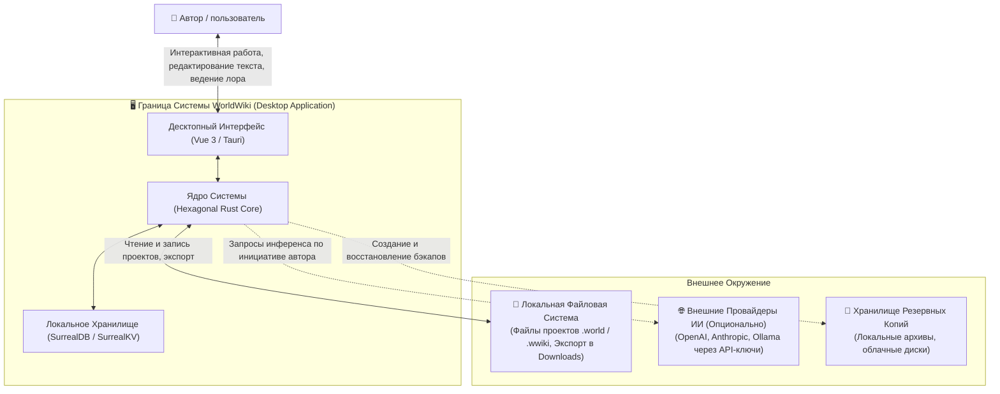
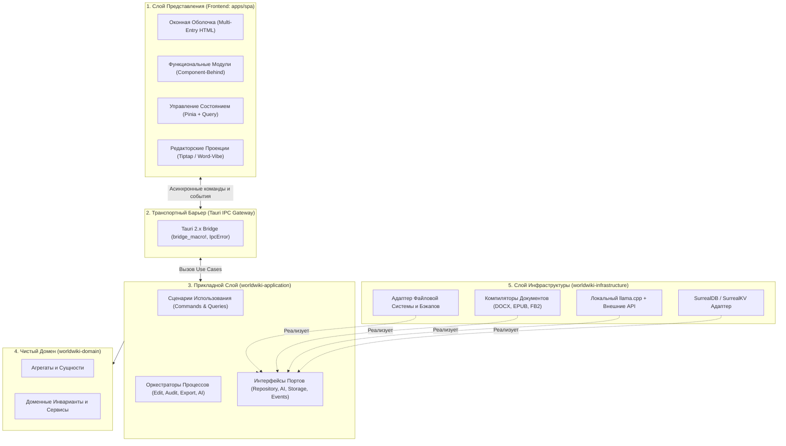
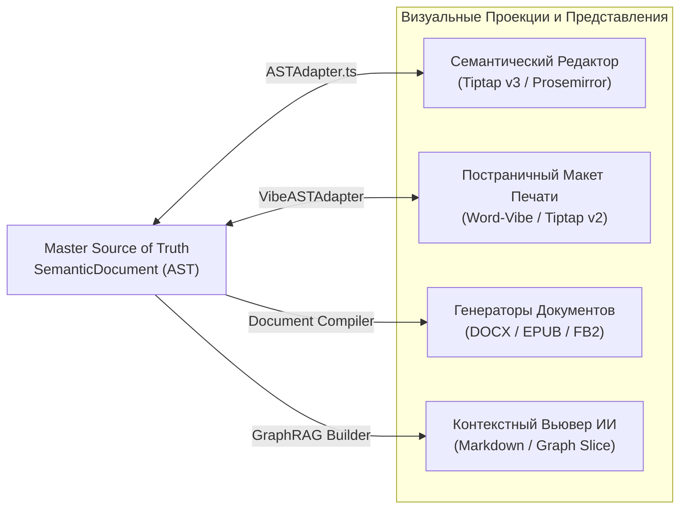
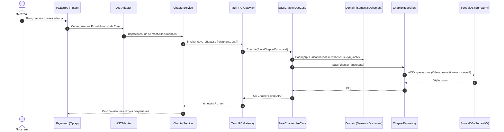
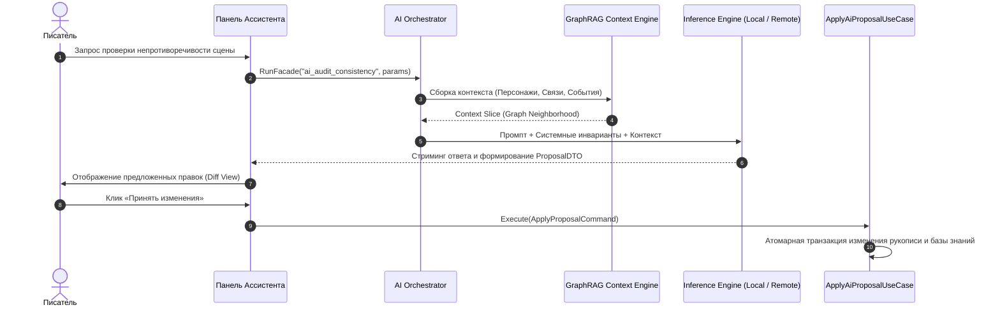
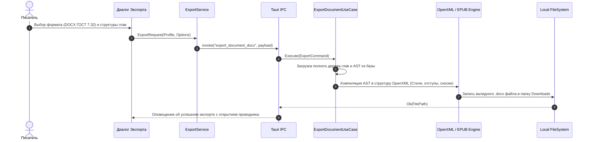

# 🏛️ Архитектура Системы WorldWiki (WorldWiki Architecture)

> **Статус документа**: Генеральный архитектурный документ (Master System Architecture).  
> **Методология**: Построен на базе принципов **arc42** (Context, Drivers, Building Blocks, Runtime Views, Cross-Cutting Concepts) с фокусом на **доменную модель (Domain-Driven Architecture)**.

---

## 1. Purpose and Scope (Назначение и Границы Документа)

Данный документ определяет **фундаментальную архитектуру программного комплекса WorldWiki**. Он фиксирует:

- границы и контекст системы;
- структуру и взаимосвязи центральной **доменной модели (Domain Architecture)**;
- декомпозицию программных блоков (Building Blocks: Frontend, Application, Domain, Infrastructure, Editors, AI);
- сценарии выполнения во время работы (Runtime Views);
- сквозные архитектурные концепции и инварианты `ARCH-001` .. `ARCH-007`.

### Что НЕ входит в данный документ:

- низкоуровневый исходный код и технические руководства для разработчиков (вынесены в специализированные README);
- списки тестовых утилит, конфигурации линтеров и инструкции по сборке;
- планы релизов и календарные графики (ведутся в Issue Tracker).

---

## 2. System Context (Контекст Системы)

**WorldWiki** — это специализированная Local-First десктопная среда для авторов литературных произведений и комплексных вымышленных вселенных. Система объединяет в едином пространстве процесс написания рукописи, построение базы знаний лора, моделирование временного континуума и управление сюжетными линиями.



### Внешние сущности и интерфейсы взаимодействия:

1. **Автор / пользователь**: взаимодействует с системой через многооконный графический интерфейс десктопного приложения.
2. **Локальная файловая система**: чтение и сохранение файлов проектов, изображений, шрифтов и экспорт готовых рукописей.
3. **Опциональные внешние LLM-провайдеры**: внешние сервисы генеративного интеллекта, подключаемые исключительно по желанию автора.
4. **Хранилище резервных копий**: создание локальных и облачных архивных копий проекта для защиты от потери данных.

---

## 3. Architectural Drivers (Архитектурные Драйверы)

Архитектурные решения WorldWiki продиктованы шестью фундаментальными требованиями:

1. **Local-First & Data Ownership (Полная автономия данных)**:
   Творческие материалы автора принадлежат исключительно ему. Все данные хранятся локально на диске в формате встроенной СУБД. Приложение не требует обязательной авторизации на сторонних серверах и полностью функционально оффлайн.
2. **Semantic Model as Single Source of Truth (Семантическая модель как источник истины)**:
   Основа системы — структурированное семантическое дерево документа и графовые связи, а не сырой HTML или неструктурированный текст.
3. **Multiple Visual Projections (Множественность представлений)**:
   Одна и та же семантическая модель проецируется в интерактивный редактор для быстрого письма, постраничный макет книги, форматы экспорта (DOCX, EPUB, FB2) и структурированный контекст для ИИ.
4. **Domain Integrity & Rich Relational Topology (Целостность связей)**:
   Глубокая связность между элементами мира: упоминания персонажей в сценах автоматически связываются с базой знаний, события позиционируются на шкале времени, а сюжетные обещания отслеживаются по всей рукописи.
5. **Multi-Calendar Temporal Continuum (Мультикалендарный континуум)**:
   Возможность моделирования вселенных с несколькими календарями без дублирования или рассинхронизации событий.
6. **Subordinate & Safe AI (Подчиненный и безопасный ИИ)**:
   ИИ является подключаемым инструментом-ассистентом. ИИ не определяет состояние системы и не имеет права модифицировать базу данных без явного подтверждения автора.

---

## 4. Domain Architecture (Архитектура Предметной Области)

Доменная архитектура является **смысловым ядром WorldWiki**. Она разделена на 5 взаимосвязанных моделей, образующих целостный граф проекта:

```
                          ┌───────────────────────┐
                          │     PROJECT MODEL     │
                          │   (Корневой Проект)   │
                          └──────────┬────────────┘
                                     │
       ┌─────────────────────────────┼─────────────────────────────┐
       │                             │                             │
┌──────▼──────────────┐   ┌──────────▼──────────┐   ┌──────────────▼──────┐
│  MANUSCRIPT MODEL   │   │   KNOWLEDGE MODEL   │   │   TEMPORAL MODEL    │
│  (Текст и Сюжет)    │   │  (База Знаний Лора) │   │ (Континуум Времени) │
└──────┬──────────────┘   └──────────┬──────────┘   └──────────────┬──────┘
       │                             │                             │
       │                   ┌─────────▼─────────┐                   │
       └──────────────────►│    PLOT MODEL     │◄──────────────────┘
                           │(Сюжетные Обещания)│
                           └───────────────────┘
```

### 4.1. Project Model (Модель Проекта)

Агрегат верхнего уровня, инкапсулирующий параметры вымышленного мира: жанры, глобальные настройки, профили оформления и реестр подключенных модулей.

### 4.2. Manuscript Model (Модель Рукописи)

Иерархическая структура литературного произведения:
$$\text{Project} \longrightarrow \text{Volumes (Тома)} \longrightarrow \text{Arcs (Арки)} \longrightarrow \text{Chapters (Главы)} \longrightarrow \text{Semantic Blocks (Блоки AST)}$$
Каждый блок текста типизирован (параграф, диалог, мысль персонажа, сноска, эпиграф) и содержит метаданные о связанных сущностях.

### 4.3. Knowledge Model (Модель Базы Знаний)

Структурированный граф сущностей вселенной (Персонажи, Локации, Фракции, Артефакты, Магические системы, События):

- **Entity**: карточка сущности с системными и динамическими атрибутами;
- **Schema**: динамическая схема пользовательских типов полей (текст, число, булево, ссылки, диапазоны);
- **Relationship**: типизированное направленное ребро отношений между сущностями с весом и атрибутами периода действия.

### 4.4. Temporal Model (Темпоральная Модель Времени)

- **Физический континуум**: события вселенной привязаны к абсолютной временной шкале ($M_{\text{abs}}$ — непрерывный поток минут от условной точки отсчета мира).
- **Календарные проекции**: пользовательские календари (длина года, месяцы, високосные циклы, названия дней) являются чисто вычислительными проекциями, переводящими абсолютную координату времени в локальную дату конкретной цивилизации.

### 4.5. Plot Model (Сюжетная Модель)

- **Plot Promises (Чеховские ружья и сюжетные обещания)**: элементы текста (ружье, предзнаменование, загадка, обещание читателю), имеющие жизненный цикл: _Planted (заложено)_ $\rightarrow$ _Progressed (развито)_ $\rightarrow$ _Resolved (разрешено)_.
- **Plans & Outlines**: иерархические сюжетные чеклисты и задачи на уровне томов, арок и глав.

### 4.6. Relations Between Models (Сквозные Междоменные Связи)

| Связанные Модели                               | Механизм Связи                         | Назначение                                                                                                   |
| ---------------------------------------------- | -------------------------------------- | ------------------------------------------------------------------------------------------------------------ |
| **Manuscript $\longleftrightarrow$ Knowledge** | Упоминания `((Сущность))` в AST        | Автоматический учет появления персонажей/локаций в главах, предиктивная навигация, инспекция лора из текста. |
| **Manuscript $\longleftrightarrow$ Plot**      | Привязка обещаний к блокам AST         | Отслеживание в каких главах заложены и закрыты сюжетные ружья; аудит незакрытых ружей при завершении тома.   |
| **Knowledge $\longleftrightarrow$ Temporal**   | Участие в событиях (`participates_in`) | Фиксация присутствия и роли персонажей/фракций в исторических событиях мира.                                 |
| **Manuscript $\longleftrightarrow$ Temporal**  | Временной срез главы (`occurs_at`)     | Позиционирование событий сцены на глобальной хронологической шкале.                                          |
| **Knowledge $\longleftrightarrow$ Knowledge**  | Матрица связей (`entity_rel`)          | Построение графа фракций, генеалогических древ и карты симпатий/конфликтов.                                  |

---

## 5. System Building Blocks (Архитектура Программных Компонентов)

WorldWiki спроектирован по **Гексагональной Архитектуре (Ports & Adapters)** с жесткой изоляцией ответственности слоев.



### Спецификация и ответственность слоев:

| Слой                        | Ответственность                                                                                                 | Границы зависимостей                                                                    |
| --------------------------- | --------------------------------------------------------------------------------------------------------------- | --------------------------------------------------------------------------------------- |
| **1. Frontend Layer**       | Рендеринг UI, пользовательские взаимодействия, локальный кэш, адаптация AST для редакторов.                     | `@worldwiki/components`, `@worldwiki/resources`. Не знает о деталях реализации Rust/DB. |
| **2. Transport Gate**       | Десериализация IPC-запросов, проверка базовых форматов, маршрутизация в Use Cases, маппинг ошибок в `IpcError`. | Единственный слой с зависимостью от `tauri::*`.                                         |
| **3. Application Layer**    | Оркестрация бизнес-сценариев (Use Cases), управление транзакциями (UnitOfWork), координация AI-фасадов.         | Зависит **только** от `domain` и абстрактных трейтов `ports`.                           |
| **4. Domain Layer**         | Математика времени, правила семантического AST, инварианты целостности связей.                                  | **Не зависит от Tauri, конкретной СУБД и инфраструктурных адаптеров.**                  |
| **5. Infrastructure Layer** | Драйверы хранилища (SurrealDB), движок локального инференса (llama.cpp FFI), экспорт OpenXML/EPUB.              | Реализует интерфейсы из `ports`. Не диктует бизнес-правила.                             |

---

## 6. Data Architecture (Архитектура Данных и Хранилища)

```
       ┌────────────────────────────────────────────────────────┐
       │              Semantic Model (Memory & AST)             │
       │       Единая модель данных предметной области          │
       └───────────────────────────┬────────────────────────────┘
                                   │
              ┌────────────────────┴────────────────────┐
              ▼                                         ▼
┌───────────────────────────┐             ┌───────────────────────────┐
│     Persistence Model     │             │     Search & Graph Model  │
│   SurrealDB (SurrealKV)   │             │   SurrealQL Native Engine │
│ ├─ Документное хранение   │             │ ├─ Графовые ребра         │
│ ├─ Атомарные транзакции   │             │ ├─ Полнотекстовый поиск   │
│ └─ Версионирование схем   │             │ └─ Векторный контекст     │
└───────────────────────────┘             └───────────────────────────┘
```

1. **Семантическая Модель (Master Source of Truth)**:
   Все операции в системе выполняются над структурированными объектами семантического дерева предметной области.
2. **Модель Персистентности (Persistence Model)**:
   Отображение семантической модели на локальное хранилище SurrealDB (движок SurrealKV), обеспечивающее ACID-транзакции в одном бинарном процессе без запуска сторонних служб.
3. **Графовая и Поисковая Модель (Search & Graph Model)**:
   Нативные графовые ребра связей для мгновенного обхода отношений без соединений `JOIN`, дополненные полнотекстовым и векторным индексами для семантического поиска и формирования контекста.

---

## 7. Representation & Editor Architecture (Архитектура Представлений)

WorldWiki четко разграничивает **мастер-модель данных** и **редакторские проекции**:



- **Семантический редактор (Tiptap v3)**: интерактивная рабочая среда для быстрого потокового письма, распознавания сущностей `((Имя))` на лету и навигации по миру.
- **Издательский редактор Word-Vibe (Tiptap v2)**: специализированный постраничный движок (`packages/word-vibe`) для предпечатной подготовки с поддержкой сносок, колонтитулов и зеркальных полей.
- **Компиляторы экспорта**: автономные Rust-модули компиляции AST в целевые бинарные форматы (Word OpenXML по ГОСТ 7.32, EPUB 3.3, FB2 2.0).

---

## 8. AI Architecture (Архитектура ИИ-Подсистемы)

ИИ спроектирован как **подключаемый контекстный ассистент автора** (Two-Tier Architecture), функционирующий строго по правилу подчиненности:

```
                  ┌───────────────────────────────┐
                  │   Semantic Knowledge Graph    │
                  │       (Source of Truth)       │
                  └───────────────┬───────────────┘
                                  │
                      read-only contextual slice
                                  │
                  ┌───────────────▼───────────────┐
                  │    Context Builder (RAG)      │
                  │ (Graph + Vector + Temporal)   │
                  └───────────────┬───────────────┘
                                  │
                  ┌───────────────▼───────────────┐
                  │    8 Consolidated Facades     │
                  │  (Lore, Plot, Stylist, etc.)  │
                  └───────────────┬───────────────┘
                                  │
                  ┌───────────────▼───────────────┐
                  │      Inference Engine         │
                  │ Local GGUF / Remote Provider  │
                  └───────────────┬───────────────┘
                                  │
                             proposals
                                  │
                  ┌───────────────▼───────────────┐
                  │  👤 Автор (Явный Акцепт)     │
                  └───────────────┬───────────────┘
                                  │ write action via Use Case
                  ┌───────────────▼───────────────┐
                  │   Application Mutation Unit   │
                  └───────────────────────────────┘
```

### Ключевые архитектурные решения ИИ:

1. **Изоляция прав записи**: ИИ не может напрямую модифицировать базу данных. Любые предложения (создание персонажа, правка текста, закрытие ружья) генерируются в виде DTO-предложений и применяются в хранилище **только после подтверждения автором**.
2. **8 Консолидированных Фасадов**: специализированные сценарии для проверки фактов лора, развития сюжета, анализа стиля, структурирования текста и работы с таймлайном.
3. **Локальный инференс**: поддержка выполнения квантованных моделей GGUF на локальном оборудовании через FFI-обвязку `llama.cpp` (`vendor/llama-turboquant-cpp`) с контролем расхода видеопамяти (VRAM).
4. **GraphRAG Context Engine**: сборка контекста запроса не только по косинусному сходству текста, но и по 2-шаговой окрестности графа связей и хронологическому окну событий.

---

## 9. Runtime Views (Сценарии Выполнения)

### 9.1. Сценарий: Редактирование и сохранение рукописи



### 9.2. Сценарий: Запрос к ИИ-ассистенту и применение правок



### 9.3. Сценарий: Мультиформатный экспорт рукописи



---

## 10. Cross-Cutting Concepts (Сквозные Архитектурные Концепции)

### 10.1. State Ownership (Разделение Владения Состоянием)

- **Master Data**: семантическая модель предметной области, персистируемая в локальном хранилище.
- **Persistence**: SurrealDB / SurrealKV как встраиваемый адаптер долговременного хранения.
- **Client UI State (Pinia)**: временное состояние пользовательского интерфейса (активная вкладка, размеры сплиттеров, фокус ввода).
- **Server State Cache (TanStack Query)**: кэширование DTO сущностей на фронтенде с дебаунсом мутаций и автоматической инвалидацией.

### 10.2. Error Handling (Иерархия Обработки Ошибок)

$$\boxed{\text{DomainError}} \longrightarrow \boxed{\text{ApplicationError}} \longrightarrow \boxed{\text{IpcError (JSON Code + User Message)}} \longrightarrow \boxed{\text{UI Toast / Form Feedback}}$$
Все ошибки строго типизированы. Доменные ошибки никогда не раскрывают внутренние детали реализации наружу.

### 10.3. Transactions & Rollback (Транзакционность и Откат)

Любая мутация данных, затрагивающая несколько агрегатов, выполняется в атомарной транзакции базы данных (`UnitOfWork`). Фронтенд поддерживает откат оптимистичного состояния (Optimistic UI Rollback) при возникновении ошибки бэкенда.

### 10.4. Cancellation & Async Lifecycle (Управление Асинхронными Задачами)

Все длительные операции (генерация токенов ИИ, индексация лора, экспорт больших книг) принимают токен отмены (`CancellationToken`) и прерываются мгновенно по команде пользователя без зависания фоновых потоков.

### 10.5. Security & Local Sovereignty (Безопасность и Приватность)

- Отсутствие скрытой фоновой телеметрии и недокументированных сетевых запросов.
- Санитизация путей к файлам для защиты от Path Traversal.
- Хранение API-ключей внешних провайдеров в локальном хранилище пользователя.

---

## 11. Architectural Invariants (Системные Архитектурные Инварианты)

| Код          | Архитектурный Инвариант          | Обоснование                                                                                                                            |
| ------------ | -------------------------------- | -------------------------------------------------------------------------------------------------------------------------------------- |
| **ARCH-001** | **Semantic Model Authority**     | Семантическая модель предметной области является единственным источником истины.                                                       |
| **ARCH-002** | **Editor Projection Decoupling** | Редакторские представления не владеют постоянным состоянием документа и являются проекциями семантического дерева.                     |
| **ARCH-003** | **Domain Independence**          | Доменная модель изолирована от UI-фреймворков, конкретных СУБД и внешних протоколов.                                                   |
| **ARCH-004** | **Infrastructure Subordination** | Инфраструктурные компоненты подключаются строго через абстракции портов прикладного слоя.                                              |
| **ARCH-005** | **AI Adaptability & Safety**     | Внешний и локальный ИИ является подключаемым инструментом и не изменяет состояние системы в обход контролируемых прикладных сценариев. |
| **ARCH-006** | **Local Data Sovereignty**       | Все пользовательские проекты и мастер-данные хранятся и обрабатываются локально.                                                       |
| **ARCH-007** | **Cancellation & Async Control** | Длительные и ресурсоемкие операции поддерживают явную отмену без блокировки системы.                                                   |

---

## 12. Technology Foundation (Технологический Базис)

```
┌────────────────────────────────────────────────────────────────────────┐
│                          WORLDWIKI STACK                               │
├───────────────────────┬────────────────────────────────────────────────┤
│ Desktop Runtime       │ Tauri 2.x + Rust                               │
│ Frontend Platform     │ Vue 3.5+ (Composition API) + TypeScript 5.8+  │
│ UI & Design System    │ Vanilla Scoped CSS + CSS Custom Properties     │
│ Client State & Cache  │ Pinia Stores + @tanstack/vue-query             │
│ Local Persistence     │ SurrealDB v2+ (Встраиваемый движок SurrealKV)  │
│ Semantic Editors      │ Tiptap v3 (SPA) / Tiptap v2 (Word-Vibe)        │
│ AI Inference Engine   │ Local llama.cpp (GGUF FFI) / Remote REST APIs  │
└───────────────────────┴────────────────────────────────────────────────┘
```

---

## 13. Architecture Documentation Map (Карта Архитектурной Документации)

Для углубленного изучения реализации конкретных слоев и модулей обращайтесь к специализированным инженерным документам:

### 📱 Архитектура Клиентской Части (Frontend)

- [Архитектура SPA, Multi-Page HTML и точки входа](./apps/spa/src/ts/README_Architecture.md)
- [Каталог функциональных доменных модулей](./apps/spa/src/ts/features/README_Features.md)
- [Слой реактивных запросов и кэширования](./apps/spa/src/ts/composables/README_Composables.md)
- [Спецификация схемы данных SurrealDB и GraphRAG](./apps/spa/src/logic/README_Logic.md)
- [Пакет базового UI-Kit `@worldwiki/components`](./packages/components/README.md)
- [Постраничный издательский редактор `@worldwiki/word-vibe`](./packages/word-vibe/README_WordVibe.md)

### 🦀 Архитектура Бэкенда и Ядра (Backend Core)

- [Гексагональная архитектура Rust-монолита и Composition Root](./src-tauri/src/README_src.md)
- [Инфраструктурный пакет интеграции SurrealDB](./tauri-surreal-kit/backend/README_backend.md)

### 🤖 Архитектура ИИ-Подсистемы (AI Subsystem)

- [Бэкенд-архитектура 8 фасадов и Two-Tier модель](./чатAI/06_Backend_Architecture.md)
- [Интеграция локального движка `llama-turboquant-cpp`](./чатAI/07_Llama_TurboQuant_Integration_Plan.md)
- [Схема данных контекстной памяти агента](./чатAI/02_Data_Schema_and_SurrealDB.md)
- [Цикл выполнения агента и tool-calling](./чатAI/03_Agent_Loop_and_MCP_Tools.md)
