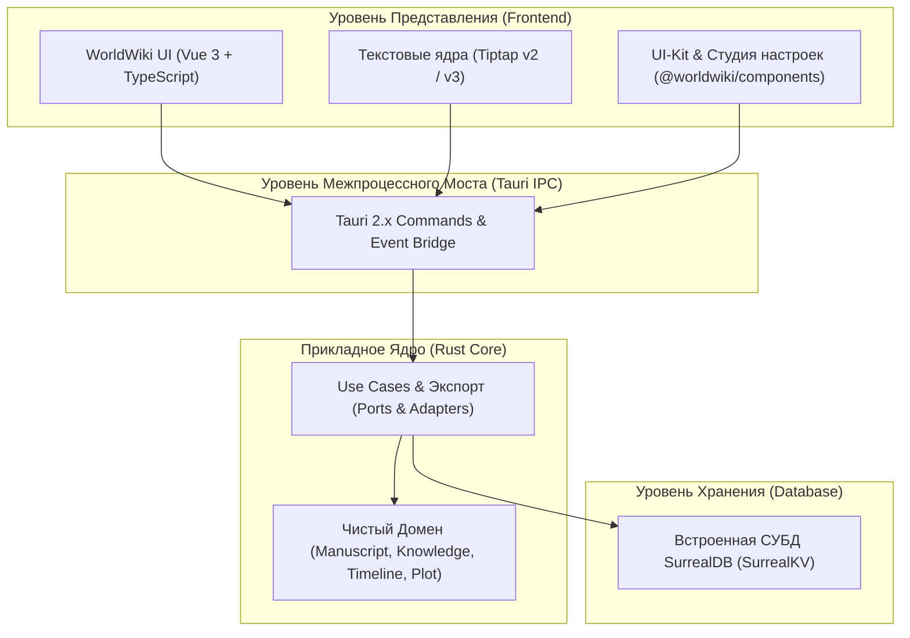

# 🪐 WorldWiki

> **Автономная локальная система подготовки литературных рукописей, ведения онтологических баз знаний и сюжетного планирования.**

---

## 👨‍🎓 Академическая информация

- **Автор:** Кузнецов Данила Денисович
- **Учебное заведение:** Калужский филиал МГТУ им. Н.Э. Баумана (КФ МГТУ им. Баумана)
- **Учебная группа:** ИУК5-52Б
- **Год разработки:** 2026 г.
- **Дисциплина:** «Модели данных»

---

## 🎯 Идея проекта

**WorldWiki** моделирует не просто текстовый документ, а **литературный проект как совокупность взаимосвязанных данных**.

Рукопись, персонажи, локации, организации, хронологические события, динамические отношения, временная структура и сюжетные линии представлены как связанные объекты единой предметной модели. Текстовый процессор выступает в качестве интерактивного интерфейса работы с этой моделью, а не единственного источника данных.

---

## 🧬 Модель данных

Центральным элементом системы является семантическая модель литературного проекта. Основные группы данных:

- **Рукопись** — 4-уровневая иерархия: проекты, тома, сюжетные арки, главы, сцены и текстовые блоки;
- **Сущности базы знаний** — типизированные объекты предметной области (персонажи, локации, фракции, артефакты);
- **Связи (Граф отношений)** — типизированные направленные и двунаправленные связи (`TYPE RELATION`) с весами доверия (-100..+100) и темпоральными интервалами действия в главах;
- **События** — хронологические события мира и граф участия сущностей (`participates_in`);
- **Время и Календари** — авторские календарные системы и взаимный пересчет времени через координату абсолютной минуты ($M_{\text{abs}} \in \mathbb{Z}$);
- **Сюжетный контроль** — драматургические обещания («чеховские ружья», тайны, предзнаменования) и жизненный цикл их раскрытия;
- **Семантические данные** — инлайн-связи текста рукописи с объектами базы знаний `((Сущность))`.

> 📑 Подробное математическое и логическое описание модели данных приведено в [docs/coursework/](./docs/coursework/).

---

## ✨ Ключевые возможности

1. 📝 **Двухуровневый текстовый процессор:**
   - **Word-режим (постраничный):** движок Tiptap v2, физическая пагинация формата A4/A5, поля, сноски, линейка с абзацным отступом 1.25 см по ГОСТ 7.32.
   - **Семантический режим (блочный):** движок Tiptap v3, древовидное абстрактное синтаксическое дерево (AST) и векторизация фрагментов текста.
2. 🏷️ **Инлайн-линковка сущностей:** автоматическое распознавание в тексте конструкций `((Сущность))` с динамической подсветкой и быстрым переходом в карточку базы знаний.
3. 🧬 **NoCode-конструктор схем данных:** визуальная настройка структуры атрибутов карточек с алгоритмом безопасного слияния миграций.
4. 🕸️ **Темпоральный граф взаимоотношений:** учет динамики связей между персонажами и организациями в главах произведения.
5. ⏳ **Кросс-календарная хронология:** моделирование вымышленных календарей с взаимным пересчетом дат в единую временную шкалу.
6. 🎯 **Сюжетный контроль:** отслеживание стадий раскрытия сюжетных обещаний ($\text{заложено} \rightarrow \text{развивается} \rightarrow \text{разрешено}$) с фиксацией узлов кульминации.
7. 🎨 **Глобальная дизайн-система и Студия настроек:** динамическая инъекция CSS-токенов в `:root`, 5 тем оформления, живое превью и адаптивная графическая производительность (High / Medium / Low).
8. 📄 **Полиграфический экспорт:** автоматическая компиляция рукописи в Microsoft Word (DOCX по ГОСТ 7.32 и Shunn SMF), EPUB 3.3, FB2 2.0 и PDF.
9. 🤖 **Интеллектуальное соавторство:** поддержка локального инференса квантованных моделей GGUF и внешних API-провайдеров.

---

## 🏗️ Архитектура системы

Архитектура WorldWiki разделена на независимые уровни в соответствии с принципами гексагональной архитектуры (Ports & Adapters):



> 🏛️ Полная спецификация слоев, крейтов и архитектурных инвариантов приведена в [ARCHITECTURE.md](./ARCHITECTURE.md).

---

## 📊 Статус проекта

**Стадия:** Активная разработка (Курсовой проект 2026 г.)

### ✅ Готово
- [x] Базовая гексагональная архитектура приложения и изоляция слоев
- [x] Локальное транзакционное хранилище данных на базе встроенной SurrealDB (SurrealKV)
- [x] Связанная модель предметной области литературного проекта
- [x] База знаний сущностей и NoCode-конструктор динамических схем
- [x] Граф отношений между сущностями (`TYPE RELATION`)
- [x] Сюжетный контроль (отслеживание «чеховских ружей» и планов)
- [x] Интерактивная линковка сущностей в тексте рукописи `((Сущность))`
- [x] Моделирование авторских календарей и расчет шкалы абсолютной минуты ($M_{\text{abs}}$)
- [x] Система глобальных настроек, дизайн-токенов и тем оформления
- [x] Базовый набор автоматизированных тестов фронтенда и бэкенда

### ⏳ В разработке
- [ ] Доработка и оптимизация модуля постраничной верстки (Word-Vibe) и CSS-подложек
- [ ] Доработка генераторов полиграфического экспорта (полная сборка DOCX по ГОСТ 7.32, EPUB 3.3, FB2 2.0)
- [ ] Доводка конвейера интеллектуального соавторства:
  - [ ] Восстановление маршрутизации сообщений ИИ-чата
  - [ ] Реализация гранулярной матрицы подтверждения инструментов (Tool Approval Matrix)
  - [ ] Верификация турбоквантования и сжатия KV-кэша локальных моделей (`llama-turboquant-cpp`)
  - [ ] Тестирование специализированных AI-фасадов в реальных сценариях
- [ ] Финальное интеграционное тестирование и подготовка демонстрационной версии

---

## 🔒 Local-First

Основные данные литературного проекта сохраняются исключительно локально на рабочей станции автора в транзакционном хранилище SurrealKV. Подключение внешних облачных сервисов не является обязательным для работы программы. При явной настройке пользователем внешних API-провайдеров языковых моделей данные контекста передаются соответствующему сервису строго в рамках выбранной пользователем интеграции.

---

## 📌 Границы проекта

- **Персональный режим:** WorldWiki является локальным однопользовательским приложением. Многопользовательский сетевой доступ, ролевое администрирование и аренда серверов вынесены за рамки проекта.
- **Приоритет предметной модели:** Основным предметом разработки является **модель данных литературного проекта**, обеспечение целостности связей и их наглядное представление автору.
- **Вспомогательная роль ИИ:** Интеллектуальные функции являются дополнительным вспомогательным инструментом и не подменяют собой ключевую модель данных приложения.

---

## 🛠️ Технологический стек

- **Десктопная платформа:** [Tauri 2.x](https://tauri.app/) (Rust) + системный движок WebView2.
- **Встроенная СУБД:** [SurrealDB 3.x](https://surrealdb.com/) (встраиваемый транзакционный движок SurrealKV).
- **Фронтенд-платформа:** [Vue 3.5+](https://vuejs.org/) (Composition API), [TypeScript 6.x](https://www.typescriptlang.org/), [Vite 8.x](https://vitejs.dev/).
- **Стейт-менеджмент и кэш:** [Pinia](https://pinia.vuejs.org/), [@tanstack/vue-query](https://tanstack.com/query/latest).
- **Текстовые процессоры:** Tiptap v3.x (SPA), Tiptap v2.x (модуль верстки Word-Vibe).
- **Дизайн-система:** Scoped Vanilla CSS + CSS Custom Properties дизайн-токены (без TailwindCSS).
- **Генераторы документов:** `docx-rs`, `quick-xml`.
- **Оркестрация монорепозитория:** [pnpm Workspaces](https://pnpm.io/), [Turborepo](https://turbo.build/).

---

## 📁 Структура монорепозитория

```
WorldWiki/
├── apps/
│   └── spa/                  # Основное клиентское SPA-приложение WorldWiki
├── packages/
│   ├── components/           # Библиотека базовых UI-компонентов (28 шт.) и модуль Settings
│   ├── resources/            # Темы оформления, дизайн-токены, шрифты и локали
│   └── word-vibe/            # Модуль полиграфической постраничной верстки (Tiptap v2)
├── src-tauri/                # Модульный бэкенд на языке Rust (5 изолированных крейтов)
├── tauri-surreal-kit/        # Инфраструктурный комплект процедурных макросов SurrealDB
└── docs/
    └── coursework/           # Расчетно-пояснительная записка и ТЗ курсового проекта
```

---

## 🚀 Быстрый старт и запуск

### Системные требования
- **ОС:** Microsoft Windows 10 / 11 (64-bit)
- **Среда Node.js:** v20+ и пакетный менеджер **pnpm** v9.4+
- **Компилятор Rust:** `rustc` / `cargo` (редакция 2021+)
- **WebView2 Runtime** (входит в стандартную поставку Windows 10/11)

### Установка и запуск

```bash
# 1. Клонирование репозитория
git clone https://github.com/nagisokyn-prog/WorldWiki.git
cd WorldWiki

# 2. Установка зависимостей монорепозитория
pnpm install

# 3. Запуск десктопного приложения в режиме разработки
pnpm tauri dev

# Либо запуск только веб-интерфейса SPA
pnpm dev
```

---

## 🧪 Контроль качества, линтинг и тесты

```bash
# Проверка типов TypeScript во всех пакетах
pnpm typecheck

# Проверка компиляции бэкенда Rust
cargo check --all-targets

# Запуск модульных тестов фронтенда
pnpm test

# Запуск тестов бэкенда Rust
cargo test

# Запуск линтеров кода и стилей
pnpm lint
pnpm lint:css

# Запуск инквизиторских скриптов аудита монорепозитория:
node analyze_vue_monoliths.js       # Аудит чистоты Vue SFC
node find_css_hardcode.js           # Аудит отсутствия хардкода CSS-цветов
node check_components_duplicates.js # Контроль отсутствия дубликатов UI
```

---

## 📖 Навигация по документации

- 🏛️ [ARCHITECTURE.md](./ARCHITECTURE.md) — обзорная архитектура фронтенда и бэкенда.
- 🛑 [AGENTS.md](./AGENTS.md) — стандарты разработки, правила монорепозитория и архитектурные инварианты (`ARCH-001` .. `ARCH-012`).
- 📑 [docs/coursework/](./docs/coursework/) — расчетно-пояснительная записка и ТЗ по дисциплине «Модели данных».

---

## 📄 Лицензия

Проект распространяется под открытой лицензией MIT. Подробнее: [`LICENSE`](./LICENSE).

```text
MIT License

Copyright (c) 2026 Kuznetsov Danila

Permission is hereby granted, free of charge, to any person obtaining a copy
of this software and associated documentation files (the "Software"), to deal
in the Software without restriction, including without limitation the rights
to use, copy, modify, merge, publish, distribute, sublicense, and/or sell
copies of the Software, and to permit persons to whom the Software is
furnished to do so, subject to the following conditions:

The above copyright notice and this permission notice shall be included in all
copies or substantial portions of the Software.

THE SOFTWARE IS PROVIDED "AS IS", WITHOUT WARRANTY OF ANY KIND, EXPRESS OR
IMPLIED, INCLUDING BUT NOT LIMITED TO THE WARRANTIES OF MERCHANTABILITY,
FITNESS FOR A PARTICULAR PURPOSE AND NONINFRINGEMENT. IN NO EVENT SHALL THE
AUTHORS OR COPYRIGHT HOLDERS BE LIABLE FOR ANY CLAIM, DAMAGES OR OTHER
LIABILITY, WHETHER IN AN ACTION OF CONTRACT, TORT OR OTHERWISE, ARISING FROM,
OUT OF OR IN CONNECTION WITH THE SOFTWARE OR THE USE OR OTHER DEALINGS IN THE
SOFTWARE.
```
