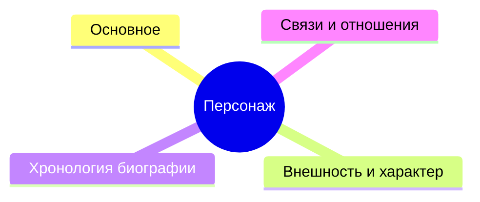
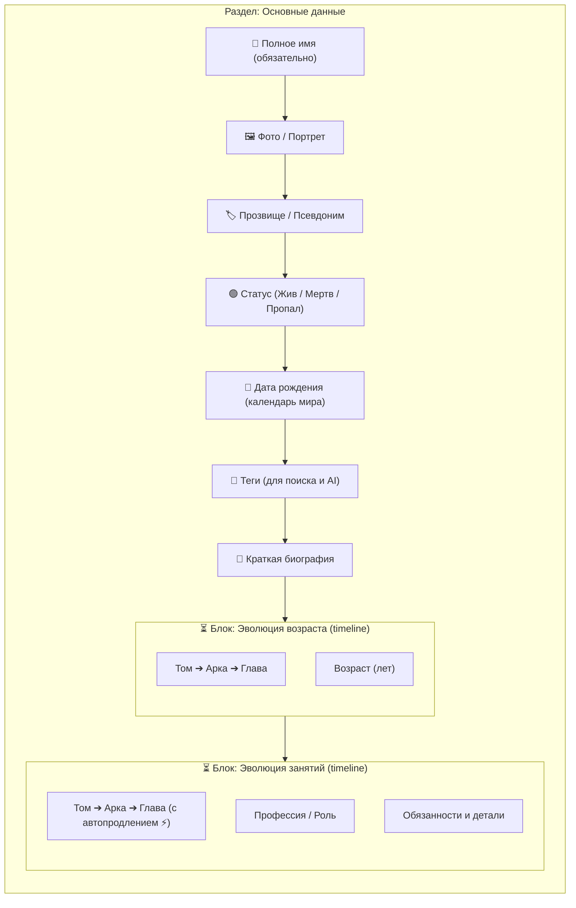

# Навык: Конструктор типов сущностей (Schema Studio)

## 1. Назначение и Режим работы

Этот навык инструктирует ИИ-агента, как проектировать и генерировать валидные схемы типов сущностей (`full_schema`) для редактора сущностей WorldWiki.

ИИ-агент работает строго в два этапа:
1. **ЭТАП 1: ПРОЕКТИРОВАНИЕ ДОСЬЕ (Для автора)**:
   - Обсуждение структуры на понятном писательском языке (**«Уровень Досье»**).
   - Предоставление наглядных Mermaid-диаграмм Уровня 1 (разделы) и Уровня 2 (поля досье).
2. **ЭТАП 2: ГЕНЕРАЦИЯ JSON-СХЕМЫ (Машинный формат)**:
   - По запросу или подтверждению автора генерация строгой валидной JSON-структуры карточки сущности.

---

## 2. Двухуровневая Архитектура Схемы

Карточка любой сущности в WorldWiki организована строго по двухуровневой модели:

```
┌─────────────────────────────────────────────────────────────────────────────┐
│ УРОВЕНЬ 1: КАРТОЧКА СУЩНОСТИ (Разделы / Страницы досье)                     │
│ Метаданные: entityType, name, icon, iconEmoji, titleField, photoField       │
│ sections: [ Страница "Основное", Страница "Хронология", Страница "Связи" ]  │
└──────────────────────────────────────┬──────────────────────────────────────┘
                                       │
            ┌──────────────────────────┴──────────────────────────┐
            ▼                                                     ▼
┌────────────────────────────────────────┐  ┌────────────────────────────────────────┐
│ УРОВЕНЬ 2: СТРАНИЦА "Основное"         │  │ УРОВЕНЬ 2: СТРАНИЦА "Хронология"       │
│                                        │  │                                        │
│ 1. Атомарные скалярные поля (fields):  │  │ 1. Атомарные поля (fields): []         │
│    - название (text, required)         │  │                                        │
│    - фото (photo)                      │  │ 2. Неатомарные контейнеры              │
│    - дата_рождения (calendar_datetime) │  │    (dynamicContainers):                │
│    - теги (tags)                       │  │    ├─ "Эволюция возраста"              │
│    - описание (textarea)               │  │    │   template: "Базовая хронология"  │
│                                        │  │    │   fieldOverrides:                 │
│ 2. Неатомарные контейнеры: []          │  │    │     - название: label "Возраст"   │
│                                        │  │    │     - статус_категория: hidden    │
│                                        │  │    │     - описание_1..3: hidden       │
│                                        │  │    │     - числовой_показ.: hidden     │
│                                        │  │    └─ "Эволюция занятий"               │
│                                        │  │        template: "Базовая хронология"  │
│                                        │  │        fieldOverrides:                 │
│                                        │  │          - название: label "Профессия" │
│                                        │  │          - описание_1: label "Детали"  │
└────────────────────────────────────────┘  └────────────────────────────────────────┘
```

---

## 3. Полная Спецификация JSON-Схемы Сущности

### 3.1. Корневая структура (Уровень 1)
```json
{
  "name": "Персонаж",
  "entityType": "character",
  "icon": "fa-user",
  "iconEmoji": "👤",
  "titleField": "название",
  "photoField": "фото",
  "tagsField": "теги",
  "sections": [
    {
      "id": "basic",
      "title": "Основное",
      "icon": "📝",
      "fields": [],
      "dynamicContainers": []
    }
  ]
}
```

- `name` (string, русский): Человекочитаемое название сущности.
- `entityType` (string, snake_case, только латиница): Уникальный системный ключ типа.
- `icon` (string): Иконка FontAwesome (например, `fa-user`, `fa-building`, `fa-globe`, `fa-gem`, `fa-scroll`).
- `iconEmoji` (string): Emoji иконка (например, `👤`, `🏢`, `🌍`, `💎`, `📜`).
- `titleField` (string): ВСЕГДА равен `"название"`.
- `photoField` (string): ВСЕГДА равен `"фото"`.
- `tagsField` (string): ВСЕГДА равен `"теги"`.
- `sections` (Array<SchemaSection>): Массив страниц (вкладок) карточки.

---

### 3.2. Правила именования и адресации данных (`path` vs `id` vs `dataPath`)

- **`path`** (`snake_case`): Ключ свойства в объекте данных сущности в базе данных (`formData`).
  - **КРИТИЧЕСКИ ВАЖНО**: `path` обязан быть **уникальным в рамках ВСЕЙ сущности** (нельзя иметь два поля с одинаковым `path`, иначе одно перетрет данные другого).
- **`id`** (`camelCase`): Внутренний уникальный идентификатор UI-компонента в схеме.
- **`dataPath`** (`snake_case`): Путь к массиву записей динамического контейнера в объекте сущности (например `"dataPath": "эволюция_возраста"` сохраняет `formData["эволюция_возраста"] = [ ... ]`).

---

### 3.3. Атомарные поля (`fields: SchemaField[]`)

Все одиночные поля, размещаемые в массиве `fields` секции:

| `type` | Описание | Дополнительные свойства | Пример |
|---|---|---|---|
| `text` | Короткая строка | `required: boolean`, `placeholder: string`, `path: string` | Имя, прозвище, титул |
| `textarea` | Многострочный текст | `rows: number` (2..6), `placeholder: string`, `path: string` | Описание, биография |
| `number` | Числовое поле | `min: number`, `max: number`, `value: number`, `path: string` | Рост, вес, возраст |
| `range` | Ползунок шкалы | `min: number`, `max: number`, `value: number`, `path: string` | Уровень сил (0..100) |
| `select` | Одиночный выбор | `options: Array<{ value: string, label: string }>` ИЛИ `entityType: string` | Статус, пол, раса |
| `multiselect` | Множественный выбор | `options: Array<{ value: string, label: string }>` ИЛИ `entityType: string` | Черты характера, связи |
| `photo` | Изображение / Портрет | `placeholder: string`, `path: string` | Фотография |
| `boolean` | Чекбокс (Да/Нет) | `path: string` | Флаг «Секретный персонаж» |
| `tags` | Теги через Enter | `placeholder: string`, `hint: string`, `path: string` | Ключевые слова для поиска и AI |
| `calendar_datetime` | Мировой календарь | `placeholder: string`, `hint: string`, `path: string` | Дата рождения / основания |

#### 🔗 Динамические связи через `entityType`
Если в поле `select` или `multiselect` указано `entityType: "character"` (или `"organization"`, `"location"`, `"item"`):
- Вместо ручного массива `options` движок автоматически подгружает **все существующие сущности этого типа из базы данных проекта**.
- Пользователь выбирает из реальных карточек проекта.

---

### 3.4. Сложные Составные Контролы

#### 1. Точка рукописи (`type: "manuscript_point"`)
Используется в хронологиях и связях. В UI рендерится как 3 зависимых барабана (**Том ➔ Арка ➔ Глава**):
```json
{
  "type": "manuscript_point",
  "class": "начальная_глава",
  "label": "Начало в рукописи (Том / Арка / Глава)",
  "placeholder": "Выберите том, арку и главу..."
},
{
  "type": "manuscript_point",
  "class": "конечная_глава",
  "label": "Окончание в рукописи (Том / Арка / Глава)",
  "placeholder": "Выберите том, арку и главу...",
  "allowAutoExtend": true
}
```
*Свойство `allowAutoExtend: true` активирует кнопку «⚡ По наст. время», которая автоматически привязывает границу к последней написанной главе книги.*

#### 2. Мировой календарь (`type: "calendar_datetime"`)
Используется для всех дат мира произведения. В UI подключает селектор даты `UniversalDatePicker` (**Календарь ➔ Эпоха ➔ Год ➔ Месяц ➔ День ➔ Время ➔ $M_{\text{abs}}$**):
```json
{
  "id": "characterBirthdate",
  "type": "calendar_datetime",
  "label": "Дата рождения",
  "placeholder": "Выберите дату по календарю мира",
  "hint": "Многоуровневый выбор по календарю мира",
  "path": "дата_рождения"
}
```

---

### 3.5. Неатомарные контейнеры (`dynamicContainers`)

Массивы записей (списки, хронологии, эволюция, связи).

#### Реестр 4 Базовых Шаблонов Системы:
1. **`"Базовая хронология"`** (`type: "timeline"`):
   - Поля: `начальная_глава` (`manuscript_point`), `конечная_глава` (`manuscript_point`), `статус_категория` (`select`), `название` (`text`), `описание_1..3` (`textarea`), `числовой_показатель` (`range`).
2. **`"Динамический элемент"`** (`type: "dynamic"`):
   - Поля: `название` (`text`), `статус_категория` (`select`), `описание_1..3` (`textarea`), `дата` (`calendar_datetime`), `числовой_показатель` (`range`).
3. **`"Двунаправленная связь"`** (`type: "dynamic"`, `isBidirectional: true`):
   - Поля: `целевая_сущность` (`select`), `тип_отношения` (`select`), вложенный контейнер `relationshipStates` (`timeline`).
4. **`"Одиночный параметр"`** (`type: "dynamic"`):
   - Поля: `значение_дата` (`calendar_datetime`), `значение_текст` (`text`).

#### Механизм `fieldOverrides` (Скрытие и кастомизация полей):
ИИ **ЗАПРЕЩЕНО** придумывать новые имена шаблонов. Для кастомизации блока ИИ указывает существующий базовый шаблон и переопределяет его поля через `fieldOverrides`:
- `"hidden": true` — скрыть лишнее поле из UI.
- `"label": "..."` — переименовать подпись поля.
- `"placeholder": "..."` — изменить текст-подсказку.
- `"type": "..."` — уточнить тип ввода (например, переключить `text` на `textarea`).

**Пример готового контейнера:**
```json
{
  "id": "ageTimeline",
  "type": "timeline",
  "title": "Эволюция возраста",
  "emptyMessage": "Возрастные состояния не добавлены",
  "template": "Базовая хронология",
  "dataPath": "эволюция_возраста",
  "fieldOverrides": {
    "название": { "label": "Возраст (лет)", "placeholder": "Например, 16 лет", "type": "text" },
    "статус_категория": { "hidden": true },
    "описание_1": { "hidden": true },
    "описание_2": { "hidden": true },
    "описание_3": { "hidden": true },
    "числовой_показатель": { "hidden": true }
  }
}
```

---

## 4. Инструкция по генерации Mermaid (MMD) для Автора

Mermaid-диаграммы служат наглядным визуальным представлением структуры досье.

### Правила генерации MMD:
1. **Уровень 1 (`mindmap`)**:
   - Используется для общего обзора карточки сущности.
   - Показывает **ТОЛЬКО** корневой узел и названия страниц (разделов).
   - Внутренние поля на Уровне 1 **НЕ УКАЗЫВАЮТСЯ**.
2. **Уровень 2 (`flowchart TD`)**:
   - Используется для детализации выбранного раздела досье.
   - Оформляется в виде аккуратного вертикального графа `flowchart TD` с блоками `subgraph`.
   - Показывает понятные автору поля с эмодзи и блоки динамических хронологий (`Том ➔ Арка ➔ Глава`).
   - Запрещено использовать устаревший синтаксис `graph TD` (только современный `flowchart TD`).

---

### Образец MMD 1: Уровень 1 (Карта разделов досье)


---

### Образец MMD 2: Уровень 2 (Детализация конкретного раздела досье)


---

## 5. Эталонный Полный Пример JSON-Схемы (Персонаж)

```json
{
  "name": "Персонаж",
  "entityType": "character",
  "icon": "fa-user",
  "iconEmoji": "👤",
  "titleField": "название",
  "photoField": "фото",
  "tagsField": "теги",
  "sections": [
    {
      "id": "basic",
      "title": "Основное",
      "icon": "📝",
      "fields": [
        {
          "id": "characterName",
          "type": "text",
          "label": "Полное имя",
          "required": true,
          "placeholder": "Имя Фамилия",
          "path": "название"
        },
        {
          "id": "characterPhoto",
          "type": "photo",
          "label": "Фото / Портрет",
          "placeholder": "Загрузите изображение",
          "path": "фото"
        },
        {
          "id": "characterAlias",
          "type": "text",
          "label": "Прозвище / Псевдоним",
          "placeholder": "Например, 'Странник'",
          "path": "прозвище"
        },
        {
          "id": "characterStatus",
          "type": "select",
          "label": "Статус",
          "required": true,
          "options": [
            { "value": "жив", "label": "🟢 Жив" },
            { "value": "мертв", "label": "🔴 Мертв" },
            { "value": "пропал", "label": "🟡 Пропал без вести" }
          ],
          "placeholder": "Выберите статус",
          "path": "статус"
        },
        {
          "id": "characterBirthdate",
          "type": "calendar_datetime",
          "label": "Дата рождения",
          "placeholder": "Выберите дату по календарю мира",
          "hint": "Многоуровневый выбор по календарю мира",
          "path": "дата_рождения"
        },
        {
          "id": "characterTags",
          "type": "tags",
          "label": "Теги",
          "placeholder": "Введите теги через Enter",
          "hint": "Ключевые слова для поиска и AI",
          "path": "теги"
        },
        {
          "id": "characterBio",
          "type": "textarea",
          "label": "Краткая биография",
          "rows": 4,
          "placeholder": "Общее описание...",
          "path": "описание"
        }
      ],
      "dynamicContainers": [
        {
          "id": "ageTimeline",
          "type": "timeline",
          "title": "Эволюция возраста",
          "emptyMessage": "Возрастные состояния не добавлены",
          "template": "Базовая хронология",
          "dataPath": "эволюция_возраста",
          "fieldOverrides": {
            "название": { "label": "Возраст (лет)", "placeholder": "Например, 16 лет", "type": "text" },
            "статус_категория": { "hidden": true },
            "описание_1": { "hidden": true },
            "описание_2": { "hidden": true },
            "описание_3": { "hidden": true },
            "числовой_показатель": { "hidden": true }
          }
        },
        {
          "id": "occupationsTimeline",
          "type": "timeline",
          "title": "Эволюция занятий",
          "emptyMessage": "Занятия не добавлены",
          "template": "Базовая хронология",
          "dataPath": "эволюция_занятий",
          "fieldOverrides": {
            "название": { "label": "Профессия / Роль", "placeholder": "Например, солдат", "type": "text" },
            "описание_1": { "label": "Обязанности и детали", "placeholder": "Подработка, хобби...", "type": "textarea" },
            "статус_категория": { "hidden": true },
            "описание_2": { "hidden": true },
            "описание_3": { "hidden": true },
            "числовой_показатель": { "hidden": true }
          }
        }
      ]
    },
    {
      "id": "relations",
      "title": "Связи и отношения",
      "icon": "👥",
      "fields": [],
      "dynamicContainers": [
        {
          "id": "characterRelations",
          "type": "dynamic",
          "title": "Отношения с персонажами",
          "emptyMessage": "Связи не добавлены",
          "template": "Двунаправленная связь",
          "dataPath": "отношения",
          "fieldOverrides": {
            "целевая_сущность": { "entityType": "character", "label": "Персонаж" },
            "тип_отношения": { "label": "Статус связи" }
          }
        }
      ]
    }
  ]
}
```

---

## 6. Железные Системные Инварианты

1. `titleField` ВСЕГДА равен `"название"`.
2. `photoField` ВСЕГДА равен `"фото"`.
3. `tagsField` ВСЕГДА равен `"теги"`.
4. В первой секции первым полем массива `fields` ВСЕГДА является:
   - `id: "название"`, `type: "text"`, `required: true`, `path: "название"`.
5. Поле `теги` (`type: "tags"`, `path: "теги"`) ВСЕГДА объявляется в `fields` первой секции для ввода тегов пользователем.
6. `entityType` — латинский идентификатор в `snake_case`.
7. `path` — `snake_case`, уникален во всей сущности.
8. Любая дата мира — **`type: "calendar_datetime"`**.
9. Любая привязка к главам книги — **`type: "manuscript_point"`** (`Том ➔ Арка ➔ Глава`, для конечной точки `allowAutoExtend: true`).
10. В `dynamicContainers` используются ТОЛЬКО 4 базовых шаблона (*«Базовая хронология»*, *«Динамический элемент»*, *«Двунаправленная связь»*, *«Одиночный параметр»*), а ненужные поля скрываются через `"fieldOverrides": { "поле": { "hidden": true } }`.
