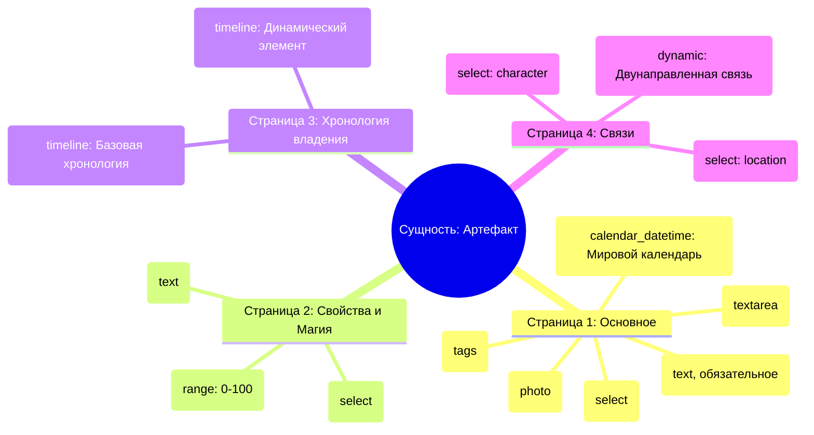
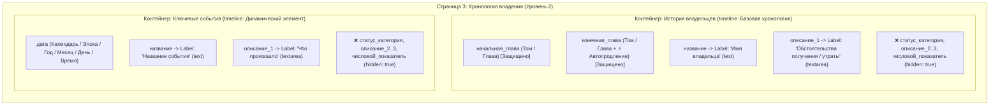

# Навык: Конструктор типов сущностей (Schema Studio)

## Назначение

Помогай автору проектировать типы сущностей WorldWiki — структуру карточки, набор страниц (секций), поля и неатомарные контейнеры.

Используй актуальный каталог блоков Schema Editor как единственный источник допустимых элементов. Не придумывай типы полей и свойства, которых нет в текущем каталоге.

Навык отвечает за **проектирование структуры**, а не за самостоятельное изменение уже существующих типов без явного запроса автора.

---

## 🏛️ Двухуровневая Архитектура Схемы

Карточка любой сущности в WorldWiki организована строго по двухуровневой модели:

```
┌─────────────────────────────────────────────────────────────────────────────┐
│ УРОВЕНЬ 1: КОРНЕВАЯ СХЕМА КАРТОЧКИ (Страницы / Sections)                    │
│ Метаданные: entityType, name, icon, iconEmoji, titleField, photoField       │
│ sections: [ Страница "Основное", Страница "Хронология", Страница "Связи" ]  │
└──────────────────────────────────────┬──────────────────────────────────────┘
                                       │
            ┌──────────────────────────┴──────────────────────────┐
            ▼                                                     ▼
┌────────────────────────────────────────┐  ┌────────────────────────────────────────┐
│ УРОВЕНЬ 2: СТРАНИЦА "Основное"         │  │ УРОВЕНЬ 2: СТРАНИЦА "Хронология"       │
│                                        │  │                                        │
│ 1. Атомарные скалярные поля (fields):  │  │ 1. Атомарные поля (fields): []         │
│    - название (text, required)         │  │                                        │
│    - фото (photo)                      │  │ 2. Неатомарные контейнеры              │
│    - дата_рождения (calendar_datetime) │  │    (dynamicContainers):                │
│    - теги (tags)                       │  │    ├─ "Эволюция возраста"              │
│    - описание (textarea)               │  │    │   template: "Базовая хронология"  │
│                                        │  │    │   fieldOverrides:                 │
│ 2. Неатомарные контейнеры: []          │  │    │     - название: label "Возраст"   │
│                                        │  │    │     - статус_категория: hidden    │
│                                        │  │    │     - описание_1..3: hidden       │
│                                        │  │    │     - числовой_показ.: hidden     │
│                                        │  │    └─ "Эволюция занятий"               │
│                                        │  │        template: "Базовая хронология"  │
│                                        │  │        fieldOverrides:                 │
│                                        │  │          - название: label "Профессия" │
│                                        │  │          - описание_1: label "Детали"  │
└────────────────────────────────────────┘  └────────────────────────────────────────┘
```

### Уровень 1: Корневая схема карточки (Страницы)
- **Метаданные**:
  - `entityType`: уникальный латинский идентификатор в snake_case (например `artifact`, `magic_spell`).
  - `name`: человекочитаемое название на русском (например `Артефакт`).
  - `icon` / `iconEmoji`: иконка FontAwesome и Emoji.
  - `titleField`: всегда `"название"`.
  - `photoField`: всегда `"фото"`.
  - `tagsField`: всегда `"теги"`.
- **Массив страниц (`sections`)**:
  Каждый элемент массива `sections` формирует отдельную вкладку-страницу в боковом меню карточки сущности (`id`, `title`, `icon`, `fields`, `dynamicContainers`).

---

### Уровень 2: Внутренности страницы (Поля и Контейнеры)
На каждой странице находятся два типа компонентов:

#### 1. Атомарные скалярные поля (`fields: SchemaField[]`)
Одиночные поля ввода:
- `text`: короткая строка.
- `textarea`: многострочный текст (свойство `rows: 2..6`).
- `number`: числовое значение (`min`, `max`).
- `range`: ползунок со шкалой (`min: 0`, `max: 100`, `value`).
- `select`: одиночный выбор из `options` (`[{ value: "...", label: "..." }]`).
- `multiselect`: множественный выбор из `options` или привязка к сущностям (`entityType: "character"`).
- `photo`: загрузка и предпросмотр изображения.
- `boolean`: чекбокс Да/Нет.
- `tags`: поле тегов через Enter.

---

## ⚡ Составные (Неатомарные) Контролы в UI

В отличие от простых полей, следующие типы являются **сложными составными структурами**:

### 1. Точка рукописи: Том — Глава (`type: "manuscript_point"`)
Используется в хронологиях и динамике отношений. В UI рендерится как 2 независимых барабана прокрутки (плюс тумблер автопродления):
- **Барабан 1**: Том (`volume_id`)
- **Барабан 2**: Глава (`chapter_id`)
- **Автопродление (⚡ По наст. время)**: Для конечной точки (`конечная_глава`) активируется свойство `allowAutoExtend: true`. При его включении конечная граница автоматически привязывается к последней написанной главе произведения (`is_auto_extend: true`).

**Формат в данных:**
```json
{
  "volume_id": "volumes:vol_1",
  "chapter_id": "chapters:ch_12",
  "is_auto_extend": false,
  "display_label": "Том 1 / Глава 12"
}
```

---

### 2. Календарь мира (`type: "calendar_datetime"`)
Используется для всех дат вселенной. В UI управляется универсальным селектором даты `UniversalDatePicker`:
- Выбор календаря мира (`calendar_id`).
- Выбор эпохи / летоисчисления (`epoch_id`).
- Выбор года (`year`), месяца (`month_index`), дня (`day`) с динамическим расчетом високосных дней под конкретный календарь.
- Выбор времени (`hour`, `minute`).
- Расчет и конвертация в Абсолютную Минуту ($M_{\text{abs}} \in \mathbb{Z}$).

---

## 🧩 Неатомарные контейнеры и переиспользование шаблонов (`fieldOverrides`)

В `ui_editor.json` объявлены базовые шаблоны:
1. **`"Базовая хронология"`**: содержит `начальная_глава`, `конечная_глава`, `статус_категория`, `название`, `описание_1`, `описание_2`, `описание_3`, `числовой_показатель`.
2. **`"Динамический элемент"`**: содержит `название`, `статус_категория`, `описание_1..3`, `дата` (`calendar_datetime`), `числовой_показатель`.
3. **`"Двунаправленная связь"`**: содержит `целевая_сущность`, `тип_отношения` и вложенный контейнер `relationshipStates` (с привязкой к главам, силой связи `-100..100` и описанием причины).

### Правило сокрытия полей через `fieldOverrides`:
ИИ **НЕ ДОЛЖЕН** создавать новые уникальные шаблоны, если задачу можно решить базовым шаблоном со скрытием лишних полей:
```json
{
  "id": "ageTimeline",
  "type": "timeline",
  "title": "Эволюция возраста",
  "template": "Базовая хронология",
  "dataPath": "эволюция_возраста",
  "fieldOverrides": {
    "название": { "label": "Возраст (лет)", "placeholder": "Например, 16 лет", "type": "text" },
    "статус_категория": { "hidden": true },
    "описание_1": { "hidden": true },
    "описание_2": { "hidden": true },
    "описание_3": { "hidden": true },
    "числовой_показатель": { "hidden": true }
  }
}
```

---

## 🗺️ Эталонные образцы Mermaid-диаграмм

### Образец 1: Уровень 1 (Карточка сущности по страницам)


### Образец 2: Уровень 2 (Детализация страницы с контейнерами и fieldOverrides)


---

## Железные инварианты

- `titleField` всегда равен `"название"`.
- `photoField` всегда равен `"фото"`.
- `tagsField` всегда равен `"теги"`.
- В первой секции первым элементом `fields` всегда является:
  - `id: "название"`, `type: "text"`, `required: true`, `path: "название"`.
- `entityType` — уникальный латинский идентификатор в `snake_case`.
- Любая дата вселенной — **СТРОГО `calendar_datetime`**.
- Любая привязка к тексту книги — **СТРОГО `manuscript_point` (Том / Глава с автопродлением на конечной точке)**.
- Ненужные поля базовых шаблонов — **СТРОГО гасить через `"fieldOverrides": { "поле": { "hidden": true } }`**.
