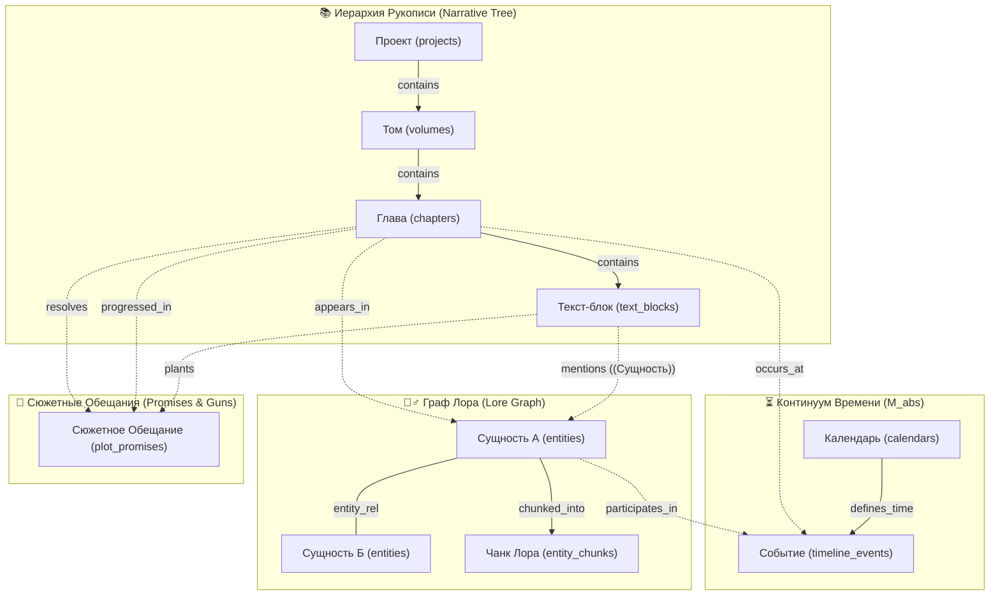
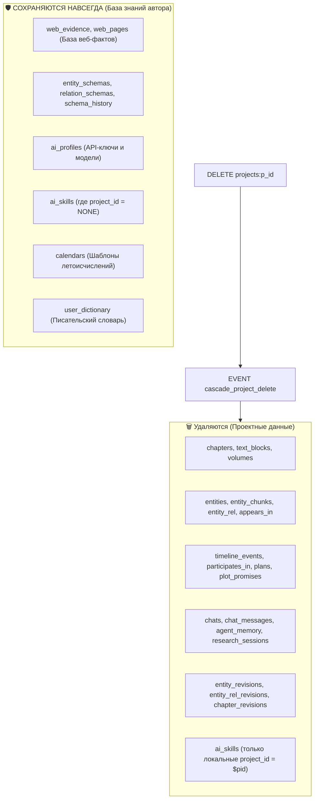

# 🧠 SurrealDB Схема Данных и Архитектура GraphRAG (README_Logic.md)

> **Расположение**: [`apps/spa/src/logic/README_Logic.md`](./README_Logic.md)  
> **Модули схемы**: [`schema/no_ai/`](./schema/no_ai/) и [`schema/ai/`](./schema/ai/)  
> **Инженерный стандарт**: [`.agents/rules/07-surrealdb.md`](../../../../.agents/rules/07-surrealdb.md)  
> **Назначение**: Полная спецификация модульной схемы базы данных SurrealDB (v2/v3), топология связного графа повествования (Narrative Graph), модель сущностей лора (Lore Knowledge Graph) и архитектура гибридного **GraphRAG** (Vector + BM25 + Graph Neighborhoods).

---

## 🌟 1. Обзор Архитектуры Базы Данных

WorldWiki использует встроенный движок **SurrealDB** (движок хранения `SurrealKv`), объединяющий в едином встраиваемом хранилище:

1. **Реляционную модель** (строго типизированные таблицы `SCHEMAFULL` с B-Tree индексами и каскадными DDL-событиями `EVENT`).
2. **Документную модель** (гибкие JSON-поля `TYPE object FLEXIBLE`, версионирование Semantic AST и динамические формы карточек).
3. **Графовую модель** (нативные реберные таблицы `TYPE RELATION IN ... OUT ...`, обход графа через `->` и `<-` без тяжелых `JOIN`).
4. **Векторную модель** (HNSW векторные индексы на эмбеддинги 768 / 1024 / 1536 / 2048 измерений с метрикой `DIST COSINE`).
5. **Полнотекстовый поиск** (BM25 Fulltext с многоязычным стеммингом `ru_en_analyzer` для глобального поиска и автокомплита).
6. **Аналитический движок** (хранимые функции `fn::*` для сбора многошагового RAG-контекста за 1 раундтрип).

---

## 📦 2. Модульная Структура Схемы и Продуктовые Редакции

Схема базы данных строго декомпозирована на две изолированные директории в папке `schema/`:

```
apps/spa/src/logic/schema/
├── no_ai/                          # 🟢 Чистое ядро (Base Edition: без ИИ-зависимостей)
│   ├── 00_analyzers.surql          # 🔤 Токенизаторы fulltext поиска (ru_en_analyzer, like)
│   ├── 01_tables.surql             # 📑 Таблицы и поля ядра (проекты, тома, арки, главы, сущности, таймлайн)
│   ├── 02_indexes.surql            # 🔍 B-Tree, Composite FK и BM25 Fulltext индексы ядра
│   └── 03_events.surql             # ⚡ Set-based каскады и триггеры логирования ревизий
└── ai/                             # 🧠 ИИ-пространство (Ultra Edition: аддитивная надстройка)
    ├── 01_workspace_tables.surql   # 🤖 Таблицы чатов, профилей, памяти агента, навыков, словаря
    ├── 02_web_research_tables.surql # 🌐 Декларативные таблицы веб-кэша web_pages и фактов web_evidence
    ├── 03_embeddings_hnsw.surql    # ⚡ entity_chunks и HNSW векторные индексы (768d, 1024d, 1536d, 2048d)
    ├── 04_indexes.surql            # 🔍 B-Tree и BM25 индексы для ИИ-таблиц и веб-кэша
    ├── 05_events.surql             # ⚡ Аддитивные каскады чатов, сессий и чанков (cascade_*_ai_delete)
    └── 06_functions.surql          # 🔮 Все хранимые функции (fn::upsert_global_web_page, fn::gather_rag_bundle и др.)
```

### 🎯 Редакции Приложения и Совместимость к Апгрейду
* **🟢 Редакция Base (Писательский фокус)**: Последовательно выполняет модуль `no_ai/` (`00` $\to$ `03`). Полный функционал вики, лора, онтологии, таймлайна, рукописи и морфологического поиска. Работает мгновенно без каких-либо ИИ-зависимостей.
* **🚀 Редакция Ultra (Интеллектуальный соавтор)**: Накатывает слой `no_ai/`, затем донакатывает слой `ai/` (`01` $\to$ `06`). Разблокирует векторный поиск HNSW, DuckDuckGo-исследования, контекст GraphRAG и библиотеку навыков.
* **🔄 Апгрейд Base $\to$ Ultra**: Полностью бесшовный и аддитивный (Cumulative Plug & Play) — при переходе на Ultra база просто донакатывает модули `ai/01..06` поверх существующего проекта без перетирания таблиц ядра.

---

## 🕸️ 3. Топология Графа Повествования и Лора (GraphRAG Master Schema)

GraphRAG в WorldWiki связывает **5 фундаментальных доменных слоев**:

- 📚 **Иерархия Рукописи**: Проект $\to$ Тома $\to$ Арки $\to$ Главы $\to$ Текст-блоки.
- 🧙‍♂️ **Граф Знаний (Lore Graph)**: Сущности и типизированные рёбра отношений (`entity_rel`).
- ⏳ **Континуум Времени**: События таймлайна с абсолютной минутой ($M_{\text{abs}}$).
- 🎯 **Сюжетные Обещания**: Чеховские ружья, тайны, предзнаменования (`plot_promises`).
- 🤖 **AI-Контекст**: Деревья чатов, чанки RAG и память агента (`agent_memory`).



---

## 📊 4. Спецификация Таблиц и Графовых Рёбер

### 4.1. Узлы Рукописи (Narrative Nodes)

| Таблица | Тип | Назначение | Ключевые поля |
|---|---|---|---|
| **`projects`** | Узел | Корневой мир / проект | `name`, `genres`, `perfLevel`, `data` |
| **`volumes`** | Узел | Том книги / часть эпопеи | `title`, `project_id` |
| **`chapters`** | Узел | Глава рукописи (Единый Источник Правды AST) | `title`, `content`, `word_count`, `summary`, `embeddings` |
| **`text_blocks`** | Индекс | Производный семантический индекс главы (RAG / стилометрия) | `chapter_id`, `block_type`, `order_index`, `embeddings` |

> 💡 **Архитектурный Инвариант: Рукопись и Текст-Блоки**:
> 1. **Единый Источник Правды**: Мастер-текстом рукописи является поле `chapters.content` (Tiptap JSON AST), где каждый абзац размечается через `SemanticParagraph` (`attrs.semanticTag` = `desc` | `dialog` | `thought`).
> 2. **Роль `text_blocks`**: Это **вторичный производный индекс**, автоматически пересчитываемый при сохранении главы. Он необходим для гранулярного RAG-поиска по фрагментам и мгновенного расчета стилометрической структуры (соотношение диалогов, описаний и мыслей).
> 3. **Версионирование блоков**: Блоки **не требуют** собственных ревизий и CHANGEFEED, так как полная история структуры и семантических тегов сохраняется в `chapter_revisions.content`. При откате главы `text_blocks` автоматически пересоздаются из сохраненного AST.
> 4. **Денормализованный Read-Model кэш главы**: Поля `chapters.participants` и `chapters.timeline_events` являются **производным денормализованным снимком (Read-Model Cache)** для быстрого рендеринга карточки главы в редакторе без выполнения двух тяжелых графовых `JOIN`. **Единым Источником Правды (Single Source of Truth)** остаются нативные таблицы и рёбра `appears_in` (граф сущностей) и `timeline_events` (хронология таймлайна). При любых расхождениях безусловный приоритет имеет нормализованная графовая модель.

---

### 4.2. Графовые Рёбра Сюжетной Иерархии (Narrative Hierarchy)

```sql
-- Ребро вложенности рукописи (Project -> Volume -> Chapter)
DEFINE TABLE OVERWRITE contains TYPE RELATION
    IN projects | volumes | chats
    OUT volumes | chapters | chats
    SCHEMAFULL;
DEFINE FIELD OVERWRITE sort_order ON contains TYPE int DEFAULT 0;
```

---

### 4.3. Узлы Лора и Графовые Рёбра Знаний (Lore & Ontology)

| Таблица | Тип | Назначение | Ключевые поля |
|---|---|---|---|
| **`entity_schemas`** | Мета | Схемы типов (Персонаж, Локация, Магия) | `type_key`, `type_name`, `icon`, `color`, `fields_schema` |
| **`schema_history`** | Мета | История версий структуры карточек | `schema_id`, `snapshot`, `saved_at`, `commit_msg` |
| **`entities`** | Узел | Карточка сущности (Лор) | `entity_type`, `name`, `description`, `attributes`, `tags` |
| **`entity_chunks`** | Узел | Текстовый чанк для векторного RAG | `entity_id`, `chunk_index`, `content`, `embedding_*` |
| **`entity_rel`** | Ребро | Связь сущностей (`entities -> entities`) | `rel_type`, `description`, `strength`, `attributes`, `created_at` |
| **`appears_in`** | Ребро | Участие в главе (`entities -> chapters`) | `role`, `notes`, `created_at` |

---

### 4.4. Таймлайн и Золотой Эталон Времени ($M_{\text{abs}}$)

* **Золотой инвариант времени**: Время измеряется исключительно в **Абсолютных Минутах ($M_{\text{abs}} \in \mathbb{Z}$)** от фиксированной точки сотворения мира.
* **Календари (`calendars`)**: Являются **проекциями (View / Линзами)**, вычисляющими отображение $M_{\text{abs}} \leftrightarrow$ «14 день месяца Дракона». Изменение параметров календаря **не требует** перезаписи событий в базе — движок отображения рассчитывает новую строку на лету.

| Таблица | Тип | Назначение | Ключевые поля |
|---|---|---|---|
| **`calendars`** | Мета | Календарная система мира | `name`, `description`, `data`, `is_default`, `is_master` |
| **`timeline_events`** | Узел | Событие хронологии | `title`, `description`, `m_abs`, `calendar_id`, `chapter_id` |
| **`participates_in`** | Ребро | Участие в событии (`entities -> events`) | `role`, `notes`, `created_at` |

---

### 4.5. Двухуровневая Модель Истории: CHANGEFEED vs Семантические Ревизии

Система разделяет поток событий и долговременную историю на **два изолированных слоя**:

| Слой истории | Механизм | Назначение | Характеристики |
|---|---|---|---|
| **Реактивный поток дельт** | `CHANGEFEED 30d` на `chapters`, `entities` | Реактивный live-sync между окнами UI через `LIVE SELECT`, сессионный Undo/Redo, дебаг фоновых обновлений ИИ | TTL 30 дней, сырые дельты (включая технические апдейты векторов) |
| **Семантические снимки (Git-like)** | `chapter_revisions`, `entity_revisions`, `entity_rel_revisions` | Долгосрочная история книги, UI отката версий, именованные коммиты `commit_msg`, закрепление `is_pinned` | Бессрочно, типизировано `SCHEMAFULL`, очищено от векторов |

#### Жизненный цикл версионирования связей (`entity_rel_revisions`):
* **`log_entity_rel_create` (`action = 'CREATE'`)**: Фиксирует момент создания связи между сущностями и исходные параметры.
* **`log_entity_rel_revision` (`action = 'UPDATE'`)**: Сохраняет снапшот при изменении типа отношений, силы или атрибутов.
* **`log_entity_rel_delete` (`action = 'DELETE'`)**: Сохраняет предсмертный снимок связи при её удалении автором для безопасного восстановления (Safety Net).

> ⚠️ **Важное Разграничение Времени: Сюжетное vs Редакторское**:
> 1. **Сюжетная Динамика Персонажей (Diegetic Narrative Time)**: Развитие отношений героев книги во времени (например, «были друзьями в томе 1, стали врагами в томе 3») хранится **внутри самой связи** `entity_rel` в полях `start_chapter`, `end_chapter` и JSON-атрибутах прогрессий `attributes`. Именно эти поля считывают ИИ и GraphRAG.
> 2. **Редакторская История (Authoring / Git Time)**: Таблица `entity_rel_revisions` отражает **только действия автора в приложении** (когда автор создал карточку, исправил опечатку или удалил связь).
> 3. **Изоляция от ИИ-контекста**: Ревизии связей `entity_rel_revisions` **НЕ передаются в ИИ-промпты и RAG-инструменты** (`fn::gather_rag_bundle`), так как ИИ должен видеть актуальный срез лора книги, а не черновики редактора. Они предназначены строго для UI истории изменений и отката (Undo).

---

## 🛡️ 5. Матрица Каскадного Удаления (Проекты и Гранулярные Сущности)

### 5.1. Каскад Удаления Проекта (`cascade_project_delete`)
При удалении проекта через `DELETE projects WHERE id = $pid` срабатывает атомарное событие `cascade_project_delete`:



### 5.2. Гранулярные Каскады Удаления Доменных Узлов
* 🧙‍♂️ **Удаление сущности (`cascade_entity_delete` в `01_core.surql`)**:
  Очищает все входящие/исходящие связи `entity_rel`, участие в сценах `appears_in`, участие в таймлайне `participates_in`, ревизии карточки `entity_revisions` и ревизии связей `entity_rel_revisions`. В Ultra-редакции `cascade_entity_chunks_delete` удаляет векторные чанки `entity_chunks`.
* 📖 **Удаление главы (`cascade_chapter_delete` в `01_core.surql`)**:
  Очищает `text_blocks`, `appears_in`, `chapter_revisions`, вложенные `plans` и `plot_promises`.
* ⏳ **Удаление календаря (`cascade_calendar_delete` в `01_core.surql`)**:
  Не удаляет события таймлайна ($M_{\text{abs}}$ неизменен), а автоматически перепривязывает все привязанные `timeline_events` к главному мастер-календарю (`is_master = true`).

---

## 🔮 6. Хранимые Аналитические Функции GraphRAG (`05_functions.surql`)

### 1. `fn::gather_rag_bundle($proj, $q, $limit, $rel_limit)`
Выполняет 1-раундтриповый сбор гибридного контекста:
- Полнотекстовый поиск по сущностям, чанкам и главам (BM25).
- Извлечение графовых рёбер отношений `entity_rel` 1-го порядка между найденными сущностями.
- Возвращает типизированный объект `{ entities, chunks, chapters, relations }`.

### 2. `fn::get_chapter_multi_hop_context($chapter)`
Собирает полный контекст конкретной главы для литературного анализа:
- Участники сцены из `appears_in`.
- Отношения между участниками из `entity_rel`.
- События таймлайна главы из `timeline_events`.
- Активные сюжетные ружья и обещания из `plot_promises`.
