# 🧠 SurrealDB Схема Данных и Архитектура GraphRAG (README_Logic.md)

> **Расположение**: [`apps/spa/src/logic/README_Logic.md`](./README_Logic.md)  
> **Связанные файлы**: [`surreal_schema.surql`](./surreal_schema.surql)  
> **Назначение**: Полная спецификация схемы базы данных SurrealDB (v2/v3), топология связного графа повествования (Narrative Graph), модель сущностей лора (Lore Knowledge Graph) и архитектура гибридного **GraphRAG** (Vector + BM25 + Graph Neighborhoods).

---

## 🌟 1. Обзор Архитектуры Базы Данных

WorldWiki использует встроенный движок **SurrealDB** (движок хранения `SurrealKv`), объединяющий в едином бинарном файле:

1. **Реляционную модель** (типизированные таблицы `SCHEMAFULL` с каскадными событиями `EVENT`).
2. **Документную модель** (гибкие JSON-поля `TYPE object FLEXIBLE`, версионирование Semantic AST).
3. **Графовую модель** (нативные рёбра `TYPE RELATION IN ... OUT ...`, обход графа через `->` и `<-` без тяжелых `JOIN`).
4. **Векторную модель** (HNSW векторные индексы на эмбеддинги 768 / 1536 / 2048 измерений).
5. **Полнотекстовый поиск** (BM25 Fulltext с кастомным токенизатором `like`).

---

## 🕸️ 2. Топология Графа Повествования и Лора (GraphRAG Master Schema)

GraphRAG в WorldWiki связывает **5 фундаментальных доменных слоев**:

- 📚 **Иерархия Рукописи**: Проект $\to$ Тома $\to$ Арки $\to$ Главы $\to$ Текст-блоки.
- 🧙‍♂️ **Граф Знаний (Lore Graph)**: Сущности и типизированные рёбра отношений (`entity_rel`).
- ⏳ **Континуум Времени**: События таймлайна с абсолютной минутой ($M_{\text{abs}}$).
- 🎯 **Сюжетные Обещания**: Чеховские ружья, тайны, предзнаменования (`plot_promises`).
- 🤖 **AI-Контекст**: Деревья чатов, чанки RAG и память агента (`agent_memory`).

```mermaid
flowchart TD
    subgraph Narrative_Layer ["📚 Иерархия Рукописи (Narrative Tree)"]
        Project["Проект (projects)"]
        Volume["Том (volumes)"]
        Arc["Арка (arcs)"]
        Chapter["Глава (chapters)"]
        TextBlock["Текст-блок (text_blocks)"]

        Project -->|contains| Volume
        Volume -->|contains| Arc
        Arc -->|contains| Chapter
        Chapter -->|contains| TextBlock
    end

    subgraph Knowledge_Layer ["🧙‍♂️ Граф Лора (Lore Graph)"]
        EntityA["Сущность А (entities)"]
        EntityB["Сущность Б (entities)"]
        EntityChunk["Чанк Лора (entity_chunks)"]

        EntityA ---|"entity_rel"| EntityB
        EntityA -->|"chunked_into"| EntityChunk
    end

    subgraph Timeline_Layer ["⏳ Континуум Времени (M_abs)"]
        Calendar["Календарь (calendars)"]
        TimelineEvent["Событие (timeline_events)"]

        Calendar -->|"defines_time"| TimelineEvent
    end

    subgraph Plot_Layer ["🎯 Сюжетные Обещания (Promises & Guns)"]
        PlotPromise["Сюжетное Обещание (plot_promises)"]
    end

    %% Межслойные Графовые Связи для GraphRAG
    TextBlock -.->|"mentions ((Сущность))"| EntityA
    Chapter -.->|"appears_in"| EntityA

    Chapter -.->|"occurs_at"| TimelineEvent
    EntityA -.->|"participates_in"| TimelineEvent

    TextBlock -.->|"plants"| PlotPromise
    Chapter -.->|"progressed_in"| PlotPromise
    Chapter -.->|"resolves"| PlotPromise
```



---

## 📊 3. Спецификация Таблиц и Графовых Рёбер

### 3.1. Узлы Рукописи (Narrative Nodes)

| Таблица           | Тип  | Назначение                | Ключевые поля                                             |
| ----------------- | ---- | ------------------------- | --------------------------------------------------------- |
| **`projects`**    | Узел | Корневой мир / проект     | `name`, `genres`, `perfLevel`, `data`                     |
| **`volumes`**     | Узел | Том книги / часть эпопеи  | `title`, `project_id`                                     |
| **`arcs`**        | Узел | Сюжетная арка внутри тома | `title`, `project_id`                                     |
| **`chapters`**    | Узел | Глава рукописи            | `title`, `content`, `word_count`, `summary`, `embeddings` |
| **`text_blocks`** | Узел | Семантический блок текста | `chapter_id`, `block_type`, `order_index`, `embeddings`   |

### 3.2. Графовые Рёбра Сюжетной Иерархии (Narrative Hierarchy)

> 💡 **Архитектурное решение по чатам**: Чаты и сообщения (`chats`, `chat_messages`) **НЕ** смешиваются с графом `contains`. Для диалогов и веток используется классическая древовидная реляционная модель (`parent_id -> chat_messages.id`). Это гарантирует мгновенный и надёжный форк веток сообщений (Branching/Forking), перегенерацию ответов и откат версий без поломки графа.

```sql
-- Ребро вложенности рукописи (Project -> Volume -> Arc -> Chapter)
DEFINE TABLE contains TYPE RELATION
    IN projects | volumes | arcs
    OUT volumes | arcs | chapters
    SCHEMAFULL;
DEFINE FIELD sort_order ON contains TYPE int DEFAULT 0;
```

---

### 3.3. Граф Лора и Сущностей (Lore Knowledge Graph)

```sql
-- Таблица сущностей (Персонажи, Локации, Фракции, Артефакты)
DEFINE TABLE entities SCHEMAFULL CHANGEFEED 30d;
DEFINE FIELD project_id   ON entities TYPE record<projects>;
DEFINE FIELD entity_type  ON entities TYPE string; -- 'character', 'location', etc.
DEFINE FIELD name         ON entities TYPE string;
DEFINE FIELD description  ON entities TYPE option<string>;
DEFINE FIELD attributes   ON entities TYPE object FLEXIBLE DEFAULT {};
DEFINE FIELD embeddings   ON entities TYPE object FLEXIBLE DEFAULT {};

-- Графовое ребро между сущностями (Матрица отношений)
DEFINE TABLE entity_rel TYPE RELATION IN entities OUT entities SCHEMAFULL;
DEFINE FIELD project_id    ON entity_rel TYPE record<projects>;
DEFINE FIELD rel_type      ON entity_rel TYPE string; -- 'ally', 'enemy', 'father', 'located_in'
DEFINE FIELD strength      ON entity_rel TYPE option<int>; -- -100..+100
DEFINE FIELD start_chapter ON entity_rel TYPE option<record<chapters>>;
DEFINE FIELD end_chapter   ON entity_rel TYPE option<record<chapters>>;
DEFINE FIELD attributes    ON entity_rel TYPE object FLEXIBLE DEFAULT {};
```

---

### 3.4. Первоклассный Таймлайн (Timeline Events & $M_{\text{abs}}$)

```sql
-- Таблица глобальных событий мира
DEFINE TABLE timeline_events SCHEMAFULL;
DEFINE FIELD project_id    ON timeline_events TYPE record<projects>;
DEFINE FIELD title         ON timeline_events TYPE string;
DEFINE FIELD description   ON timeline_events TYPE option<string>;
DEFINE FIELD m_abs         ON timeline_events TYPE int; -- Золотой эталон абсолютной минуты
DEFINE FIELD calendar_id   ON timeline_events TYPE record<calendars>;
DEFINE FIELD chapter_id    ON timeline_events TYPE option<record<chapters>>;
DEFINE FIELD block_id      ON timeline_events TYPE option<string>;
DEFINE FIELD created_at    ON timeline_events TYPE datetime DEFAULT time::now();

DEFINE INDEX idx_event_m_abs ON timeline_events FIELDS project_id, m_abs;

-- Графовое ребро участия сущностей в событии
DEFINE TABLE participates_in TYPE RELATION IN entities OUT timeline_events SCHEMAFULL;
DEFINE FIELD role  ON participates_in TYPE option<string>; -- 'initiator', 'victim', 'witness'
DEFINE FIELD notes ON participates_in TYPE option<string>;
```

---

### 3.5. Граф Сюжетных Обещаний (Plot Promises)

```sql
-- Таблица сюжетных обещаний (Чеховские ружья, тайны, предзнаменования)
DEFINE TABLE plot_promises SCHEMAFULL;
DEFINE FIELD project_id           ON plot_promises TYPE record<projects>;
DEFINE FIELD chapter_id           ON plot_promises TYPE record<chapters>;
DEFINE FIELD kind                 ON plot_promises TYPE string; -- 'gun' | 'foreshadowing' | 'mystery' | 'question'
DEFINE FIELD quote                ON plot_promises TYPE string;
DEFINE FIELD paragraph_index      ON plot_promises TYPE int DEFAULT 1;
DEFINE FIELD block_id             ON plot_promises TYPE option<string>;
DEFINE FIELD note                 ON plot_promises TYPE option<string>;
DEFINE FIELD status               ON plot_promises TYPE string DEFAULT 'planted'; -- 'planted' | 'developed' | 'resolved'
DEFINE FIELD progressions         ON plot_promises TYPE array<object> FLEXIBLE DEFAULT [];
DEFINE FIELD resolution           ON plot_promises TYPE option<object> FLEXIBLE;
DEFINE FIELD resolved_in_volume   ON plot_promises TYPE option<record<volumes>>;
DEFINE FIELD resolved_in_arc      ON plot_promises TYPE option<record<arcs>>;
DEFINE FIELD resolved_in_chapter  ON plot_promises TYPE option<record<chapters>>;
DEFINE FIELD created_at           ON plot_promises TYPE datetime DEFAULT time::now();
DEFINE FIELD updated_at           ON plot_promises TYPE datetime DEFAULT time::now();

DEFINE INDEX idx_promise_project ON plot_promises FIELDS project_id;
DEFINE INDEX idx_promise_chapter ON plot_promises FIELDS chapter_id;
DEFINE INDEX idx_promise_status  ON plot_promises FIELDS project_id, status;
```

---

### 3.6. Планы и Сюжетные Чеклисты (Plans & Outline Checklists)

```sql
-- Таблица иерархических планов и сюжетных задач (Тома, Арки, Главы, Подпланы)
DEFINE TABLE plans SCHEMAFULL;
DEFINE FIELD project_id  ON plans TYPE record<projects>;
DEFINE FIELD title       ON plans TYPE string;
DEFINE FIELD parent_ref  ON plans TYPE option<record<chapters> | record<arcs> | record<volumes> | record<plans> | null>;
DEFINE FIELD parent_type ON plans TYPE string; -- 'volume' | 'arc' | 'chapter' | 'plan'
DEFINE FIELD sort_order  ON plans TYPE int DEFAULT 0;
DEFINE FIELD completed   ON plans TYPE bool DEFAULT false;
DEFINE FIELD created_at  ON plans TYPE datetime DEFAULT time::now();
DEFINE FIELD updated_at  ON plans TYPE datetime DEFAULT time::now();

DEFINE EVENT cascade_plan_delete ON TABLE plans WHEN $event = "DELETE" THEN {
    DELETE plans WHERE parent_ref = $before.id;
};
```

---

## 🔍 4. Паттерны Запросов GraphRAG (Traversal Patterns)

### 4.1. Гибридный Поиск Контекста для Главы (Multi-Hop Graph Context)
Когда ИИ-соавтор открывает главу, GraphRAG извлекает не только текст, но и 2-шаговую семантическую окрестность:

```sql
-- 1. Персонажи, появляющиеся в главе
-- 2. Их прямые союзники и враги (1 hop)
-- 3. События таймлайна, происходящие в этот момент времени
LET $chapter = chapters:ch_01;

-- Участники главы:
LET $participants = SELECT <-appears_in<-entities AS entity FROM $chapter;

-- Отношения между участниками:
LET $relations = SELECT
    in.name AS from,
    rel_type,
    strength,
    out.name AS to
FROM entity_rel
WHERE in IN $participants.entity AND out IN $participants.entity;

-- Активные сюжетные ружья:
LET $active_guns = SELECT * FROM plot_promises
WHERE project_id = $chapter.project_id AND status != 'resolved';
```

---

### 4.2. Комплексный Сюжетный Аудит Тома/Арки (Незакрытые Ружья + Невыполненные Планы)

При закрытии Тома или Арки система выполняет проверку по всему дереву вложенности:
1. **Невыполненные чекпоинты планов** (`plans` где `completed = false`) на уровне Тома, его Арок и Глав.
2. **Незакрытые сюжетные ружья** (`plot_promises` где `status != 'resolved'`), заложенные в главах этого тома.

```sql
LET $volume = volumes:vol_01;

-- 1. Главы и Арки внутри тома через граф вложенности:
LET $arcs = SELECT VALUE out FROM $volume->contains;
LET $chapters = SELECT VALUE out FROM $volume->contains->contains;

-- 2. Все невыполненные планы тома (на уровне тома, арок и глав):
LET $pending_plans = SELECT 
    id, 
    title, 
    parent_type, 
    parent_ref 
FROM plans 
WHERE project_id = $volume.project_id 
  AND completed = false 
  AND (
      parent_ref = $volume.id 
      OR parent_ref IN $arcs 
      OR parent_ref IN $chapters
  );

-- 3. Все незакрытые сюжетные ружья, посаженные внутри глав этого тома:
LET $unresolved_promises = SELECT 
    id, 
    kind, 
    quote, 
    chapter_id.title AS chapter_title, 
    status 
FROM plot_promises 
WHERE project_id = $volume.project_id 
  AND status != 'resolved' 
  AND chapter_id IN $chapters;

-- Итог аудита готовности тома:
RETURN {
    volume_id: $volume.id,
    has_blockers: (count($pending_plans) > 0 OR count($unresolved_promises) > 0),
    pending_plans_count: count($pending_plans),
    pending_plans: $pending_plans,
    unresolved_promises_count: count($unresolved_promises),
    unresolved_promises: $unresolved_promises
};
```>>;
DEFINE FIELD resolved_in_arc      ON plot_promises TYPE option<record<arcs>>;
DEFINE FIELD resolved_in_chapter  ON plot_promises TYPE option<record<chapters>>;
DEFINE FIELD created_at           ON plot_promises TYPE datetime DEFAULT time::now();
DEFINE FIELD updated_at           ON plot_promises TYPE datetime DEFAULT time::now();

DEFINE INDEX idx_promise_project ON plot_promises FIELDS project_id;
DEFINE INDEX idx_promise_chapter ON plot_promises FIELDS chapter_id;
DEFINE INDEX idx_promise_status  ON plot_promises FIELDS project_id, status;
```

---

## 🔍 4. Паттерны Запросов GraphRAG (Traversal Patterns)

### 4.1. Гибридный Поиск Контекста для Главы (Multi-Hop Graph Context)

Когда ИИ-соавтор открывает главу, GraphRAG извлекает не только текст, но и 2-шаговую семантическую окрестность:

```sql
-- 1. Персонажи, появляющиеся в главе
-- 2. Их прямые союзники и враги (1 hop)
-- 3. События таймлайна, происходящие в этот момент времени
LET $chapter = chapters:ch_01;

-- Участники главы:
LET $participants = SELECT <-appears_in<-entities AS entity FROM $chapter;

-- Отношения между участниками:
LET $relations = SELECT
    in.name AS from,
    rel_type,
    strength,
    out.name AS to
FROM entity_rel
WHERE in IN $participants.entity AND out IN $participants.entity;

-- Активные сюжетные ружья:
LET $active_guns = SELECT * FROM plot_promises
WHERE project_id = $chapter.project_id AND status != 'resolved';
```

---

### 4.2. Проверка Незакрытых Сюжетных Ружей при Завершении Тома

```sql
-- Поиск всех ружей, заложенных в Главе/Арке, но не закрытых к концу Тома
SELECT
    id,
    kind,
    quote,
    chapter_id.title AS planted_in_chapter,
    status
FROM plot_promises
WHERE project_id = $proj
  AND status = 'planted'
  AND chapter_id IN (SELECT VALUE out FROM $volume->contains->contains);
```

---

### 4.3. Хронологический Срез Мировых Событий (Timeline Window)

```sql
-- Выборка всех событий мира между двумя абсолютными минутами M_abs
SELECT
    title,
    m_abs,
    description,
    chapter_id.title AS chapter_title,
    (SELECT in.name AS name, role FROM <-participates_in) AS characters
FROM timeline_events
WHERE project_id = $proj
  AND m_abs >= $start_m_abs
  AND m_abs <= $end_m_abs
ORDER BY m_abs ASC;
```

---

## 🧹 5. План Очистки и Оптимизации `surreal_schema.surql`

Для поддержания чистоты схемы в `surreal_schema.surql` зафиксированы следующие правила:

1. **Устранение дубликатов**:
   - Оставлена **единственная каноническая** декларация `plot_promises` со строгими `record<...>` связями.
   - Оставлена **единственная каноническая** декларация `entity_chunks` с гибридными HNSW (2048/768/1536) и BM25 индексами.
2. **Каскадные удаления (`cascade_*_delete`)**:
   - Удаление проекта удаляет все связанные узлы и рёбра.
   - Удаление тома/арки каскадно очищает граф через `DELETE ->contains->...`.
   - Удаление главы удаляет связанные `text_blocks`, `plot_promises` и `timeline_events`.
