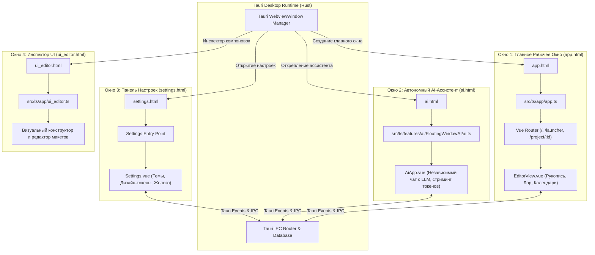
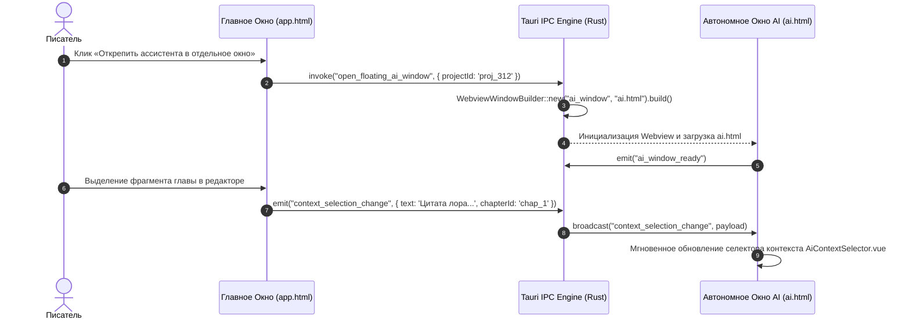

# apps/spa/src/ts — Генеральная Архитектура, Карта Системы, Конфигурация и Точки Входа (Multi-Page HTML)

> **Назначение**: Главный инженерный атлас клиентской части WorldWiki SPA. Содержит полную архитектурную карту директории `src/ts/`, детальный разбор всех 4 многооконных точек входа HTML (`app.html`, `ai.html`, `settings.html`, `ui_editor.html`), исчерпывающий анализ конфигурационных файлов (`vite.config.ts`, `tsconfig.json`, `package.json`, `knip.json`) и схему межпроцессного взаимодействия окон Tauri.

---

## 🗺️ Генеральная Карта Директории `src/ts/` (Master Directory Sitemap)

Директория `src/ts/` организована по принципу модульной слоистой архитектуры с чётким разделением ответственности:

```
apps/spa/src/ts/
├── README_Architecture.md              # 🌟 Главный архитектурный атлас и разбор конфигов (текущий файл)
│
├── 🚀 app/                             # [Слой Запуска & Маршрутизации] (Bootstrap, Router, Launcher)
│   ├── README_App.md                   # 📖 Документация инициализации приложения
│   ├── app.ts                          # Bootstrap главного окна: createApp(), Pinia, Router, errorHandler
│   ├── router.ts                       # Маршрутизация Vue Router (/, /launcher, /project/:id, /ai)
│   ├── project_launcher.ts             # Логика лаунчера проектов, распаковка архивов .world
│   ├── chapters.ts                     # Оркестрация рукописи на уровне приложения
│   ├── ui_editor.ts                    # Оркестрация компоновки рабочих панелей
│   └── settings.ts                     # Предстартовая синхронная инициализация токенов (Zero FOUC)
│
├── ⚡ composables/                     # [Слой Реактивных Запросов & Мутаций] (Data-Fetching)
│   ├── README_Composables.md           # 📖 Документация Data-Fetching слоя
│   ├── useExport.ts                    # Оркестратор экспорта документов (DOCX, PDF, FB2, EPUB, MD)
│   └── queries/                        # Реактивные хуки запросов с кэшированием и дебаунс-мутациями
│       ├── useProjectQueries.ts        # Запросы проектов (список, создание, клонирование)
│       ├── useChapterQueries.ts        # Запросы иерархии глав, автосохранение, статистика
│       ├── useEntityQueries.ts         # Запросы карточек сущностей, мутации полей, инвалидация связей
│       ├── useCalendarQueries.ts       # Запросы календарей, эпох, фаз лун, пакетный saveAll
│       ├── useTagQueries.ts            # Запросы глобальных тегов и категорий
│       └── useBatchQueries.ts          # Параллельная предзагрузка доменов через Promise.allSettled
│
├── 🧩 features/                        # [Слой Функциональных Подсистем] (8 Доменов)
│   ├── README_Features.md              # 📖 Генеральный справочник всех 8 фич
│   ├── ai/                             # Интеллектуальный ассистент WoWiLon AI (README_AI.md)
│   ├── chapters/                       # Рукопись, 4 режима редактора, сюжет (README_Chapters.md)
│   ├── documents/                      # Академические ГОСТ-стандарты, инспектор (README_Documents.md)
│   ├── entities/                       # База знаний лора, карточки сущностей (README_Entities.md)
│   ├── schemas/                        # Студия схем Schema Studio (README_Schemas.md)
│   ├── shell/                          # Каркас оболочки и лаунчер проектов (README_Shell.md)
│   ├── sync/                           # E2EE Облачная синхронизация и 3-Way Merge (README_Sync.md)
│   └── timeline/                       # Континуум времени, календари, Атлас Времени (README_Timeline.md)
│
├── 🛠️ services/                        # [Слой Бизнес-Логики & Документного Движка]
│   ├── README_Services.md              # 📖 Документация сервисного слоя
│   ├── api.client.ts                   # Клиент взаимодействия с Tauri IPC / REST
│   ├── project.service.ts              # Сервис управления проектами
│   ├── chapter.service.ts              # Сервис рукописи и сохранения глав
│   ├── editor.service.ts               # Координатор активных редакторов и вкладок
│   ├── footnote.service.ts             # Индексация и нумерация сносок
│   ├── Calendars/                      # calendar.math.ts (Математика времени, луны, солнце)
│   ├── Entity/                         # entity.service.ts (Сущности лора и связи)
│   └── document/                       # Комплексный документный движок (ASTAdapter, ГОСТ, экспорт)
│
├── 🗃️ stores/                          # [Слой Реактивного Состояния Pinia]
│   ├── README_Stores.md                # 📖 Документация хранилищ Pinia
│   ├── chapter.store.ts                # Рукопись, иерархия томов, кэш глав chapterCache
│   ├── calendar.store.ts               # Календари, эпохи, нормализация data.data
│   ├── timeline.store.ts               # Хронологические события мира (M_abs)
│   ├── schema.ts                       # Схемы типов сущностей и правила связей
│   ├── tags.store.ts                   # Глобальный реестр тегов
│   ├── shell.ts                        # Состояние оболочки, сайдбары, навигация
│   ├── hotkeys.ts                      # Глобальный реестр горячих клавиш
│   ├── floating.ts                     # Стек Z-index и координаты плавающих окон
│   └── document_profiles.store.ts      # Профили оформления (ГОСТ 7.32, Книга, ВАК)
│
├── 🏷️ types/                           # [Слой Строгой Глобальной Типизации]
│   ├── README_Types.md                 # 📖 Документация контрактов данных
│   ├── chapters.d.ts                   # Типы ChapterNode, SceneData, StoryPromise
│   ├── entities.d.ts                   # Типы EntityRecord, CustomField, Relationship
│   ├── settings.d.ts                   # Типы AppSettings, ThemePreset, TypographyConfig
│   ├── tauri.d.ts                      # Контракты вызовов Tauri IPC и Rust Enums
│   └── generated/                      # Автогенерированные Rust DTO (ts-rs / Specta)
│
└── 🧰 utils/                           # [Слой Вспомогательных Утилит & Директив]
    ├── README_Utils.md                 # 📖 Документация утилитного слоя
    ├── ui-helpers.ts                   # Цвета (hex/hsl/contrast), debounce, throttle, форматирование
    ├── v-glass.ts                      # Vue Директива v-glass (эффекты Glassmorphism)
    ├── requestCache.ts                 # In-Flight Request Deduplication и TTL кэш промисов
    ├── windowManager.ts                # Управление окнами Tauri WebviewWindow
    └── path.ts                         # Кроссплатформенная нормализация путей (Windows / POSIX)
```

---

## 🏛️ Архитектура Многооконного Режима (Multi-Page HTML Architecture)

WorldWiki скомпонован как высокопроизводительное многооконное приложение на базе Tauri WebView2 с 4 изолированными точками входа:



---

## 📄 Спецификация Многооконных Точек Входа HTML

| HTML Файл | Точка входа скрипта | Роль в системе | Особенности инициализации |
|---|---|---|---|
| **`app.html`** | `src/ts/app/app.ts` | **Главное окно приложения**: лаунчер миров, дерево рукописи, редактор глав (WYSIWYG/Word), карточки сущностей, календари, студия схем | Полный стек: Pinia + Vue Router + Директивы + Синхронный `initSettingsPreRender()` для исключения FOUC |
| **`ai.html`** | `src/ts/features/ai/FloatingWindowAI/ai.ts` | **Автономное окно WoWiLon AI**: открепляемый независимый чат с языковыми моделями (Llama.cpp, Ollama, OpenRouter), плавающий над экраном | Легковесный стек: изолированный чат-инстанс Pinia, стриминг токенов по IPC, без тяжелого роутера |
| **`settings.html`** | Модуль `Settings/` | **Выделенное окно глобальных настроек**: палитры тем, шрифты, аппаратное ускорение, горячие клавиши | Прямой доступ к `settings.service.ts` и инъекции CSS-токенов в `:root` |
| **`ui_editor.html`** | `src/ts/app/ui_editor.ts` | **Инспектор компоновок**: визуальная отладка рабочих столов, сплиттеров и панелей | Инструментальный режим разработчика |

---

## ⚙️ Исчерпывающий Анализ Конфигурационных Файлов

### 1. `vite.config.ts` (Конфигурация Сборщика и Dev-Сервера)
```typescript
// Ключевые фрагменты конфигурации Vite:
export default defineConfig({
  plugins: [
    vue(), // Компиляция Vue 3 SFC (Single File Components)
    AutoImport({ ... }), // Автоимпорт ref, computed, onMounted из vue/pinia
    Components({ ... })  // Авторегистрация компонентов
  ],
  build: {
    outDir: '../../dist',
    emptyOutDir: true,
    cssMinify: 'esbuild',
    rollupOptions: {
      input: {
        app: resolve(__dirname, 'app.html'),
        settings: resolve(__dirname, 'settings.html'),
        ui_editor: resolve(__dirname, 'ui_editor.html'),
        ai: resolve(__dirname, 'ai.html')
      }
    }
  },
  server: {
    port: 3000,
    host: '0.0.0.0',
    strictPort: true, // Гарантия неизменности порта 3000 для Tauri devUrl
    fs: {
      allow: ['../..'] // Доступ к корневым пакетам монорепозитория
    }
  },
  test: {
    globals: true,
    environment: 'jsdom' // Среда эмуляции DOM для тестов Vitest
  }
});
```

* **`build.rollupOptions.input`**: Объявляет 4 раздельных бандла для каждого HTML-окна, минимизируя размер загружаемого JS для автономных окон.
* **`server.strictPort: true`**: Предотвращает автоматический перескок на порт `3001` при занятости порта, что критично для согласованности с конфигурацией `tauri.conf.json` (`devUrl: "http://localhost:3000"`).
* **`server.fs.allow: ['../..']`**: Открывает безопасный доступ к локальным пакетам монорепозитория (`packages/word-vibe`, `packages/components`, `packages/resources`).

---

### 2. `tsconfig.json` (Конфигурация TypeScript и Path Aliases)
```json
{
  "compilerOptions": {
    "target": "ESNext",
    "module": "ESNext",
    "moduleResolution": "bundler",
    "strict": true,
    "noImplicitAny": true,
    "jsx": "preserve",
    "paths": {
      "@/*": ["./src/*"],
      "@worldwiki/components": ["../../packages/components/src"],
      "@worldwiki/word-vibe": ["../../packages/word-vibe/src"],
      "@worldwiki/resources/*": ["../../packages/resources/src/*"]
    }
  }
}
```
* **Path Aliases**: Обеспечивает прямую типизацию монорепозитория без необходимости сборки промежуточных `.d.ts` при разработке в режиме реального времени.
* **Strict Mode**: Полный запрет `any` и строгая проверка нулевых указателей `strictNullChecks: true`.

---

### 3. `package.json` (Скрипты и Зависимости SPA)
```json
{
  "name": "@worldwiki/spa",
  "scripts": {
    "dev": "vite",
    "build": "vue-tsc -b && vite build",
    "typecheck": "vue-tsc -b",
    "test": "vitest run",
    "test:coverage": "vitest run --coverage"
  }
}
```
* **`build`**: Включает обязательный предварительный прогон `vue-tsc -b` для гарантии отсутствия ошибок типизации в шаблонах `.vue` файлов до сборки Rollup.

---

### 4. `knip.json` (Аудит Неиспользуемого Кода)
```json
{
  "$schema": "https://unpkg.com/knip@5/overview/schema.json",
  "entry": ["src/ts/app/app.ts", "src/ts/features/ai/FloatingWindowAI/ai.ts"],
  "project": ["src/**/*.{ts,vue}"]
}
```
* Обеспечивает непрерывный статический анализ кодовой базы, выявляя неиспользуемые экспорты, мертвые файлы и избыточные зависимости.

---

## 🔄 Жизненный цикл межпроцессного взаимодействия окон (Sequence Diagram)



---

## 🧪 Полный пайплайн верификации и сборки SPA

```bash
# 1. Комплексная проверка типов TypeScript во всех файлах и Vue SFC
pnpm --filter @worldwiki/spa typecheck

# 2. Запуск полного тестового набора Vitest с отчетом покрытия
pnpm --filter @worldwiki/spa test:coverage

# 3. Аудит чистоты кодовой базы и неиспользуемого кода
npx knip

# 4. Продакшн-сборка всех 4 HTML-окон
pnpm --filter @worldwiki/spa build
```
