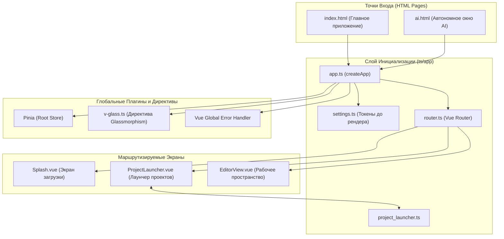
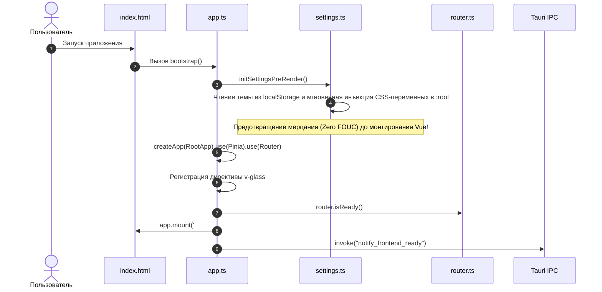

# apps/spa/src/ts/app — Архитектура Инициализации Приложения и Маршрутизации

> **Назначение**: Корневой уровень инициализации, конфигурации и загрузки (Application Bootstrap & Entry Points) WorldWiki SPA. Отвечает за создание инстанса Vue 3, регистрацию глобальных плагинов (Pinia, Vue Router), установку пользовательских директив (`v-glass`), навигационные гарды маршрутизации (`router.ts`), логику лаунчера вселенных (`project_launcher.ts`) и перехват критических ошибок приложения.

---

## 📁 Структура папок и файлов

```
apps/spa/src/ts/app/
├── README_App.md                       # 🌟 Данная всеобъемлющая документация слоя приложения
│
├── app.ts                              # 🚀 Главная точка сборки: createApp(), Pinia, Router, директивы, errorHandler
├── router.ts                           # 🗺️ Конфигурация Vue Router: маршруты экранов, навигационные гарды
├── project_launcher.ts                 # 🌌 Логика лаунчера проектов: инициализация вселенных, распаковка .world архивов
├── chapters.ts                         # 📖 Координация состояния рукописи на уровне приложения
├── ui_editor.ts                        # 🎨 Оркестрация компоновки рабочих панелей редактора
└── settings.ts                         # ⚙️ Предстартовая инициализация дизайн-системы и токенов
```

---

## 🏛️ Архитектурная модель Bootstrap-Пайплайна



---

## 🔄 Жизненный цикл старта и инициализации (Sequence Diagram)



---

## 🗺️ Карта Маршрутизации (`router.ts`)

| Маршрут | Компонент представления | Назначение | Навигационные проверки |
|---|---|---|---|
| `/` | `Splash.vue` | Стартовая диагностика и проверка целостности локальной БД | Автопереход на `/launcher` после инициализации |
| `/launcher` | `ProjectLauncher.vue` | Выбор или создание вселенной из шаблонов | Очистка активного состояния проекта |
| `/project/:id` | `EditorView.vue` | Главное рабочее пространство проекта (Рукопись / Лор / Календари) | Валидация существования `projectId` в БД |
| `/ai` | `FloatingWindowAI/AiApp.vue` | Автономный режим окна интеллектуального ассистента | Режим отдельного Webview-окна |

---

## ⚠️ Важные нюансы реализации (Gotchas & Best Practices)

1. **Исключение Flash of Unstyled Content (FOUC)**:
   * Вызов `settings.ts` выполняется **синхронно до** вызова `app.mount('#app')`. Это гарантирует, что темная тема или кастомный акцент применятся до первого кадра отрисовки DOM.
2. **Глобальный перехватчик необработанных исключений (`app.config.errorHandler`)**:
   * Все ошибки компонентов перехватываются, логируются в `console.ts` и при критических сбоях выводят дружелюбное диалоговое окно восстановления сессии без падения всего WebView.

---

## 🧪 Верификация и тестирование

Запуск проверки слоя приложения:
```bash
# Typecheck и юнит-тесты роутера и лаунчера
pnpm --filter @worldwiki/spa typecheck
pnpm test apps/spa/src/ts/app
```
