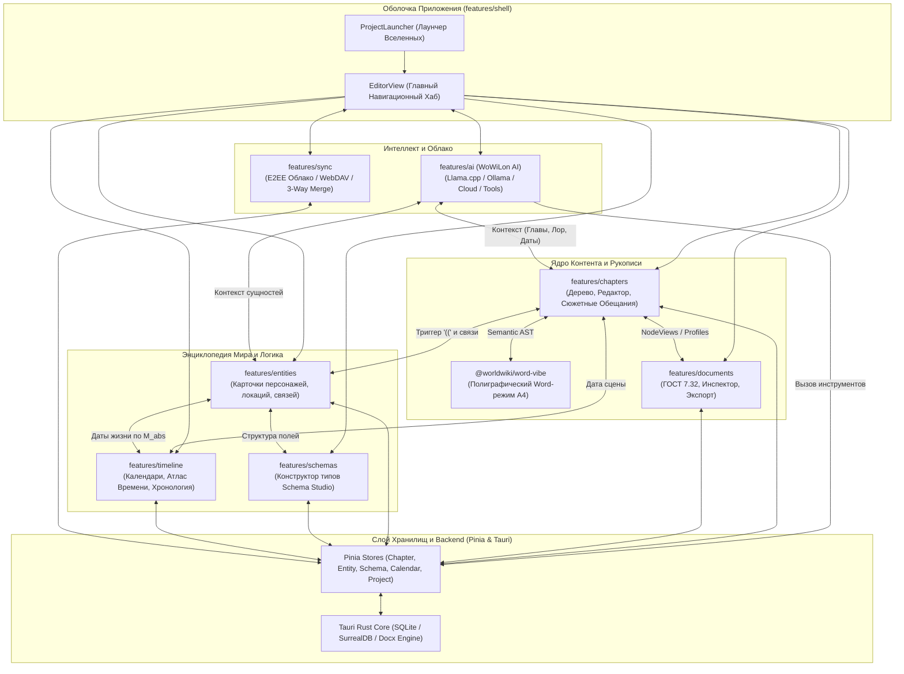

# apps/spa/src/ts/features — Генеральный Архитектурный Справочник и Карта Модулей WorldWiki

> **Назначение**: Главный архитектурный узел и навигационный атлас всех 8 функциональных подсистем (Features) веб-приложения WorldWiki SPA. Описывает сквозные потоки данных, межмодульные связи, слои изоляции, систему хранения данных (Pinia / Tauri / SQLite / SurrealDB) и служит центральным оглавлением для всей инженерной документации проекта.

---

## 🗺️ Генеральная Карта Подсистем (Master Sitemap & Feature Index)

Каждая из 8 подсистем изолирована в собственной директории и снабжена исчерпывающей технической документацией с математическими выкладками, диаграммами последовательности (Sequence Diagrams) и спецификациями API:

```
apps/spa/src/ts/features/
├── README_Features.md                  # 🌟 Генеральный архитектурный справочник
│
├── 🧠 ai/                              # Интеллектуальный Ассистент WoWiLon AI
│   ├── README_AI.md                    # 📖 Llama.cpp, Ollama, OpenRouter, <think> reasoning, ветки диалогов, тулы
│   ├── WowilonPanel.vue                # Боковой сайдбар ассистента с ресайзом
│   ├── FloatingWindowAI/               # Открепляемое независимое окно (Tauri WebviewWindow)
│   ├── components/                     # Компоненты диалога, ввода, выбора контекста и прав
│   └── settings/                       # Настройки моделей, API-ключей, профилей и мониторинг VRAM/GPU
│
├── 📖 chapters/                        # Рукопись и Редактор Глав
│   ├── README_Chapters.md              # 📖 Иерархическое дерево, 4 режима редактора (WYSIWYG/MD/Split/Word), сюжет
│   ├── ChaptersView.vue                # Корневой маршрутизируемый контейнер раздела
│   └── components/                     # Декомпозированные подсистемы: workspace/, tree/, editor/, panels/, modals/, semantic/
│
├── 📑 documents/                       # Академические Документы и ГОСТ-Стандарты
│   ├── README_Documents.md             # 📖 ГОСТ 7.32-2017, 5-вкладочный инспектор структуры, NodeViews, экспорт
│   ├── AcademicInspector/              # Инспектор оглавления, рисунков, таблиц, формул и титульного листа
│   ├── DocumentExportModal/            # Модальное окно компиляции Semantic AST в DOCX/PDF/LaTeX
│   ├── DocumentLayoutBar/              # Панель пресетов верстки (ГОСТ, Книга, ВАК, Custom)
│   ├── DocumentProcessor/              # Экран пакетной обработки и валидации документов
│   ├── nodes/                          # Tiptap v3 NodeViews: FootnoteNode, FigureNode, CrossReferenceNode
│   └── extensions/                     # Расширения LineHeightExtension (1.5) и TextIndentExtension (1.25 см)
│
├── 👤 entities/                        # База Сущностей и Энциклопедия Лора Мира
│   ├── README_Entities.md              # 📖 Схемно-ориентированные поля, граф связей, плавающая карточка, теги
│   ├── EntityEditor/                   # Полноэкранный редактор карточки сущности
│   ├── CharacterJourney/               # Хронология пути персонажа и встреч
│   └── components/                     # Модальные окна: modals/ (FloatingEntityEditor, TagsManagerModal, CreateEntityModal)
│
├── 📐 schemas/                         # Студия Схем и Конструктор Типов Сущностей
│   ├── README_Schemas.md               # 📖 Schema Studio, Drag & Drop палитра полей, валидаторы, шаблоны миров
│   ├── SchemaEditorMain.vue            # Главный экран конструктора схем
│   ├── composables/                    # Сервисные композаблы (useSchemaData, useSchemaDnD, useAvailableEntityTypes...)
│   └── components/                     # Холст (canvas/), справка (help/), сайдбар (sidebar/), тулбар (toolbar/)
│
├── 🚀 shell/                           # Оболочка Приложения и Лаунчер Проектов
│   ├── README_Shell.md                 # 📖 Splash диагностика, лаунчер вселенных, навигационный хаб EditorView
│   ├── EditorView.vue                  # Главный полноэкранный рабочий каркас приложения
│   └── components/                     # Подкомпоненты: launcher/ (ProjectLauncher), splash/ (Splash), switcher/ (AppSwitcher)
│
├── ☁️ sync/                            # Облачная Синхронизация и Резервные Копии
│   ├── README_Sync.md                  # 📖 WorldWiki Cloud, WebDAV, Git, E2EE Vault (AES-GCM-256), 3-Way Merge
│   ├── CloudSyncModal.vue              # Модальное окно управления синхронизацией и статусом
│   └── useCloudSyncModal.ts            # Детектор конфликтов версий (Vector Clocks) и криптографический модуль
│
└── ⏳ timeline/                        # Континуум Времени, Календари и Хронология
    ├── README_Timeline.md              # 📖 Главный путеводитель по континууму времени и шкале M_abs
    └── components/                     # Подсистемы: calendars/, planets/, atlas/, inspectors/
```

---

## 🏛️ Генеральная Архитектурная Схема Взаимодействия (Master Architecture)



---

## 🧭 Сводная Таблица Подсистем и Архитектурных Ролей

| Подсистема      | Роль в приложении                                                                                         | Ключевые зависимости                                            | Ссылка на документацию                                      |
| --------------- | --------------------------------------------------------------------------------------------------------- | --------------------------------------------------------------- | ----------------------------------------------------------- |
| **`ai`**        | Интеллектуальный ассистент писателя (WoWiLon AI), локальный и облачный рантайм, reasoning `<think>`, тулы | `aiModels.api.ts`, Tauri IPC, Llama.cpp / Ollama                | [README_AI.md](./ai/README_AI.md)                          |
| **`chapters`**  | Главное рабочее пространство писателя: тома, главы, 4 режима редактора, сюжетный инспектор                | `chapter.store.ts`, `ASTAdapter.ts`, `@worldwiki/word-vibe`     | [README_Chapters.md](./chapters/README_Chapters.md)        |
| **`documents`** | Академическая стандартизация (ГОСТ 7.32), титульные листы, инспектор структуры, компилятор экспорта       | `ASTAdapter.ts`, Tiptap v3 NodeViews, Rust Docx Engine          | [README_Documents.md](./documents/README_Documents.md)    |
| **`entities`**  | База знаний лора вселенной, карточки сущностей, двусторонний граф отношений, плавающий редактор           | `entity.store.ts`, `entity.tree.ts`, `schema.store.ts`          | [README_Entities.md](./entities/README_Entities.md)        |
| **`schemas`**   | Студия мета-моделирования (Schema Studio): визуальное проектирование типов сущностей и правил связей      | `schema.store.ts`, HTML5 DnD, `useSchemaTemplates`              | [README_Schemas.md](./schemas/README_Schemas.md)           |
| **`shell`**     | Каркас приложения: сплэш-диагностика, лаунчер вселенных, навигационный хаб `EditorView`, горячие клавиши  | `project.store.ts`, `project.service.ts`, `settings.service.ts` | [README_Shell.md](./shell/README_Shell.md)                 |
| **`sync`**      | Сквозная E2EE синхронизация проектов (WorldWiki Cloud, WebDAV, Git), версионирование Vector Clocks        | `sync.service.ts`, Tauri Crypto (AES-GCM-256), Rust Sync        | [README_Sync.md](./sync/README_Sync.md)                    |
| **`timeline`**  | Единый континуум времени ($M_{\text{abs}}$), авторские календари, луны, солнце, реестр и селекторы даты   | `calendar.store.ts`, `useCalendarEngine.ts`, `timeline.store.ts`    | [README_Timeline.md](./timeline/README_Timeline.md)        |

---

## 🧩 Ключевые Архитектурные Инварианты Системы

1. **Единый Semantic AST как мост данных**:
   - Все редакторы и модули рукописи обмениваются данными исключительно через типизированный промежуточный AST (`SemanticDocument`). Ни один модуль не зависит от сырых структур чужого WYSIWYG-движка.
2. **Абсолютная Минута ($M_{\text{abs}}$) как основа хронологии**:
   - Время в WorldWiki не привязано к земному календарю. Любая дата в любой культуре — это проекция глобального числа минут от сотворения мира ($M_{\text{abs}}$), что позволяет мгновенно синхронизировать даты сцен, жизни персонажей и исторические эпохи.
3. **Чистые границы пакетов (Clean Package Boundaries)**:
   - Тяжелые автономные движки (такие как `@worldwiki/word-vibe` для полиграфического Word-режима) вынесены в отдельные npm-пакеты и не имеют прямых связей с хранилищами SPA.

---

## 🧪 Полный прогон тестов всех фич приложения

```bash
# 1. Тесты ядра рукописи и редактора
pnpm test apps/spa/src/ts/features/chapters

# 2. Тесты сущностей лора и схем
pnpm test apps/spa/src/ts/features/entities
pnpm test apps/spa/src/ts/features/schemas

# 3. Тесты подсистемы времени и календарей
pnpm test apps/spa/src/ts/features/timeline

# 4. Тесты документов и экспорта
pnpm test apps/spa/src/ts/features/documents

# 5. Тесты оболочки и синхронизации
pnpm test apps/spa/src/ts/features/shell
pnpm test apps/spa/src/ts/features/sync

# 6. Тесты искусственного интеллекта WoWiLon AI
pnpm test apps/spa/src/ts/features/ai

# 7. Комплексный прогон всех тестов SPA
pnpm --filter @worldwiki/spa test
```
