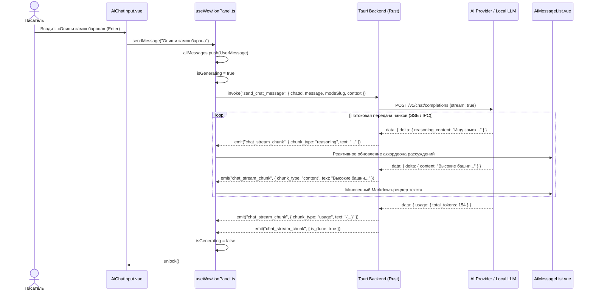
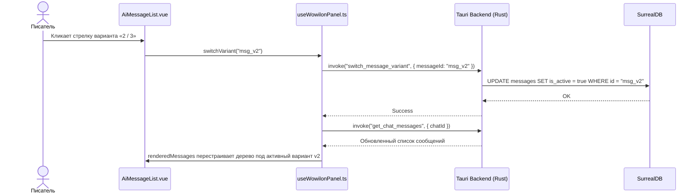
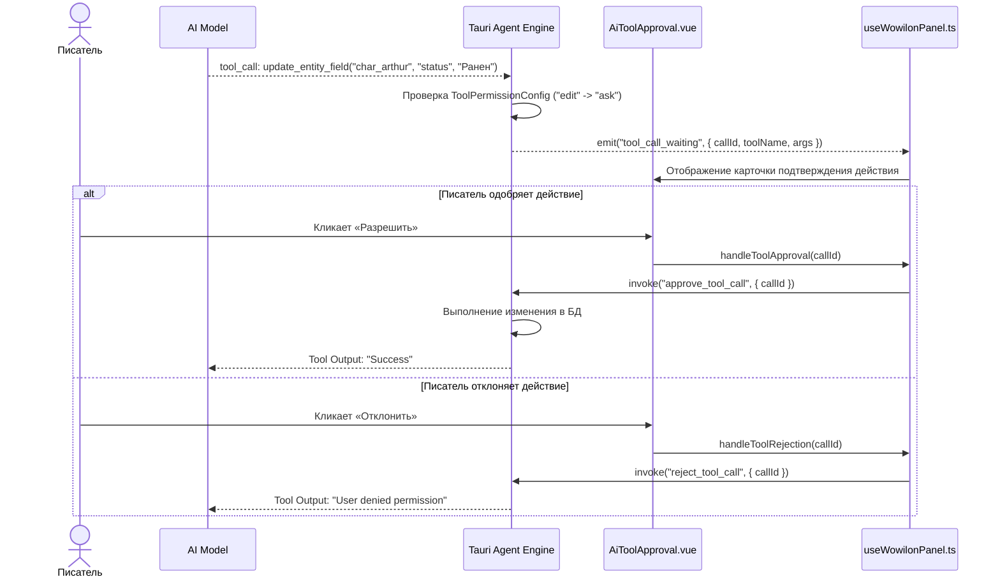
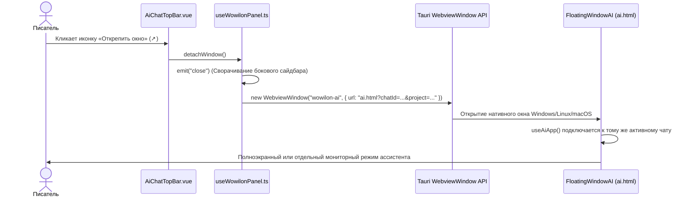

# apps/spa/src/ts/features/ai — Архитектура и Инженерный Справочник WoWiLon AI

> **Назначение**: Комплексная подсистема искусственного интеллекта приложения WorldWiki («WoWiLon AI»). Обеспечивает работу интеллектуального ассистента писателя (режимы *Собеседник*, *Редактор*, *Аналитик*), веточное нелинейное дерево диалогов с вариантами ответов, парсинг цепочек рассуждений (`<think>` reasoning), стриминг токенов по IPC/SSE, селектор контекста рукописи (главы, персонажи, локации, календарные даты), систему контроля прав и подтверждения вызова инструментов (Tool Approval), управление профилями облачных провайдеров (OpenRouter, Anthropic, OpenAI, DeepSeek, Custom) и встроенным локальным рантаймом GGUF-моделей (Llama.cpp / Ollama) с динамическим мониторингом аппаратных ресурсов (GPU, VRAM, CPU, RAM).

---

## 📁 Структура папок и файлов

```
apps/spa/src/ts/features/ai/
├── README_AI.md                        # Данная всеобъемлющая документация подсистемы AI
├── WowilonPanel.vue                    # Главная боковая панель ассистента (боковой сайдбар с ресайзом и плавным интерфейсом)
├── useWowilonPanel.ts                  # Главный координирующий Composable: стримы, отправка сообщений, дерево вариантов, скролл, ресайз
│
├── FloatingWindowAI/                   # Отдельное открепляемое окно ассистента (Tauri WebviewWindow)
│   ├── AiApp.vue                       # Корневой интерфейс автономного окна WoWiLon AI
│   ├── ai.ts                           # Точка входа SPA-страницы ai.html (инициализация Pinia, i18n)
│   ├── useAiApp.ts                     # Composable управления плавающим окном и синхронизацией проекта
│   └── __tests__/                      # Юнит-тесты автономного окна
│
├── components/                         # UI-компоненты панели диалога
│   ├── AiActionButtons.vue             # Кнопки быстрых действий над сообщением (копировать, редактировать, перегенерировать, ветвить)
│   ├── AiChatHistory.vue               # Дерево истории чатов (папки проектов, переименование, удаление, переключение)
│   ├── useAiChatHistory.ts             # Composable управления историей чатов
│   ├── AiChatInput.vue                 # Текстовое поле ввода с автовысотой, горячими клавишами (Enter / Shift+Enter) и блокировкой
│   ├── useAiChatInput.ts               # Composable обработки ввода и разблокировки
│   ├── AiChatTopBar.vue                # Верхняя панель: выбор режима (Собеседник/Редактор/Аналитик), профиля, кнопка открепления и настроек
│   ├── useAiChatTopBar.ts              # Composable переключения модов и профилей
│   ├── AiContextSelector.vue           # Селектор контекста: прикрепление глав рукописи, сущностей базы знаний, дат календаря
│   ├── useAiContextSelector.ts         # Composable поиска и фильтрации контекстных карточек
│   ├── AiHeader.vue                    # Заголовок чата с кнопками сайдбара и закрытия
│   ├── AiMessageList.vue               # Список сообщений: Markdown-рендер, спойлеры рассуждений <think>, логи тулов, переключатель вариантов
│   ├── useAiMessageList.ts             # Composable рендера списка сообщений
│   ├── AiSelect.vue                    # Кастомный стилизованный селектор с поддержкой поиска и иконок
│   ├── useAiSelect.ts                  # Composable выпадающего списка
│   ├── AiToolApproval.vue              # Интерактивная карточка подтверждения выполнения тула (Read/Edit/System с аргументами)
│   └── useAiToolApproval.ts            # Composable подтверждения/отклонения вызова тула
│
├── composables/                        # Специализированные сервисные композаблы
│   ├── useAiChats.ts                   # Управление деревом чатов, переименование, удаление, синхронизация с проектом
│   ├── useAiModels.ts                  # Загрузка и кэширование списка моделей от провайдеров
│   ├── useAiProfiles.ts                # CRUD профилей генерации (температура, контекст, thinking budget, инструкции)
│   └── __tests__/                      # Юнит-тесты композаблов
│
├── settings/                           # Панель расширенных настроек нейросети
│   ├── AiSettingsView.vue              # Главное модальное окно настроек со вкладками
│   ├── useAiSettingsView.ts            # Composable переключения вкладок и сохранения настроек
│   └── tabs/                           # Вкладки настроек
│       ├── AiSettingsConnectionsTab.vue # Подключения: API-ключи, базовые URL провайдеров, проверка связи
│       ├── useAiSettingsConnectionsTab.ts # Composable управления API-ключами
│       ├── AiSettingsModelsTab.vue      # Профили моделей: выбор LLM, max_tokens, temperature, thinking budget, auto-RAG
│       ├── useAiSettingsModelsTab.ts    # Composable конфигурации гиперпараметров
│       ├── AiSettingsModesTab.vue       # Системные промпты и моды (Собеседник, Редактор, Аналитик)
│       ├── useAiSettingsModesTab.ts     # Composable редактирования системных промптов
│       ├── AiSettingsPermissionsTab.vue # Безопасность: уровни прав тулов (Allow / Ask / Deny), категории риска
│       ├── useAiSettingsPermissionsTab.ts # Composable матрицы прав
│       ├── AiSettingsLocalTab.vue       # Локальный ИИ: мониторинг железа, загрузка GGUF с HuggingFace, Llama.cpp / Ollama
│       ├── HardwareMonitorChart.vue     # График нагрузки VRAM / RAM / CPU в реальном времени
│       ├── useHardwareMonitorChart.ts   # Composable монитора аппаратных ресурсов
│       └── local/                       # Внутренние модули локального рантайма
│           ├── LocalAiExplore.vue       # Поиск моделей на HuggingFace Hub
│           ├── LocalAiLibrary.vue       # Список установленных локальных GGUF-моделей на диске
│           ├── LocalAiRecommended.vue   # Рекомендованные карточки моделей с оценкой VRAM под GPU пользователя
│           ├── LocalAiRuntime.vue       # Управление статусом сервера llama.cpp/Ollama (Start/Stop/Port)
│           ├── useLocalAiRuntime.ts     # Composable управления процессом рантайма
│           └── useLocalAiTab.ts         # Composable оркестрации локальных моделей
│
├── api/                                # Транспортный слой (Tauri IPC + внешние REST API)
│   ├── aiModels.api.ts                 # Получение моделей (OpenRouter REST, Local IPC, Custom API)
│   ├── aiProfiles.api.ts               # Сохранение и чтение профилей
│   └── __tests__/                      # Тесты API вызовов
│
└── types/                              # Строгая TypeScript-типизация
    └── ai.types.ts                     # Интерфейсы: AiProfile, InstalledModelInfo, HardwareInfo, ToolPermissionConfig, etc.
```

---

## 🧠 Архитектурная модель данных и компонентов

```
┌─────────────────────────────────────────────────────────────────────────────────┐
│                              WorldWiki Core Context                             │
│       (Главы рукописи / База сущностей / Календари / Глобальный проект)         │
└────────────────────────────────────────┬────────────────────────────────────────┘
                                         │  Контекстные сниппеты
                                         ▼
┌─────────────────────────────────────────────────────────────────────────────────┐
│                        useWowilonPanel (Оркестратор)                            │
│  ├── allMessages: ref<ChatMessage[]>        ───► Линейный массив сообщений       │
│  ├── renderedMessages: ComputedRef<Group[]> ───► Дерево активных веток          │
│  ├── activeChatId, activeModeSlug, profile  ───► Состояние сессии               │
│  └── eventListener('chat_stream_chunk')     ───► Реактивный стриминг токенов    │
└───────────────────┬─────────────────────────────────────────┬───────────────────┘
                    │                                         │
        (Tauri IPC / Events)                     (UI Представление)
                    ▼                                         ▼
┌───────────────────────────────────────┐   ┌─────────────────────────────────────┐
│             Rust Backend              │   │            WowilonPanel             │
│  ├── send_chat_message                │   │  ├── AiChatTopBar (Режимы, Профили) │
│  ├── chat_stream_chunk (SSE/Event)    │   │  ├── AiContextSelector (Сниппеты)   │
│  ├── edit_chat_message                │   │  ├── AiMessageList (Markdown, Think)│
│  ├── switch_message_variant           │   │  ├── AiToolApproval (Модалки прав)  │
│  ├── generate_chat_title              │   │  └── AiChatInput (Ввод, Блокировка) │
│  └── Llama.cpp / Ollama / Cloud HTTP  │   └─────────────────────────────────────┘
└───────────────────────────────────────┘
```

---

## 🧮 Дерево диалогов и разбор структуры сообщений

### 1. Модель ветвления диалога (MessageVariantGroup)

Каждое сообщение `ChatMessage` содержит:
* `id` — уникальный строковый идентификатор сообщения (`m1`, `msg_xyz`);
* `parent_id` — ID родительского сообщения (для корня — `null`);
* `role` — `'user' | 'assistant' | 'system'`;
* `content` — очищенный текст ответа;
* `reasoning` — ход рассуждений модели (извлекается из тегов `<think>...</think>`);
* `toolLogs` — логи выполненных или вызванных инструментов;
* `is_active` — флаг активного варианта в текущей ветке.

#### Алгоритм построения дерева в `renderedMessages`:
1. Строится хэш-таблица `Map<string | null, ChatMessage[]>` по `parent_id`.
2. Начиная с `currentParent = null`, последовательно извлекаются все дочерние элементы (`children`).
3. Внутри группы вариантов (`variants`) выбирается активный элемент с `is_active !== false` (или последний добавленный).
4. Выполняется парсинг `<think>` блоков.
5. Указатель `currentParent` перемещается на `activeMsg.id`.

### 2. Извлечение цепочек рассуждений (`<think>`)

Модели с поддержкой Deep Reasoning (DeepSeek-R1, Qwen-2.5-Coder-Thinking, Claude Thinking) возвращают рассуждения внутри тегов `<think>`.

```typescript
// Завершенное рассуждение:
"<think>Анализирую хронологию битвы...</think>Битва началась на рассвете."
➔ reasoning: "Анализирую хронологию битвы..."
➔ content:   "Битва началась на рассвете."

// Незавершенный стриминг (тег еще не закрыт):
"<think>Проверяю персонажей..."
➔ reasoning: "Проверяю персонажей..."
➔ content:   ""
```

В интерфейсе `<AiMessageList>` рассуждения скрыты в аккуратный сворачиваемый аккордеон с анимацией «Думает...», не загромождая основной текст рукописи.

---

## 🔁 Mermaid: Sequence Diagrams — Ключевые сценарии

---

### 1. Отправка сообщения и реактивный стриминг токенов



---

### 2. Переключение вариантов ответов (Ветвление)



---

### 3. Авторизация выполнения инструментов (Tool Approval)



---

### 4. Открепление в автономное плавающее окно



---

## ⚙️ Локальный ИИ и Мониторинг Аппаратных Ресурсов

Вкладка `AiSettingsLocalTab` предоставляет полноценный менеджер локальных моделей без необходимости ставить сторонний софт:

### 1. Архитектура интеграции Llama.cpp и Ollama
* Автоматическое скачивание квантованных моделей `.gguf` с HuggingFace Hub;
* Расчет необходимой видеопамяти под размер контекста ($N_{\text{ctx}}$) и слои GPU ($N_{\text{gpu\_layers}}$);
* Оценка статуса совместимости:
  * `ok` — модель полностью помещается в VRAM (максимальная скорость токенов/сек);
  * `warning` — модель частично выгружается в RAM (CPU Offloading, скорость средняя);
  * `exceeds` — модель превышает суммарную память системы.

### 2. Монитор железа в реальном времени (`useHardwareMonitorChart.ts`)
Каждые 1000 мс композабл опрашивает системные датчики через `invoke('get_hardware_metrics')`:
* **VRAM**: Использовано / Всего (МБ / ГБ), имя видеокарты;
* **RAM**: Нагрузка оперативной памяти;
* **GPU Compute %**: Процент утилизации тензорных ядер.

---

## 🔒 Безопасность и Архитектурная Чистота

1. **Защита от XSS и отсутствие `eslint-disable`**:
   Все сообщения ассистента и логи инструментов форматируются через безопасный рендерер `MarkdownIt` и выводятся с предварительной санитизацией HTML через DOMPurify или компонент `<SafeHtml>`.
2. **Нулевой монолит (100% Companion Composables)**:
   Все 16 Vue-компонентов директории `apps/spa/src/ts/features/ai` полностью отделены от логики: разметка находится в `.vue`, реактивное состояние и вызовы API — в парных `use<ComponentName>.ts`.
3. **Строгая типизация без `any`**:
   Все параметры промптов, чатов, тулов, моделей и ответов строго типизированы через DTO-интерфейсы в `types/ai.types.ts`.
4. **Синхронизация скролла при стриминге**:
   Автоматический скролл вниз вызывается только если пользователь находится внизу чата. Если писатель прокрутил историю наверх для чтения предыдущего ответа, стриминг не срывает позицию экрана. Позиция скролла кэшируется в `localStorage` по ключу `worldwiki_ai_scroll_<chatId>`.

---

## 📝 Разработчику на заметку (Gotchas)

1. **Разделение режимов чата (`AiTopBarMode`)**:
   * `chat` (*Собеседник*) — мягкий творческий диалог, мозговой штурм, генерация сюжетных поворотов;
   * `edit` (*Редактор*) — фокус на стилистике текста, исправлении тавтологий, соблюдении авторского ритма;
   * `analyze` (*Аналитик*) — поиск сюжетных дыр, хронологических нестыковок и логических противоречий в лоре мира.
2. **Обработка временных сообщений (`temp_`)**:
   До подтверждения сохранения на бэкенде сообщению присваивается временный ID `temp_<timestamp>`. Методы `deleteMessage` и `editMessage` игнорируют временные ID, пока сообщение не получит постоянный идентификатор от SurrealDB.
3. **Очистка слушателей событий**:
   Слушатель потока `unlistenChunk` обязательно отписывается в хуке `onUnmounted`, предотвращая утечки памяти при переключении разделов приложения.
