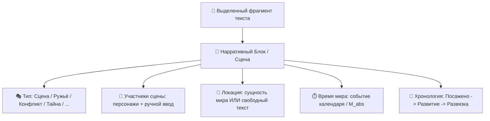

# 📜 Архитектурная спецификация: Единый Хаб Сцен и Нарративных Блоков

> **Статус**: Утверждено в разработку  
> **Область**: `apps/spa/src/ts/features/chapters/` (`PromisesPanel`, `PromiseCard`, `ChapterRightSidebar`)  
> **Стандарты**: Cerberus Zero-Debt, Vue 3 Composable Architecture, Hexagonal Core

---

## 1. 🎯 Концепция: Универсальный Нарративный Контейнер

Вместо разрозненных аккордеонов («Участники», «Таймлайн главы», «Обещания») создается **Единый Нарративный Контейнер**.  
Любой выделенный автором фрагмент текста (1 абзац, несколько абзацев или диалог) становится нарративным блоком с единой контекстной карточкой.



---

## 2. 🧩 Интерактивная карточка Сцены / Блока (`PromiseCard.vue`)

### 2.1. Структура карточки
Каждая карточка в правом сайдбаре позволяет автору на лету редактировать контекст сцены:

```
┌─────────────────────────────────────────────────────────────┐
│  🎭 [ Сцена ▾ ]               Гл. 1 · абз. 3–5       [ ✕ ]  │
├─────────────────────────────────────────────────────────────┤
│  📍 Локация:                                                │
│     [ 🏛️ Тронный зал Академии / Трактир "У Лиса"        ]  │  <- Combobox (сущность / текст)
│                                                             │
│  👥 Участники этой сцены:                                   │
│     [ 👤 Итан ✕ ] [ 👤 Эрис ✕ ] [ 👤 Стражник ✕ ]           │  <- Чипы участников
│     [ + Добавить персонажа... ▾ ]                           │  <- Выбор из базы / ввод текста
│                                                             │
│  ⏱️ Время действия (Календарь):                            │
│     [ 📅 14 Эпоха, 24 Марта · Тайный совет (M: 1420) ▾ ]    │  <- Выбор события таймлайна
│                                                             │
│  💬 Цитата / Текст сцены:                                   │
│     «Рудеус сделал шаг вперед и обнажил клинок...»          │
│     [ 📍 Перейти к тексту в редакторе ]                     │
│                                                             │
│  🌿 Вехи и сюжетное развитие:                               │
│     🌱 Посажено (Гл. 1 · абз. 3)                            │
│     ├─ 🌿 Развитие (Гл. 3 · абз. 12)                        │
│     └─ 🎯 Развязка (Гл. 5 · абз. 8)                         │
│     [ 🌿 + Развить ] [ 🎯 Отстрелять ]                      │
└─────────────────────────────────────────────────────────────┘
```

### 2.2. Гибридный ввод Локации и Персонажей
* **Локация (`location_id`)**:
  * Реализуется через `<input list="project-locations" />` / кастомный Combobox.
  * Если автор выбирает существующую локацию мира $\rightarrow$ привязывается ID сущности (`entities:loc_room`).
  * Если автор пишет произвольный текст $\rightarrow$ сохраняется строка (`"Трактир на окраине"`). Создавать сущность в базе **не требуется**.
* **Участники (`participant_ids`)**:
  * Чипы персонажей с кнопкой `✕` для мгновенного удаления.
  * Быстрый выпадающий список персонажей проекта + поле свободного добавления эпизодических лиц.

---

## 3. 🗂️ Реорганизация Правого Сайдбара (`ChapterRightSidebar.vue`)

Правая панель переключается между **2 чистыми режимами**:

1. **🎯 Нарративные Блоки & Сцены**:
   * Инспектор сцен текущей главы и всего произведения.
   * Фильтры: `[ В текущей главе | Все сцены | По персонажу | По статусу ]`.
   * Создание нового блока по кнопке `[ ＋ Сцена ]` или через ПКМ в редакторе.
2. **📋 Планы**:
   * Вкладки: `[ 📖 Том | ⚡ Арка | 📄 Глава ]`.

---

## 4. 📁 Архитектурная декомпозиция компонентов

Для строгого соблюдения **Cerberus Zero-Debt** (`ARCH-031`, `VUE-001`):

```
apps/spa/src/ts/features/chapters/PromisesPanel/
├── PromisesPanel.vue                 # Главный контейнер списка сцен
├── usePromisesPanel.ts               # Composable фильтрации, загрузки и мутаций
├── components/
│   ├── PromiseCard.vue               # Карточка сцены/блока
│   ├── PromiseCardMeta.vue           # Интерактивный редактор локации, участников и времени
│   ├── usePromiseCardMeta.ts         # Composable управления локациями и участниками
│   ├── PromiseCardNote.vue           # Заметки автора
│   └── PromiseFilterBar.vue          # Фильтры по главе, персонажам, статусам
```

---

## 5. 🧪 План тестирования и верификации

1. **Unit-тесты**:
   * `usePromiseCardMeta.spec.ts`: Проверка добавления/удаления участников (сущностей и ручных строк), выбора локаций.
   * `usePromisesPanel.spec.ts`: Проверка создания блоков с произвольным выделением текста, привязки таймлайн-событий.
2. **Cerberus Firewall**:
   * `cerberus-sfc check`: 0 нарушений токенов и SFC.
   * `cargo cerberus check --ci`: 0 предупреждений архитектурного файрвола.
