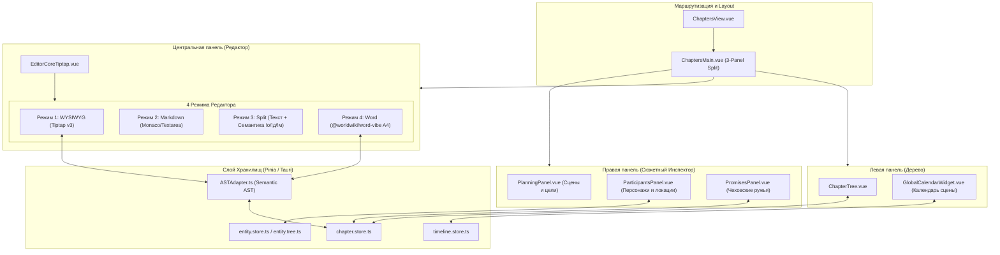
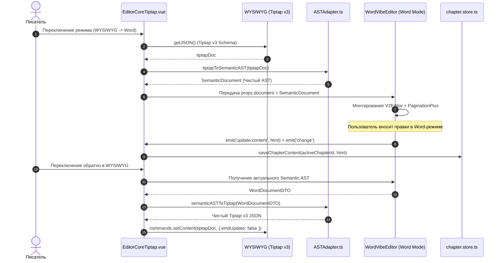

# apps/spa/src/ts/features/chapters — Архитектура Рукописи и Редактора Глав

> **Назначение**: Центральная подсистема написания книги и управления структурой рукописи в WorldWiki. Включает иерархическое дерево томов/глав/сцен, 4-режимный текстовый процессор (WYSIWYG, Markdown, Split со структурными бейджами, Word-режим A4/Книга), инспекторы сюжета (Участники, Планирование сцен, Сюжетные обещания / Чеховские ружья) и систему экспорта рукописи.

---

## 📁 Структура папок и файлов

```
apps/spa/src/ts/features/chapters/
├── README_Chapters.md                  # Данная всеобъемлющая документация архитектуры рукописи
├── ChaptersView.vue                    # Корневой маршрутизируемый контейнер раздела «Рукопись»
│
├── ChapterTree/                        # Левая панель: Иерархическое дерево рукописи
│   ├── ChapterTree.vue                 # UI дерева: тома, части, главы, сцены, драг-н-дроп, контекстное меню
│   ├── ChapterTree.model.ts            # Пропсы и события дерева
│   ├── useChapterTree.ts               # Управление деревом: создание, переименование, удаление, перенос, подсчет слов
│   └── __tests__/                      # Тесты useChapterTree (добавление, сортировка, фильтрация)
│
├── ChaptersMain/                       # Главная рабочая область (3-панельный сплит-лейаут)
│   ├── ChaptersMain.vue                # Главный контейнер: Левое дерево + Редактор + Правый инспектор сюжета
│   ├── useChaptersMain.ts              # Composable координации панелей, автосохранения, смены активной главы
│   ├── hooks/                          # Вспомогательные хуки лейаута и истории
│   │   ├── useChapterLayout.ts         # Управление видимостью и шириной панелей (localStorage)
│   │   ├── useChapterHistory.ts        # Undo / Redo стек снимков состояния главы
│   │   ├── useFloatingEntities.ts      # Всплывающие карточки сущностей при наведении/клике
│   │   └── __tests__/                  # Юнит-тесты хуков лейаута
│   └── __tests__/
│
├── EditorCoreTiptap/                   # Центральный мультирежимный редактор рукописи
│   ├── EditorCoreTiptap.vue            # Главный компонент переключения 4 режимов: WYSIWYG, Markdown, Split, Word
│   ├── EditorCoreTiptap.model.ts       # Интерфейс пропсов и эмиттов редактора
│   ├── useEditorCoreTiptap.ts          # Главный Composable оркестрации режимов, горячих клавиш и AST-синхронизации
│   ├── EditorToolbar.vue               # Тулбар форматирования Tiptap v3 (жирный, курсив, заголовки, сноски, формулы)
│   ├── useTiptapEditor.ts              # Фабрика экземпляра Tiptap v3 со всеми расширениями
│   ├── EntityLinkSelector.vue          # Быстрый попап вставки ссылок на персонажей/локации (триггер '((')
│   ├── useEntityLinkSelector.ts        # Поиск по базе сущностей проекта и вставка инлайн-тегов
│   ├── PromiseContextMenu.vue          # Контекстное меню привязки фрагмента текста к Сюжетному обещанию
│   ├── usePromiseContextMenu.ts        # Обработка выделения текста и создание вехи (Milestone)
│   ├── AiGhostTextExtension.ts         # Tiptap v3 расширение серого текста-призрака (AI Autocomplete)
│   ├── extensions/                     # Кастомные расширения форматирования
│   │   └── WordFormatExtensions.ts     # Расширения шрифтов, цветов, маркеров
│   ├── hooks/                          # Модули режимов редактора
│   │   ├── useTiptapState.ts           # Реактивное состояние, статистика слов/знаков, footnotes
│   │   ├── useTiptapFormatting.ts      # Команды жирного, курсива, списков, цитат, ссылок
│   │   ├── useTiptapMarkdown.ts        # Парсинг и генерация Markdown через Turndown / Marked
│   │   ├── useTiptapSplitView.ts       # Сплит-режим структуры: дерево семантических блоков со скроллом
│   │   └── __tests__/
│   └── __tests__/                      # Тесты редактора и мостов
│
├── Semantic/                           # Семантическая разметка абзацев рукописи
│   ├── SemanticParagraph.vue           # Бейджи семантики (!о - описание, !д - диалог, !м - мысль)
│   ├── useSemanticParagraph.ts         # Переключение семантических тегов по клику
│   ├── SemanticParagraphNode.vue       # ProseMirror NodeView кастомного абзаца
│   ├── useSemanticParagraphNode.ts     # Интеграция с Tiptap
│   └── __tests__/
│
├── PlanningPanel/                      # Правая панель: План сцен и статус главы
│   ├── PlanningPanel.vue               # Карточки сцен: цели, POV-персонаж, локация, статус (Черновик / Готово)
│   ├── usePlanningPanel.ts             # Composable управления сценами и заметками главы
│   └── __tests__/
│
├── ParticipantsPanel/                  # Правая панель: Персонажи и участники главы
│   ├── ParticipantsPanel.vue           # Список действующих лиц, локаций и предметов сцены
│   ├── useParticipantsPanel.ts         # Автодетекция сущностей в тексте + ручное добавление в сцену
│   └── __tests__/
│
├── PromisesPanel/                      # Правая панель: Сюжетные обещания (Чеховские ружья)
│   ├── PromisesPanel.vue               # Список обещаний: открытые, выполненные, нарушенные + шкала вех
│   ├── usePromisesPanel.ts             # Composable трекинга обещаний, привязка к главам и цитатам текста
│   └── __tests__/
│
└── Export/                             # Экспорт рукописи и книги
    ├── ExportModal.vue                 # Диалог экспорта в форматы DOCX, PDF, FB2, EPUB, Markdown, TXT
    ├── useExportModal.ts               # Сборка полного текста рукописи с учетом иерархии томов
    └── __tests__/
```

---

## 🏛️ Архитектурная модель рукописи



---

## 🔄 Жизненный цикл переключения режимов и AST-синхронизации (Sequence Diagram)



---

## 🧮 Семантическое дерево документа (Semantic AST Specification)

Все 4 режима редактора рукописи взаимодействуют через канонический промежуточный формат `SemanticDocument`. Это исключает потерю разметки, комментариев, формул и сносок при переключении между Tiptap v3, Markdown и Word-режимом.

### 1. Спецификация узлов Semantic AST
$$\text{SemanticDocument} = \{ \text{id}, \text{profileId}, \text{metadata}, \text{blocks}: \text{BlockNode}[] \}$$

Каждый $\text{BlockNode}$ строго типизирован:
* **ParagraphNode**: `{ type: 'paragraph', id, inlines: InlineNode[], semanticTag?: 'desc' | 'dialog' | 'other' }`
* **HeadingNode**: `{ type: 'heading', id, level: 1..6, inlines: InlineNode[] }`
* **TableNode**: `{ type: 'table', id, rows: TableRowNode[], caption?: string }`
* **FigureNode**: `{ type: 'figure', id, src: string, alt?: string, caption?: string, width?: number, height?: number }`
* **EquationNode**: `{ type: 'equation', id, latex: string, display: 'block' | 'inline' }`
* **SceneBreakNode**: `{ type: 'scene_break', id, variant: 'asterisms' | 'line' | 'space' }`
* **QuoteNode**: `{ type: 'quote', id, inlines: InlineNode[], author?: string }`

### 2. Маппинг инлайн-марок (Inline Mark Conversion)
$$\text{InlineNode} = \text{TextNode} \mid \text{MathInlineNode} \mid \text{EntityReferenceNode} \mid \text{FootnoteReferenceNode}$$

$$\text{TextMark} = \begin{cases}
\text{bold}, \text{italic}, \text{underline}, \text{strike}, \text{code}, \text{subscript}, \text{superscript} \\
\text{fontSize}: \{\text{sizePt}: \mathbb{R}\} \longleftrightarrow \text{Tiptap mark } \texttt{'fontSize'} \\
\text{fontFamily}: \{\text{font}: \text{string}\} \longleftrightarrow \text{Tiptap mark } \texttt{'fontFamily'} \\
\text{color}: \{\text{color}: \text{string}\} \longleftrightarrow \text{Tiptap mark } \texttt{'highlight'} \\
\text{link}: \{\text{href}: \text{string}, \text{title}?: \text{string}\} \longleftrightarrow \text{Tiptap mark } \texttt{'link'}
\end{cases}$$

---

## 🔄 4 Режима работы редактора рукописи

| Режим | Идентификатор | Описание и стек | Ключевые возможности |
|---|---|---|---|
| **WYSIWYG** | `'wysiwyg'` | Tiptap v3 + ProseMirror + кастомные NodeViews | Визуальное форматирование, заголовки, сноски, формулы LaTeX, ссылки на сущности (триггер `((`), AI Ghost Text автодополнение |
| **Markdown** | `'markdown'` | Двусторонняя синхронизация через Turndown / Marked | Чистый Markdown-код рукописи с подсветкой синтаксиса для любителей легкой разметки |
| **Split View** | `'split'` | Tiptap v3 + Боковая панель структуры | Синхронный скролл, интерактивная навигация по блокам, семантические бейджи абзацев (`!о` Описание, `!д` Диалог, `!м` Мысль) |
| **Word Mode** | `'word'` | `@worldwiki/word-vibe` (A4/Книга) | Постраничная полиграфическая верстка, поля ГОСТ 7.32, колонтитулы `{page}` из `{total}`, интерактивная линейка отступов, экспорт в DOCX |

---

## 🎯 Сюжетные подсистемы (Right Inspector)

### 1. Planning Panel (План сцен и цели)
* Позволяет разбивать главу на отдельные логические сцены.
* Каждая сцена содержит:
  * Название и краткий синопсис.
  * POV-персонажа (от чьего лица ведется повествование).
  * Локацию действия и временную привязку.
  * Статус готовности (`draft`, `in_progress`, `completed`).

### 2. Participants Panel (Участники сцены)
* Автоматический парсинг упоминаний персонажей, локаций и артефактов в тексте главы.
* Возможность вручную закрепить ключевых персонажей за сценой.
* Быстрый переход в карточку сущности в WorldWiki без потери контекста рукописи.

### 3. Promises Panel (Сюжетные обещания / Чеховские ружья)
* Инструмент отслеживания сюжетных арок и заложенных «ружей»:
  * **Завязка (Setup)**: фрагмент текста в главе, где дано обещание (выделяется цитатой).
  * **Вехи (Milestones)**: промежуточные сцены развития интриги.
  * **Развязка (Resolution)**: сцена, где обещание «выстрелило».
* Статусы обещания: `Open` (в процессе), `Fulfilled` (выполнено), `Broken` (забыто / нарушено).

---

## 💾 Семантическая разметка текста (Semantic Paragraphs)

Каждый абзац рукописи может иметь семантическую классификацию:
- **`!о` (Описание / Description)** — статические описания окружения, природы, портретов персонажей.
- **`!д` (Диалог / Dialogue)** — прямая речь персонажей.
- **`!м` (Мысль / Monologue)** — внутренний монолог, размышления POV-персонажа.

В сплит-режиме (`split`) семантические теги визуализируются интерактивными цветными бейджами слева от текста, позволяя писателю одним кликом циклически менять тип абзаца и визуально анализировать баланс диалогов и описаний в главе.

---

## ⚠️ Важные нюансы реализации (Gotchas & Best Practices)

1. **Изоляция горячих клавиш в Tiptap**:
   * При вводе триггера `((` для вызова `EntityLinkSelector` перехватывается событие `keydown`, предотвращая разрыв параграфа и ввод лишних скобок.
2. **Предотвращение бесконечных циклов синхронизации (Watch Loops)**:
   * При переключении режимов вызовы `setContent()` производятся строго с опцией `{ emitUpdate: false }`. Это предотвращает каскадный запуск автосохранения и повторный парсинг AST.
3. **AI Ghost Text Extension**:
   * Текст-призрак генерируется как ProseMirror Decoration Widget с прозрачностью `opacity: 0.5`. Нажатие клавиши `Tab` или стрелки вправо `->` инлайнит сгенерированный текст в тело документа.

---

## 🧪 Верификация и тестирование

Запуск тестового набора рукописи:
```bash
# Тесты дерева глав и навигации
pnpm test apps/spa/src/ts/features/chapters/ChapterTree

# Тесты ядра редактора и режимов
pnpm test apps/spa/src/ts/features/chapters/EditorCoreTiptap

# Тесты панелей сюжета (Обещания, Участники, План)
pnpm test apps/spa/src/ts/features/chapters/PromisesPanel
pnpm test apps/spa/src/ts/features/chapters/ParticipantsPanel
pnpm test apps/spa/src/ts/features/chapters/PlanningPanel
```
