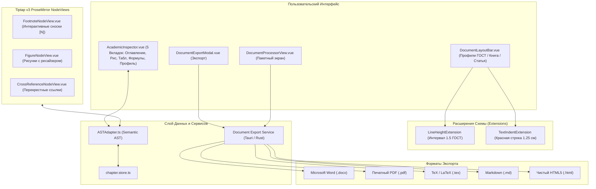
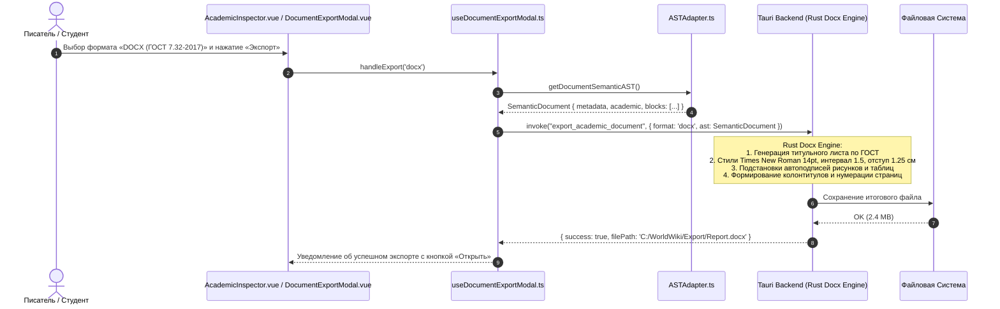

# apps/spa/src/ts/features/documents — Архитектура Академических Документов, ГОСТ-Стандартов и Экспорта

> **Назначение**: Комплексная подсистема академического оформления, ГОСТ-стандартизации (ГОСТ 7.32-2017, ГОСТ 7.0.5-2008), динамических узлов Tiptap v3 и экспорта документов в WorldWiki. Включает 5-вкладочный инспектор структуры (`AcademicInspector`), компилятор и модальное окно экспорта Semantic AST (`DocumentExportModal`), панель пресетов верстки (`DocumentLayoutBar`), экран пакетной обработки (`DocumentProcessor`), а также специализированные ProseMirror NodeViews (сноски, рисунки, перекрестные ссылки) и расширения форматирования (межстрочный интервал, красная строка).

---

## 📁 Структура папок и файлов

```
apps/spa/src/ts/features/documents/
├── README_Documents.md                 # Данная всеобъемлющая документация подсистемы документов
├── index.ts                            # Главный реэкспорт узлов, расширений и UI-компонентов
│
├── AcademicInspector/                  # Боковой 5-вкладочный инспектор структуры и ГОСТ-метаданных
│   ├── AcademicInspector.vue           # UI инспектора: Оглавление, Рисунки, Таблицы, Формулы, Профиль
│   ├── AcademicInspector.model.ts      # Типы и DTO инспектора: InspectorItem, HeadingItem, FigureItem
│   ├── useAcademicInspector.ts         # Composable сбора дерева документа, прыжков к узлам и генерации ссылок
│   └── __tests__/                      # Тесты useAcademicInspector.spec.ts
│
├── DocumentExportModal/                # Модальное окно компиляции и экспорта Semantic AST
│   ├── DocumentExportModal.vue         # Диалог выбора формата (DOCX, PDF, LaTeX, Markdown, HTML)
│   ├── DocumentExportModal.model.ts    # Пропсы и события окна экспорта
│   ├── useDocumentExportModal.ts       # Composable вызова сервисов компиляции через Tauri IPC
│   └── __tests__/                      # Тесты useDocumentExportModal.spec.ts
│
├── DocumentLayoutBar/                  # Тулбар профилей оформления документа
│   ├── DocumentLayoutBar.vue           # Селектор профилей: ГОСТ 7.32, Книга, Научная статья, Custom
│   ├── DocumentLayoutBar.model.ts      # Модель панели макета
│   ├── useDocumentLayoutBar.ts         # Composable применения профилей к активному редактору
│   └── __tests__/                      # Тесты useDocumentLayoutBar.spec.ts
│
├── DocumentProcessor/                  # Экран пакетной обработки и конвертации документов
│   ├── DocumentProcessorView.vue       # Рабочий стол валидатора, очереди документов и пакетного конвертера
│   ├── DocumentProcessor.model.ts      # Модель процессора документов и статусов очереди
│   ├── useDocumentProcessor.ts         # Composable оркестрации очереди обработки и валидации
│   └── __tests__/                      # Тесты useDocumentProcessor.spec.ts
│
├── nodes/                              # Специализированные NodeViews для Tiptap v3 (WYSIWYG)
│   ├── index.ts                        # Реестр и фабрики Tiptap NodeViews
│   ├── FootnoteNode/                   # Интерактивная сноска внизу страницы / текста
│   │   ├── FootnoteNodeView.vue        # Шаблон: надстрочный бейдж [N] + всплывающий поповер редактирования
│   │   ├── FootnoteNodeView.model.ts   # Пропсы и события сноски
│   │   └── useFootnoteNodeView.ts      # Composable управления текстом сноски и открытием попапа
│   ├── FigureNode/                     # Рисунок с ГОСТ-подписью «Рисунок N — Название»
│   │   ├── FigureNodeView.vue          # Шаблон: центрированное изображение, ресайзер и строка подписи
│   │   ├── FigureNodeView.model.ts     # Пропсы и атрибуты рисунка (src, width, caption, alignment)
│   │   └── useFigureNodeView.ts        # Composable drag-ресайза картинки и обновления атрибутов узла
│   └── CrossReference/                 # Перекрестная ссылка на рисунок, таблицу или главу
│       ├── CrossReferenceNodeView.vue  # Кликабельный бейдж с автоподстановкой номера цели (Рис. 1, Табл. 2)
│       ├── CrossReferenceNodeView.model.ts # Модель перекрестной ссылки (targetId, targetType, label)
│       └── useCrossReferenceNodeView.ts # Composable резолва цели и детекции битых ссылок (isBroken)
│
└── extensions/                         # Расширения форматирования абзацев и символов
    ├── index.ts                        # Реестр расширений Tiptap
    ├── LineHeightExtension.ts          # Межстрочный интервал (1.0, 1.15, 1.5 ГОСТ, 2.0)
    ├── TextIndentExtension.ts          # Абзацный отступ / красная строка (1.25 см ГОСТ)
    └── __tests__/                      # Тесты расширений LineHeightExtension / TextIndentExtension
```

---

## 🏛️ Архитектурная модель Document Engine



---

## 🔄 Жизненный цикл экспорта и компиляции документа (Sequence Diagram)



---

## 📑 Вкладки Инспектора Документа (`AcademicInspector`)

Инспектор располагается в правой панели рабочего стола и обеспечивает сквозную навигацию и контроль целостности рукописи:

### 1. Вкладка «📑 Оглавление» (`toc`)
* Строит иерархическое дерево всех заголовков документа ($H_1 \dots H_6$).
* Вычисляет строгие номера разделов по ГОСТ: `1`, `1.1`, `1.1.1`.
* Клик по элементу выполняет плавный скролл редактора к целевому узлу (`jumpToNode(id)`).
* Кнопка `+ Ссылка` автоматически вставляет в позицию каретки инлайн-узел `CrossReferenceNode` с текстом *«см. раздел 1.2»*.

### 2. Вкладка «🖼️ Рисунки» (`figures`)
* Сканирует документ на наличие узлов `FigureNode`.
* Отображает превью, номер `Рис. N` и подпись.
* Позволяет быстро переместиться к иллюстрации или вставить в текст ссылку *«(см. рисунок N)»*.

### 3. Вкладка «📊 Таблицы» (`tables`)
* Формирует динамический реестр всех таблиц документа.
* Показывает заголовки таблиц, вычисляет номера `Табл. N` и предоставляет действие быстрой вставки перекрестной ссылки.

### 4. Вкладка «∑ Формулы» (`equations`)
* Реестр вынесенных математических формул LaTeX (`EquationNode`).
* Отображает номер уравнения `(N)` и TeX-формулу, позволяя сослаться на уравнение в тексте главы.

### 5. Вкладка «⚙️ Профиль» (`profiles`)
* Переключение активного профиля оформления (ГОСТ 7.32, Книга, ВАК / IEEE, Custom).
* Инспектор полей титульного листа: вуз, кафедра, тип работы, группа, научный руководитель, город, год.

---

## 🧩 Спецификация NodeViews (Tiptap v3)

### 1. `FootnoteNode` (Интерактивные сноски)
* **DOM**: `<sup class="ww-footnote-badge">[{{ footnoteNumber }}]</sup>`
* **Поповер**: При клике на бейдж открывается плавающее окно ввода текста сноски.
* **Рендер**: При экспорте в DOCX/PDF текст автоматически выносится в нижний колонтитул соответствующей страницы.

### 2. `FigureNode` (Иллюстрации с подписью)
* **Атрибуты узла**: `{ id: string, src: string, caption: string, width: string, alignment: 'left' | 'center' | 'right' }`.
* **Интерактивный ресайз**: Правый угловой манипулятор `.ww-figure-resizer` перехватывает `mousedown` и вычисляет ширину картинки в реальном времени.
* **Подпись**: Инпут `.ww-figure-caption-input` обновляет атрибут `caption` без перезагрузки узла.

### 3. `CrossReferenceNode` (Перекрестные ссылки)
* **Атрибуты узла**: `{ targetId: string, targetType: 'heading' | 'figure' | 'table' | 'equation', customLabel?: string }`.
* **Авторезолв**: Узел на лету находит целевой объект в документе и рендерит актуальный номер (например, *«Рисунок 3»*).
* **Защита от битых ссылок**: Если целевой рисунок был удален, бейдж окрашивается в красный цвет со статусом `isBroken: true` (*«[!] Ссылка не найдена»*).

---

## 🧮 Типографика и математика форматирования (ГОСТ 7.32-2017)

### 1. Формулы преобразования метрик шрифта и отступов
$$\text{Indent}_{\text{px}} = \text{Indent}_{\text{cm}} \times \frac{96}{2.54} \approx 1.25\text{ см} \times 37.795 \approx 47.24\text{ px}$$
$$\text{FontSize}_{\text{px}} = \text{FontSize}_{\text{pt}} \times \frac{96}{72} \approx 14\text{ pt} \times 1.333 \approx 18.66\text{ px}$$

### 2. Профили оформления (`DocumentLayoutBar`)
| Параметр | ГОСТ 7.32 (Отчет / ВКР) | Художественная Книга | Научная статья (ВАК) |
|---|---|---|---|
| **Гарнитура шрифта** | Times New Roman | Garamond / Georgia | Arial / Inter |
| **Кегль (Font Size)** | `14 pt` | `11 pt` | `10 pt` |
| **Межстрочный интервал** | `1.5` (Lines) | `1.15` (Lines) | `1.0` (Lines, 2 колонки) |
| **Красная строка** | `1.25 см` | `0.8 см` | `0.5 см` |
| **Выравнивание** | По ширине (Justify) | По ширине (Justify) | По ширине (Justify) |
| **Поля (Л / П / В / Н)** | `30 / 15 / 20 / 20 мм` | `20 / 20 / 20 / 20 мм` | `15 / 15 / 15 / 15 мм` |

---

## ⚠️ Важные нюансы реализации (Gotchas & Best Practices)

1. **Изоляция Tiptap v3 NodeViews от Tiptap v2 (Word Mode)**:
   * NodeViews из папки `nodes/` работают исключительно в основном WYSIWYG-редакторе SPA (Tiptap v3).
   * При переключении в Word-режим пакет `@worldwiki/word-vibe` использует собственные легковесные V2-расширения, взаимодействуя с SPA исключительно через промежуточный `ASTAdapter`.
2. **Атомарная валидация очереди в `DocumentProcessor`**:
   * При пакетной конвертации очереди документов каждый файл изолированно валидируется на соответствие ГОСТ-профилю. Ошибки форматирования в одном документе не прерывают обработку остальных файлов.

---

## 🧪 Верификация и тестирование

Запуск тестового набора академических документов:
```bash
# 1. Тесты 5-вкладочного инспектора структуры
pnpm test apps/spa/src/ts/features/documents/AcademicInspector

# 2. Тесты модального окна экспорта и вызовов Tauri
pnpm test apps/spa/src/ts/features/documents/DocumentExportModal

# 3. Тесты панели пресетов макета и расширений форматирования
pnpm test apps/spa/src/ts/features/documents/DocumentLayoutBar
pnpm test apps/spa/src/ts/features/documents/extensions

# 4. Тесты процессора пакетной обработки
pnpm test apps/spa/src/ts/features/documents/DocumentProcessor
```
