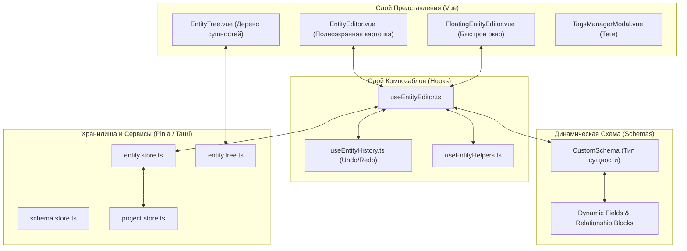
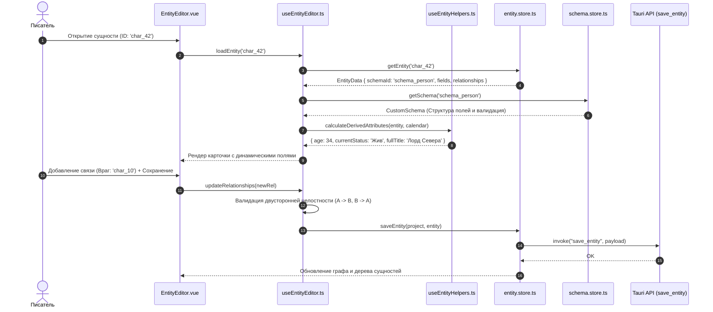

# apps/spa/src/ts/features/entities — Архитектура Сущностей и Карточек Мира

> **Назначение**: Базовая база знаний и энциклопедия лора WorldWiki. Управляет всеми сущностями вымышленного мира (персонажами, локациями, фракциями, артефактами, магическими системами, историческими эпохами, технологиями и бестиарием), их динамическими атрибутами на основе схем, связями, биографиями, галереями и временными линиями изменений.

---

## 📁 Структура папок и файлов

```
apps/spa/src/ts/features/entities/
├── README_Entities.md                  # Данная всеобъемлющая документация подсистемы сущностей
│
├── components/                         # Декомпозированные компоненты
│   ├── modals/                         # Модальные и плавающие окна
│   │   ├── FloatingEntityEditor/       # Плавающее окно быстрого редактирования (Vue, Composable, Model, Spec)
│   │   ├── TagsManagerModal/           # Менеджер тегов проекта (Vue, Composable, Model, Spec)
│   │   └── CreateEntityModal/          # Модалка создания сущности (Vue, Composable, Model, Spec)
│   └── ...
│
├── CharacterJourney/                   # Инспектор пути персонажа и хронологии встреч
│   ├── CharacterJourney.vue
│   ├── useCharacterJourney.ts
│   ├── CharacterJourney.model.ts
│   ├── components/                     # Атомарные элементы таймлайна пути
│   └── composables/                    # Композаблы фильтрации и хронологии пути
│
└── EntityEditor/                       # Главный полноэкранный редактор карточки сущности
    ├── EntityEditor.vue                # UI карточки: шапка (аватар, имя, теги), динамические поля, граф связей
    ├── EntityEditor.model.ts           # Интерфейс пропсов и эмиттов EntityEditor
    ├── useEntityEditor.ts              # Главный Composable: загрузка сущности по ID, автосохранение, валидация по схеме
    ├── components/                     # Подвиджеты (LocationAstronomyWidget, EntityHistoryBanner)
    ├── composables/                    # Вспомогательные композаблы карточки сущности
    │   ├── entityConfigLoader.utils.ts # Утилиты загрузки конфигураций
    │   ├── useEntityConfigLoader.ts    # Загрузка и резолв референсных данных
    │   ├── useEntityDynamicOps.ts      # Сворачивание и разворачивание динамических блоков
    │   ├── useEntityHelpers.ts         # Форматирование полей, вычисление возраста, титулов, статусов
    │   ├── useEntityHiddenConfig.ts    # Управление скрытыми полями
    │   ├── useEntityHistory.ts         # Стек Undo / Redo изменений атрибутов карточки
    │   ├── useEntityPhoto.ts           # Загрузка и кэширование аватаров
    │   └── __tests__/                  # Юнит-тесты композаблов карточки
    └── __tests__/                      # Тесты useEntityEditor
```

---

## 🏛️ Архитектурная модель данных



---

## 🔄 Жизненный цикл сущности и связей (Sequence Diagram)



---

## 🧮 Вычисляемые атрибуты сущностей (Derived Lore Mathematics)

### 1. Расчёт возраста и дат жизни по Календарю Мира
Для сущностей с полями `birthDate` и `deathDate` возраст на момент активной главы $M_{\text{chapter}}$ вычисляется через абсолютные минуты:

$$\text{Age}(M_{\text{chapter}}) = \begin{cases} 
\text{Не родился}, & \text{если } M_{\text{chapter}} < M_{\text{birth}} \\
\lfloor (M_{\text{chapter}} - M_{\text{birth}}) / T_{\text{year\_mins}} \rfloor, & \text{если } M_{\text{birth}} \le M_{\text{chapter}} \le M_{\text{death}} \\
\text{Погиб в возрасте } \lfloor (M_{\text{death}} - M_{\text{birth}}) / T_{\text{year\_mins}} \rfloor, & \text{если } M_{\text{chapter}} > M_{\text{death}}
\end{cases}$$

### 2. Двусторонняя согласованность связей (Relationship Graph Matrix)
Отношение между сущностями $A$ и $B$ описывается ориентированным ребром с комплементарным типом:
$$R(A \xrightarrow{\text{type}} B) \implies R(B \xrightarrow{\text{inverse(type)}} A)$$

| Прямой тип ($A \to B$) | Обратный тип ($B \to A$) | Симметрия |
|---|---|---|
| **Родитель (Parent)** | **Ребёнок (Child)** | Асимметричная |
| **Союзник (Ally)** | **Союзник (Ally)** | Симметричная |
| **Враг (Enemy)** | **Враг (Enemy)** | Симметричная |
| **Правитель (Ruler)** | **Подданный (Subject)** | Асимметричная |
| **Создатель (Creator)** | **Творение (Creation)** | Асимметричная |

---

## 🧩 Ключевые возможности и подсистемы

### 1. Схемно-ориентированная структура (Schema-Driven)
Каждая сущность базируется на пользовательской схеме (`schemaId`):
* Персонаж получает поля: *Имя, Титул, Раса, Возраст, Дата рождения, Отношения, Характер, Биография*.
* Локация получает поля: *Тип местности, Климат, Правитель, Население, Координаты на карте, Карта*.
* Значения полей сериализуются в универсальный словарь `fields: Record<string, unknown>`.

### 2. Динамические связи и отношения (`Relationships`)
* Двусторонние и направленные связи с автодополнением и быстрой фильтрацией.
* Автоматическая поддержка согласованности связей между сущностями при переименовании и удалении.

### 3. Floating Entity Editor (Плавающая карточка)
* Позволяет писателю редактировать или просматривать карточку сущности прямо во время написания главы, кликнув на упоминание сущности `((Сущность))`.
* Не нарушает фокус ввода в редакторе рукописи.

### 4. Менеджер тегов (`TagsManagerModal`)
* Цветовое кодирование тегов для быстрой визуальной классификации в дереве и на графе связей.
* Пакетное переименование и слияние дублирующихся тегов по всему проекту.

---

## ⚠️ Важные нюансы реализации (Gotchas & Best Practices)

1. **Каскадная очистка связей**:
   * При удалении сущности $A$ хук `useEntityEditor` автоматически удаляет все входящие ребра $X \to A$ из других сущностей, предотвращая появление битых ссылок (Dangling References).
2. **Защита от циклических зависимостей в графе**:
   * При построении генеалогических деревьев и иерархий подчинения алгоритм обхода использует `Set<string>` посещенных узлов для предотвращения зацикливания.
3. **Оптимистичный Undo/Redo стек (`useEntityHistory`)**:
   * Изменения накапливаются в стеке с дебаунсом в 300 мс. При нажатии `Ctrl+Z` восстанавливается точный снимок `fields` и `relationships`.

---

## 🧪 Верификация и тестирование

Запуск тестового набора сущностей:
```bash
# Тесты редактора сущностей
pnpm test apps/spa/src/ts/features/entities/EntityEditor

# Тесты хуков истории и хелперов
pnpm test apps/spa/src/ts/features/entities/EntityEditor/hooks

# Тесты плавающего окна и тегов
pnpm test apps/spa/src/ts/features/entities
```
