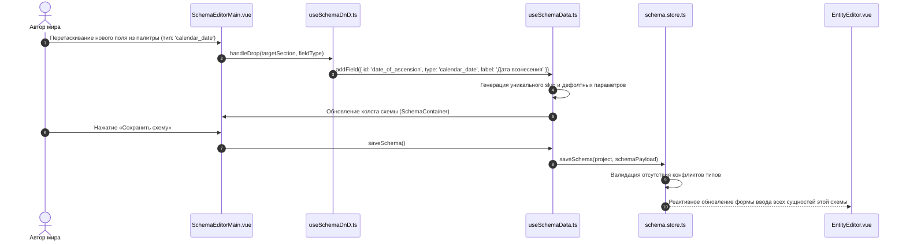

# apps/spa/src/ts/features/schemas — Архитектура Конструктора Схем и Типов Сущностей

> **Назначение**: Мета-моделирование и конструктор типов данных (Schema Studio) в WorldWiki. Позволяет проектировать любые пользовательские шаблоны и типы сущностей мира (Персонаж, Локация, Заклинание, Артефакт, Фракция, Звездная система), настраивать валидацию полей, визуальные модули, структуру связей, шаблоны отношений и привязку временных точек рукописи.

---

## 📁 Структура папок и файлов

```
apps/spa/src/ts/features/schemas/
├── README_Schemas.md                   # Данная всеобъемлющая документация конструктора схем
├── SchemaEditorMain.vue                # Главный экран конструктора: список схем, палитра полей, холст
├── useSchemaEditorMain.ts              # Composable верхнего уровня: создание, дублирование, удаление, сохранение
├── SchemaEditorMain.model.ts           # DTO, Props, Emits главного экрана
├── __tests__/                          # Тесты главного координатора
│   └── useSchemaEditorMain.spec.ts
│
├── types/                              # Строгая TypeScript-типизация
│   └── schemaReference.types.ts        # Интерфейсы справочных данных и связей
│
├── utils/                              # Вспомогательные функции
│   └── schemaReferenceMatcher.ts       # Утилиты сопоставления типов и опций
│
├── composables/                        # Специализированные сервисные композаблы
│   ├── useAvailableEntityTypes.ts      # Загрузка и агрегация доступных типов сущностей (SurrealDB + System)
│   ├── useModuleReferenceData.ts       # Справочные данные и типы модулей
│   ├── useSchemaData.ts                # Управление реактивным объектом схемы, клонирование, сохранение
│   ├── useSchemaDnD.ts                 # Drag & Drop сортировка полей и секций
│   ├── useSchemaHistory.ts             # Стек Undo / Redo правок схемы
│   ├── useSchemaTemplates.ts           # Библиотека готовых шаблонов (Фэнтези, Sci-Fi, Детектив, ГОСТ)
│   └── __tests__/                      # Юнит-тесты композаблов
│
└── components/                         # UI-компоненты конструктора схем
    ├── canvas/                         # Рабочая область
    │   ├── SchemaContainer/            # Контейнер визуального отображения и упорядочивания секций
    │   └── SchemaFieldEditor/          # Инспектор настройки конкретного поля (тип, валидация, дефолт)
    ├── help/                           # Интерактивная справка и предпросмотр
    │   ├── ModuleHelpPreview/          # Превью карточки
    │   ├── ModuleHelpBidiCard/         # Карточка двусторонних отношений
    │   └── ModuleHelpDynamicCard/      # Карточка динамических модулей
    ├── sidebar/                        # Боковые панели
    │   ├── SchemaCatalogSidebar/       # Каталог типов полей и палитра
    │   └── SchemaHistoryDrawer/        # Панель истории версий схемы
    └── toolbar/                        # Верхняя панель управления
        └── SchemaEditorToolbar/        # Кнопки сохранения, экспорта, истории и превью
```

---

## 🏛️ Архитектурная модель Schema Engine

```mermaid
flowchart TD
    subgraph UI_Studio ["Конструктор Схем (Schema Studio)"]
        Main["SchemaEditorMain.vue"]
        Palette["Палитра типов полей (Text, Number, Date, Select, Relation)"]
        Container["SchemaContainer.vue (Рабочий холст)"]
        Inspector["SchemaFieldEditor.vue (Свойства поля)"]
        RelBlock["RelationshipBlock.vue (Матрица связей)"]
        Preview["ModuleHelpPreview.vue (Живое превью)"]
    end

    subgraph Logic_Hooks ["Служебные Composable"]
        DataHook["useSchemaData.ts (State & Save)"]
        DnDHook["useSchemaDnD.ts (Drag & Drop)"]
        HistHook["useSchemaHistory.ts (Undo / Redo)"]
        TplHook["useSchemaTemplates.ts (Шаблоны миров)"]
    end

    subgraph Consumer_Features ["Потребители Схем в WorldWiki"]
        EntityCard["EntityEditor.vue (Карточки сущностей)"]
        TimelineCalc["Timeline / Calendar System"]
        ManuscriptPicker["ManuscriptPointPicker (Привязка сцен)"]
    end

    subgraph Store_Layer ["Хранилища (Pinia)"]
        SchemaStore["schema.store.ts"]
        EntityStore["entity.store.ts"]
    end

    Main --> Container
    Main --> Palette
    Main --> Inspector
    Container --> RelBlock
    Main --> Preview

    Main <--> DataHook
    Container <--> DnDHook
    Main <--> HistHook
    Main <--> TplHook

    DataHook <--> SchemaStore
    SchemaStore --> EntityCard
    SchemaStore --> TimelineCalc
    ManuscriptPicker <--> TimelineCalc
```



---

## 🔄 Жизненный цикл проектирования схемы и синхронизации (Sequence Diagram)



---

## 🧮 Математика и структуры данных схемы (Schema Data Specification)

### 1. Спецификация структуры схемы
$$\text{CustomSchema} = \{ \text{id}, \text{name}, \text{icon}, \text{color}, \text{sections}: \text{SchemaSection}[], \text{allowedRelationships}: \text{RelationRule}[] \}$$

Каждая секция $\text{SchemaSection}$ содержит упорядоченный список полей:
$$\text{SchemaSection} = \{ \text{id}, \text{title}, \text{fields}: \text{CustomField}[] \}$$

$$\text{CustomField} = \begin{cases}
\text{id}: \text{string} \quad (\text{уникальный идентификатор атрибута}) \\
\text{type}: \text{FieldType} \\
\text{label}: \text{string} \quad (\text{человекочитаемое имя}) \\
\text{validation}?: \{ \text{required}?: \mathbb{B}, \text{min}?: \mathbb{R}, \text{max}?: \mathbb{R}, \text{regex}?: \text{string} \} \\
\text{options}?: \text{FieldOption}[] \quad (\text{для списков select / radio}) \\
\text{defaultValue}?: \text{unknown}
\end{cases}$$

### 2. Алгоритм безопасной миграции данных сущностей при правке схемы
При добавлении, переименовании или удалении полей в схеме существующие данные сущностей обрабатываются без потерь:
$$\text{EntityFields}_{\text{migrated}} = \text{Merge}(\text{EntityFields}_{\text{old}}, \text{SchemaDefaults})$$
* Новые поля получают `defaultValue` из схемы.
* Удаленные из схемы поля помечаются как `orphaned`, но не удаляются из базы данных автоматически, защищая автора от случайной потери текста биографии или заметок.

---

## 🧩 Поддерживаемые типы полей схемы

| Тип поля | Идентификатор | Описание и валидация |
|---|---|---|
| **Текст** | `'text' / 'textarea'` | Строковое значение, валидация длины, регулярные выражения, форматирование |
| **Число** | `'number'` | Целые и дробные числа, диапазон `min`/`max`, единицы измерения (кг, км, кредиты) |
| **Дата мира** | `'calendar_date'` | Привязка к авторским календарям WorldWiki (год, месяц, день, время) |
| **Выбор** | `'select' / 'multiselect'` | Одиночный или множественный выбор из настраиваемого списка вариантов |
| **Связь** | `'entity_relation'` | Ссылка на другую сущность с выбором типа отношения (*союзник, создатель, правитель*) |
| **Флаг** | `'boolean'` | Логическое значение (*Жив/Мертв, Канон/Легенда*) |
| **Медиа** | `'image' / 'gallery'` | Загрузка аватаров, гербов, карт, схем артефактов |
| **Таймлайн-точка** | `'timeline_point'` | Привязка момента появления/изменения сущности к рукописи (`ManuscriptPointPicker`) |

---

## 🎯 Библиотека готовых шаблонов (`useSchemaTemplates`)

Конструктор включает встроенные готовые пресеты типов сущностей:
1. **Фэнтези-сеттинг**: *Персонаж (раса, класс, магия), Локация (биомы, безопасность), Артефакт (зачарование, прочность)*.
2. **Sci-Fi / Космоопера**: *Звездная система (спектральный класс, планеты), Корабль (двигатель, экипаж, вооружение), Корпорация*.
3. **Детектив / Исторический**: *Улика, Подозреваемый (алиби, мотив), Событие преступления*.
4. **Академический стандарт (ГОСТ)**: *Научная работа, Рукопись, Структура отчета*.

---

## ⚠️ Важные нюансы реализации (Gotchas & Best Practices)

1. **Изоляция ID полей**:
   * Идентификаторы полей (`field.id`) формируются в `snake_case` и блокируются от изменения после сохранения схемы, чтобы не нарушать связи в созданных сущностях.
2. **Интеграция с `ManuscriptPointPicker`**:
   * При выборе точки в рукописи пикер транслирует индекс главы и сцены в абсолютную временную точку на глобальном таймлайне проекта, автоматически создавая веху истории.
3. **Drag & Drop без потери фокуса**:
   * Сортировка полей в `useSchemaDnD` использует `HTML5 Drag and Drop API` с предварительным расчетом смещения, предотвращая мерцание инспекторов свойств.

---

## 🧪 Верификация и тестирование

Запуск тестового набора конструктора схем:
```bash
# Тесты конструктора схем и компонентов
pnpm test apps/spa/src/ts/features/schemas/SchemaEditor

# Тесты хуков данных, истории и шаблонов
pnpm test apps/spa/src/ts/features/schemas/SchemaEditor/hooks

# Тесты пикера точек рукописи
pnpm test apps/spa/src/ts/features/schemas/SchemaEditor/ManuscriptPointPicker
```
