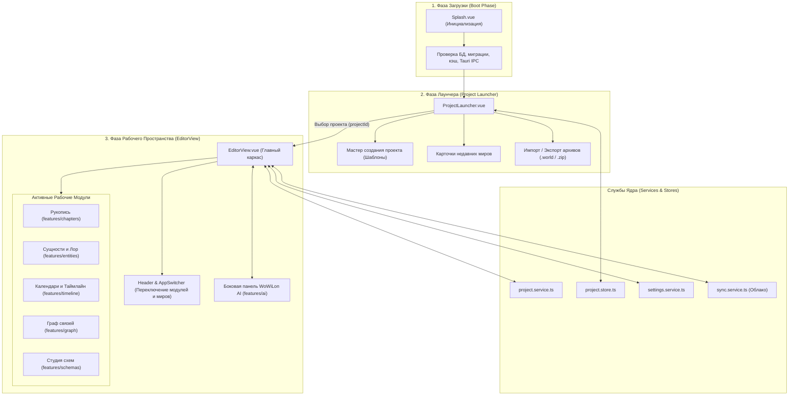
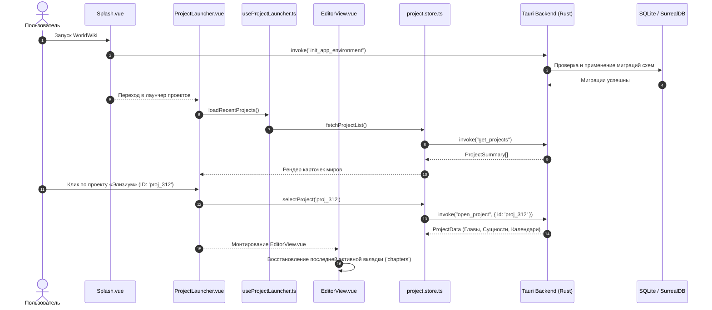

# apps/spa/src/ts/features/shell — Архитектура Оболочки и Лаунчера Проектов

> **Назначение**: Корневой каркас рабочего пространства приложения WorldWiki. Управляет начальной загрузкой (`Splash`), стартовым экраном создания и управления вселенными/проектами (`ProjectLauncher`), главным окном редактора (`EditorView`) с координацией навигационных модулей (Рукопись, Сущности, Календари, Граф связей, WoWiLon AI), горячими клавишами глобального уровня и переключением проектов (`AppSwitcher`).

---

## 📁 Структура папок и файлов

```
apps/spa/src/ts/features/shell/
├── README_Shell.md                     # Данная всеобъемлющая документация архитектуры оболочки
├── EditorView.vue                      # Главный полноэкранный рабочий каркас (Header, Navigation, Workspace, AI Sidebar)
├── EditorView.vue.ts                   # Логика оркестрации EditorView: вкладки, горячие клавиши, модалки
├── useEditorViewListeners.ts           # Слушатели IPC и глобальных событий
├── useEditorViewListeners.spec.ts      # Тесты слушателей EditorView
│
└── components/                         # Декомпозированные компоненты оболочки
    ├── launcher/                       # Лаунчер проектов
    │   └── ProjectLauncher/            # Компонент лаунчера, хуки, константы и тесты
    ├── splash/                         # Экран загрузки
    │   └── Splash/                     # Сплэш-скрин загрузки приложения и логика инициализации
    └── switcher/                       # Переключатель миров
        └── AppSwitcher/                # Компактный выпадающий селектор быстрого переключения проектов
```

---

## 🏛️ Архитектурная модель оболочки (Shell Architecture)



---

## 🔄 Жизненный цикл старта приложения и открытия проекта (Sequence Diagram)



---

## 🧮 Шаблоны генерации новых миров (`ProjectTemplate`)

При создании проекта лаунчер формирует базовую структуру на основе выбранного шаблона:

$$\text{ProjectInitPayload} = \{ \text{id}, \text{name}, \text{description}, \text{templateId}, \text{initialSchemas}, \text{defaultCalendar} \}$$

| Шаблон | Идентификатор | Предустановленные схемы и структуры |
|---|---|---|
| **Чистый лист** | `'blank'` | Минимальная структура, 1 дефолтная глава, стандартный календарь (12 месяцев) |
| **Фэнтези-вселенная** | `'fantasy'` | Схемы: *Персонаж (магия, раса)*, *Локация*, *Артефакт*, *Фракция*. Календарь с 3 лунами и эпохами |
| **Sci-Fi / Космоопера** | `'scifi'` | Схемы: *Звездная система*, *Корабль*, *Корпорация*, *Технология*. Метрическое звездное время |
| **Детективный роман** | `'detective'` | Схемы: *Подозреваемый*, *Улика*, *Место преступления*. Таймлайн с поминутной сеткой алиби |
| **Академическая работа** | `'academic'` | Пресет ГОСТ 7.32-2017: Титульный лист, Введение, Главы, Заключение, Список источников |

---

## 🧩 Ключевые возможности оболочки

### 1. Splash Screen & Diagnostic Boot
* Проверяет целостность локальных баз данных, директорий кэша и доступность аппаратного ускорения WebView.
* При обнаружении поврежденных файлов предлагает режим автоматического восстановления из последнего локального бэкапа.

### 2. Управление проектами (`useProjectLauncher`)
* Создание, дублирование, архивирование и экспорт вселенной в единый сжатый файл `.world` (ZIP-контейнер с манифестом `manifest.json`, базой SQLite и каталогом медиа-ресурсов).
* Импорт существующих проектов без риска перезаписи существующих ID.

### 3. EditorView Navigation Hub
* Динамическое переключение между крупными функциональными экранами приложения с сохранением состояния каждого экрана (KeepAlive).
* Глобальный хоткей-менеджер: `Ctrl+P` (Командная палитра), `Ctrl+B` (Скрыть/показать дерево), `Ctrl+J` (Открыть WoWiLon AI).

---

## ⚠️ Важные нюансы реализации (Gotchas & Best Practices)

1. **Изоляция контекста проекта при переключении**:
   * При смене проекта в `AppSwitcher` вызывается полная очистка всех реактивных хранилищ Pinia (`chapter.store`, `entity.store`, `timeline.store`, `schema.store`) перед загрузкой данных нового мира, предотвращая утечку данных между проектами.
2. **Асинхронный экспорт больших проектов**:
   * Экспорт архива `.world` выполняется в отдельном фоновом потоке Rust через Tauri Command с эмиттом прогресса `export_progress`, не блокируя интерфейс лаунчера.

---

## 🧪 Верификация и тестирование

Запуск тестового набора оболочки:
```bash
# Тесты логики лаунчера и создания проектов
pnpm test apps/spa/src/ts/features/shell

# Тесты инициализации и переключения режимов EditorView
pnpm test apps/spa/src/ts/features/shell/__tests__
```
