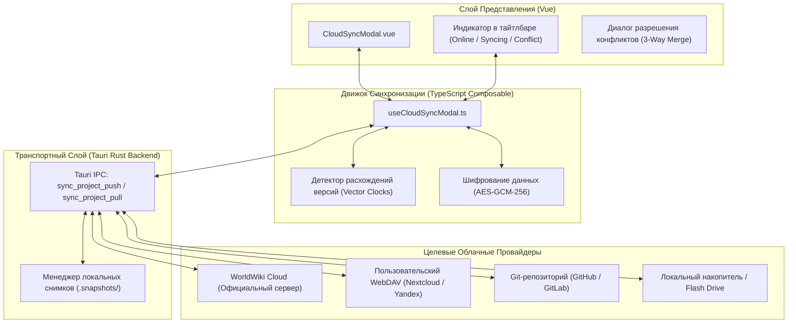
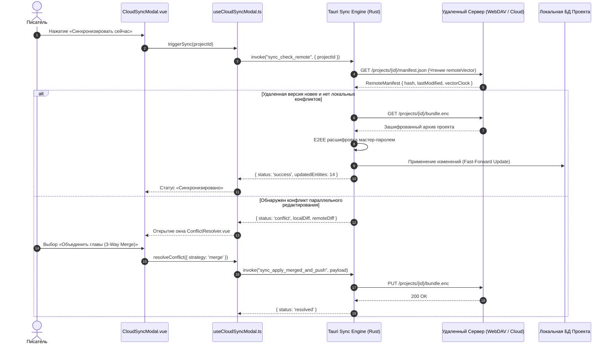

# apps/spa/src/ts/features/sync — Архитектура Облачной Синхронизации и Бэкапов

> **Назначение**: Подсистема межплатформенной синхронизации и резервного копирования проектов WorldWiki. Обеспечивает сквозную синхронизацию данных (WorldWiki Cloud, WebDAV, Git, локальные хранилища), сквозное шифрование (E2EE), трёхстороннее разрешение конфликтов (3-Way Merge) и управление снимками версий проекта (Snapshots & Backups).

---

## 📁 Структура папок и файлов

```
apps/spa/src/ts/features/sync/
├── README_Sync.md                      # Данная всеобъемлющая документация подсистемы синхронизации
├── CloudSyncModal.vue                  # Модальное окно управления облаком: статус, выбор провайдера, лог
├── useCloudSyncModal.ts                # Composable синхронизации: запуск пуша/пула, обработка конфликтов, E2E ключи
└── __tests__/                          # Юнит-тесты синхронизации (useCloudSyncModal.spec.ts)
```

---

## 🏛️ Архитектурная модель синхронизации



---

## 🔄 Жизненный цикл синхронизации и разрешения конфликтов (Sequence Diagram)



---

## 🧮 Математика версионирования и криптография

### 1. Векторные часы версий (Vector Clocks)
Для предотвращения потери правок в оффлайн-режиме каждая сущность и глава содержат кортеж версии:
$$V_{\text{doc}} = \langle \text{device\_id}: \text{counter}, \text{timestamp}, \text{sha256\_hash} \rangle$$

Определение отношения предка и конфликта:
$$V_A < V_B \iff \forall k \, V_A[k] \le V_B[k] \land \exists k \, V_A[k] < V_B[k] \quad (\text{Fast-Forward})$$
$$V_A \parallel V_B \iff \neg(V_A \le V_B) \land \neg(V_B \le V_A) \quad (\text{Конфликт версий! Требуется 3-Way Merge})$$

### 2. Сквозное шифрование (E2EE Vault)
Все данные проекта перед отправкой на сторонние серверы шифруются на стороне клиента:
$$\text{Key}_{\text{master}} = \text{Argon2id}(\text{Passphrase}, \text{Salt}_{\text{proj}}, \text{Memory}=64\text{MB}, \text{Iterations}=3)$$
$$\text{Ciphertext} = \text{AES-GCM-256}(\text{ProjectArchive}, \text{Key}_{\text{master}}, \text{IV}_{96\text{bit}})$$

---

## 🧩 Поддерживаемые провайдеры синхронизации

| Провайдер | Протокол | Ключевые особенности |
|---|---|---|
| **WorldWiki Cloud** | HTTPS REST + WebSocket | Мгновенные push-уведомления о правках соавторов, E2EE |
| **WebDAV** | WebDAV HTTP/HTTPS | Полная независимость (собственный Nextcloud, Synology, Yandex Disk) |
| **Git Backend** | SSH / HTTPS Git | Поверсионное версионирование текстовых Markdown-глав и JSON-схем |
| **Local Snapshot** | Local Filesystem / USB | Автоматическое создание снимков проекта каждые 15 минут в скрытую папку `.snapshots` |

---

## ⚠️ Важные нюансы реализации (Gotchas & Best Practices)

1. **Защита от повреждения базы при внезапном отключении сети**:
   * Скачивание удаленного пакета всегда производится во временный изолированный файл `.tmp_bundle`. Подмена рабочих файлов базы проекта происходит атомарно только после успешной верификации контрольной суммы SHA-256.
2. **Исключение тяжелых медиа-файлов при мобильной синхронизации**:
   * Текстовые данные глав и JSON-сущности имеют наивысший приоритет. Синхронизация тяжелых видео/аудио вложений в лор может быть отложена автором при медленном соединении.
3. **Безопасность мастер-пароля**:
   * Мастер-пароль шифрования никогда не сохраняется на удаленном сервере и хранится локально в системном хранилище ключей (Windows Credential Manager / macOS Keychain).

---

## 🧪 Верификация и тестирование

Запуск тестового набора синхронизации:
```bash
# Тесты Composable управления облаком и конфликтами
pnpm test apps/spa/src/ts/features/sync
```
