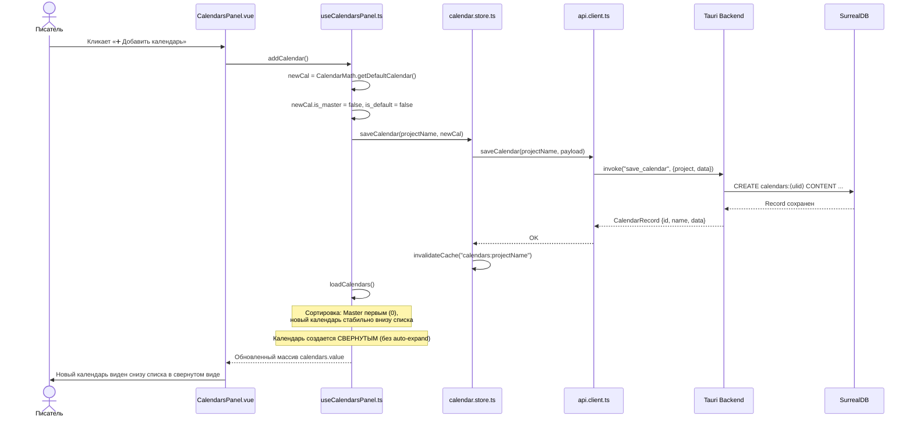
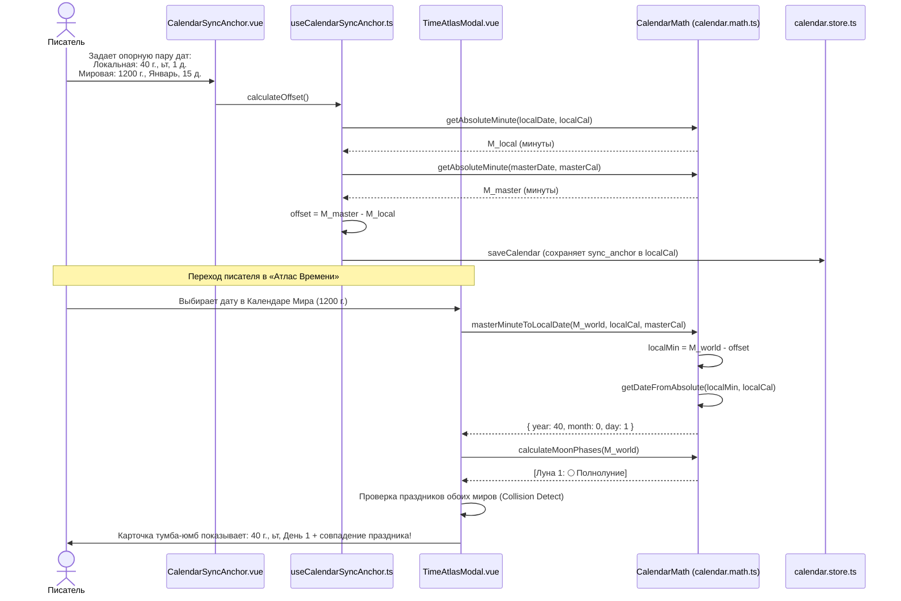
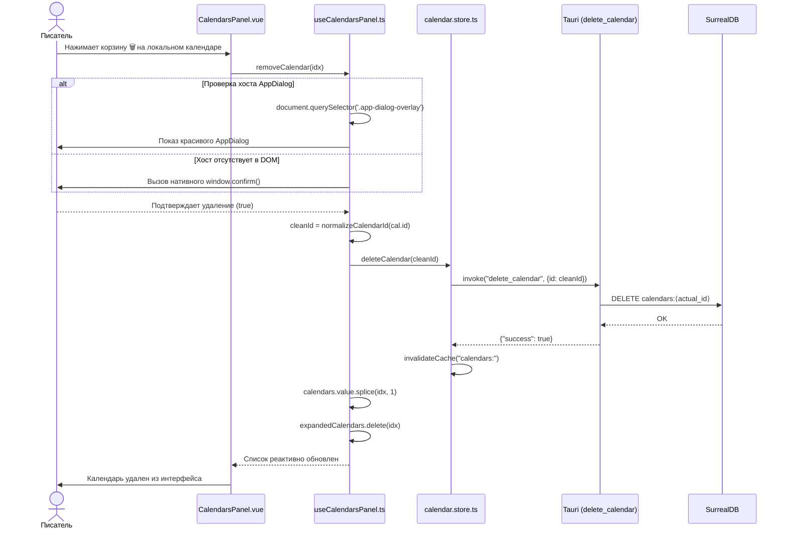

# apps/spa/src/ts/features/timeline/Calendars — Архитектура и Математика Календарей

> **Назначение**: Комплексная мультикалендарная подсистема приложения WorldWiki. Обеспечивает проектирование авторских календарей произвольной структуры (нестандартные месяцы, недели, эпохи, високосные циклы, орбитальные периоды лун, сезоны, часовые пояса), математическую синхронизацию летоисчислений культур с глобальным временем мира (Календарь Мира / Master Timeline), кросс-конвертацию дат между народами и наложение сеток в «Атласе Времени».

---

## 📁 Структура папок и файлов

```
apps/spa/src/ts/features/timeline/
├── Calendars/
│   ├── README_Calendars.md             # Данная всеобъемлющая документация архитектуры и математики
│   ├── CalendarEras/                   # Редактор эпох календаря (название, диапазон лет, обратный отсчет)
│   │   ├── CalendarEras.vue            # UI список эпох с drag/move и чекбоксом «До нашей эры»
│   │   ├── useCalendarEras.ts          # Composable: добавление, удаление, сортировка эпох
│   │   └── __tests__/                  # Юнит-тесты эпох
│   ├── CalendarHolidays/               # Редактор праздников и памятных дат
│   │   ├── CalendarHolidays.vue        # Карточки праздников (название, диапазон день/месяц начала и конца)
│   │   ├── useCalendarHolidays.ts      # Composable управления списком праздников
│   │   └── __tests__/
│   ├── CalendarLeapYear/               # Настройка високосных правил
│   │   ├── CalendarLeapYear.vue        # Выбор правила (Григорианское, Каждый 4-й год, Пользовательское, Нет)
│   │   ├── useCalendarLeapYear.ts      # Валидация високосного месяца и дня смещения
│   │   └── __tests__/
│   ├── CalendarMonths/                 # Конфигуратор месяцев года
│   │   ├── CalendarMonths.vue          # Список месяцев, длительность в днях, порядок
│   │   ├── useCalendarMonths.ts        # Composable добавления/удаления месяцев, подсчет суммы дней года
│   │   └── __tests__/
│   ├── CalendarMoons/                  # Астрономические спутники и фазы лун
│   │   ├── CalendarMoons.vue          # Настройка лун: орбитальный период в днях, начальная фаза, имена 4 фаз
│   │   ├── useCalendarMoons.ts         # Composable управления спутниками
│   │   └── __tests__/
│   ├── CalendarOrigin/                 # Точка отсчета календаря (эпоха нуля)
│   │   ├── CalendarOrigin.vue          # Настройка стартовой точки: год, месяц, день, стартовый день недели
│   │   ├── useCalendarOrigin.ts        # Composable точки отсчета
│   │   └── __tests__/
│   ├── CalendarPlayground/             # Интерактивная песочница проверки календаря
│   │   ├── CalendarPlayground.vue      # Поле ввода даты с мгновенным расчетом дня недели, лун и праздников
│   │   ├── useCalendarPlayground.ts    # Реактивный пересчет песочницы через CalendarMath
│   │   └── __tests__/
│   ├── CalendarSeasons/                # Климатические сезоны года
│   │   ├── CalendarSeasons.vue         # Привязка месяцев к сезонам (Зима, Весна, Сезон дождей и т.д.)
│   │   ├── useCalendarSeasons.ts       # Управление сезонами
│   │   └── __tests__/
│   ├── CalendarSettings/               # Суточные параметры времени
│   │   ├── CalendarSettings.vue        # Часов в сутках, минут в часе, секунд в минуте, широта планеты
│   │   ├── useCalendarSettings.ts      # Валидация суточных констант
│   │   └── __tests__/
│   ├── CalendarSyncAnchor/             # Модуль привязки летоисчисления к Календарю Мира
│   │   ├── CalendarSyncAnchor.vue      # UI спаривания даты локального календаря с датой эталона
│   │   ├── useCalendarSyncAnchor.ts    # Расчет смещения Delta в минутах и днях, валидация привязки
│   │   └── __tests__/
│   ├── CalendarTimezones/              # Региональные часовые пояса
│   │   ├── CalendarTimezones.vue       # Таблица зон со смещением в минутах относительно нулевого меридиана
│   │   ├── useCalendarTimezones.ts     # Добавление и редактирование таймзон
│   │   └── __tests__/
│   ├── CalendarWeekdays/               # Дни недели
│   │   ├── CalendarWeekdays.vue        # Количество дней в неделе и их авторские наименования
│   │   ├── useCalendarWeekdays.ts      # Управление структурой недели
│   │   └── __tests__/
│   ├── GlobalCalendarWidget/           # Виджет текущего дня рукописи над проводником
│   │   ├── GlobalCalendarWidget.vue    # Glassmorphism-панель: дата, день недели, луны, праздники, кнопки ◀ ▶
│   │   ├── useGlobalCalendarWidget.ts  # Реактивная синхронизация с датой активной главы рукописи
│   │   └── __tests__/
│   ├── GlobalTimeViewer/               # Инспектор мирового абсолютного времени
│   │   ├── GlobalTimeViewer.vue        # Отображение времени в шкалах всех календарей одновременно
│   │   ├── useGlobalTimeViewer.ts      # Синхронный опрос времени
│   │   └── __tests__/
│   ├── TimeAtlas/                      # «Атлас Времени» (модальный супер-инструмент писателя)
│   │   ├── TimeAtlasModal.vue          # 3 вкладки: «Мост Времени», «Сетка Месяца», «Датировки для Текста»
│   │   ├── useTimeAtlasModal.ts        # Кросс-календарная конвертация, детекция совпадений лун/праздников
│   │   └── __tests__/
│   └── TimelinePanel/                  # Панель исторических событий таймлайна
│       ├── TimelinePanel.vue           # Хронологический список событий с фильтрацией по эпохам
│       ├── useTimelinePanel.ts         # Сортировка событий по абсолютной шкале минут
│       └── __tests__/
│
├── CalendarsPanel/                     # Панель реестра календарей (в Настройках Проекта)
│   ├── CalendarsPanel.vue              # Карточки календарей (Календарь Мира закреплен сверху, кнопка добавления)
│   ├── useCalendarsPanel.ts            # Загрузка, добавление в конец, удаление, сохранение всех
│   └── __tests__/
│
└── UniversalDatePicker/                # Универсальный контрол выбора даты для сущностей и глав
    ├── UniversalDatePicker.vue         # Дропдаун с выбором календаря, эпохи, года, месяца, дня
    └── useUniversalDatePicker.ts       # Синхронизация CalendarDate
```

### Связанные сервисы и хранилища (Core Layer)
```
apps/spa/src/ts/
├── services/Calendars/
│   ├── calendar.math.ts                # TypeScript ядро математики календаря (зеркало Rust-модуля)
│   ├── calendar.types.ts               # DTO интерфейсы: CalendarData, SyncAnchor, MoonConfig, DaylightResult
│   └── timeline-panel.ts               # Мост связи событий с главами
│
└── stores/
    └── calendar.store.ts               # Pinia Store: CRUD календарей, кэширование, normalizeCalendarId

src-tauri/src/logic/
├── models.rs                           # Определение сущности Calendar (таблица calendars в SurrealDB)
└── calendar_math.rs                    # Ядро математики на Rust (64-битные вычисления, Tauri команды)
```

---

## 🪓 Архитектурные соглашения подсистемы календарей

1. **Принцип эталона (Master Timeline Invariant)**:
   В каждом проекте обязан существовать ровно один эталонный календарь — **Календарь Мира (`is_master = true`)**. Он объявляется физической осью времени вселенной. Все локальные календари культур («тумба-юмб», «эльфов», «кочевников») привязываются к нему через смещение эпох `sync_anchor`.
2. **Базовая единица измерения — Абсолютная Минута Мира ($M_{\text{abs}}$)**:
   Все операции сравнения событий, упорядочивания глав, детекции праздников и кросс-конвертации производятся в целых 64-битных числах минут (`i64`), отсчитываемых от $00:00$ дня $1$ месяца $0$ года $1$ Календаря Мира.
3. **Хронологическая стабильность списков**:
   Календарь Мира жестко закреплен на нулевом индексе (`index: 0`). Все остальные локальные календари добавляются строго в конец списка (хронологический порядок создания). Новые календари создаются свернутыми, чтобы не загромождать интерфейс.
4. **Санитизация идентификаторов (SurrealDB 2.x Thing Cleanliness)**:
   Любой ID календаря перед отправкой в Rust или сохранением в Pinia нормализуется утилитой `normalizeCalendarId()` в чистую строку вида `calendars:0195...` (без объектов `{tb, id}`, кавычек и системных скобок `⟨⟩`).
5. **Изоляция и дублирование математики (Rust ↔ TS)**:
   Алгоритмы `CalendarMath` реализованы зеркально: в TypeScript (`calendar.math.ts`) для мгновенного отклика UI без IPC-задержек, и в Rust (`calendar_math.rs`) для тяжелых серверных выборок, валидации и фонового RAG-индексирования глав.

---

## 📄 Детальное описание каждого файла подсистемы

---

### `features/timeline/CalendarsPanel/useCalendarsPanel.ts`
**Назначение**: Управление списком календарей проекта внутри модального окна настроек проекта (`ProjectLauncher`).
- **Ключевые функции**:
  - `loadCalendars()` — загружает список календарей из Pinia `calendar.store`, гарантирует сортировку (Календарь Мира на индексе 0, локальные календари сохраняют порядок добавления внизу).
  - `addCalendar()` — создает новый календарь со свернутым состоянием, сохраняет в SurrealDB и добавляет в конец списка.
  - `saveCalendar(idx)` — сохраняет конкретный календарь с нормализацией ID.
  - `saveAll()` — последовательный батч-сейв всех открытых календарей.
  - `removeCalendar(idx)` — удаление календаря с подтверждением (с fallback на нативный диалог при отсутствии модального хоста) и удалением из SurrealDB.
  - `setDefault(idx)` — переключение активного дефолтного календаря для новых глав.
- **Зависимости**: `calendar.store`, `CalendarMath`, `@worldwiki/components`.

---

### `services/Calendars/calendar.types.ts`
**Назначение**: Полный набор DTO-интерфейсов и типов данных календаря.
- **Основные структуры**:
  - `CalendarMonth`: `{ название: string, дней: number }`
  - `CalendarEra`: `{ название: string, год_начала: number, год_конца: number, обратный_отсчет?: boolean }`
  - `CalendarTimeSettings`: `{ часов_в_сутках: number, минут_в_часе: number, секунд_в_минуте: number, широта: number, учитывать_сезонную_длительность_дня: boolean }`
  - `MoonConfig`: `{ name: string, period_days: number, initial_phase: number, phase_names?: MoonPhaseNames }`
  - `SyncAnchorDate`: `{ era_index: number, year: number, month: number, day: number, hour?: number, minute?: number }`
  - `SyncAnchor`: `{ linked_to_master: boolean, local_anchor_date?: SyncAnchorDate, master_anchor_date?: SyncAnchorDate, local_absolute_minute?: number, master_absolute_minute?: number }`
  - `CalendarData`: агрегирующий объект, хранящийся в поле `data` таблицы `calendars`.

---

### `services/Calendars/calendar.math.ts` — **Математическое ядро (Frontend)**
**Назначение**: Централизованный движок астрономических и календарных расчетов.
- **Ключевые методы**:
  - `isLeapYear(calendar, year)` — расчет високосного года.
  - `getDaysInYear(calendar, year)` — сумма дней всех месяцев года с учетом високосных правил.
  - `getDaysInMonth(calendar, year, monthIdx)` — длительность конкретного месяца с учетом смещения.
  - `getAbsoluteMinute(input, calendar)` — перевод локальной даты в непрерывную шкалу минут от начала времен календаря.
  - `getDateFromAbsolute(minute, calendar, eraIdx)` — восстановление года, месяца, дня, часа, минуты из непрерывной шкалы.
  - `getAnchorOffset(localCal, masterCal)` — расчет дельты смещения $\Delta$ в минутах между локальным календарем и эталоном Мира.
  - `localDateToMasterMinute(...)` / `masterMinuteToLocalDate(...)` — прямой и обратный перевод локальной даты в мировую минуту.
  - `convertDateBetweenCalendars(...)` — сквозная кросс-конвертация даты между двумя любыми календарями проекта.
  - `calculateMoonPhases(absoluteMinute, moons, calendar)` — расчет положения лун на орбите ($0.0..1.0$), фазы (Новолуние, Растущая, Полнолуние, Убывающая), emoji и дня цикла.
  - `calculateDaylight(absoluteMinute, calendar)` — расчет долготы дня, времени восхода, заката и полудня по широте через гармоническую косинусную волну.
  - `isHoliday(calendar, year, month, day)` — проверка попадания даты в интервалы ежегодных праздников.
  - `getSeasonForDate(calendar, year, month)` — определение климатического сезона.

---

### `src-tauri/src/logic/calendar_math.rs` — **Математическое ядро (Rust Backend)**
**Назначение**: Высокопроизводительное 64-битное зеркало математического движка на стороне Rust.
- **Ключевые функции**:
  - `CalendarMath::is_leap_year`
  - `CalendarMath::get_days_in_year`
  - `CalendarMath::get_absolute_minute` / `get_date_from_absolute`
  - `CalendarMath::get_anchor_offset`
  - `CalendarMath::convert_between_calendars`
- **Tauri-команды**:
  - `convert_calendar_date(from_cal, to_cal, master_cal, ...)` — вызывается из фронтенда для серверного пересчета.
  - `convert_absolute_to_local(absolute_minute, calendar, era_index)` — восстановление даты по мировой минуте.

---

### `stores/calendar.store.ts` (Pinia)
**Назначение**: Реактивное состояние календарей, кэширование запросов и защита от гонок создания мастера.
- **Поля и методы**:
  - `isCreatingMaster` — флаг блокировки параллельного автосоздания Календаря Мира.
  - `getCalendars(projectName)` — выборка календарей из БД с 15-секундным кэшем (`requestCache`), автоматической нормализацией ID через `normalizeCalendarId()` и авто-инициализацией мастера при пустом проекте.
  - `saveCalendar(projectName, calendar)` — сериализация структуры `CalendarData`, сохранение через `api.saveCalendar`, инвалидация кэша `calendars:${projectName}`.
  - `deleteCalendar(id)` — очистка ID от служебных символов и удаление записи из SurrealDB через `api.deleteCalendar`.

---

### `features/timeline/Calendars/TimeAtlas/TimeAtlasModal.vue` & `useTimeAtlasModal.ts`
**Назначение**: «Атлас Времени» — интерактивный пульт сопоставления эпох и культур.
- **Вкладка 1 («🧭 Мост Времени»)**:
  - Закрепленный сверху Календарь Мира (`.master-pinned-section`) как эталон.
  - Карточки локальных календарей. Изменение даты в любой карточке моментально пересчитывает мировую минуту $M_{\text{world}}$ и обновляет все остальные календари.
  - Анализатор культурных коллизий (`detectedCollisions`): сообщает писателю, если на выбранную дату у одного народа выпадает праздник, а у другого — полнолуние или траур.
- **Вкладка 2 («📅 Наложенная Сетка Месяца»)**:
  - Сетка дней базового календаря. В углу каждой ячейки отображается соответствующий день и месяц чужой культуры (`comp-day-tag`).
- **Вкладка 3 («📜 Датировки для Текста»)**:
  - Генерация летописных фраз для вставки в рукопись (например: *«15 Июня 1200 г. (что у племени тумба-юмб зовется День 1, ьт, 40 г.)»*) с копированием в буфер.

---

### `features/timeline/Calendars/CalendarSyncAnchor/CalendarSyncAnchor.vue` & `useCalendarSyncAnchor.ts`
**Назначение**: Инструмент связывания эпох локального календаря с Календарем Мира.
- **Интерфейс**:
  - Ввод известной писателю опорной даты локального календаря (Год, Месяц, День).
  - Ввод соответствующей даты Календаря Мира (Год, Месяц, День).
  - Наглядное отображение рассчитанного смещения: сколько лет и дней разницы между точками отсчета культур.

---

## 🧮 Глубокая математика календарей (Mathematical Engine Specification)

---

### 1. Непрерывная шкала времени (Absolute Minute Scale)

Чтобы связать календарь, где в сутках 24 часа, с календарем, где в сутках 10 часов или 30 часов, все расчеты приводятся к **Абсолютной Минуте Мира ($M$)**.

* Константа суток календаря:
  $$T_{\text{day\_mins}} = H_{\text{day}} \times M_{\text{hour}}$$
  *(Для стандартного григорианского календаря: $24 \times 60 = 1440$ минут).*

---

### 2. Прямой перевод даты в абсолютную минуту (`get_absolute_minute`)

Дана дата: Эпоха $E$, Год $Y$, Месяц $M$, День $D$, Час $h$, Минута $m$.

#### Шаг 2.1. Учет направления эпохи (B.C. / Обратный отсчет)
Если у эпохи $E$ установлен флаг `обратный_отсчет: true`:
$$Y_{\text{actual}} = -Y$$
Иначе:
$$Y_{\text{actual}} = Y$$

#### Шаг 2.2. Суммирование дней предшествующих лет ($\text{Days}_{\text{years}}$)
Год $1$ считается базовым (на стыке $0$ и $1$ года):
- Если $Y_{\text{actual}} > 1$:
  $$\text{Days}_{\text{years}} = \sum_{y = 1}^{Y_{\text{actual}} - 1} \text{DaysInYear}(y)$$
- Если $Y_{\text{actual}} < 1$ (исторические эпохи до нашей эры):
  $$\text{Days}_{\text{years}} = - \sum_{y = Y_{\text{actual}}}^{0} \text{DaysInYear}(y)$$
- Если $Y_{\text{actual}} = 1$:
  $$\text{Days}_{\text{years}} = 0$$

#### Шаг 2.3. Суммирование дней предшествующих месяцев текущего года ($\text{Days}_{\text{months}}$)
$$\text{Days}_{\text{months}} = \sum_{m = 0}^{M - 1} \text{DaysInMonth}(Y_{\text{actual}}, m)$$
Где $\text{DaysInMonth}(y, m)$ возвращает базовое количество дней месяца плюс день смещения, если год $y$ високосный и $m$ совпадает с високосным месяцем.

#### Шаг 2.4. Итоговая абсолютная минута
$$\text{TotalDays} = \text{Days}_{\text{years}} + \text{Days}_{\text{months}} + (D - 1)$$
$$M_{\text{abs}} = (\text{TotalDays} \times T_{\text{day\_mins}}) + (h \times M_{\text{hour}}) + m$$

---

### 3. Обратное восстановление даты из абсолютной минуты (`get_date_from_absolute`)

Дана абсолютная минута $M_{\text{abs}}$.

#### Шаг 3.1. Извлечение суток и времени внутри дня
Используется евклидово деление с остатком для корректной работы с отрицательными временами:
$$\text{TotalDays} = \lfloor M_{\text{abs}} / T_{\text{day\_mins}} \rfloor$$
$$\text{DayMinutes} = M_{\text{abs}} \pmod{T_{\text{day\_mins}}}$$
Если $\text{DayMinutes} < 0$:
$$\text{DayMinutes} = \text{DayMinutes} + T_{\text{day\_mins}}$$
$$\text{TotalDays} = \text{TotalDays} - 1$$

$$h = \lfloor \text{DayMinutes} / M_{\text{hour}} \rfloor$$
$$m = \text{DayMinutes} \pmod{M_{\text{hour}}}$$

#### Шаг 3.2. Восстановление года
- **Если $\text{TotalDays} \ge 0$**:
  Начинаем с $Y = 1$. Пока $\text{TotalDays} \ge \text{DaysInYear}(Y)$:
  $$\text{TotalDays} \leftarrow \text{TotalDays} - \text{DaysInYear}(Y)$$
  $$Y \leftarrow Y + 1$$
- **Если $\text{TotalDays} < 0$**:
  Начинаем с $Y = 0$. Пока $\text{TotalDays} < 0$:
  $$\text{TotalDays} \leftarrow \text{TotalDays} + \text{DaysInYear}(Y)$$
  $$Y \leftarrow Y - 1$$

#### Шаг 3.3. Восстановление месяца и дня
Начинаем с месяца $M = 0$. Проходим по массиву месяцев:
Если $\text{TotalDays} \ge \text{DaysInMonth}(Y, M)$:
$$\text{TotalDays} \leftarrow \text{TotalDays} - \text{DaysInMonth}(Y, M)$$
$$M \leftarrow M + 1$$
Иначе — цикл завершается.

День месяца:
$$D = \text{TotalDays} + 1$$

Если эпоха имеет обратный отсчет:
$$Y \leftarrow -Y$$

Результат: $(Y, M, D, h, m)$.

---

### 4. Синхронизация летоисчислений культур (`SyncAnchor`)

Синхронизация устраняет проблему разных календарей через вычисление постоянного межэпохального сдвига $\Delta_{\text{offset}}$.

#### Формула смещения ($\Delta$)
Писатель задает пару соответствующих дат:
- Дату локального календаря $D_{\text{local}}$ (например: День 1, Месяц 0, 40 год у племени).
- Дату Календаря Мира $D_{\text{master}}$ (например: День 1, Январь, 1 год у Империи).

Через формулу прямого перевода находим их абсолютные минуты:
$$M_{\text{loc}} = \text{get\_absolute\_minute}(D_{\text{local}}, \text{Cal}_{\text{local}})$$
$$M_{\text{mst}} = \text{get\_absolute\_minute}(D_{\text{master}}, \text{Cal}_{\text{master}})$$

Искомый сдвиг эпох:
$$\Delta_{\text{offset}} = M_{\text{mst}} - M_{\text{loc}}$$

#### Почему смещение получается отрицательным? (Разбор кейса автора)
Если 40-й год племени приравнен к 1-му году Мира:
* У племени прошло 39 полных лет: $39 \times 368 \text{ дн} \times 1440 \text{ мин} \approx +20\,675\,520 \text{ мин}$.
* У Календаря Мира прошел 0 лет (начало 1 года): $0 \text{ мин}$.
* Смещение: $\Delta = 0 - 20\,675\,520 = -20\,675\,520 \text{ мин}$ (что соответствует **$-14\,358$ дням**).
* **Смысл знака «минус»**: нулевой год племени наступил на 14 тысяч дней РАНЬШЕ сотворения мира Империи. Племя древнее Империи на 39 своих лет.

#### Сквозной перевод между любыми двумя народами ($A \to B$)
Дана дата $D_A$ в календаре народа $A$. Требуется узнать дату у народа $B$:
1. Переводим дату $A$ в единую шкалу Мира:
   $$M_{\text{world}} = \text{get\_absolute\_minute}(D_A, \text{Cal}_A) + \Delta_A$$
2. Переводим шкалу Мира в локальное время народа $B$:
   $$M_B = M_{\text{world}} - \Delta_B$$
   $$D_B = \text{get\_date\_from\_absolute}(M_B, \text{Cal}_B)$$

---

### 5. Астрономия: Фазы Лун (`calculateMoonPhases`)

Каждая луна описывается:
- Орбитальный (синодический) период в днях: $P_{\text{days}}$.
- Начальная фаза в долях орбиты: $\Phi_0 \in [0.0, 1.0)$.

Орбитальный период в минутах:
$$P_{\text{mins}} = P_{\text{days}} \times T_{\text{day\_mins}}$$

Текущая фаза луны $\Phi(M)$ на абсолютную минуту $M$:
$$\Phi = \left( \frac{M}{P_{\text{mins}}} + \Phi_0 \right) \pmod{1.0}$$
*(Если $\Phi < 0$, то $\Phi \leftarrow \Phi + 1.0$).*

Классификация фазы по секторам орбиты:
| Диапазон фазы $\Phi$ | Название фазы | Иконка |
|---|---|---|
| $0.875 < \Phi \le 1.0$ или $0.0 \le \Phi \le 0.125$ | **Новолуние** | 🌑 |
| $0.125 < \Phi \le 0.375$ | **Растущая луна (Первая четверть)** | 🌓 |
| $0.375 < \Phi \le 0.625$ | **Полнолуние** | 🌕 |
| $0.625 < \Phi \le 0.875$ | **Убывающая луна (Последняя четверть)** | 🌗 |

День в лунном цикле:
$$\text{DayInCycle} = \Phi \times P_{\text{days}}$$

---

### 6. Астрономия: Сезонная долгота дня и солнцестояния (`calculateDaylight`)

Если в настройках включен расчет сезонного освещения, время восхода и заката солнца моделируется гармонической волной:
- Длительность дня на летнем солнцестоянии: $H_{\text{summer}}$ часов.
- Длительность дня на зимнем солнцестоянии: $H_{\text{winter}}$ часов.
- Суммарное число дней в физическом году планеты: $Y_{\text{days}}$.

Номер дня от начала эпохи:
$$\text{DayIndex} = \lfloor M_{\text{abs}} / T_{\text{day\_mins}} \rfloor$$

Годовой прогресс орбиты $\theta$:
$$\theta = \frac{\text{DayIndex} \pmod{Y_{\text{days}}}}{Y_{\text{days}}} \times 2\pi$$

Косинусная волна инсоляции:
$$W = -\cos(\theta)$$

Длительность дня в минутах:
$$L_{\text{day}} = \frac{H_{\text{summer}} + H_{\text{winter}}}{2} \times 60 + W \times \left( \frac{H_{\text{summer}} - H_{\text{winter}}}{2} \times 60 \right)$$

Астрономический полдень (зенит):
$$T_{\text{zenith}} = \frac{H_{\text{day}}}{2} \times M_{\text{hour}}$$

Время восхода и заката:
$$T_{\text{sunrise}} = T_{\text{zenith}} - \frac{L_{\text{day}}}{2}$$
$$T_{\text{sunset}} = T_{\text{zenith}} + \frac{L_{\text{day}}}{2}$$

---

## 🔁 Mermaid: Sequence Diagrams — Ключевые сценарии

---

### 1. Создание нового календаря культуры (порядок и свертывание)



---

### 2. Синхронизация эпох через `CalendarSyncAnchor` и расчет в «Атласе Времени»



---

### 3. Удаление календаря с санитизацией ID и Fallback-диалогом



---

## 📝 Важные примечания и технические нюансы (Gotchas)

1. **Санитизация ID из SurrealDB 2.x**:
   При чтении записей из таблицы `calendars` поле `id` может десериализоваться как объект `Thing { tb: "calendars", id: "..." }` или строка со скобками `calendars:⟨019...⟩`. Никогда не вызывайте строковые методы (`cal.id.startsWith()`) без предварительного прогона через `normalizeCalendarId()`.
2. **Нумерация месяцев и дней**:
   - Месяцы в `CalendarData` индексируются с **0** (0 — первый месяц, 1 — второй месяц), аналогично стандарту JavaScript Date.
   - Дни месяца индексируются с **1** (первый день месяца равен 1).
   - Года индексируются с **1** (год 0 является годом непосредственно перед 1 годом нашей эры, т.е. 1 год до н.э.).
3. **Непустой Календарь Мира**:
   Удаление Календаря Мира запрещено в UI (`v-if="!cal.is_master"`). Если проект открывается впервые и таблица `calendars` пуста, `calendar.store.ts` автоматически генерирует мастер-календарь с флагом `is_master: true`.
4. **Високосные смещения**:
   Пользовательские високосные правила (`custom_leap_rule`) задают смещение в днях `день_смещения` (обычно $+1$) для конкретного месяца. При расчете года `getDaysInYear` обязательно учитывает високосность этого года.
5. **Отрицательное смещение SyncAnchor — это норма**:
   Если опорный год культуры больше опорного года мастера ($Y_{\text{local}} > Y_{\text{master}}$), смещение $\Delta = M_{\text{master}} - M_{\text{local}}$ математически ВСЕГДА отрицательно. В UI для писателя выводится читаемая формулировка: *«Летоисчисление началось на X лет раньше/позже Календаря Мира»*.
