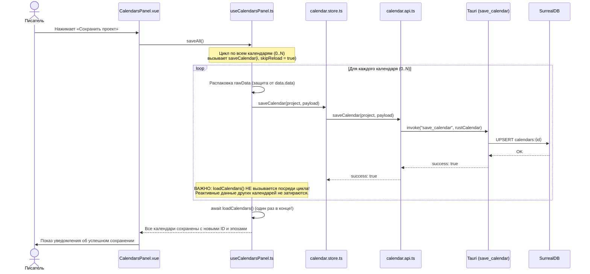
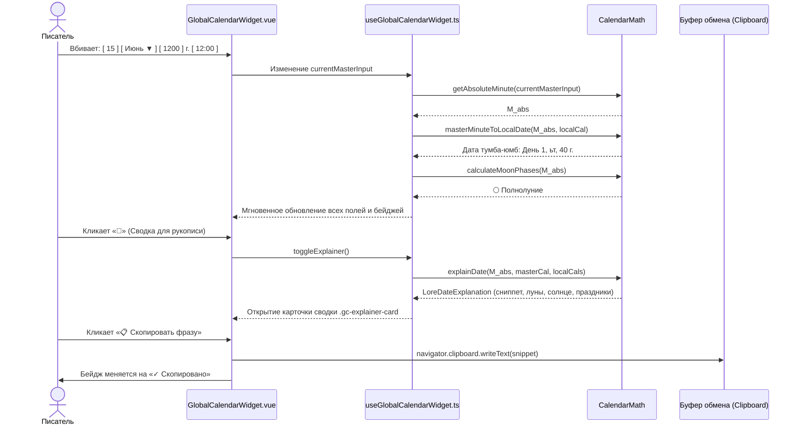
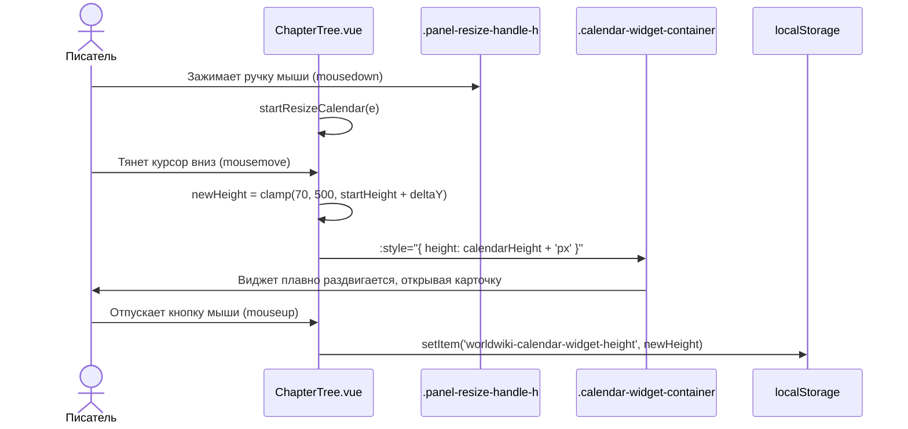
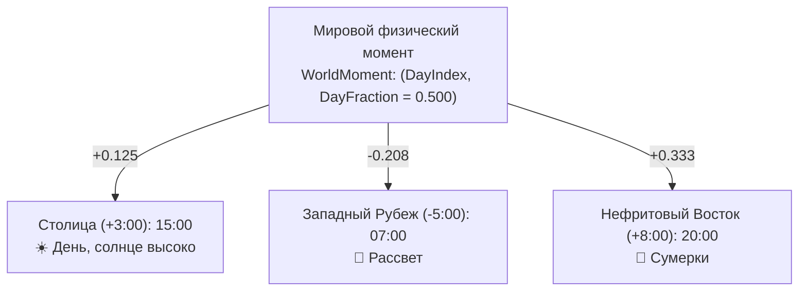

# apps/spa/src/ts/features/timeline/Calendars — Архитектура и Математика Календарей

> **Назначение**: Комплексная мультикалендарная подсистема приложения WorldWiki. Обеспечивает проектирование авторских календарей произвольной структуры (нестандартные месяцы, недели, эпохи, високосные циклы, орбитальные периоды лун, сезоны, часовые пояса), математическую синхронизацию летоисчислений культур с глобальным временем мира (Календарь Мира / Master Timeline), кросс-конвертацию дат между народами, наложение сеток в «Атласе Времени» и интерактивное управление датой/временем сцен прямо в сайдбаре рукописи.

---

## 📁 Структура папок и файлов

```
apps/spa/src/ts/features/timeline/
├── Calendars/
│   ├── README_Calendars.md             # Данная всеобъемлющая документация архитектуры и математики
│   ├── CalendarEras/                   # Редактор эпох календаря (название, диапазон лет, обратный отсчет)
│   │   ├── CalendarEras.vue            # UI список эпох с v-model, drag/move и синхронизацией название <-> name
│   │   ├── useCalendarEras.ts          # Composable: добавление, удаление, сортировка эпох и watch-синхронизация
│   │   └── __tests__/                  # Юнит-тесты эпох (useCalendarEras.spec.ts)
│   ├── CalendarHolidays/               # Редактор праздников и памятных дат
│   │   ├── CalendarHolidays.vue        # Карточки праздников (название, диапазон день/месяц начала и конца)
│   │   ├── useCalendarHolidays.ts      # Composable управления списком праздников
│   │   └── __tests__/
│   ├── CalendarLeapYear/               # Настройка високосных правил
│   │   ├── CalendarLeapYear.vue        # Выбор правила (Григорианское, Каждый 4-й год, Пользовательское, Нет)
│   │   ├── useCalendarLeapYear.ts      # Валидация високосного месяца и дня смещения
│   │   └── __tests__/
│   ├── CalendarMonths/                 # Конфигуратор месяцев года
│   │   ├── CalendarMonths.vue          # Список месяцев, длительность в днях, порядок
│   │   ├── useCalendarMonths.ts        # Composable добавления/удаления месяцев, подсчет суммы дней года
│   │   └── __tests__/
│   ├── CalendarMoons/                  # Астрономические спутники и фазы лун
│   │   ├── CalendarMoons.vue           # Настройка лун: орбитальный период в днях, начальная фаза, имена 4 фаз
│   │   ├── useCalendarMoons.ts         # Composable управления спутниками
│   │   └── __tests__/
│   ├── CalendarOrigin/                 # Точка отсчета календаря (эпоха нуля)
│   │   ├── CalendarOrigin.vue          # Настройка стартовой точки: год, месяц, день, стартовый день недели
│   │   ├── useCalendarOrigin.ts        # Composable точки отсчета
│   │   └── __tests__/
│   ├── CalendarPlayground/             # Интерактивная песочница проверки календаря
│   │   ├── CalendarPlayground.vue      # Поле ввода даты с мгновенным расчетом дня недели, лун и праздников
│   │   ├── useCalendarPlayground.ts    # Реактивный пересчет песочницы через CalendarMath
│   │   └── __tests__/
│   ├── CalendarSeasons/                # Климатические сезоны года
│   │   ├── CalendarSeasons.vue         # Привязка месяцев к сезонам (Зима, Весна, Сезон дождей и т.д.)
│   │   ├── useCalendarSeasons.ts       # Управление сезонами
│   │   └── __tests__/
│   ├── CalendarSettings/               # Суточные параметры времени
│   │   ├── CalendarSettings.vue        # Часов в сутках, минут в часе, секунд в минуте, широта планеты
│   │   ├── useCalendarSettings.ts      # Валидация суточных констант
│   │   └── __tests__/
│   ├── CalendarSyncAnchor/             # Модуль привязки летоисчисления к Календарю Мира (UX 2.0)
│   │   ├── CalendarSyncAnchor.vue      # Интуитивная строка привязки года (masterStartYear) + компактный спойлер
│   │   ├── useCalendarSyncAnchor.ts    # Двусторонний computed masterStartYear, человеческий расчет смещения
│   │   └── __tests__/
│   ├── CalendarTimezones/              # Региональные часовые пояса и география мира
│   │   ├── CalendarTimezones.vue       # Управление сеткой поясов мира и географическими регионами (широта/долгота)
│   │   ├── useCalendarTimezones.ts     # Управление коллекциями WorldTimezone и WorldRegion
│   │   └── __tests__/
│   ├── CalendarWeekdays/               # Дни недели
│   │   ├── CalendarWeekdays.vue        # Количество дней в неделе и их авторские наименования
│   │   ├── useCalendarWeekdays.ts      # Управление структурой недели
│   │   └── __tests__/
│   ├── GlobalCalendarWidget/           # Виджет текущего дня рукописи над проводником глав
│   │   ├── GlobalCalendarWidget.vue    # Glassmorphism-панель: прямой ввод дня, месяца, года, времени (ч:м), луны, праздники, 🔮 Explainer
│   │   ├── useGlobalCalendarWidget.ts  # Реактивный пересчет даты, кросс-календаря, лун, литературной сводки
│   │   └── __tests__/
│   ├── GlobalTimeViewer/               # Инспектор мирового абсолютного времени
│   │   ├── GlobalTimeViewer.vue        # Отображение времени в шкалах всех календарей одновременно
│   │   ├── useGlobalTimeViewer.ts      # Синхронный опрос времени
│   │   └── __tests__/
│   ├── TimeAtlas/                      # «Атлас Времени» (модальный супер-инструмент писателя)
│   │   ├── TimeAtlasModal.vue          # Тонкая модалка: Teleport, переключатель табов, баннер маркеров дня
│   │   ├── useTimeAtlasModal.ts        # Кросс-календарная конвертация, детекция маркеров, снимок регионов мира
│   │   ├── tabs/                       # Изолированные вкладки Атласа:
│   │   │   ├── TimeAtlasBridgeTab.vue  # Вкладка 1: «Мост Времени» (колонки летоисчислений культур)
│   │   │   ├── TimeAtlasMatrixTab.vue  # Вкладка 2: «Наложенная Сетка» (двухкалендарный месяц)
│   │   │   ├── TimeAtlasWorldTab.vue   # Вкладка 3: «Срез Мира» (часовые пояса, солнце, регионы)
│   │   │   └── TimeAtlasSnippetsTab.vue# Вкладка 4: «Датировки в Текст» (быстрое копирование в рукопись)
│   │   └── __tests__/
│   └── TimelinePanel/                  # Панель исторических событий таймлайна
│       ├── TimelinePanel.vue           # Хронологический список событий с фильтрацией по эпохам
│       ├── useTimelinePanel.ts         # Сортировка событий по абсолютной шкале минут
│       └── __tests__/
│
├── CalendarsPanel/                     # Панель реестра календарей (в Настройках Проекта)
│   ├── CalendarsPanel.vue              # Карточки календарей (Календарь Мира закреплен сверху, кнопка добавления)
│   ├── useCalendarsPanel.ts            # Асинхронное сохранение saveAll() без перезатирания памяти, удаление
│   └── __tests__/
│
└── UniversalDatePicker/                # Универсальный контрол выбора даты для сущностей и глав
    ├── UniversalDatePicker.vue         # Дропдаун с выбором календаря, эпохи, года, месяца, дня
    └── useUniversalDatePicker.ts       # Синхронизация CalendarDate
```

### Интеграция с боковой панелью глав (`ChapterTree`)
В `ChapterTree.vue` виджет размещен над деревом глав и разделен специальным горизонтальным сплиттером:
- `.calendar-widget-container` — контейнер виджета с изменяемой высотой (`calendarHeight`) и внутренним плавным скроллом `overflow-y: auto`.
- `.panel-resize-handle.panel-resize-handle-h` — перетаскиваемая ручка ресайза (70px – 500px), запоминающая размер в `localStorage`.

### Связанные сервисы и хранилища (Core Layer)
```
apps/spa/src/ts/
├── services/Calendars/
│   ├── calendar.math.ts                # TypeScript ядро математики календаря, форматтер солнца, explainDate()
│   ├── calendar.types.ts               # DTO интерфейсы: CalendarData, LoreDateExplanation, DaylightResult
│   └── timeline-panel.ts               # Мост связи событий с главами
│
├── services/api/
│   └── calendar.api.ts                 # Tauri IPC вызовы save_calendar / get_calendars с защитой от двойной упаковки
│
└── stores/
    └── calendar.store.ts               # Pinia Store: CRUD календарей, кэширование, распаковка data.data, нормализация ID
```

---

## 🧮 Математический аппарат календаря (`CalendarMath`)

В основе всей системы лежит концепция **Минуты Абсолютного Времени (Absolute Minute)**.  
Все даты, эпохи, события и главы рукописи приводятся к единому числу $M_{\text{abs}} \in (-\infty, +\infty)$ — количеству минут от условной точки творения мира (Unix-подобный таймстамп мира).

### 1. Константы суток и года

Пусть задан календарь $C$:
- $H_{\text{day}}$ — часов в сутках (по умолчанию 24);
- $M_{\text{hour}}$ — минут в часе (по умолчанию 60);
- $S_{\text{min}}$ — секунд в минуте (по умолчанию 60).

Длительность суток в минутах:
$$T_{\text{day\_mins}} = H_{\text{day}} \times M_{\text{hour}}$$

### 2. Прямое преобразование: Дата $\to$ Абсолютные Минуты (`getAbsoluteMinute`)

Дана дата $(Y, M, D, h, m)$ в календаре $C$:
1. **Года $\to$ Дни**:  
   Для $Y > 1$:
   $$\text{Days}_{\text{years}} = \sum_{y=1}^{Y-1} \text{DaysInYear}(y, C)$$
   Для $Y \le 0$ (до н.э. / обратный отсчет):
   $$\text{Days}_{\text{years}} = - \sum_{y=Y}^{0} \text{DaysInYear}(y, C)$$

2. **Месяцы $\to$ Дни**:
   $$\text{Days}_{\text{months}} = \sum_{i=0}^{M-1} \text{DaysInMonth}(Y, i, C)$$

3. **Суммарный день**:
   $$\text{TotalDays} = \text{Days}_{\text{years}} + \text{Days}_{\text{months}} + (D - 1)$$

4. **Минуты**:
   $$M_{\text{abs}} = \text{TotalDays} \times T_{\text{day\_mins}} + h \times M_{\text{hour}} + m$$

---

### 3. Обратное преобразование: Абсолютные Минуты $\to$ Дата (`getDateFromAbsolute`)

Дано $M_{\text{abs}}$:
1. Вычисляем суммарные сутки и время суток:
   $$\text{TotalDays} = \lfloor M_{\text{abs}} / T_{\text{day\_mins}} \rfloor$$
   $$\text{RemMinutes} = M_{\text{abs}} \pmod{T_{\text{day\_mins}}}$$
   $$h = \lfloor \text{RemMinutes} / M_{\text{hour}} \rfloor, \quad m = \text{RemMinutes} \pmod{M_{\text{hour}}}$$

2. Восстанавливаем год $Y$:
   Итерируемся годами вперед или назад, вычитая/прибавляя $\text{DaysInYear}(Y)$, пока остаток дней не уложится в диапазон текущего года.

3. Восстанавливаем месяц $M$ и день $D$:
   Проходим по массиву месяцев календаря, вычитая дни каждого месяца, пока остаток $\text{TotalDays} < \text{DaysInMonth}(Y, M)$.  
   День месяца: $D = \text{TotalDays} + 1$.

---

### 4. Синхронизация летоисчислений культур (`SyncAnchor`)

Синхронизация связывает произвольный региональный календарь с Календарем Мира через постоянный сдвиг $\Delta_{\text{offset}}$:

$$\Delta_{\text{offset}} = M_{\text{master}} - M_{\text{local}}$$

#### Преобразование между календарями культур ($A \to B$):
$$M_{\text{world}} = \text{getAbsoluteMinute}(D_A, \text{Cal}_A) + \Delta_A$$
$$M_B = M_{\text{world}} - \Delta_B$$
$$D_B = \text{getDateFromAbsolute}(M_B, \text{Cal}_B)$$

#### Литературное описание смещения (`formatAnchorOffsetDescription`):
Вместо математических сырых отрицательных чисел интерфейс формулирует сдвиг на понятном автору языке:
* *«1-й год этого календаря соответствует 35-му году в Календаре Мира»*
* *«Летоисчисление культуры началось на 34 г. раньше Календаря Мира»*.

---

### 5. Астрономия: Фазы Лун (`calculateMoonPhases`)

Для каждого спутника с синодическим периодом $P_{\text{days}}$ и начальной фазой $\Phi_0$:
$$\Phi = \left( \frac{M_{\text{abs}}}{P_{\text{days}} \times T_{\text{day\_mins}}} + \Phi_0 \right) \pmod{1.0}$$

Классификация:
* $0.875 < \Phi \le 1.0$ или $0.0 \le \Phi \le 0.125$ — **🌑 Новолуние**
* $0.125 < \Phi \le 0.375$ — **🌓 Первая четверть**
* $0.375 < \Phi \le 0.625$ — **🌕 Полнолуние**
* $0.625 < \Phi \le 0.875$ — **🌗 Последняя четверть**

---

### 6. Астрономия: Солнце и световой день (`formatDaylightLiterary`)

Рассчитывает зенит, восход и закат солнца по широте планеты и положению в годовом цикле:
* Формула выдает литературный результат: `Световой день: 17 ч 42 мин, Восход: 04:18, Закат: 22:00` (без псевдонаучного термина «инсоляция»).

---

### 7. Сводка для рукописи (`explainDate`)

Метод `CalendarMath.explainDate()` формирует полный сниппет лора текущего момента:
* Точную дату в Календаре Мира;
* Точные даты во всех локальных культурах;
* Состояние небесных тел (все луны мира с фазами);
* Характеристики дня (долгота дня, восход, закат);
* Действующие праздники;
* Художественную фразу для вставки в главу рукописи:  
  *«Шёл 1200 год от основания Мира (15 Июня). На небе сияла Луна: 🌕 Полнолуние. День длился 17 ч 42 мин.»*

---

## 🔁 Mermaid: Sequence Diagrams — Ключевые сценарии

---

### 1. Пакетное сохранение календарей проекта (`saveAll`)



---

### 2. Интерактивный виджет даты и генерация сводки для рукописи (`🔮`)



---

### 3. Ресайз виджета над структурой глав (`ChapterTree`)



---

### 4. Мировое Физическое Время, География и Часовые Пояса

> **Базовый постулат**: Часовой пояс — это свойство **географии планеты (долготы региона)**, а не культуры или календаря.  
> **Культура ≠ Часовой пояс**. Персонажи одной культуры в разных частях света живут в разных часовых поясах, но говорят на одном календарном языке.

#### Трёхслойная модель:
1. **Слой 1: Физический мир**: Инвариант планеты — **Мировые сутки (World Day)**. Момент времени задаётся как пара:
   $$\text{WorldMoment} = (\text{DayIndex}, \text{DayFraction})$$
   где $\text{DayFraction} \in [0.0, 1.0)$ — точная доля прошедших планетных суток от полуночи на нулевом меридиане.
2. **Слой 2: Календарные языки**: Любая культура делит физический день на свои авторские кванты (Империя: $24 \times 60 = 1440$ минут, Тумба-Юмб: $10 \times 100 = 1000$ единиц). Благодаря `DayFraction` момент $0.25$ суток для Империи это `06:00`, а для Тумба-Юмб — `2 ч 50 мин`.
3. **Слой 3: География и Регион**: Регион задаёт `latitude` (широта: длина дня и сезоны), `longitude` (долгота: истинный зенит солнца) и ссылку на часовой пояс `timezone_id`. Формула сцены:
   $$\text{Сцена} = \text{WorldMoment} + \text{Регион} + \text{Календарь}$$



---

## 📝 Важные примечания и технические нюансы (Gotchas)

1. **Защита от двойной упаковки `{ data: { data: ... } }`**:
   В `calendar.api.ts` и `calendar.store.ts` внедрена обязательная распаковка поля `data`: если при десериализации внутри объекта календаря обнаружен вложенный объект `data.data`, он автоматически разворачивается в плоскую структуру `CalendarData`. Это предотвращает потерю массивов `эпохи` и `месяцы` при повторных сохранениях.
2. **Безопасный цикл `saveAll()`**:
   Никогда не вызывайте `loadCalendars()` внутри итерации по несохраненным элементам. `loadCalendars()` обращается к БД и перезаписывает реактивный массив `calendars.value` старыми данными, стирая пользовательский ввод во всех последующих вкладках. В `saveAll()` перезагрузка выполняется строго **один раз в самом конце**.
3. **Двусторонняя связка названий эпох (`название` $\leftrightarrow$ `name`)**:
   В SurrealDB поле эпохи хранится как `название`, однако в некоторых DTO использовался алиас `name`. В `CalendarEras.vue` и `useCalendarEras.ts` инпут связан через `v-model="era.название"`, а реактивный `watch` непрерывно синхронизирует оба свойства.
4. **Адаптивность в узком сайдбаре рукописи**:
   Ширина панели глав составляет всего 200–260px. Все элементы виджета (`.gc-world-date-box`, `.gc-local-result`, `.gc-explainer-card`) строго используют `box-sizing: border-box`, `min-width: 0` и `word-break: break-word / overflow-wrap: anywhere`, исключая горизонтальное вылезание и обрезание текста.
5. **Отрицательное смещение SyncAnchor — это норма**:
   Если опорный год культуры больше опорного года мастера ($Y_{\text{local}} > Y_{\text{master}}$), смещение $\Delta = M_{\text{master}} - M_{\text{local}}$ математически ВСЕГДА отрицательно. В UI для писателя выводится понятная литературная формулировка взаимного соотношения лет.
