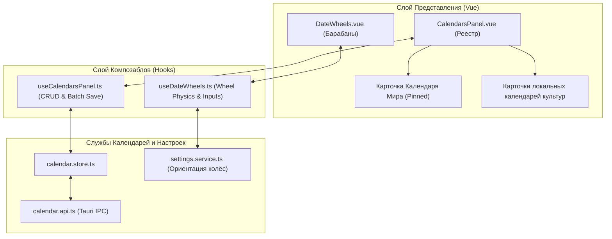
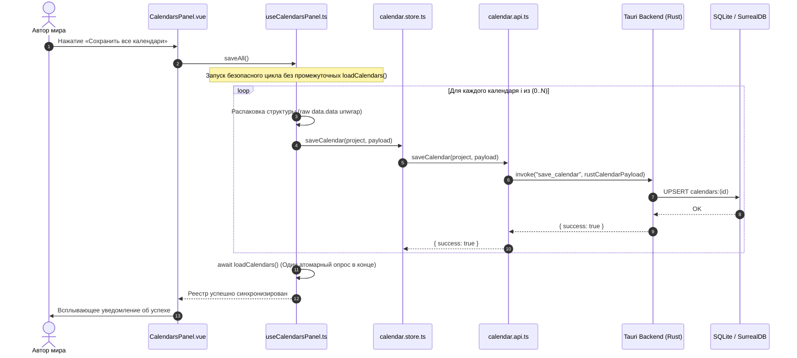

# apps/spa/src/ts/features/timeline/CalendarsPanel — Архитектура Реестра Календарей и Барабанов Даты

> **Назначение**: Панель управления реестром календарей проекта (размещается в Настройках Вселенной) и физический контрол селектора даты на основе интерактивных барабанов прокрутки (`DateWheels`). Обеспечивает создание, удаление, привязку и пакетное сохранение авторских календарей с гарантией целостности ссылок и поддержкой ввода через геймпад/мышь.

---

## 📁 Структура папок и файлов

```
apps/spa/src/ts/features/timeline/CalendarsPanel/
├── README_CalendarsPanel.md            # Данная всеобъемлющая документация реестра календарей
├── CalendarsPanel.vue                  # UI панели реестра: карточки календарей, эталонный Календарь Мира, кнопка создания
├── useCalendarsPanel.ts                # Composable управления реестром: пакетный saveAll(), удаление, переключение
├── DateWheels.vue                      # Компонент вращающихся барабанов прокрутки даты (Эпоха, Год, Месяц, День, Время)
├── useDateWheels.ts                    # Composable физики прокрутки барабанов, ориентации (вертикальная/горизонтальная)
└── __tests__/                          # Набор юнит-тестов (useCalendarsPanel.spec.ts, useDateWheels.spec.ts)
```

---

## 🏛️ Архитектурная модель реестра календарей



---

## 🔄 Жизненный цикл пакетного сохранения (`saveAll` Sequence Diagram)



---

## 🧮 Механика и физика барабанов прокрутки (`DateWheels`)

Контрол `DateWheels` реализует непрерывную кинетическую прокрутку временных осей:

### 1. Вычисление доступных дней в зависимости от високосного года
$$\text{DaysLimit}(Y, M, C) = \begin{cases}
\text{DaysInMonth}(M) + 1, & \text{если } \text{IsLeapYear}(Y, C) \land M = M_{\text{leap}} \\
\text{DaysInMonth}(M), & \text{иначе}
\end{cases}$$

### 2. Динамическая ориентация барабанов (Horizontal vs Vertical)
Контрол реактивно адаптирует свою структуру по настройке `settingsService`:
* **Vertical Mode**: Стандартные вертикальные столбцы колес с прокруткой `wheelDeltaY`.
* **Horizontal Mode**: Компактная горизонтальная лента с прокруткой `wheelDeltaX` и поддержкой стиков геймпада (Xbox / DualSense).

---

## ⚠️ Важные нюансы реализации (Gotchas & Best Practices)

1. **Защита от двойной упаковки данных (`data.data`)**:
   * При получении календаря из внешних IPC-сервисов свойство `data` может быть вложено само в себя. `useCalendarsPanel` содержит валидатор `unwrapCalendarData()`, нормализующий объект перед отправкой в Rust.
2. **Неприкосновенность Календаря Мира (Master Calendar)**:
   * Календарь Мира имеет фиксированный ID `master` (или `is_master: true`). Его удаление заблокировано на уровне UI и API, так как он служит глобальной точкой отсчета абсолютного времени $M_{\text{abs}}$.
3. **Безопасная сортировка**:
   * Календарь Мира всегда принудительно сортируется на 0-ю позицию в списке (`sort((a, b) => a.is_master ? -1 : 1)`).

---

## 🧪 Верификация и тестирование

Запуск тестового набора панели календарей:
```bash
# Тесты реестра календарей и сохранения
pnpm test apps/spa/src/ts/features/timeline/CalendarsPanel/__tests__/useCalendarsPanel.spec.ts

# Тесты физики барабанов даты
pnpm test apps/spa/src/ts/features/timeline/CalendarsPanel/__tests__/useDateWheels.spec.ts
```
