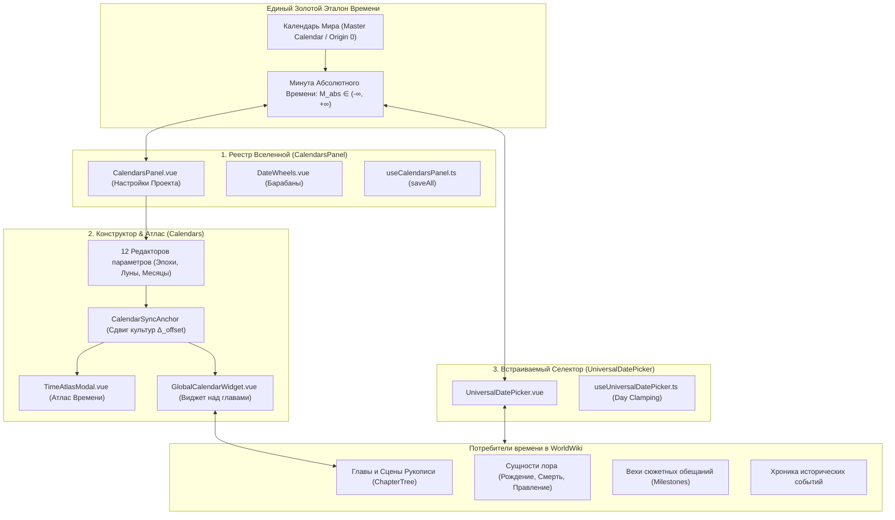

# apps/spa/src/ts/features/timeline — Путеводитель по Системе Времени, Календарей и Хронологии

> **Назначение**: Главный архитектурный навигатор и путеводитель по всей подсистеме времени, хронологии, календарей и датировок приложения WorldWiki. Объединяет проектирование авторских астрономических календарей, реестр вселенной, физические барабаны выбора даты и универсальные контролы датировок рукописи в единый согласованный математический континуум.

---

## 📁 Структура папок и файлов

```
apps/spa/src/ts/features/timeline/
├── README_Timeline.md                  # Данная всеобъемлющая документация архитектуры времени
│
└── components/                         # Декомпозированные подсистемы времени и хронологии
    ├── calendars/                      # Конструктор и инструменты календарей
    │   ├── CalendarEditor/             # 5-вкладочный редактор календаря (Structure, Eras, Lore, Playground, Reforms)
    │   ├── CalendarAuditModal/         # Аудит и проверка согласованности календарей
    │   ├── CalendarPresetsModal/       # Модалка выбора пресетов исторических и фантастических календарей
    │   ├── DialHierarchyConstructor/   # Конструктор иерархии циферблатов
    │   ├── PlanetCalendarTree/         # Дерево планет и привязанных календарей
    │   ├── CalendarEntityAdapter/      # Адаптер календаря к сущности мира
    │   └── presets/                    # Шаблоны календарей (Китай, Египет, Средиземье, Фаэрун, Вестерос...)
    ├── planets/                        # Астрономия и планетарные системы
    │   └── PlanetEditor/               # Редактор астрофизики, лун, орбит и часовых поясов планет
    ├── atlas/                          # Инструменты навигации и обзора времени
    │   ├── TimeAtlas/                  # Модальный «Атлас Времени»
    │   ├── GlobalCalendarWidget/       # Виджет текущей даты над деревом рукописи
    │   └── GlobalTimeViewer/           # Инспектор мирового абсолютного времени
    └── inspectors/                     # Панели и инспекторы хронологии
        ├── TimelineInspector/          # Хронологический инспектор томов и глав
        └── TimelinePanel/              # Панель исторических событий таймлайна
```

---

## 🏛️ Архитектура Единого Континуума Времени



---

## 🧭 Как связаны подсистемы (Инженерный гид)

| Подсистема | Расположение | Роль в экосистеме |
|---|---|---|
| **Конструктор Календарей (`calendars/`)** | `./components/calendars/` | `CalendarEditor` (5 вкладок: `Tab1Structure`, `Tab2ErasSync`, `Tab3CultureLore`, `Tab4Playground`, `Tab5ReformsDst`), `CalendarAuditModal`, `CalendarPresetsModal`, `DialHierarchyConstructor`, `PlanetCalendarTree`, `CalendarEntityAdapter` и библиотека `presets/`. |
| **Планеты и Астрономия (`planets/`)** | `./components/planets/` | `PlanetEditor` (`PlanetAstrophysicsTab`, `PlanetMoonsTab`, `PlanetTimezonesTab`, `PlanetPresetsModal`) — параметры орбиты, вращения, лун и часовых поясов. |
| **Атлас и Виджеты (`atlas/`)** | `./components/atlas/` | `TimeAtlasModal` (матрица конвертации культур, мировое время), `GlobalCalendarWidget` над деревом глав и `GlobalTimeViewer`. |
| **Инспекторы (`inspectors/`)** | `./components/inspectors/` | `TimelineInspector` (хронология томов и глав) и `TimelinePanel` (события таймлайна). |

---

## 🧮 Золотой Стандарт Времени: Минута Абсолютного Времени ($M_{\text{abs}}$)

Все модули подсистемы `timeline` общаются между собой через фундаментальную абстракцию — **Минуту Абсолютного Времени** ($M_{\text{abs}}$):

1. Любая дата в любом календаре переводится в $M_{\text{abs}}$ функцией:
   $$M_{\text{abs}} = \text{CalendarMath.getAbsoluteMinute}(\text{date}, \text{calendar}) + \Delta_{\text{offset}}$$
2. Обратное восстановление даты в календаре любой культуры:
   $$\text{date}_{\text{culture}} = \text{CalendarMath.getDateFromAbsolute}(M_{\text{abs}} - \Delta_{\text{culture}}, \text{calendar}_{\text{culture}})$$
3. Это гарантирует, что если персонаж родился в 1200 году по Календарю Мира, в летоисчислении Эльфов эта же дата мгновенно и без погрешностей отобразится как «45-й год Эпохи Звёзд».

---

## 🧪 Полный запуск тестов подсистемы Времени

```bash
# 1. Запуск тестов календарей и редактора
pnpm test apps/spa/src/ts/features/timeline/components/calendars

# 2. Запуск тестов планет и астрофизики
pnpm test apps/spa/src/ts/features/timeline/components/planets

# 3. Запуск тестов атласа времени и инспекторов
pnpm test apps/spa/src/ts/features/timeline/components/atlas
pnpm test apps/spa/src/ts/features/timeline/components/inspectors

# 4. Полный прогон всех тестов подсистемы времени
pnpm test apps/spa/src/ts/features/timeline
```
