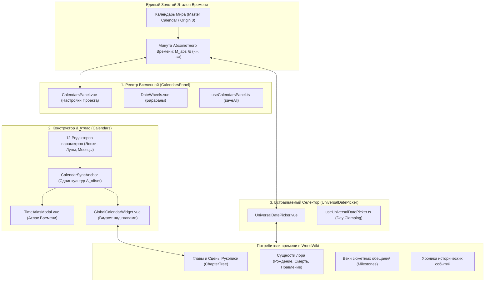

# apps/spa/src/ts/features/timeline — Путеводитель по Системе Времени, Календарей и Хронологии

> **Назначение**: Главный архитектурный навигатор и путеводитель по всей подсистеме времени, хронологии, календарей и датировок приложения WorldWiki. Объединяет проектирование авторских астрономических календарей, реестр вселенной, физические барабаны выбора даты и универсальные контролы датировок рукописи в единый согласованный математический континуум.

---

## 📁 Структура папок и файлов

```
apps/spa/src/ts/features/timeline/
├── README_Timeline.md                  # Данная всеобъемлющая документация архитектуры времени
│
└── components/                         # Декомпозированные подсистемы времени и хронологии
    ├── calendars/                      # Конструктор и инструменты календарей
    │   ├── CalendarEditor/             # 5-вкладочный редактор календаря (Structure, Eras, Lore, Playground, Reforms)
    │   ├── CalendarAuditModal/         # Аудит и проверка согласованности календарей
    │   ├── CalendarPresetsModal/       # Модалка выбора пресетов исторических и фантастических календарей
    │   ├── DialHierarchyConstructor/   # Конструктор иерархии циферблатов
    │   ├── PlanetCalendarTree/         # Дерево планет и привязанных календарей
    │   ├── CalendarEntityAdapter/      # Адаптер календаря к сущности мира
    │   └── presets/                    # Шаблоны календарей (Китай, Египет, Средиземье, Фаэрун, Вестерос...)
    ├── planets/                        # Астрономия и планетарные системы
    │   └── PlanetEditor/               # Редактор астрофизики, лун, орбит и часовых поясов планет
    ├── atlas/                          # Инструменты навигации и обзора времени
    │   ├── TimeAtlas/                  # Модальный «Атлас Времени»
    │   ├── GlobalCalendarWidget/       # Виджет текущей даты над деревом рукописи
    │   └── GlobalTimeViewer/           # Инспектор мирового абсолютного времени
    └── inspectors/                     # Панели и инспекторы хронологии
        ├── TimelineInspector/          # Хронологический инспектор томов и глав
        └── TimelinePanel/              # Панель исторических событий таймлайна
```
│   ├── CalendarsPanel.vue              # Карточки календарей в Настройках Проекта (Master Calendar закреплен)
│   ├── useCalendarsPanel.ts            # Управление списком и синхронизация с Tauri
│   ├── DateWheels.vue                  # Барабаны прокрутки даты (Xbox/Mouse, горизонтальный/вертикальный режим)
│   └── useDateWheels.ts                # Кинетика и физика колес прокрутки
│
└── UniversalDatePicker/                # 🎯 Универсальный Селектор Даты для Форм
    ├── README_UniversalDatePicker.md   # 📖 Адаптивный ввод, day clamping, интеграция с сущностями и сценами
    ├── UniversalDatePicker.vue         # Компактный выпадающий селектор даты для карточек и глав
    └── useUniversalDatePicker.ts       # Реактивный расчет диапазонов и високосных дней
```

---

## 🏛️ Архитектура Единого Континуума Времени



---

## 🧭 Как связаны три подсистемы (Инженерный гид)

| Подсистема | Где живёт в UI | Роль в экосистеме | Ссылка на подробную доку |
|---|---|---|---|
| **Реестр Календарей (`CalendarsPanel`)** | Вкладка «Календари» в Настройках Проекта | Точка входа для создания и настройки списка календарей мира. Отвечает за пакетное сохранение в SQLite/SurrealDB через Tauri IPC | [README_CalendarsPanel.md](./CalendarsPanel/README_CalendarsPanel.md) |
| **Математика и Инструменты (`Calendars`)** | Виджет над деревом глав, «Атлас Времени», панель событий | Выполняет астрономические расчеты, фазы лун, восход/закат солнца, кросс-конвертацию летоисчислений культур и генерацию литературных сводок для текста рукописи | [README_Calendars.md](./Calendars/README_Calendars.md) |
| **Универсальный Контрол (`UniversalDatePicker`)** | Карточки персонажей, заголовки глав, модалки событий | Компактный встраиваемый селектор для писателя. Позволяет выбрать дату любого календаря с адаптивным числовым или карусельным вводом | [README_UniversalDatePicker.md](./UniversalDatePicker/README_UniversalDatePicker.md) |

---

## 🧮 Золотой Стандарт Времени: Минута Абсолютного Времени ($M_{\text{abs}}$)

Все модули подсистемы `timeline` общаются между собой через фундаментальную абстракцию — **Минуту Абсолютного Времени** ($M_{\text{abs}}$):

1. Любая дата в любом календаре переводится в $M_{\text{abs}}$ функцией:
   $$M_{\text{abs}} = \text{CalendarMath.getAbsoluteMinute}(\text{date}, \text{calendar}) + \Delta_{\text{offset}}$$
2. Обратное восстановление даты в календаре любой культуры:
   $$\text{date}_{\text{culture}} = \text{CalendarMath.getDateFromAbsolute}(M_{\text{abs}} - \Delta_{\text{culture}}, \text{calendar}_{\text{culture}})$$
3. Это гарантирует, что если персонаж родился в 1200 году по Календарю Мира, в летоисчислении Эльфов эта же дата мгновенно и без погрешностей отобразится как «45-й год Эпохи Звёзд».

---

## 🧪 Полный запуск тестов подсистемы Времени

```bash
# 1. Запуск тестов математики календарей и астрономии
pnpm test apps/spa/src/ts/features/timeline/Calendars

# 2. Запуск тестов реестра и барабанов даты
pnpm test apps/spa/src/ts/features/timeline/CalendarsPanel

# 3. Запуск тестов универсального селектора даты
pnpm test apps/spa/src/ts/features/timeline/UniversalDatePicker

# 4. Полный прогон всех тестов подсистемы времени
pnpm test apps/spa/src/ts/features/timeline
```
