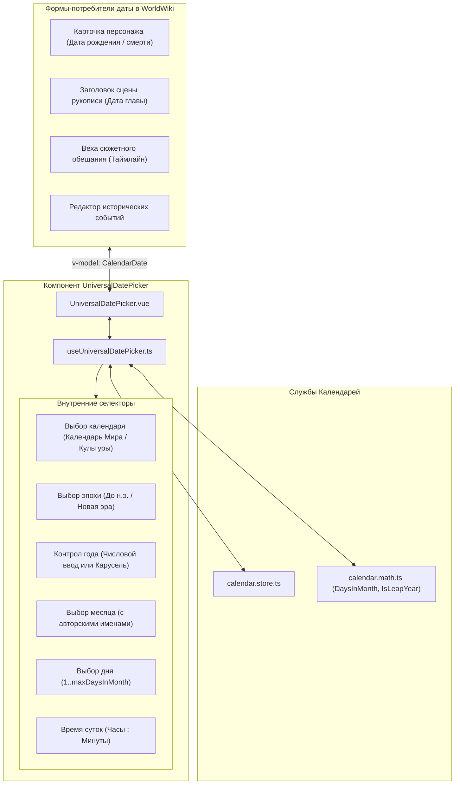
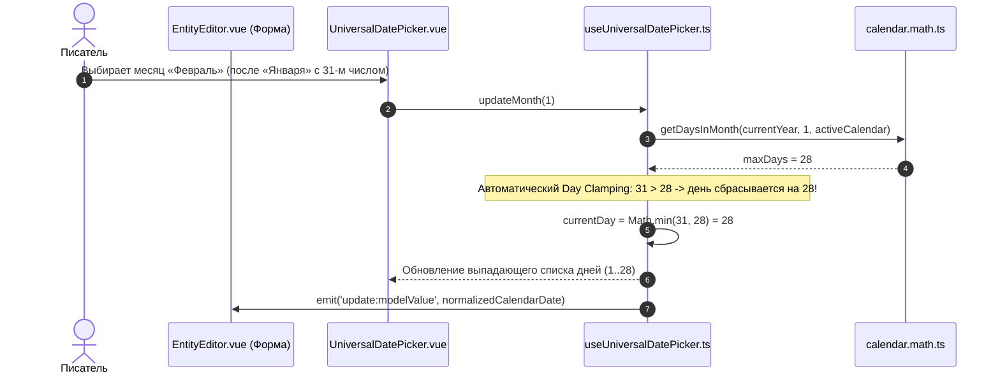

# apps/spa/src/ts/features/timeline/UniversalDatePicker — Архитектура Универсального Селектора Даты

> **Назначение**: Универсальный контрол выбора и редактирования даты мира (`UniversalDatePicker`). Встраивается во все формы приложения (карточки сущностей: даты рождения/смерти/событий, заголовок сцены рукописи, вехи сюжета, фильтры таймлайна). Обеспечивает бесшовный выбор любой даты в рамках произвольного авторского календаря с динамическим пересчетом високосных дней, адаптивным переключением режимов ввода (колеса / прямой ввод) и защитой от переполнения дней месяца.

---

## 📁 Структура папок и файлов

```
apps/spa/src/ts/features/timeline/UniversalDatePicker/
├── README_UniversalDatePicker.md       # Данная всеобъемлющая документация селектора даты
├── UniversalDatePicker.vue             # UI контрола: дропдаун выбора календаря, эпохи, года, месяца, дня и времени
├── useUniversalDatePicker.ts           # Composable: реактивный пересчет диапазонов, високосных дней, day clamping
└── __tests__/                          # Юнит-тесты (useUniversalDatePicker.spec.ts)
```

---

## 🏛️ Архитектурная модель селектора даты



---

## 🔄 Жизненный цикл изменения даты и защиты от переполнения (Sequence Diagram)



---

## 🧮 Алгоритмы и логика селектора

### 1. Адаптивный режим ввода года (`yearInputMode`)
Диапазон лет эпохи $\Delta Y = Y_{\text{end}} - Y_{\text{start}}$ определяет тип интерфейса:
$$\text{InputMode} = \begin{cases}
\text{Direct Number Input (Поле ввода)}, & \text{если } \Delta Y > 500 \text{ лет (эпохи на тысячи лет)} \\
\text{Dropdown / Wheel Picker (Карусель)}, & \text{если } \Delta Y \le 500 \text{ лет (компактные эпохи)}
\end{cases}$$

### 2. Динамический расчет максимального дня месяца (`maxDaysInMonth`)
$$\text{MaxDays}(Y, M, C) = \text{calendar.math.getDaysInMonth}(Y, M, C)$$
При изменении года или месяца текущий выбранный день $D$ автоматически нормализуется:
$$D_{\text{clamped}} = \max(1, \min(D, \text{MaxDays}(Y, M, C)))$$

---

## ⚠️ Важные нюансы реализации (Gotchas & Best Practices)

1. **Обратная совместимость с датами без эпохи**:
   * Если во входящем объекте `CalendarDate` отсутствует поле `эпоха`, селектор автоматически сопоставляет его с 0-й эпохой текущего календаря без выбрасывания ошибок.
2. **Мгновенная реакция на смену активного календаря**:
   * При переключении календаря в селекторе вызывается трансляция даты через `CalendarMath.getDateFromAbsolute(currentAbsMinute, newCalendar)`, сохраняя точный момент времени в истории мира.

---

## 🧪 Верификация и тестирование

Запуск тестового набора селектора даты:
```bash
# Тесты Composable универсального селектора даты
pnpm test apps/spa/src/ts/features/timeline/UniversalDatePicker
```
