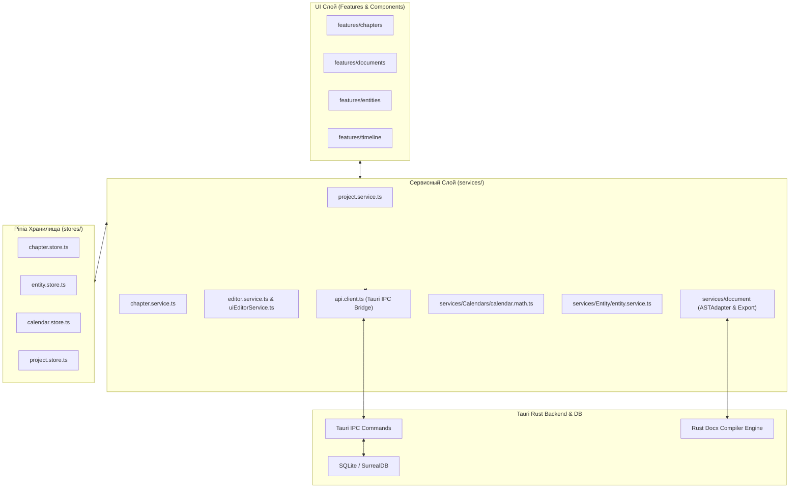
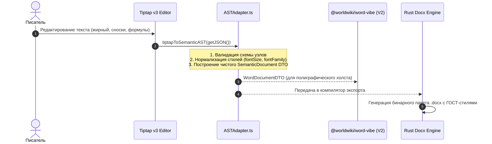

# apps/spa/src/ts/services — Архитектура Сервисного Слоя и Документного Движка

> **Назначение**: Центральный сервисный слой бизнес-логики WorldWiki SPA. Инкапсулирует вызовы бэкенда через `api.client.ts`, координацию проектов (`project.service`), иерархию рукописи (`chapter.service`), сервисы редактора (`editor.service`, `uiEditorService`), сноски (`footnote.service`), а также комплексный документный конвейер `services/document` (Semantic AST, ASTAdapter, компиляторы экспорта, профили ГОСТ, перекрестные ссылки и динамическая нумерация).

---

## 📁 Структура папок и файлов

```
apps/spa/src/ts/services/
├── README_Services.md                  # 🌟 Данная всеобъемлющая документация сервисного слоя
│
├── api.client.ts                       # Низкоуровневый клиент взаимодействия с Tauri IPC / REST
├── api.service.ts                      # Точка реэкспорта API
├── project.service.ts                  # Сервис управления проектами (создание, загрузка, переключение, экспорт)
├── chapter.service.ts                  # Сервис рукописи (загрузка глав, сохранение содержимого, статистика слов)
├── editor.service.ts                   # Координатор активных редакторов, вкладок и фокуса
├── uiEditorService.ts                  # Сервис UI-панелей и состояния тулбаров
├── footnote.service.ts                 # Индексация и резолв сносок
│
├── Calendars/                          # Сервисы подсистемы времени
│   ├── calendar.math.ts                # Математическое ядро расчетов времени, фаз лун и солнца
│   ├── calendar.types.ts               # DTO интерфейсы календарей
│   └── timeline-panel.ts               # Сервис привязки событий к главам рукописи
│
├── Entity/                             # Сервисы базы знаний
│   ├── entity.service.ts               # CRUD сущностей, графы связей, кэширование
│   └── useRelationshipBlock.ts         # Логика связей и матриц отношений
│
└── document/                           # 📑 Комплексный Документный Движок (Document Engine)
    ├── index.ts                        # Точка входа подсистемы документов
    ├── ast/                            # Semantic AST (Дерево абстрактного синтаксиса)
    │   ├── ASTAdapter.ts               # Двусторонний мост Tiptap v3 <-> Semantic AST <-> Tiptap v2
    │   └── types.ts                    # Типы узлов: ParagraphNode, HeadingNode, TableNode, FigureNode
    ├── converters/                     # Конвертеры форматов (Markdown, HTML, TeX, AST)
    ├── crossref/                       # Движок перекрестных ссылок и детекции битых целей
    ├── export/                         # Пайплайн компиляции в форматы DOCX, PDF, LaTeX, MD
    ├── layout/                         # Геометрия листов, расчет полей и колонтитулов
    ├── numbering/                      # Динамический Numbering Engine (ГОСТ автоподписи)
    └── profiles/                       # Профили оформления: ГОСТ 7.32, Книга, ВАК, Custom
```

---

## 🏛️ Архитектурная модель Сервисного Слоя



---

## 🔄 Жизненный цикл трансляции документа через `ASTAdapter`



---

## 🧮 Спецификация `ASTAdapter` (Конвертация Узлов)

`ASTAdapter.ts` выполняет роль канонического транслятора между диалектами разметки:

| Tiptap v3 Узел / Марка | Semantic AST Node / Mark | Tiptap v2 (`word-vibe`) | Rust Docx Element |
|---|---|---|---|
| `paragraph` | `ParagraphNode` | `paragraph` | `<w:p>` + `<w:pPr>` (красная строка 1.25 см) |
| `heading` (`level: 1..6`) | `HeadingNode` | `heading` | `<w:pStyle w:val="HeadingN"/>` |
| `table` + `tableRow` + `tableCell` | `TableNode` | `table` | `<w:tbl>` + `<w:tblGrid>` (Сетка ГОСТ) |
| `figureNode` | `FigureNode` | `gostFigure` | `<w:drawing>` + подпись `Рисунок N — ...` |
| `footnoteNode` | `FootnoteReferenceNode` | `footnote` | `<w:footnoteReference>` |
| `fontSize` (`sizePt: 14`) | `fontSize: { sizePt: 14 }` | `fontSize` | `<w:sz w:val="28"/>` (полупункты) |
| `fontFamily` (`font: 'Times'`) | `fontFamily: { font: 'Times' }`| `fontFamily` | `<w:rFonts w:ascii="Times New Roman"/>` |

---

## ⚠️ Важные нюансы реализации (Gotchas & Best Practices)

1. **Защита от устаревших марок (`textStyle`)**:
   * Tiptap v3 отказался от марки `textStyle` в пользу атомарных расширений `fontSize`, `fontFamily`, `highlight`. `ASTAdapter` строго валидирует входящий JSON, исключая генерацию RangeError в рантайме.
2. **Идемпотентность трансляции**:
   * Преобразование `JSON -> AST -> JSON` обратимо без потери пользовательских атрибутов узлов (`isBroken`, `customLabel`, `semanticTag`).
3. **Безопасные IPC-вызовы через `api.client.ts`**:
   * Все вызовы оборачиваются в `try/catch` с типизированным возвратом `ApiResponse<T>`, предотвращая падение UI при системных ошибках Rust.

---

## 🧪 Верификация и тестирование

Запуск тестового набора сервисного слоя:
```bash
# Тесты ASTAdapter и конвертеров
pnpm test apps/spa/src/ts/services/document

# Тесты клиентов API и сервисов рукописи/проектов
pnpm test apps/spa/src/ts/services
```
