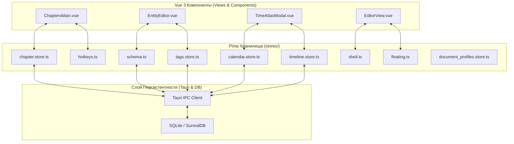
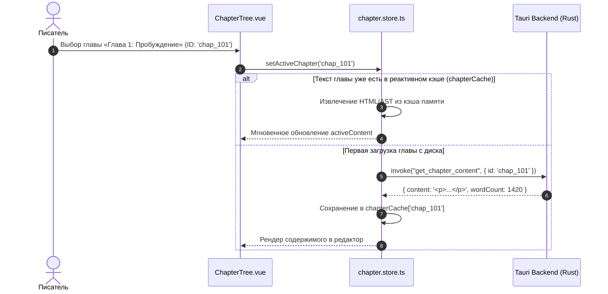

# apps/spa/src/ts/stores — Архитектура Pinia-Хранилищ и Реактивного Состояния

> **Назначение**: Центральный слой реактивного управления состоянием (State Management) приложения WorldWiki SPA на базе Pinia. Инкапсулирует реактивные хранилища данных проекта: рукопись (`chapter.store`), календари и астрономию (`calendar.store`), хронологию событий (`timeline.store`), студию схем (`schema`), теги (`tags.store`), оболочку (`shell`), горячие клавиши (`hotkeys`), плавающие окна (`floating`) и профили ГОСТ (`document_profiles.store`).

---

## 📁 Структура папок и файлов

```
apps/spa/src/ts/stores/
├── README_Stores.md                    # 🌟 Данная всеобъемлющая документация хранилищ Pinia
├── index.ts                            # Точка реэкспорта всех хранилищ
│
├── chapter.store.ts                    # 📖 Рукопись: иерархия глав, тома, сцены, активный текст, автосохранение
├── calendar.store.ts                   # ⏳ Календари: реестр, эпохи, месяцы, луны, праздники, нормализация data.data
├── timeline.store.ts                   # 🗺️ Хроника: события мира, привязка к абсолютной минуте M_abs
├── schema.ts                           # 📐 Схемы: типы сущностей, поля, валидаторы, правила отношений
├── tags.store.ts                       # 🏷️ Теги: глобальная палитра тегов, фильтрация, слияние категорий
├── shell.ts                            # 🚀 Оболочка: активный экран, видимость сайдбаров, панели, меню
├── shell/                              # Модульные подхранилища оболочки
├── hotkeys.ts                          # ⌨️ Горячие клавиши: регистрация хоткеев, приоритеты, блокировки
├── floating.ts                         # 🪟 Плавающие окна: стек z-index, координаты, минимизация
├── document_profiles.store.ts          # 📑 Профили оформления: ГОСТ 7.32, Книга, ВАК, Custom
├── zoom.ts                             # 🔍 Масштабирование: коэффициент зума холста (50% - 200%)
├── settings.ts                         # ⚙️ Настройки: мост к settings.service
└── console.ts                          # 🖥️ Консоль: системные логи, ошибки, телеметрия отладки
```

---

## 🏛️ Архитектурная модель реактивных хранилищ



---

## 🔄 Жизненный цикл загрузки и кэширования глав (`chapterStore`)



---

## 🧩 Подробный обзор ключевых хранилищ

### 1. `chapter.store.ts` (Хранилище Рукописи)
* **State**: `chaptersHierarchy: ChapterNode[]`, `activeChapterId: string | null`, `activeContent: string`, `chapterCache: Record<string, string>`, `isSaving: boolean`.
* **Actions**:
  * `loadChapters(projectId)`: Загрузка иерархического дерева томов и глав.
  * `saveActiveChapterContent(content)`: Дебаунс-сохранение с валидацией через `ASTAdapter`.
  * `reorderChapters(sourceId, targetId, position)`: Перемещение глав с обновлением `sortOrder`.

### 2. `calendar.store.ts` (Хранилище Календарей)
* **State**: `calendars: CalendarData[]`, `masterCalendar: CalendarData`, `activeCalendarId: string`.
* **Особенность**: Автоматическая распаковка `data.data` и гарантированное удержание Календаря Мира на 0-й позиции.

### 3. `schema.ts` (Хранилище Схем Сущностей)
* **State**: `schemas: CustomSchema[]`, `activeSchemaId: string`.
* **Функции**: Валидация полей сущностей, генерация дефолтных значений для новых карточек лора.

### 4. `hotkeys.ts` (Реестр Горячих Клавиш)
* **State**: `bindings: Map<string, HotkeyAction>`, `isSuspended: boolean`.
* **Возможности**: Временная приостановка горячих клавиш при открытых модальных окнах или вводе текста в инпуты.

---

## ⚠️ Важные нюансы реализации (Gotchas & Best Practices)

1. **Очистка состояния при смене проекта**:
   * При переключении вселенной метод `projectService.switchProject()` вызывает `$reset()` во всех хранилищах, предотвращая отображение данных старого проекта.
2. **Иммутабельность снимков кэша**:
   * При обновлении свойств главы в иерархии возвращается новый объект через деструктуризацию `{ ...chapter, ...patch }`, обеспечивая корректное срабатывание Vue `computed()`.
3. **Защита от состояния гонки (Race Condition)**:
   * Быстрое переключение между главами проверяет актуальность `activeChapterId` перед записью ответа из асинхронного вызова `get_chapter_content`.

---

## 🧪 Верификация и тестирование

Запуск тестового набора хранилищ:
```bash
# Тесты хранилищ рукописи, календарей и схем
pnpm test apps/spa/src/ts/stores
```
