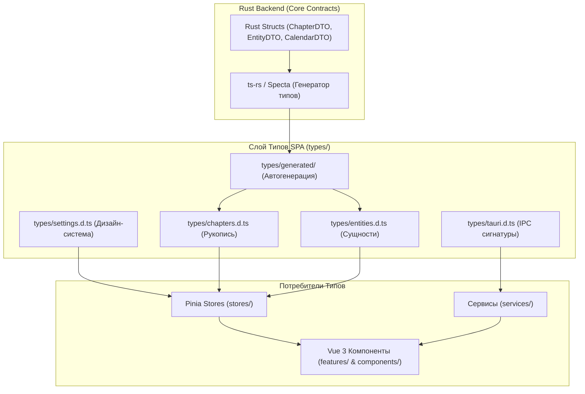

# apps/spa/src/ts/types — Система Глобальной Строгой Типизации и Контрактов

> **Назначение**: Централизованная система TypeScript-деклараций, интерфейсов и типов данных приложения WorldWiki SPA. Обеспечивает сквозную типобезопасность (End-to-End Type Safety) между слоем представления Vue, сервисами, Pinia-хранилищами и автогенерированными Rust DTO бэкенда Tauri.

---

## 📁 Структура папок и файлов

```
apps/spa/src/ts/types/
├── README_Types.md                     # 🌟 Данная всеобъемлющая документация системы типов
├── index.ts                            # Центральный реэкспорт типов приложения
│
├── chapters.d.ts                       # 📖 Декларации рукописи: ChapterNode, SceneData, StoryPromise
├── entities.d.ts                       # 👤 Декларации сущностей: EntityRecord, CustomField, Relationship
├── settings.d.ts                       # ⚙️ Декларации настроек: AppSettings, ThemePreset, TypographyConfig
├── tauri.d.ts                          # 🦀 Контракты вызовов Tauri Core: IPC Commands, Rust Enums, Events
└── generated/                          # 🤖 Автогенерированные Rust DTO (ts-rs / specta)
```

---

## 🏛️ Архитектурная модель Слоя Типизации



---

## 🧮 Спецификация ключевых интерфейсов

### 1. `ChapterNode` (`chapters.d.ts`)
```typescript
export interface ChapterNode {
  id: string;
  projectId: string;
  parentId?: string | null;
  title: string;
  type: 'volume' | 'part' | 'chapter' | 'scene';
  order: number;
  wordCount: number;
  characterCount: number;
  status: 'draft' | 'in_progress' | 'review' | 'completed';
  scenes?: SceneData[];
  createdAt: number;
  updatedAt: number;
}
```

### 2. `EntityRecord` (`entities.d.ts`)
```typescript
export interface EntityRecord {
  id: string;
  projectId: string;
  schemaId: string;
  name: string;
  avatarUrl?: string;
  tags: string[];
  fields: Record<string, unknown>;
  relationships: RelationshipRecord[];
  createdAt: number;
  updatedAt: number;
}
```

### 3. `AppSettings` (`settings.d.ts`)
```typescript
export interface AppSettings {
  theme: 'dark' | 'light' | 'midnight' | 'cyberpunk' | 'parchment' | 'system';
  accentColor: string;
  uiScale: number; // 0.8 .. 1.5
  dropdowns?: {
    wheelOrientation: 'vertical' | 'horizontal';
  };
  editor?: {
    autoSaveIntervalMs: number;
    ghostTextEnabled: boolean;
    showSemanticBadges: boolean;
  };
  performance?: {
    reduceMotion: boolean;
    virtualListThreshold: number;
  };
}
```

---

## ⚠️ Важные нюансы реализации (Gotchas & Best Practices)

1. **Строгий режим Strict Mode**:
   * Все типы компилируются с флагом `strict: true` и `noImplicitAny: true`, исключая неявные приведения типов `any`.
2. **Изоляция D-файлов от рантайм-кода**:
   * Файлы `.d.ts` содержат исключительно декларации типов и интерфейсов без исполняемого JavaScript/TypeScript кода, предотвращая раздувание бандла приложения.
3. **Версионирование автогенерированных типов**:
   * Папка `generated/` обновляется автоматически при изменении структур Rust через pre-build скрипты. Ручные правки в `generated/` запрещены.

---

## 🧪 Верификация типов

Запуск проверки типов во всем проекте SPA:
```bash
# Комплексный Typecheck через vue-tsc
pnpm --filter @worldwiki/spa typecheck
```
