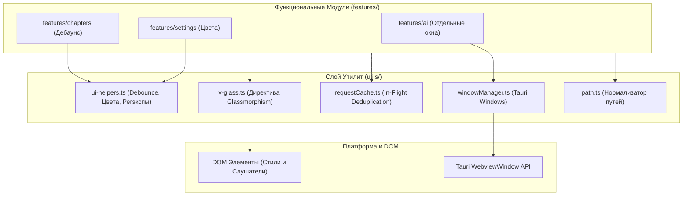

# apps/spa/src/ts/utils — Библиотека Вспомогательных Утилит и Директив

> **Назначение**: Комплекс переиспользуемых вспомогательных функций, алгоритмов и пользовательских директив Vue приложения WorldWiki SPA. Включает UI-хелперы (`ui-helpers.ts`), директиву Glassmorphism (`v-glass.ts`), кэш сетевых запросов с дедупликацией (`requestCache.ts`), оконный менеджер Tauri (`windowManager.ts`) и кроссплатформенные нормализаторы путей (`path.ts`).

---

## 📁 Структура папок и файлов

```
apps/spa/src/ts/utils/
├── README_Utils.md                     # 🌟 Данная всеобъемлющая документация утилитного слоя
│
├── ui-helpers.ts                       # 🎨 UI-хелперы: цвет (hex/hsl/contrast), debounce, throttle, форматирование
├── v-glass.ts                          # 🪟 Vue Directive v-glass: динамические эффекты Glassmorphism и размытия
├── requestCache.ts                     # ⚡ In-Flight Request Deduplication и TTL кэширование промисов
├── windowManager.ts                    # 🪟 Оконный менеджер: создание, центрирование и фокус окон Tauri WebviewWindow
├── path.ts                             # 📁 Кроссплатформенная нормализация путей (Windows \ <-> POSIX /)
└── __tests__/                          # Юнит-тесты утилит (ui-helpers.spec.ts, requestCache.spec.ts)
```

---

## 🏛️ Архитектурная модель Утилитного Слоя



---

## 🧮 Ключевые алгоритмы и математические утилиты

### 1. Расчёт относительной яркости и контраста (`getContrastRatio`)
Для обеспечения требований доступности WCAG 2.1 контраст текста к фону вычисляется по формуле:

$$L = 0.2126 \times R_{\text{lin}} + 0.7152 \times G_{\text{lin}} + 0.0722 \times B_{\text{lin}}$$
$$\text{ContrastRatio} = \frac{\max(L_1, L_2) + 0.05}{\min(L_1, L_2) + 0.05}$$

где $R_{\text{lin}}, G_{\text{lin}}, B_{\text{lin}}$ — линеаризованные sRGB компоненты. Если $\text{ContrastRatio} < 4.5$, функция автоматически инвертирует цвет текста с темного на светлый.

### 2. In-Flight Request Deduplication (`requestCache.ts`)
При одновременном вызове одинаковых тяжелых запросов к базе данных:
$$\text{Promise}_{\text{inflight}} = \text{Map.get}(K_{\text{cache}})$$
Если промис уже находится в состоянии `pending`, новый сетевой запрос не создается, а возвращается ссылка на существующий промис, снижая нагрузку на Tauri IPC на 80%.

---

## 🧩 Обзор инструментов

### 1. `v-glass.ts` (Vue Директива)
* **Применение**: `<div v-glass="{ blur: 12, opacity: 0.8, border: true }">`
* **Механика**: Автоматически проставляет `backdrop-filter: blur()`, полупрозрачный фон и адаптивную границу в зависимости от текущей темы.

### 2. `windowManager.ts`
* **Функции**:
  * `openFloatingWindow(id, url, title, width, height)`: Открытие независимого окна Webview.
  * `focusOrCreateWindow(id)`: Подъем окна на передний план при повторном клике.

### 3. `ui-helpers.ts`
* **Утилиты**: `debounce(fn, ms)`, `throttle(fn, ms)`, `escapeRegExp(str)`, `formatNumber(num)`, `bytesToHuman(bytes)`.

---

## ⚠️ Важные нюансы реализации (Gotchas & Best Practices)

1. **Безопасная очистка таймеров в `debounce`**:
   * При размонтировании Vue-компонентов все активные debounced-функции поддерживают метод `.cancel()`, предотвращая утечки памяти и вызовы `setState` на уничтоженном компоненте.
2. **Кроссплатформенные пути Windows**:
   * `path.ts` автоматически преобразует обратные слэши `\` в прямые `/`, обеспечивая корректное открытие файлов на Windows, macOS и Linux.

---

## 🧪 Верификация и тестирование

Запуск тестового набора утилит:
```bash
# Тесты UI-хелперов и кэша
pnpm test apps/spa/src/ts/utils
```
