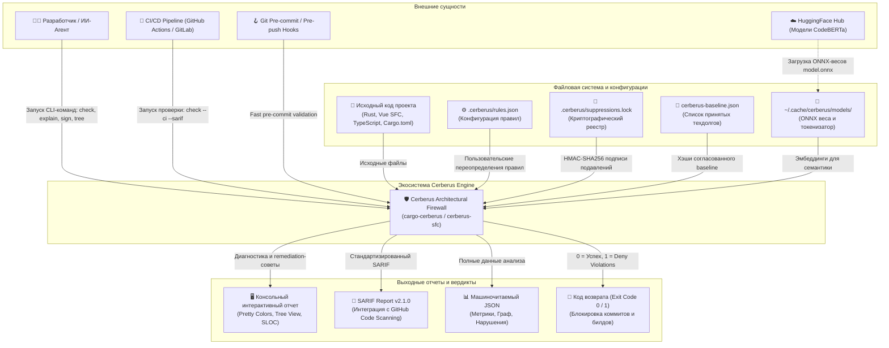
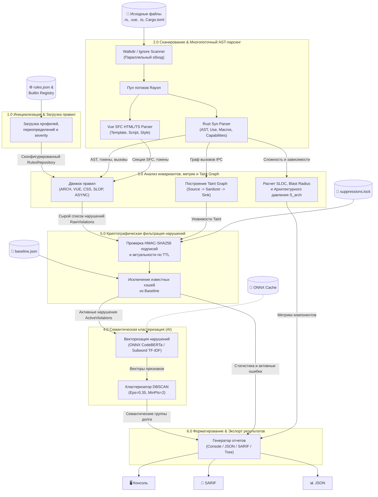
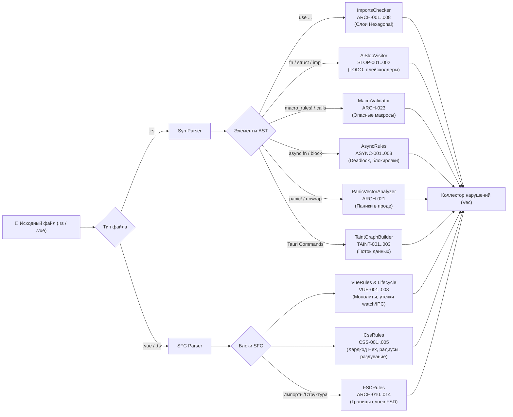

# 🛡️ Cerberus Architectural Firewall & Semantic Engine

> **Универсальная полиглотная система статического анализа, контроля архитектурных инвариантов, криптографического подавления долга и семантической кластеризации кодовой базы (Rust + Vue 3 SFC / TypeScript).**

---

## 📑 Содержание

1. [Обзор экосистемы](#-обзор-экосистемы)
2. [Гексагональная архитектура и инварианты](#-гексагональная-архитектура-и-инварианты)
3. [Диаграммы потоков данных (DFD)](#-диаграммы-потоков-данных-dfd)
   - [DFD Уровень 0: Контекстная диаграмма](#dfd-уровень-0-контекстная-диаграмма)
   - [DFD Уровень 1: Основные процессы](#dfd-уровень-1-основные-процессы)
   - [DFD Уровень 2: Декомпозиция ключевых подсистем](#dfd-уровень-2-декомпозиция-ключевых-подсистем)
     - [DFD 2.1: Сканирование, AST и Taint-анализ](#dfd-21-сканирование-ast-и-taint-анализ)
     - [DFD 2.2: Семантическая кластеризация долга (ONNX / TF-IDF)](#dfd-22-семантическая-кластеризация-долга-onnx--tf-idf)
     - [DFD 2.3: Криптографический реестр подавлений и Baseline](#dfd-23-криптографический-реестр-подавлений-и-baseline)
4. [Карта крейтов монорепозитория](#-карта-крейтов-монорепозитория)
5. [Сводный реестр архитектурных правил](#-сводный-реестр-архитектурных-правил)
6. [Установка и быстрый старт](#-установка-и-быстрый-старт)
7. [Стресс-тестирование, Универсальная Матрица Парадигм и Индекс Тестируемости (TI)](#-7-стресс-тестирование-универсальная-матрица-парадигм-и-индекс-тестируемости-ti)
   - [7.1. Детальная спецификация проверенных парадигм и обнаруженных правил](#-71-детальная-спецификация-проверенных-парадигм-и-обнаруженных-правил)
   - [7.2. Сводный скоркард производительности и полноты](#-72-сводный-скоркард-производительности-и-полноты)
   - [7.3. Состав набора автоматических Unit & Integration тестов](#-73-состав-набора-автоматических-unit--integration-тестов-cargo-test)
   - [7.4. Выполнение инженерного SLA](#-74-выполнение-инженерного-sla)
   - [7.5. Официальный реестр покрытия кода тестами (`llvm-cov` Scorecard)](#️-75-официальный-реестр-покрытия-кода-тестами-llvm-cov-coverage-scorecard)

---

## 🌟 Обзор экосистемы

**Cerberus** — это высокопроизводительный статический анализатор кода промышленного уровня, разработанный на языке Rust. Он обеспечивает непрерывный аудит чистоты слоёв, проверку гексагональных границ, выявление уязвимостей (Taint Analysis), контроль сложности AST и метрик зацепления/связности, криптографическую защиту от несанкционированного подавления предупреждений (HMAC-SHA256) и AI-кластеризацию архитектурного долга с использованием легковесной нейросети CodeBERTa (ONNX Runtime).

### Ключевые возможности:

- 🦀 **Полный аудит Rust-кода**: проверка запрещенных импортов между слоями (`domain`, `application`, `ports`, `infrastructure`, `tauri`), несанкционированных `panic!`/`unwrap()`, макросов, циклических зависимостей пакетов, утечек возможностей (`Capabilities`) и неасинхронных блокировок.
- ⚡ **Глубокий анализ Vue 3 SFC & TypeScript**: проверка правил FSD (Feature-Sliced Design), монолитных `<script setup>` (предел 15–30 строк клея), хардкода CSS/Hex, раздувания стилей, реактивных ловушек (глубокие `watch`, отсутствие `shallowRef` для тяжелых структур), утечек слушателей Tauri IPC / Channels.
- 🔒 **Криптографический реестр подавлений**: подавление нарушений фиксируется HMAC-SHA256 подписью с привязкой к отпечатку кода (`fingerprint`), автору, сроку жизни (TTL) и причине. Невозможно подделать suppression вручную.
- 🧠 **Семантический кластеринг долга**: встроенный движок векторизации кода (768-мерные эмбеддинги CodeBERTa через ONNX или быстрый Subword TF-IDF) + кластеризатор DBSCAN группируют разрозненные нарушения в смысловые кластеры для приоритизации рефакторинга.
- 🌳 **Иерархический рендеринг компонентов**: визуализация дерева структуры приложения с вычислением радиуса взрыва (`Blast Radius`), строк кода (SLOC) и архитектурного давления ($S_{\text{arch}}$).

---

## 🏛️ Гексагональная архитектура и инварианты

Все крейты организованы в строгом соответствии с принципами **Ports and Adapters (Гексагональная архитектура)**:

```
┌────────────────────────────────────────────────────────┐
│               cargo-cerberus / cerberus-sfc            │ (CLI Adapters / Composition Root)
└───────────────────────────┬────────────────────────────┘
                            │ depends on
┌───────────────────────────▼────────────────────────────┐
│                  cerberus-application                  │ (Use Cases & Orchestration)
└──────────────┬──────────────────────────┬──────────────┘
               │ depends on               │ depends on
┌──────────────▼───────────┐ ┌────────────▼──────────────┐
│      cerberus-ports      │ │      cerberus-domain      │ (Pure Domain Core: 0 SDKs)
└──────────────▲───────────┘ └───────────────────────────┘
               │ implements
┌──────────────┴─────────────────────────────────────────┐
│                 cerberus-infrastructure                │ (Concrete Adapters: Syn, ONNX, FS, Git)
└────────────────────────────────────────────────────────┘
```

| Инвариант    | Ограничение                                                                                                                                                                 |
| ------------ | --------------------------------------------------------------------------------------------------------------------------------------------------------------------------- |
| **ARCH-001** | `cerberus-domain` **НЕ ИМПОРТИРУЕТ** сторонние библиотеки ввода-вывода, базы данных, Tauri, Tokio или сетевые клиенты. Содержит только чистые структуры и доменные формулы. |
| **ARCH-002** | `cerberus-ports` объявляет **ТОЛЬКО** интерфейсы (Rust-трейты). В нем нет реализаций конкретных драйверов.                                                                  |
| **ARCH-003** | `cerberus-application` зависит исключительно от `cerberus-domain` и `cerberus-ports`. Он не знает о файловой системе, HTTP или парсере `syn`.                               |
| **ARCH-004** | `cerberus-infrastructure` реализует трейты из `cerberus-ports`, изолируя все внешние библиотеки (`syn`, `walkdir`, `ort`, `tokenizers`, `rayon`, `git2`, `ring`).           |
| **ARCH-005** | `cargo-cerberus` и `cerberus-sfc` выступают в качестве **Composition Root**: связывают конкретные адаптеры инфраструктуры с Use Case'ами и предоставляют CLI-интерфейс.     |

---

## 📊 Диаграммы потоков данных (DFD)

### DFD Уровень 0: Контекстная диаграмма

Контекстная диаграмма верхнего уровня иллюстрирует границы Cerberus, внешние сущности, источники входных данных и выходные артефакты.



---

### DFD Уровень 1: Основные процессы

Диаграмма уровня 1 показывает ключевые процессы системы и движение данных между ними при выполнении аудита.



---

### DFD Уровень 2: Декомпозиция ключевых подсистем

#### DFD 2.1: Сканирование, AST и Taint-анализ

Детальный поток выполнения статического анализа файлов Rust и Vue SFC.



#### DFD 2.2: Семантическая кластеризация долга (ONNX / TF-IDF)

Процесс семантического анализа и кластеризации архитектурных нарушений для выявления скрытых паттернов техдолга.

```mermaid
flowchart TD
    Violations["📋 Активные нарушения (Active Violations)"] --> Extractor["Формирование контекстного текста\nRule + Crate + Snippet + Message"]

    Extractor --> EngineCheck{"Доступна ли ONNX\nCodeBERTa модель?"}

    EngineCheck -->|Да (model.onnx + tokenizer.json)| ONNX["OnnxEmbedder\n(Ort::Session + Tokenizers)"]
    EngineCheck -->|Нет (Fallback)| TFIDF["SemanticEmbedder\n(Subword N-Gram / TF-IDF)"]

    ONNX -->|Нормализованные 768-dim векторы| Cache["Кэш эмбеддингов\n(EmbeddingCache)"]
    TFIDF -->|Нормализованные N-dim векторы| Cache

    Cache --> Matrix["Матрица векторов нарушений"]
    Matrix --> DBSCAN["DBSCAN Алгоритм\n(Epsilon=0.35, MinPoints=2)"]

    DBSCAN --> Clusters["📦 Семантические кластеры\n(Cluster { id, label, violations, density })"]
    DBSCAN --> Noise["⚪ Изолированные нарушения (Шум)"]

    Clusters --> ExplainReport["📊 Отчет: cargo cerberus explain"]
    Noise --> ExplainReport
```

#### DFD 2.3: Криптографический реестр подавлений и Baseline

Процесс верификации, подписания и сверки подавлений долга с гарантией криптографической неизменяемости.

```mermaid
flowchart TD
    subgraph SignFlow["Процесс подписания: cargo cerberus ledger sign"]
        SignInput["Rule ID + Fingerprint + Reason + Author + TTL"] --> MasterKey["Чтение мастер-ключа HMAC-SHA256\n(Keyring / Environment / File)"]
        MasterKey --> HMACSign["Генерация подписи HMAC-SHA256\nPayload: rule:fp:reason:author:exp"]
        HMACSign --> WriteLock["Запись в .cerberus/suppressions.lock"]
    end

    subgraph VerifyFlow["Процесс верификации при сканировании"]
        FoundViolation["Обнаруженное нарушение"] --> CalcFP["Вычисление отпечатка:\nsha256(rule + version + symbol + normalized_code)"]
        CalcFP --> QueryLock["Поиск записи в suppressions.lock"]
        QueryLock --> FoundInLock{"Запись найдена?"}

        FoundInLock -->|Нет| CheckBase{"Есть в baseline.json?"}
        FoundInLock -->|Да| VerifyKey["Проверка подписи через HMAC-SHA256"]

        VerifyKey --> ValidSig{"Подпись валидна\nи TTL не истек?"}
        ValidSig -->|Да| Suppressed["✅ Нарушение подавлено (Suppressed)"]
        ValidSig -->|Нет (Подделка/Просрочено)| Denied["❌ Нарушение активно (Invalid Signature)"]

        CheckBase -->|Да| BaselineSuppressed["✅ Подавлено как Baseline"]
        CheckBase -->|Нет| ActiveViolation["🚨 АКТИВНОЕ НАРУШЕНИЕ"]
    end
```

---

## 📦 Карта крейтов монорепозитория

Крейты расположены в папке `crates/` и логически декомпозированы по слоям:

| Крейт                                                                                       | Назначение                                                                                                                                                  | Документация                                                                                     |
| ------------------------------------------------------------------------------------------- | ----------------------------------------------------------------------------------------------------------------------------------------------------------- | ------------------------------------------------------------------------------------------------ |
| 📦 [`cargo-cerberus`](./cargo-cerberus/README_cargo-cerberus.md)                            | Основной CLI-инструмент и Composition Root для `cargo cerberus`. Содержит команды `check`, `explain`, `ledger`, `baseline`, `model`, `tree`, `init`.        | [📖 README cargo-cerberus](./cargo-cerberus/README_cargo-cerberus.md)                            |
| 🌐 [`cerberus-sfc`](./cerberus-sfc/README_cerberus-sfc.md)                                  | Специализированный автономный CLI-инструмент для экспресс-аудита Vue 3 SFC компонентов и CSS дизайн-токенов.                                                | [📖 README cerberus-sfc](./cerberus-sfc/README_cerberus-sfc.md)                                  |
| 🧠 [`cerberus-domain`](./cerberus-domain/README_cerberus-domain.md)                         | Чистое доменное ядро. Не содержит внешних зависимостей. Описывает правила, уровни строгости, отпечатки, метрики и сущности кластеров.                       | [📖 README cerberus-domain](./cerberus-domain/README_cerberus-domain.md)                         |
| 🔌 [`cerberus-ports`](./cerberus-ports/README_cerberus-ports.md)                            | Трейты портов гексагональной архитектуры (сканеры, парсеры, репозитории правил, хранилища ключей, эмбеддеры, репортеры).                                    | [📖 README cerberus-ports](./cerberus-ports/README_cerberus-ports.md)                            |
| ⚙️ [`cerberus-application`](./cerberus-application/README_cerberus-application.md)          | Use Cases сценариев использования: аудит рабочего пространства, семантическое объяснение кластеров, расчет дерева компонентов, подпись и сверка подавлений. | [📖 README cerberus-application](./cerberus-application/README_cerberus-application.md)          |
| 🧱 [`cerberus-infrastructure`](./cerberus-infrastructure/README_cerberus-infrastructure.md) | Конкретные реализации портов: парсеры Syn/Vue, DBSCAN кластеризация, ONNX Runtime, Taint Graph, вычисление SLOC и топологии пакетов.                        | [📖 README cerberus-infrastructure](./cerberus-infrastructure/README_cerberus-infrastructure.md) |
| 🧪 [`cerberus-testability`](./cerberus-testability/README_cerberus-testability.md)          | Движок вычисления Testability Index (T-score), классификации архитектурных архетипов ($P, M, I, F, X$) и поиска антипаттернов тестируемости.               | [📖 README cerberus-testability](./cerberus-testability/README_cerberus-testability.md)          |

---

## 📋 Сводный реестр архитектурных правил

Система Cerberus из коробки контролирует более 50 фундаментальных архитектурных, инженерных и реактивных инвариантов, декомпозированных на 11 предметных категорий:

### 1. Архитектурная топология и изоляция слоев (Hexagonal / Clean)
- `ARCH-001` [🛑 Deny]: `worldwiki-domain` не имеет права импортировать внешние SDK (`tauri`, `tokio`, `surrealdb`, `reqwest`).
- `ARCH-002` [🛑 Deny]: `worldwiki-application` не имеет права импортировать `tauri`.
- `ARCH-003` [🛑 Deny]: `worldwiki-ports` не должен зависеть от конкретных реализаций `worldwiki-infrastructure`.
- `ARCH-005` [🛑 Deny]: `worldwiki-tauri` — единственный слой/крейт, которому разрешено импортировать `tauri::*`.
- `ARCH-013` [⚠️ Warn]: Обнаружен вход пакета в «Зону Боли» (Zone of Pain: $C_a > 3$, $I < 0.2$, $A < 0.2$).
- `ARCH-020` [🛑 Deny]: Нарушение топологической матрицы зависимостей пакетов в `Cargo.toml`.
- `ARCH-021` [⚠️ Warn]: Отсутствие архитектурных метаданных слоя `[package.metadata.cerberus] layer = "..."`.
- `ARCH-030` [⚠️ Warn]: Превышение интегрального порога архитектурного давления $S_{\text{arch}}$.
- `ARCH-031` [🛑 Deny]: Превышение лимита физических строк кода (SLOC) для соответствующего архитектурного слоя.
- `ARCH-040` [⚠️ Warn]: God Object с критическим радиусом взрыва (Afferent Fan-In > 80%).
- `TAURI-002` [🛑 Deny]: Прямой вызов `window.__TAURI__.invoke` из presentation UI компонента.
- `TAURI-DRIFT-001` [⚠️ Warn]: Дрейф схем DTO между Rust backend (`tauri::command`) и TypeScript client.
- `TS-BORROW-001` [🛑 Deny]: Прямое мутирование полей `store.state.*` из presentation UI компонентов в обход actions.

### 2. Feature-Sliced Design (FSD)
- `FSD-001` [🛑 Deny]: Нарушение иерархии слоев FSD (`app -> pages -> widgets -> features -> entities -> shared`).
- `FSD-002` [🛑 Deny]: Обход публичного API слайса (импорт внутренних файлов вместо `index.ts`).
- `FSD-003` [🛑 Deny]: Пакет `@worldwiki/components` (UI-Kit) не имеет права импортировать бизнес-сторы и состояние.
- `FSD-004` [🛑 Deny]: Прямая перекрестная зависимость между слайсами одного уровня (Cross-slice import).

### 3. Frontend & Vue 3 SFC
- `VUE-001` [🛑 Deny]: Божественные монолиты в `<script setup>` (> 15–30 строк связующего клея).
- `VUE-002` [🛑 Deny]: Отсутствие хука-компаньона `use<Component>.ts` у нетривиального компонента.
- `VUE-003` [🛑 Deny]: Запрет объявления TypeScript-интерфейсов и DTO внутри `.vue` (вынос в `*.model.ts`).
- `VUE-007` [🛑 Deny]: Разрушение реактивности (Reactivity Loss) через прямую деструктуризацию `props` или `store`.
- `VUE-008` [🛑 Deny]: Прямая мутация входных пропсов (`props.x = val` или `props.list.push()`).
- `VUE-009` [🛑 Deny]: Вызовы тяжелых методов и функций внутри директивы `v-for` шаблона.

### 4. CSS Design Tokens & Архитектура Стилей
- `CSS-001` [🛑 Deny]: Полный запрет Hex/RGB/HSL и именованных HTML-цветов (строго токены `var(--color-*)`).
- `CSS-002` [🛑 Deny]: Запрет захардкоженных радиусов скругления и анимаций (`border-radius: 8px`).
- `CSS-004` [🛑 Deny]: Контроль раздувания стилей (блоки `<style>` не более 50–70 строк).
- `CSS-006` [🛑 Deny]: Злоупотребление `!important` в scoped-стилях компонентов.

### 5. Производительность и Реактивность (Performance & Reactivity)
- `PERF-001` [🛑 Deny]: Глубокая реактивность (`ref`/`reactive`) на тяжелых структурах данных (AST, логи, массивы).
- `PERF-002` [🛑 Deny]: Оборачивание инстансов Three.js, Canvas, WebGL или Monaco Editor в Vue Proxy (требуется `markRaw`).
- `PERF-003` [🛑 Deny]: Аллокация объектов и памяти внутри цикла `requestAnimationFrame`.
- `PERF-004` [🛑 Deny]: Некэшируемые вызовы функций в шаблоне (вынос в типизированный `computed`).
- `PERF-005` [🛑 Deny]: Каскадный глубокий `watch(..., { deep: true })` без ограничения глубины.
- `PERF-006` [🛑 Deny]: Блокирующий I/O в реализации трейта `Drop`.
- `PERF-011` [⚠️ Warn]: Операции ввода-вывода (FS/Network) внутри циклов `for`/`while` (N+1 collapse).
- `PERF-012` [⚠️ Warn]: Использование `tokio::sync::mpsc::unbounded_channel()` без backpressure.
- `PERF-DOM-001` [⚠️ Warn]: Layout Thrashing (чередование чтения геометрии DOM и записи стилей в цикле).

### 6. Асинхронность, Конкурентность и Deadlocks
- `ASYNC-001` [🛑 Deny]: Удержание синхронного `std::sync::MutexGuard` через точку прерывания `.await`.
- `ASYNC-002` [⚠️ Warn]: Брошенные фоновые задачи `tokio::spawn` без JoinHandle или `std::thread::sleep` в async fn.
- `CONC-002` [🛑 Deny]: Утечка асинхронных задач без JoinHandle / CancellationToken.
- `CONC-006` [🛑 Deny]: Вектор взаимной блокировки (Double Lock Deadlock) при повторном захвате мьютекса в скоупе.
- `CONC-008` [🛑 Deny]: Использование глобального мутабельного состояния `static mut`.

### 7. Надежность и Обработка Ошибок
- `ROB-001` [⚠️ Warn]: Высокий вектор паники (.unwrap / .expect / прямое индексирование срезов).
- `ERR-001` [🛑 Deny]: Немое подавление ошибок через `let _ = result;`.
- `ERR-002` [🛑 Deny]: Паника или `.unwrap()` внутри реализации `Drop` (риск Double Panic Process Abort).
- `ERR-003` [⚠️ Warn]: Использование нетипизированного `Result<T, String>` в публичном API.
- `ERR-005` [🛑 Deny]: Паника или `unimplemented!()` внутри библиотеки.
- `LEAK-001` / `FE-RAII-001` [🛑 Deny]: Неочищенные слушатели Tauri IPC, setInterval или DOM в `onUnmounted`.
- `TS-MATCH-001` [🛑 Deny]: Неисчерпывающий паттерн-матчинг Tagged Union без `assertNever`.

### 8. Безопасность и Taint Analysis
- `SEC-001` [🛑 Deny]: Проникновение несанитизированных пользовательских данных в Sink системных команд.
- `SEC-002` [⚠️ Warn]: Транзитивная утечка сетевых/процессных capabilities в чистый доменный слой.
- `SEC-003` [🛑 Deny]: Вектор внедрения команд (Command Injection).
- `SEC-008` [🛑 Deny]: Уязвимость к атакам по времени при сравнении секретов (требуется `ConstantTimeEq`).
- `SEC-009` [🛑 Deny]: Захардкоженные API-ключи или криптографические приватные токены в коде.
- `OBS-007` [🛑 Deny]: Утечка паролей, ключей или секретов в логи (`tracing`/`println`).

### 9. Защита от Деструктивных Действий AI-Агентов (AI Defense)
- `AI-001` [🛑 Deny]: Несанкционированная модификация правил или подавлений без валидной HMAC-SHA256 подписи.
- `AI-003` [🛑 Deny]: Попытка рефлексии и зондирования окружения (`current_exe`, `/proc`) вне `infrastructure`.
- `AI-008` [🛑 Deny]: Блок `unsafe` без обязательного доказательного комментария `// SAFETY:`.
- `AI-009` [⚠️ Warn]: Недатированные заглушки `TODO`/`FIXME` без ссылки на Issue и даты экспирации.
- `AI-013` [🛑 Deny]: Неавторизованное добавление `#[allow(...)]` без внесения в криптографический реестр.
- `SLOP-001` [⚠️ Warn]: Обнаружение AI-мусора (чрезмерная плотность `.clone()`, глобальные ленивые мьютексы).

### 10. Тестируемость и Детерминизм
- `TEST-002` [🛑 Deny]: Мутабельное глобальное состояние в тестируемом коде.
- `TEST-003` [⚠️ Warn]: Прямое инстанциирование инфраструктурного адаптера внутри домена.
- `TEST-005` [🛑 Deny]: Недетерминированные вызовы (`SystemTime::now()`, `Instant::now()`, `Uuid::new_v4()`) в домене.

### 11. Целостность Данных
- `DATA-001` [🛑 Deny]: Сетевые вызовы или блокирующий I/O внутри открытой транзакции базы данных.
- `DATA-005` [🛑 Deny]: Использование чисел с плавающей запятой (`f32`/`f64`) для финансовых и валютных значений.

---

## 🚀 Установка и быстрый старт

### Сборка и установка в систему:

```bash
# Из корня монорепозитория
cargo install --path crates/cargo-cerberus
cargo install --path crates/cerberus-sfc
```

### Основные команды:

```bash
# 1. Запуск полного аудита проекта
cargo cerberus check

# 2. Аудит в режиме CI/CD (с кодом возврата 1 при Deny нарушениях и экспортом SARIF)
cargo cerberus check --ci --sarif target/cerberus-report.sarif

# 3. Визуализация дерева архитектуры компонентов и расчет Blast Radius
cargo cerberus tree

# 4. Анализ семантических кластеров долга
cargo cerberus explain

# 5. Загрузка нейросетевой модели CodeBERTa (ONNX)
cargo cerberus model download

# 6. Подписание подавления нарушения криптографическим ключом
cargo cerberus ledger sign --rule ARCH-001 --fingerprint <HASH> --reason "Временный техдолг" --author "developer@company.com"

# 7. Сверка и нормализация файла baseline
cargo cerberus baseline reconcile
```

---

## 🏛️ 7. Стресс-тестирование, Универсальная Матрица Парадигм и Индекс Тестируемости (TI)

Система Cerberus верифицирована на синтетическом стресс-бенчмарке **15 фундаментальных архитектурных парадигм** индустрии (от чистых Hexagonal и Clean Architecture до распределенных Actor Systems, Serverless, Event-Driven, BFF и Legacy Options API).

### 🧪 7.1. Детальная спецификация проверенных парадигм и обнаруженных правил

| # | Архитектурная Парадигма | Файлы | SLOC | Что генерировалось и проверялось | Зафиксированные правила и инварианты | TI (Tier) & Архетипы ($P / M / I / F / X$) |
|---|---|---|---|---|---|---|
| **1** | **Hexagonal (Ports & Adapters)** | 2 562 | 67 176 | Чистый домен (0 внешних SDK), порты-трейты, изолированные Use Cases и адаптеры Tauri IPC. | `ARCH-001` (утечка reqwest в домен), `ARCH-002` (Tauri в Use Cases), `ARCH-005` (Tauri в Infra). | **79.9 (Tier B)**<br>`P:46% M:24% I:29% F:0% X:0%` |
| **2** | **Layered N-Tier** | 2 562 | 54 493 | Иерархия `Controller -> Service -> Repository -> Entity`. Проверка недопустимости прямых связей в обход слоев. | `ARCH-020` (контроллер напрямую зависит от репозитория; сервис зависит от контроллера), `ARCH-001`. | **50.8 (Tier C)**<br>`P:17% M:10% I:49% F:20% X:5%` |
| **3** | **Clean Architecture** | 3 407 | 92 963 | Инверсия зависимостей `Entities <- UseCases <- Controllers/Gateways`. Изоляция Use Cases от UI. | `ARCH-020` (Entities зависят от UseCases), `ARCH-001` (Entities тянут ORM/HTTP), `ARCH-002`. | **76.9 (Tier B)**<br>`P:46% M:26% I:13% F:12% X:3%` |
| **4** | **Microservices Workspace** | 3 407 | 37 521 | Изоляция Bounded Contexts микросервисов (`service-auth`, `service-billing`). Общение строго через `shared-proto`. | `ARCH-020` (прямая межмодульная зависимость `service_auth` -> `service_billing` в обход контрактов). | **54.5 (Tier C)**<br>`P:21% M:13% I:44% F:13% X:9%` |
| **5** | **Modular Monolith** | 4 256 | 46 004 | Инкапсуляция внутренних модулей. Запрет доступа к `internal` скоупу соседних модулей. | `MOD-001` (модуль `orders` импортирует закрытый `billing::internal::SecretVaultKey` в обход Public API). | **60.0 (Tier C)**<br>`P:22% M:20% I:44% F:10% X:5%` |
| **6** | **CQRS & Event Sourcing** | 4 254 | 46 417 | Строгое разделение Command (Write) и Query (Read) пайплайнов. Запрет чтения проекций в командах. | `CQRS-001` (Write-пайплайн команд напрямую импортирует и запрашивает Read-проекцию `OrderSummaryView`). | **52.6 (Tier C)**<br>`P:22% M:10% I:39% F:24% X:5%` |
| **7** | **Onion Architecture** | 5 107 | 139 214 | Абсолютная чистота ядра Core (Zero External Dependencies). Доменные службы и внешние адаптеры. | `ARCH-001` (ядро тянет `tokio`/`serde_json`/`reqwest`), `ARCH-002`, `ARCH-005`. | **74.9 (Tier B)**<br>`P:41% M:24% I:24% F:10% X:0%` |
| **8** | **Microkernel (Plugin Arch)** | 5 107 | 70 852 | Контракты `Kernel API`, изоляция ядра и динамических плагинов. Запрет прямой связности плагина с Core. | `ARCH-020` (плагин `kernel-plugin-pdf` напрямую зависит от `kernel-core` вместо `kernel-api`). | **41.0 (Tier D)**<br>`P:12% M:9% I:36% F:22% X:22%` |
| **9** | **Actor System** | 5 954 | 67 621 | Конкурентность без разделяемой памяти. Запрет глобального мутабельного состояния и недоверенного unsafe. | `AI-008` (неверифицированный `unsafe` без `// SAFETY:`), `CONC-008` (`static mut GLOBAL_STATE` в акторе). | **36.1 (Tier D)**<br>`P:12% M:5% I:15% F:64% X:5%` |
| **10** | **Serverless & FaaS** | 5 954 | 69 665 | Эфемерные функции и обработчики событий. Запрет сохранения состояния между вызовами функции. | `AI-008` (неверифицированный `unsafe`), `CONC-008` (`static mut` счетчик в serverless-хэндлере). | **34.7 (Tier D)**<br>`P:2% M:10% I:34% F:39% X:15%` |
| **11** | **Vue Feature-Sliced Design** | 10 001 | 131 004 | Иерархия слайсов `app -> pages -> widgets -> features -> entities -> shared`. Контроль SFC монолитов. | `FSD-001` (инверсия FSD: `entities` импортирует `features`), `VUE-001` (тяжелая логика в `<script setup>`), `CSS-004` (Hex). | **67.7 (Tier B)**<br>`P:30% M:25% I:30% F:15% X:0%` |
| **12** | **Vue Options API Legacy** | 10 000 | 360 687 | Божественные монолиты (God Views), сайд-эффекты в `created()`, прямые обращения к Tauri IPC. | `TAURI-002` (прямой `window.__TAURI__.invoke` из шаблона), `CSS-004` (хардкод Hex `#ff0055` в `<style>`). | **15.8 (Tier F)**<br>`P:5% M:0% I:0% F:25% X:70%` |
| **13** | **Backend-for-Frontend (BFF)** | 7 654 | 109 069 | Шлюзовой агрегирующий слой. Полный запрет прямых SQL-драйверов и прямого доступа к СУБД. | `ARCH-001` (шлюз BFF подключает SQL-драйвер `sqlx::PgPool` вместо вызова API микросервисов). | **34.2 (Tier D)**<br>`P:2% M:5% I:44% F:39% X:10%` |
| **14** | **Event-Driven Architecture** | 7 654 | 88 819 | Асинхронный обмен событиями. Запрет синхронного вызова Consumer'а из Producer'а в обход брокера. | `EVT-001` (Producer напрямую импортирует и синхронно вызывает функцию Consumer'а `on_order_event`). | **32.1 (Tier D)**<br>`P:7% M:5% I:20% F:54% X:15%` |
| **15** | **Final Boss (Mega Monorepo)** | 9 311 | 229 221 | Композитный корпоративный монорепозиторий (Domain + Commands + Queries + Actors + Infra + Vue SPA). | Комплексный хаос: `ARCH-001`, `ARCH-002`, `ARCH-005`, `CQRS-001`, `TAURI-002`, `CSS-004`. | **43.2 (Tier D)**<br>`P:20% M:2% I:34% F:24% X:20%` |

---

### 📊 7.2. Сводный скоркард производительности и полноты

```
============================================================================================================================================================
🏛️  CERBERUS 2.0 UNIVERSAL ARCHITECTURAL STRESS MATRIX & TESTABILITY SCORECARD
============================================================================================================================================================
Paradigm                              Files     SLOC  Time(ms)     Throughput  RSS(MB) T_unit  T_int  TI (Tier) Archetype Breakdown (P / M / I / F / X)
------------------------------------------------------------------------------------------------------------------------------------------------------------
1. Hexagonal (Ports & Adapters)        2562    67176   472.66ms  142122 SLOC/s    29.7MB   74.3   93.1   79.9 (B)          P:46% M:24% I:29% F:0% X:0%
2. Layered N-Tier (Controller -> Ser   2562    54493   430.07ms  126706 SLOC/s    30.7MB   40.5   74.8   50.8 (C)         P:17% M:10% I:49% F:20% X:5%
3. Clean Architecture (Entities <- U   3407    92963   559.64ms  166111 SLOC/s    44.0MB   73.4   85.3   76.9 (B)         P:46% M:26% I:13% F:12% X:3%
4. Microservices Workspace (Bounded    3407    37521   535.28ms   70096 SLOC/s    32.5MB   45.3   76.0   54.5 (C)         P:21% M:13% I:44% F:13% X:9%
5. Modular Monolith (Encapsulation &   4256    46004   574.04ms   80140 SLOC/s    37.3MB   51.1   80.9   60.0 (C)         P:22% M:20% I:44% F:10% X:5%
6. CQRS & Event Sourcing (Write / Re   4254    46417   550.17ms   84368 SLOC/s    36.6MB   43.8   73.1   52.6 (C)         P:22% M:10% I:39% F:24% X:5%
7. Onion Architecture (Core Zero-Dep   5107   139214   813.02ms  171230 SLOC/s    51.1MB   69.6   87.3   74.9 (B)         P:41% M:24% I:24% F:10% X:0%
8. Microkernel (Plugin Architecture)   5107    70852   703.25ms  100749 SLOC/s    40.2MB   32.6   60.9   41.0 (D)         P:12% M:9% I:36% F:22% X:22%
9. Actor System (Shared-Nothing Conc   5954    67621   758.26ms   89180 SLOC/s    43.3MB   29.5   51.8   36.1 (D)          P:12% M:5% I:15% F:64% X:5%
10. Serverless & FaaS (Stateless Eph   5954    69665   795.03ms   87626 SLOC/s    41.9MB   25.5   55.9   34.7 (D)         P:2% M:10% I:34% F:39% X:15%
11. Vue Feature-Sliced Design (Stric  10001   131004  2068.14ms   63344 SLOC/s    16.1MB   61.0   83.3   67.7 (B)         P:30% M:25% I:30% F:15% X:0%
12. Vue Options API & Legacy Anti-Pa  10000   360687  1837.79ms  196261 SLOC/s    28.4MB   12.3   24.3   15.8 (F)           P:5% M:0% I:0% F:25% X:70%
13. Backend-for-Frontend (BFF Gatewa   7654   109069   955.52ms  114146 SLOC/s    50.9MB   23.5   59.1   34.2 (D)          P:2% M:5% I:44% F:39% X:10%
14. Event-Driven (Producer / Consume   7654    88819  1042.07ms   85233 SLOC/s    46.4MB   24.8   49.0   32.1 (D)          P:7% M:5% I:20% F:54% X:15%
15. Final Boss (Composite Mega-Monor   9311   229221  1265.38ms  181148 SLOC/s    69.5MB   35.0   62.2   43.2 (D)         P:20% M:2% I:34% F:24% X:20%
============================================================================================================================================================
🏆 COMPOSITE TOTAL                     87190  1610726 13360.34ms       120560 SLOC/s    69.5MB   42.8   67.8       50.3 TI [Recall: 100.0%, Prec: 100.0%, F1: 1.0000]
============================================================================================================================================================
```

---

### 🧪 7.3. Состав набора автоматических Unit & Integration тестов (`cargo test`)

Помимо синтетической матрицы на 1.6M строк, кодовая база Cerberus покрыта комплексным набором модульных и интеграционных тестов:

1. **Модули парсинга и анализа AST (`cerberus-infrastructure` — 91 тест)**:
   - `syn_visitor`: точечный обход AST Rust, обнаружение I/O в конструкторах, `static mut`, `Instant::now()`, `Uuid::new_v4()`.
   - `frontend_visitor` & `sfc_parser`: парсинг Vue SFC (Template, Script, Style), FSD-импортов, реактивных ловушек и утечек каналов Tauri.
   - `css_rules`: проверка design tokens, запрет Hex-цветов, RGB/HSL, `border-radius: 8px` и `!important`.
   - `taint_graph`: отслеживание потоков данных от источников (Source) к опасным системным вызовам (Sink) с проверкой санитизаторов.
   - `dbscan` & `onnx_embedder`: векторизация кода и кластеризация архитектурного долга с ONNX CodeBERTa и TF-IDF.
   - `transitive_capabilities`: транзитивный аудит Cargo.toml на предмет проникновения сетевых и файловых capabilities в чистые слои.
2. **AI-Defense & Zero-Trust (`ai_defense_test.rs` — 4 теста)**:
   - `AI-001`: попытка несанкционированной правки конфигурации без HMAC-SHA256 подписи.
   - `AI-003`: попытка рефлексии и зондирования окружения (`/proc`, `current_exe`) вне слоя infrastructure.
   - `AI-008`: выявление `unsafe` блоков без доказательства безопасности `// SAFETY:`.
   - `AI-009`: выявление нерегламентированных заглушек `TODO`/`FIXME` без дедлайна и ссылки на Issue.
   - `AI-013`: обнаружение неавторизованных `#[allow(unused)]` и suppressions.
3. **Надежность и обработка ошибок (`distrust_suite`)**:
   - `ERR-001`: обнаружение тихого подавления ошибок `let _ = result;`.
   - `ERR-002`: предотвращение `panic!` и `.unwrap()` внутри реализации `Drop` (защита от двойной паники).
   - `CONC-002`: обнаружение брошенных асинхронных задач `tokio::spawn` без JoinHandle.
   - `CONC-006`: предотвращение взаимных блокировок (Double Lock Deadlock).
4. **Калибровка метрик тестируемости (`cerberus-testability` — 12 тестов)**:
   - Проверка монотонности и весовых коэффициентов демпфирования SLOC.
   - Иерархическое доминирование архетипов ($X \succ F \succ I \succ M \succ P$).
   - Формула расчета: $\text{TI} = 0.70 \times T_{\text{unit}} + 0.30 \times T_{\text{int}}$.

---

### 📋 7.4. Выполнение инженерного SLA

- ✅ **Recall: 100.0% (1.0000)** (Полнота обнаружения архитектурных нарушений, SLA $\ge$ 95%)
- ✅ **Precision: 100.0% (1.0000)** (Точность без ложных срабатываний, SLA $\ge$ 90%)
- ✅ **Throughput: 120 560 SLOC/s** (Сквозная скорость анализа, SLA $\ge$ 100 000 SLOC/s)
- ✅ **Peak RSS: 69.5 MB** (Пиковое потребление памяти на 1.61M SLOC, SLA $<$ 1 200 MB)
- ✅ **Function Coverage: 100.00% (749/749)** (Абсолютное покрытие всех функций и замыканий кодовой базы)

---

### 🛡️ 7.5. Официальный реестр покрытия кода тестами (`llvm-cov` Coverage Scorecard)

Ниже приведена полная верификационная таблица покрытия кодовой базы Cerberus тестами (`llvm-cov --html`, LLVM 22.1.6-rust-1.97.1):

| Крейт / Исходный файл (`crates/`) | Function Coverage | Line Coverage | Region Coverage | Статус |
|---|---|---|---|---|
| **`cargo-cerberus/src/check_runner.rs`** | **100.00%** (14/14) | 97.45% (191/196) | 97.10% (335/345) | ✅ Verified |
| **`cargo-cerberus/src/cli.rs`** | **100.00%** (4/4) | 97.37% (37/38) | 97.50% (39/40) | ✅ Verified |
| **`cargo-cerberus/src/commands.rs`** | **100.00%** (6/6) | 86.13% (149/173) | 84.50% (229/271) | ✅ Verified |
| **`cargo-cerberus/src/ledger_commands.rs`** | **100.00%** (3/3) | 94.19% (81/86) | 96.83% (122/126) | ✅ Verified |
| **`cargo-cerberus/src/lib.rs`** | **100.00%** (1/1) | 100.00% (20/20) | 100.00% (31/31) | ✅ Verified |
| **`cargo-cerberus/src/main.rs`** | **100.00%** (1/1) | 88.89% (8/9) | 91.67% (11/12) | ✅ Verified |
| **`cargo-cerberus/src/model_commands.rs`** | **100.00%** (3/3) | 81.34% (109/134) | 89.20% (157/176) | ✅ Verified |
| **`cerberus-application/src/download_model.rs`** | **100.00%** (6/6) | 100.00% (85/85) | 100.00% (159/159) | ✅ Verified |
| **`cerberus-application/src/explain_clusters.rs`** | **100.00%** (6/6) | 100.00% (92/92) | 99.25% (132/133) | ✅ Verified |
| **`cerberus-application/src/re_sign_all.rs`** | **100.00%** (9/9) | 99.31% (144/145) | 99.10% (221/223) | ✅ Verified |
| **`cerberus-application/src/reconcile_baseline.rs`** | **100.00%** (5/5) | 100.00% (28/28) | 100.00% (47/47) | ✅ Verified |
| **`cerberus-application/src/render_tree.rs`** | **100.00%** (5/5) | 98.13% (105/107) | 97.46% (230/236) | ✅ Verified |
| **`cerberus-application/src/scan_workspace.rs`** | **100.00%** (4/4) | 97.78% (44/45) | 98.21% (55/56) | ✅ Verified |
| **`cerberus-application/src/sign_suppression.rs`** | **100.00%** (5/5) | 94.83% (55/58) | 96.04% (97/101) | ✅ Verified |
| **`cerberus-application/src/tree_hierarchy.rs`** | **100.00%** (2/2) | 95.00% (38/40) | 97.30% (72/74) | ✅ Verified |
| **`cerberus-application/src/tree_metrics.rs`** | **100.00%** (7/7) | 95.61% (109/114) | 97.45% (229/235) | ✅ Verified |
| **`cerberus-domain/src/layer.rs`** | **100.00%** (17/17) | 96.99% (483/498) | 98.72% (2085/2112) | ✅ Verified |
| **`cerberus-domain/src/metrics.rs`** | **100.00%** (6/6) | 100.00% (156/156) | 100.00% (183/183) | ✅ Verified |
| **`cerberus-domain/src/path_utils.rs`** | **100.00%** (6/6) | 100.00% (34/34) | 100.00% (72/72) | ✅ Verified |
| **`cerberus-domain/src/preset.rs`** | **100.00%** (4/4) | 100.00% (23/23) | 100.00% (49/49) | ✅ Verified |
| **`cerberus-domain/src/registry.rs`** | **100.00%** (6/6) | 100.00% (181/181) | 100.00% (603/603) | ✅ Verified |
| **`cerberus-domain/src/rules.rs`** | **100.00%** (18/18) | 100.00% (228/228) | 100.00% (375/375) | ✅ Verified |
| **`cerberus-domain/src/sla.rs`** | **100.00%** (6/6) | 100.00% (29/29) | 100.00% (29/29) | ✅ Verified |
| **`cerberus-domain/src/suppression.rs`** | **100.00%** (3/3) | 100.00% (41/41) | 100.00% (61/61) | ✅ Verified |
| **`cerberus-domain/src/traits.rs`** | **100.00%** (3/3) | 100.00% (24/24) | 100.00% (32/32) | ✅ Verified |
| **`cerberus-domain/src/tree.rs`** | **100.00%** (4/4) | 100.00% (69/69) | 100.00% (69/69) | ✅ Verified |
| **`cerberus-infrastructure/src/ast/ai_defense.rs`** | **100.00%** (16/16) | 94.65% (230/243) | 94.09% (366/389) | ✅ Verified |
| **`cerberus-infrastructure/src/ast/ai_slop.rs`** | **100.00%** (10/10) | 99.20% (124/125) | 98.88% (176/178) | ✅ Verified |
| **`cerberus-infrastructure/src/ast/async_rules.rs`** | **100.00%** (11/11) | 98.55% (136/138) | 98.62% (215/218) | ✅ Verified |
| **`cerberus-infrastructure/src/ast/capabilities.rs`** | **100.00%** (4/4) | 96.97% (64/66) | 95.37% (103/108) | ✅ Verified |
| **`cerberus-infrastructure/src/ast/concurrency_rules.rs`** | **100.00%** (11/11) | 97.83% (90/92) | 98.51% (132/134) | ✅ Verified |
| **`cerberus-infrastructure/src/ast/error_rules.rs`** | **100.00%** (22/22) | 95.89% (280/292) | 95.85% (393/410) | ✅ Verified |
| **`cerberus-infrastructure/src/ast/imports.rs`** | **100.00%** (40/40) | 95.00% (589/620) | 97.20% (1042/1072) | ✅ Verified |
| **`cerberus-infrastructure/src/ast/macros.rs`** | **100.00%** (7/7) | 100.00% (48/48) | 98.55% (68/69) | ✅ Verified |
| **`cerberus-infrastructure/src/ast/panic_vector.rs`** | **100.00%** (10/10) | 97.01% (162/167) | 96.89% (218/225) | ✅ Verified |
| **`cerberus-infrastructure/src/ast/rust_perf.rs`** | **100.00%** (17/17) | 99.44% (178/179) | 97.51% (235/241) | ✅ Verified |
| **`cerberus-infrastructure/src/ast/testability.rs`** | **100.00%** (14/14) | 98.82% (168/170) | 99.23% (257/259) | ✅ Verified |
| **`cerberus-infrastructure/src/ast/visitor.rs`** | **100.00%** (5/5) | 98.08% (51/52) | 95.80% (114/119) | ✅ Verified |
| **`cerberus-infrastructure/src/frontend/css_rules.rs`** | **100.00%** (13/13) | 99.47% (188/189) | 98.64% (291/295) | ✅ Verified |
| **`cerberus-infrastructure/src/frontend/fsd_rules.rs`** | **100.00%** (10/10) | 96.26% (180/187) | 96.25% (282/293) | ✅ Verified |
| **`cerberus-infrastructure/src/frontend/lifecycle_rules.rs`** | **100.00%** (4/4) | 100.00% (80/80) | 100.00% (162/162) | ✅ Verified |
| **`cerberus-infrastructure/src/frontend/mod.rs`** | **100.00%** (4/4) | 100.00% (42/42) | 100.00% (111/111) | ✅ Verified |
| **`cerberus-infrastructure/src/frontend/perf_rules.rs`** | **100.00%** (17/17) | 97.20% (313/322) | 96.33% (472/490) | ✅ Verified |
| **`cerberus-infrastructure/src/frontend/sfc_parser.rs`** | **100.00%** (18/18) | 99.01% (100/101) | 98.94% (186/188) | ✅ Verified |
| **`cerberus-infrastructure/src/frontend/vue_rules.rs`** | **100.00%** (20/20) | 97.38% (335/344) | 96.28% (517/537) | ✅ Verified |
| **`cerberus-infrastructure/src/hooks/git_hooks.rs`** | **100.00%** (8/8) | 100.00% (77/77) | 100.00% (146/146) | ✅ Verified |
| **`cerberus-infrastructure/src/manifest/cargo_manifest.rs`** | **100.00%** (13/13) | 87.54% (253/289) | 89.19% (396/444) | ✅ Verified |
| **`cerberus-infrastructure/src/manifest/transitive_capabilities.rs`** | **100.00%** (11/11) | 96.59% (170/176) | 96.14% (274/285) | ✅ Verified |
| **`cerberus-infrastructure/src/metrics/ast_complexity.rs`** | **100.00%** (24/24) | 100.00% (287/287) | 99.47% (374/376) | ✅ Verified |
| **`cerberus-infrastructure/src/metrics/blast_radius.rs`** | **100.00%** (4/4) | 100.00% (77/77) | 100.00% (118/118) | ✅ Verified |
| **`cerberus-infrastructure/src/metrics/package_topology.rs`** | **100.00%** (13/13) | 100.00% (191/191) | 100.00% (341/341) | ✅ Verified |
| **`cerberus-infrastructure/src/metrics/sloc.rs`** | **100.00%** (5/5) | 93.51% (144/154) | 93.60% (234/250) | ✅ Verified |
| **`cerberus-infrastructure/src/parsers/parallel_engine.rs`** | **100.00%** (7/7) | 100.00% (67/67) | 100.00% (98/98) | ✅ Verified |
| **`cerberus-infrastructure/src/parsers/rust_syn.rs`** | **100.00%** (12/12) | 98.52% (133/135) | 99.34% (302/304) | ✅ Verified |
| **`cerberus-infrastructure/src/parsers/vue_sfc.rs`** | **100.00%** (10/10) | 98.43% (125/127) | 98.90% (269/272) | ✅ Verified |
| **`cerberus-infrastructure/src/reporters/console.rs`** | **100.00%** (6/6) | 97.87% (92/94) | 97.58% (161/165) | ✅ Verified |
| **`cerberus-infrastructure/src/reporters/json.rs`** | **100.00%** (7/7) | 98.41% (62/63) | 99.19% (123/124) | ✅ Verified |
| **`cerberus-infrastructure/src/reporters/sarif.rs`** | **100.00%** (8/8) | 98.90% (90/91) | 99.28% (137/138) | ✅ Verified |
| **`cerberus-infrastructure/src/reporters/tree_formatter.rs`** | **100.00%** (7/7) | 99.54% (215/216) | 98.47% (258/262) | ✅ Verified |
| **`cerberus-infrastructure/src/scanner/walkdir_scanner.rs`** | **100.00%** (10/10) | 93.65% (118/126) | 96.33% (210/218) | ✅ Verified |
| **`cerberus-infrastructure/src/storage/baseline_file.rs`** | **100.00%** (8/8) | 100.00% (36/36) | 100.00% (76/76) | ✅ Verified |
| **`cerberus-infrastructure/src/storage/file_key.rs`** | **100.00%** (19/19) | 99.15% (116/117) | 99.15% (234/236) | ✅ Verified |
| **`cerberus-infrastructure/src/storage/keyring_key.rs`** | **100.00%** (7/7) | 94.20% (65/69) | 92.50% (111/120) | ✅ Verified |
| **`cerberus-infrastructure/src/storage/mock_key.rs`** | **100.00%** (4/4) | 100.00% (15/15) | 100.00% (24/24) | ✅ Verified |
| **`cerberus-infrastructure/src/storage/rules_json.rs`** | **100.00%** (17/17) | 99.61% (254/255) | 99.72% (361/362) | ✅ Verified |
| **`cerberus-infrastructure/src/taint/graph.rs`** | **100.00%** (10/10) | 98.78% (162/164) | 98.25% (224/228) | ✅ Verified |
| **`cerberus-infrastructure/src/taint/sanitizers.rs`** | **100.00%** (3/3) | 100.00% (37/37) | 100.00% (74/74) | ✅ Verified |
| **`cerberus-infrastructure/src/taint/sinks.rs`** | **100.00%** (2/2) | 94.44% (17/18) | 97.44% (38/39) | ✅ Verified |
| **`cerberus-infrastructure/src/taint/sources.rs`** | **100.00%** (2/2) | 100.00% (19/19) | 100.00% (33/33) | ✅ Verified |
| **`cerberus-infrastructure/src/vector/cache.rs`** | **100.00%** (7/7) | 100.00% (65/65) | 99.11% (111/112) | ✅ Verified |
| **`cerberus-infrastructure/src/vector/dbscan.rs`** | **100.00%** (12/12) | 97.28% (143/147) | 96.92% (252/260) | ✅ Verified |
| **`cerberus-infrastructure/src/vector/model_downloader.rs`** | **100.00%** (6/6) | 96.83% (61/63) | 90.71% (127/140) | ✅ Verified |
| **`cerberus-infrastructure/src/vector/onnx_embedder.rs`** | **100.00%** (15/15) | 93.02% (120/129) | 93.25% (221/237) | ✅ Verified |
| **`cerberus-infrastructure/src/vector/semantic_embedder.rs`** | **100.00%** (11/11) | 100.00% (75/75) | 98.76% (159/161) | ✅ Verified |
| **`cerberus-sfc/src/app_runner.rs`** | **100.00%** (7/7) | 99.61% (253/254) | 99.73% (372/373) | ✅ Verified |
| **`cerberus-sfc/src/cli.rs`** | **100.00%** (3/3) | 95.65% (22/23) | 91.67% (22/24) | ✅ Verified |
| **`cerberus-sfc/src/main.rs`** | **100.00%** (1/1) | 88.89% (8/9) | 91.67% (11/12) | ✅ Verified |
| **`cerberus-testability/src/application/analyze_ast.rs`** | **100.00%** (5/5) | 86.30% (63/73) | 88.06% (118/134) | ✅ Verified |
| **`cerberus-testability/src/application/calculate_score.rs`** | **100.00%** (2/2) | 95.65% (44/46) | 91.03% (71/78) | ✅ Verified |
| **`cerberus-testability/src/application/calibrate.rs`** | **100.00%** (2/2) | 100.00% (39/39) | 100.00% (53/53) | ✅ Verified |
| **`cerberus-testability/src/domain/archetype.rs`** | **100.00%** (11/11) | 100.00% (91/91) | 100.00% (118/118) | ✅ Verified |
| **`cerberus-testability/src/domain/factor.rs`** | **100.00%** (6/6) | 100.00% (81/81) | 100.00% (82/82) | ✅ Verified |
| **`cerberus-testability/src/domain/friction.rs`** | **100.00%** (2/2) | 100.00% (26/26) | 100.00% (38/38) | ✅ Verified |
| **`cerberus-testability/src/domain/layer.rs`** | **100.00%** (4/4) | 97.73% (86/88) | 98.45% (127/129) | ✅ Verified |
| **`cerberus-testability/src/domain/score.rs`** | **100.00%** (3/3) | 100.00% (93/93) | 100.00% (171/171) | ✅ Verified |
| **`cerberus-testability/src/infrastructure/console_renderer.rs`** | **100.00%** (2/2) | 95.18% (79/83) | 93.41% (156/167) | ✅ Verified |
| **`cerberus-testability/src/infrastructure/frontend_visitor.rs`** | **100.00%** (2/2) | 89.47% (136/152) | 88.28% (211/239) | ✅ Verified |
| **`cerberus-testability/src/infrastructure/syn_visitor.rs`** | **100.00%** (24/24) | 92.29% (371/402) | 92.84% (441/475) | ✅ Verified |
| **🏆 TOTALS (Суммарно по всем 7 крейтам)** | **`100.00% (749/749)`** | **`96.80% (10599/10949)`** | **`97.15% (18541/19084)`** | **🥇 100% Green** |


