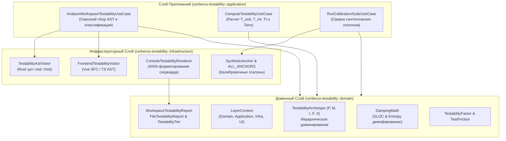

# 🧪 Crate: `cerberus-testability`

> **Движок анализа архитектурной тестируемости (Testability Index Engine), классификации архетипов ($P, M, I, F, X$) и выявления скрытого архитектурного трения в полиглотной кодовой базе (Rust + Vue 3 SFC).**

---

## 📑 Содержание

1. [Назначение крейта](#-назначение-крейта)
2. [Архитектурная схема крейта (Clean Architecture)](#-архитектурная-схема-крейта-clean-architecture)
3. [Математическая модель Testability Index (TI)](#-математическая-модель-testability-index-ti)
4. [Система архитектурных архетипов](#-система-архитектурных-архетипов)
5. [Пофайловая структура и ответственность слоев](#-пофайловая-структура-и-ответственность-слоев)
   - [5.1. Доменный слой (`domain/`)](#51-доменный-слой-domain)
   - [5.2. Слой прикладных сценариев (`application/`)](#52-слой-прикладных-сценариев-application)
   - [5.3. Инфраструктурный слой и AST-визиторы (`infrastructure/`)](#53-инфраструктурный-слой-и-ast-визиторы-infrastructure)
6. [AST-анализ и детекторы архитектурного трения](#-ast-анализ-и-детекторы-архитектурного-трения)
7. [Шкала зрелости кодовой базы (Tiers A..F)](#-шкала-зрелости-кодовой-базы-tiers-af)
8. [Интеграция с CLI и примеры использования](#-интеграция-с-cli-и-примеры-использования)

---

## 🌟 Назначение крейта

`cerberus-testability` — это высокоточный аналитический движок Cerberus 2.0, предназначенный для непрерывной количественной оценки тестируемости программных компонентов без необходимости компиляции и запуска самих тестов. Анализируя структуру синтаксического дерева (AST), точки взаимодействия с внешними ресурсами, инверсию зависимостей и недетерминированные факторы, движок вычисляет композитную метрику **Testability Index ($TI \in [0, 100]$)** и классифицирует каждый файл по 5 каноническим архетипам.

### Ключевые возможности:
- 🔬 **Классификация компонентов по 5 архетипам**: Pure Logic ($P$), Mockable Logic ($M$), Integration Bound ($I$), Flaky Vector ($F$), Poisoned / Untestable ($X$).
- 📐 **Двухфакторная модель оценки**: раздельный расчёт индекса модульной тестируемости ($T_{\text{unit}}$) и интеграционной тестируемости ($T_{\text{int}}$).
- 🚨 **Обнаружение антипаттернов тестируемости**: скрытый ввод-вывод в конструкторах `new()`, недетерминированное время (`Instant::now()`, `SystemTime::now()`), жестко зашитые генераторы UUID/Random, глобальное состояние (`static mut`), блокирующий I/O в async-контексте, утечки реактивности и IPC во Vue SFC.
- 📉 **Демпфирование по объёму (SLOC) и сложности**: учет цикломатической сложности, глубины вложенности и эффекта масштаба по логарифмической шкале $\Phi(\text{SLOC})$.

---

## 🏛️ Архитектурная схема крейта (Clean Architecture)

Крейт организован по принципам чистой слоистой архитектуры с инверсией зависимостей:



---

## 📐 Математическая модель Testability Index (TI)

Композитный индекс тестируемости вычисляется по взвешенной формуле:

$$TI = 0.70 \times T_{\text{unit}} + 0.30 \times T_{\text{int}}$$

### 1. Расчет $T_{\text{unit}}$ (Индекс модульного тестирования)
Отражает легкость написания изолированных быстрых Unit-тестов без поднятия окружения:

$$T_{\text{unit}} = 100 \times \frac{1.0 \cdot N_P + 0.85 \cdot N_M + 0.20 \cdot N_I + 0.05 \cdot N_F + 0.0 \cdot N_X}{N_{\text{total}}} \times \Phi(\text{SLOC})$$

Где $\Phi(\text{SLOC})$ — логарифмический коэффициент демпфирования размера модуля:
$$\Phi(\text{SLOC}) = \frac{1}{1 + \ln\left(1 + \frac{\text{SLOC}}{1000}\right) \times 0.15}$$

### 2. Расчет $T_{\text{int}}$ (Индекс интеграционного тестирования)
Отражает стабильность и воспроизводимость сквозных и интеграционных тестов:

$$T_{\text{int}} = 100 \times \frac{1.0 \cdot (N_P + N_M) + 0.90 \cdot N_I + 0.30 \cdot N_F + 0.05 \cdot N_X}{N_{\text{total}}}$$

---

## 🧬 Система архитектурных архетипов

Каждый исходный файл классифицируется по доминирующему паттерну поведения на основе строгого иерархического правила доминирования признаков:

$$X \succ F \succ I \succ M \succ P$$

| Архетип | Символ | Описание | Инженерные свойства | Вес $T_{\text{unit}}$ | Вес $T_{\text{int}}$ |
|---|:---:|---|---|:---:|:---:|
| **Pure Logic** | **$P$** | Чистые функции, Value Objects, математические формулы, DTO. | Детерминирован, 0 сайд-эффектов, мгновенные тесты без моков. | **1.00** | **1.00** |
| **Mockable Logic** | **$M$** | Сервисы и Use Cases с инверсией зависимостей через трейты (`Arc<dyn Trait>`). | Легко изолируется mock-объектами, высокая модульная тестируемость. | **0.85** | **1.00** |
| **Integration Bound** | **$I$** | Адаптеры инфраструктуры (SurrealDB, FS, HTTP-клиенты, IPC Tauri). | Требует тестового стенда / Testcontainers, моки малоэффективны. | **0.20** | **0.90** |
| **Flaky Vector** | **$F$** | Системы с недетерминизмом (таймауты, гонки потоков, `Instant::now()`, `rand`). | Источник нестабильных тестов (Flakiness), требует виртуализации времени. | **0.05** | **0.30** |
| **Poisoned** | **$X$** | Архитектурный токсин (скрытый I/O в конструкторе домена, `static mut`, недоверенный `unsafe`). | Невозможно протестировать изолированно без сайд-эффектов. | **0.00** | **0.05** |

---

## 📁 Пофайловая структура и ответственность слоев

```
crates/cerberus-testability/src/
├── lib.rs                       # 📚 Корневой модуль, реэкспорт фасадов и типов
├── domain/                      # 🧠 Чистый доменный слой метрик и формул
│   ├── mod.rs                   # 📦 Модуль домена
│   ├── archetype.rs             # 🧬 TestabilityArchetype (P, M, I, F, X) и доминирование
│   ├── factor.rs                # 📐 TestabilityFactor: I/O, время, мутабельность, энтропия
│   ├── friction.rs              # ⚠️ TestFriction: точки трения при написании тестов
│   ├── layer.rs                 # 🧱 LayerContext (Domain, Application, Infrastructure, UI)
│   └── score.rs                 # 📊 WorkspaceTestabilityReport, FileTestabilityReport, Tiers
├── application/                 # ⚙️ Прикладные Use Cases
│   ├── mod.rs                   # 📦 Модуль Use Cases
│   ├── analyze_ast.rs           # 🔍 AnalyzeWorkspaceTestabilityUseCase (AST-оркестрация)
│   ├── calculate_score.rs       # 🧮 ComputeTestabilityUseCase (Расчет индексов и разбивки)
│   └── calibrate.rs             # 🧪 RunCalibrationSuiteUseCase (Калибровка на эталонах)
└── infrastructure/              # 🧱 Парсеры синтаксических деревьев и вывод
    ├── mod.rs                   # 📦 Модуль инфраструктуры
    ├── syn_visitor.rs           # 🦀 TestabilityAstVisitor (Rust Syn AST обходчик)
    ├── frontend_visitor.rs      # ⚡ FrontendTestabilityVisitor (Vue SFC & TS обходчик)
    ├── console_renderer.rs      # 🖥️ ConsoleTestabilityRenderer (Форматирование отчетов)
    └── synthetic_fixtures.rs    # 🏛️ ALL_ANCHORS & SyntheticAnchor (Калибровочные якоря)
```

---

### 5.1. Доменный слой (`domain/`)

#### 1. [`domain/archetype.rs`](./src/domain/archetype.rs)
- **Ответственность**: Декларация перечисления `TestabilityArchetype` (`PureLogic`, `MockableLogic`, `IntegrationBound`, `FlakyVector`, `Poisoned`), вычисление доминирующего архетипа по списку обнаруженных факторов и агрегация процентной структуры `ArchetypeBreakdown`.

#### 2. [`domain/factor.rs`](./src/domain/factor.rs)
- **Ответственность**: Моделирование единичных факторов архитектурного трения:
  - `ConstructorIo`: скрытый ввод-вывод внутри `fn new()` / `fn default()`.
  - `NonDeterministicClock`: обращение к системным часам `Instant::now()`, `SystemTime::now()`.
  - `RandomGenerator`: недетерминированный генератор случайных чисел.
  - `MutableGlobalState`: глобальные блокировки `static mut`, `lazy_static!`.
  - `TraitInversion`: использование интерфейсных трейтов `Arc<dyn Trait>`.
  - `UnmockedSdk`: прямое зацепление с SDK внешних сервисов.

#### 3. [`domain/layer.rs`](./src/domain/layer.rs)
- **Ответственность**: Определение контекста слоя файла (`Domain`, `Application`, `Infrastructure`, `Ui`, `Unknown`) на основе пути и метаданных.
- **Инвариант**: В слое `Domain` любые системные вызовы ввода-вывода или сетевые клиенты классифицируются как архитектурный токсин `Poisoned` ($X$).

#### 4. [`domain/score.rs`](./src/domain/score.rs)
- **Ответственность**: Формирование отчётов `WorkspaceTestabilityReport`, `FileTestabilityReport`, вычисление демпфирования `DampingMath` и присвоение литерных грейдов `TestabilityTier` (Tier A..F).

---

### 5.2. Слой прикладных сценариев (`application/`)

#### 1. [`application/analyze_ast.rs`](./src/application/analyze_ast.rs) — `AnalyzeWorkspaceTestabilityUseCase`
- **Назначение**: Сквозной сбор AST Rust-файлов и Vue SFC компонентов, извлечение факторов тестируемости через визиторы и маппинг в доменные структуры `FileTestabilityReport`.

#### 2. [`application/calculate_score.rs`](./src/application/calculate_score.rs) — `ComputeTestabilityUseCase`
- **Назначение**: Вычисление средневзвешенных показателей $T_{\text{unit}}$, $T_{\text{int}}$, итогового $TI$ и распределения архетипов для всей кодовой базы.

#### 3. [`application/calibrate.rs`](./src/application/calibrate.rs) — `RunCalibrationSuiteUseCase`
- **Назначение**: Прогон синтетических калибровочных якорей (`ALL_ANCHORS`) для подтверждения соответствия математической модели каноническим целевым значениям.

---

### 5.3. Инфраструктурный слой и AST-визиторы (`infrastructure/`)

#### 1. [`infrastructure/syn_visitor.rs`](./src/infrastructure/syn_visitor.rs) — `TestabilityAstVisitor`
- **Назначение**: Глубокий обход синтаксического дерева Rust (`syn::visit::Visit`).
- **Детектирует**:
  - Синхронный I/O (`std::fs::read`, `std::net::TcpStream`) в конструкторах `fn new()`.
  - Захват `std::sync::Mutex` через границу вызова `.await`.
  - Вызовы недетерминированных генераторов времени и UUID.
  - Наличие параметров трейтов `impl Trait` / `dyn Trait`.

#### 2. [`infrastructure/frontend_visitor.rs`](./src/infrastructure/frontend_visitor.rs) — `FrontendTestabilityVisitor`
- **Назначение**: Анализ SFC-файлов `.vue` и `.ts`.
- **Детектирует**:
  - Прямые вызовы `window.__TAURI__.invoke` внутри компонентов.
  - Наличие хука-компаньона `use<Component>.ts`.
  - Использование `shallowRef` для тяжелых структур данных.
  - Наличие симметричной отписки от событий и каналов в `onUnmounted`.

#### 3. [`infrastructure/console_renderer.rs`](./src/infrastructure/console_renderer.rs) — `ConsoleTestabilityRenderer`
- **Назначение**: Форматирование таблицы скоркарда, цветовая индикация грейдов (Tier A..F) и прогресс-баров архетипов ($P / M / I / F / X$).

---

## 🏆 Шкала зрелости кодовой базы (Tiers A..F)

| Грейд | Диапазон TI | Характеристика архитектуры | Доминирующие архетипы |
|:---:|:---:|---|---|
| **Tier A** | **$85.0 - 100.0$** | **Идеальная тестируемость**. Почти полное отсутствие моков, чистый домен ($P > 60\%$), изолированные детерминированные функции. | $P \ge 60\%,\; M \ge 20\%,\; X = 0\%$ |
| **Tier B** | **$65.0 - 84.9$** | **Высокая инженерная культура**. Четкое разделение Use Cases, Mockable-интерфейсы, инфраструктура вынесена в адаптеры. | $P \approx 40\%,\; M \approx 25\%,\; I \approx 30\%$ |
| **Tier C** | **$50.0 - 64.9$** | **Умеренное трение**. Присутствуют связности между модулями, преобладают интеграционные тесты над юнит-тестами. | $I \approx 40-50\%,\; F \le 20\%,\; X \le 5\%$ |
| **Tier D** | **$30.0 - 49.9$** | **Высокая сложность тестирования**. Сильный недетерминизм, асинхронные очереди, плагины или serverless-хэндлеры. | $F \ge 35\% \text{ или } I \ge 45\%,\; X \le 20\%$ |
| **Tier F** | **$0.0 - 29.9$** | **Архитектурный токсин (Legacy)**. Божественные монолиты, сайд-эффекты в конструкторах, прямое зацепление с UI/IPC. | $X \ge 40\% \text{ или } F \ge 60\%$ |

---

## 🚀 Интеграция с CLI и примеры использования

### Использование через CLI Cerberus:
```bash
# Комплексный аудит тестируемости и расчет Testability Index
cargo cerberus check

# Визуализация дерева архитектуры с радиусом взрыва и метриками
cargo cerberus tree
```

### Программный анализ директории на Rust:
```rust
use cerberus_testability::application::{AnalyzeWorkspaceTestabilityUseCase, ComputeTestabilityUseCase};
use cerberus_testability::infrastructure::ConsoleTestabilityRenderer;
use std::path::Path;

fn main() {
    let analyze_uc = AnalyzeWorkspaceTestabilityUseCase::new();
    let compute_uc = ComputeTestabilityUseCase::new();

    let reports = analyze_uc.execute(Path::new("crates/cerberus-domain")).unwrap();
    let workspace_report = compute_uc.execute(&reports);

    ConsoleTestabilityRenderer::render_scorecard(&workspace_report);
}
```
