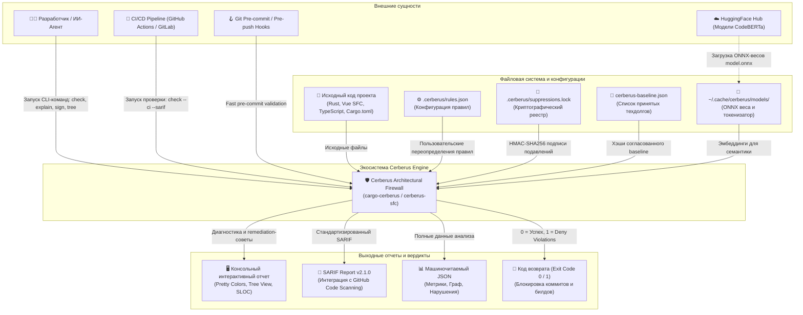
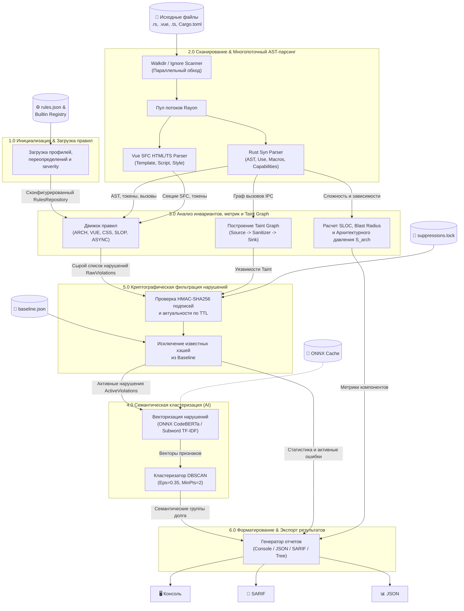
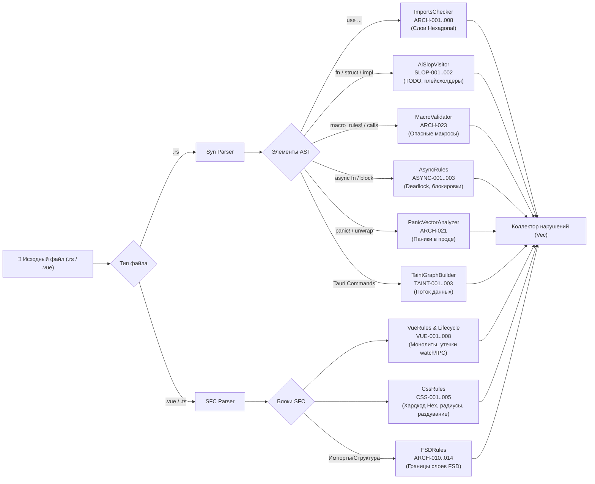

# 🛡️ Cerberus Architectural Firewall & Semantic Engine

> **Универсальная полиглотная система статического анализа, контроля архитектурных инвариантов, криптографического подавления долга и семантической кластеризации кодовой базы (Rust + Vue 3 SFC / TypeScript).**

---

## 📑 Содержание

1. [Обзор экосистемы](#-обзор-экосистемы)
2. [Гексагональная архитектура и инварианты](#-гексагональная-архитектура-и-инварианты)
3. [Диаграммы потоков данных (DFD)](#-диаграммы-потоков-данных-dfd)
   - [DFD Уровень 0: Контекстная диаграмма](#dfd-уровень-0-контекстная-диаграмма)
   - [DFD Уровень 1: Основные процессы](#dfd-уровень-1-основные-процессы)
   - [DFD Уровень 2: Декомпозиция ключевых подсистем](#dfd-уровень-2-декомпозиция-ключевых-подсистем)
     - [DFD 2.1: Сканирование, AST и Taint-анализ](#dfd-21-сканирование-ast-и-taint-анализ)
     - [DFD 2.2: Семантическая кластеризация долга (ONNX / TF-IDF)](#dfd-22-семантическая-кластеризация-долга-onnx--tf-idf)
     - [DFD 2.3: Криптографический реестр подавлений и Baseline](#dfd-23-криптографический-реестр-подавлений-и-baseline)
4. [Карта крейтов монорепозитория](#-карта-крейтов-монорепозитория)
5. [Сводный реестр архитектурных правил](#-сводный-реестр-архитектурных-правил)
6. [Установка и быстрый старт](#-установка-и-быстрый-старт)

---

## 🌟 Обзор экосистемы

**Cerberus** — это высокопроизводительный статический анализатор кода промышленного уровня, разработанный на языке Rust. Он обеспечивает непрерывный аудит чистоты слоёв, проверку гексагональных границ, выявление уязвимостей (Taint Analysis), контроль сложности AST и метрик зацепления/связности, криптографическую защиту от несанкционированного подавления предупреждений (HMAC-SHA256) и AI-кластеризацию архитектурного долга с использованием легковесной нейросети CodeBERTa (ONNX Runtime).

### Ключевые возможности:

- 🦀 **Полный аудит Rust-кода**: проверка запрещенных импортов между слоями (`domain`, `application`, `ports`, `infrastructure`, `tauri`), несанкционированных `panic!`/`unwrap()`, макросов, циклических зависимостей пакетов, утечек возможностей (`Capabilities`) и неасинхронных блокировок.
- ⚡ **Глубокий анализ Vue 3 SFC & TypeScript**: проверка правил FSD (Feature-Sliced Design), монолитных `<script setup>` (предел 15–30 строк клея), хардкода CSS/Hex, раздувания стилей, реактивных ловушек (глубокие `watch`, отсутствие `shallowRef` для тяжелых структур), утечек слушателей Tauri IPC / Channels.
- 🔒 **Криптографический реестр подавлений**: подавление нарушений фиксируется HMAC-SHA256 подписью с привязкой к отпечатку кода (`fingerprint`), автору, сроку жизни (TTL) и причине. Невозможно подделать suppression вручную.
- 🧠 **Семантический кластеринг долга**: встроенный движок векторизации кода (768-мерные эмбеддинги CodeBERTa через ONNX или быстрый Subword TF-IDF) + кластеризатор DBSCAN группируют разрозненные нарушения в смысловые кластеры для приоритизации рефакторинга.
- 🌳 **Иерархический рендеринг компонентов**: визуализация дерева структуры приложения с вычислением радиуса взрыва (`Blast Radius`), строк кода (SLOC) и архитектурного давления ($S_{\text{arch}}$).

---

## 🏛️ Гексагональная архитектура и инварианты

Все крейты организованы в строгом соответствии с принципами **Ports and Adapters (Гексагональная архитектура)**:

```
┌────────────────────────────────────────────────────────┐
│               cargo-cerberus / cerberus-sfc            │ (CLI Adapters / Composition Root)
└───────────────────────────┬────────────────────────────┘
                            │ depends on
┌───────────────────────────▼────────────────────────────┐
│                  cerberus-application                  │ (Use Cases & Orchestration)
└──────────────┬──────────────────────────┬──────────────┘
               │ depends on               │ depends on
┌──────────────▼───────────┐ ┌────────────▼──────────────┐
│      cerberus-ports      │ │      cerberus-domain      │ (Pure Domain Core: 0 SDKs)
└──────────────▲───────────┘ └───────────────────────────┘
               │ implements
┌──────────────┴─────────────────────────────────────────┐
│                 cerberus-infrastructure                │ (Concrete Adapters: Syn, ONNX, FS, Git)
└────────────────────────────────────────────────────────┘
```

| Инвариант    | Ограничение                                                                                                                                                                 |
| ------------ | --------------------------------------------------------------------------------------------------------------------------------------------------------------------------- |
| **ARCH-001** | `cerberus-domain` **НЕ ИМПОРТИРУЕТ** сторонние библиотеки ввода-вывода, базы данных, Tauri, Tokio или сетевые клиенты. Содержит только чистые структуры и доменные формулы. |
| **ARCH-002** | `cerberus-ports` объявляет **ТОЛЬКО** интерфейсы (Rust-трейты). В нем нет реализаций конкретных драйверов.                                                                  |
| **ARCH-003** | `cerberus-application` зависит исключительно от `cerberus-domain` и `cerberus-ports`. Он не знает о файловой системе, HTTP или парсере `syn`.                               |
| **ARCH-004** | `cerberus-infrastructure` реализует трейты из `cerberus-ports`, изолируя все внешние библиотеки (`syn`, `walkdir`, `ort`, `tokenizers`, `rayon`, `git2`, `ring`).           |
| **ARCH-005** | `cargo-cerberus` и `cerberus-sfc` выступают в качестве **Composition Root**: связывают конкретные адаптеры инфраструктуры с Use Case'ами и предоставляют CLI-интерфейс.     |

---

## 📊 Диаграммы потоков данных (DFD)

### DFD Уровень 0: Контекстная диаграмма

Контекстная диаграмма верхнего уровня иллюстрирует границы Cerberus, внешние сущности, источники входных данных и выходные артефакты.



---

### DFD Уровень 1: Основные процессы

Диаграмма уровня 1 показывает ключевые процессы системы и движение данных между ними при выполнении аудита.



---

### DFD Уровень 2: Декомпозиция ключевых подсистем

#### DFD 2.1: Сканирование, AST и Taint-анализ

Детальный поток выполнения статического анализа файлов Rust и Vue SFC.



#### DFD 2.2: Семантическая кластеризация долга (ONNX / TF-IDF)

Процесс семантического анализа и кластеризации архитектурных нарушений для выявления скрытых паттернов техдолга.

```mermaid
flowchart TD
    Violations["📋 Активные нарушения (Active Violations)"] --> Extractor["Формирование контекстного текста\nRule + Crate + Snippet + Message"]

    Extractor --> EngineCheck{"Доступна ли ONNX\nCodeBERTa модель?"}

    EngineCheck -->|Да (model.onnx + tokenizer.json)| ONNX["OnnxEmbedder\n(Ort::Session + Tokenizers)"]
    EngineCheck -->|Нет (Fallback)| TFIDF["SemanticEmbedder\n(Subword N-Gram / TF-IDF)"]

    ONNX -->|Нормализованные 768-dim векторы| Cache["Кэш эмбеддингов\n(EmbeddingCache)"]
    TFIDF -->|Нормализованные N-dim векторы| Cache

    Cache --> Matrix["Матрица векторов нарушений"]
    Matrix --> DBSCAN["DBSCAN Алгоритм\n(Epsilon=0.35, MinPoints=2)"]

    DBSCAN --> Clusters["📦 Семантические кластеры\n(Cluster { id, label, violations, density })"]
    DBSCAN --> Noise["⚪ Изолированные нарушения (Шум)"]

    Clusters --> ExplainReport["📊 Отчет: cargo cerberus explain"]
    Noise --> ExplainReport
```

#### DFD 2.3: Криптографический реестр подавлений и Baseline

Процесс верификации, подписания и сверки подавлений долга с гарантией криптографической неизменяемости.

```mermaid
flowchart TD
    subgraph SignFlow["Процесс подписания: cargo cerberus ledger sign"]
        SignInput["Rule ID + Fingerprint + Reason + Author + TTL"] --> MasterKey["Чтение мастер-ключа HMAC-SHA256\n(Keyring / Environment / File)"]
        MasterKey --> HMACSign["Генерация подписи HMAC-SHA256\nPayload: rule:fp:reason:author:exp"]
        HMACSign --> WriteLock["Запись в .cerberus/suppressions.lock"]
    end

    subgraph VerifyFlow["Процесс верификации при сканировании"]
        FoundViolation["Обнаруженное нарушение"] --> CalcFP["Вычисление отпечатка:\nsha256(rule + version + symbol + normalized_code)"]
        CalcFP --> QueryLock["Поиск записи в suppressions.lock"]
        QueryLock --> FoundInLock{"Запись найдена?"}

        FoundInLock -->|Нет| CheckBase{"Есть в baseline.json?"}
        FoundInLock -->|Да| VerifyKey["Проверка подписи через HMAC-SHA256"]

        VerifyKey --> ValidSig{"Подпись валидна\nи TTL не истек?"}
        ValidSig -->|Да| Suppressed["✅ Нарушение подавлено (Suppressed)"]
        ValidSig -->|Нет (Подделка/Просрочено)| Denied["❌ Нарушение активно (Invalid Signature)"]

        CheckBase -->|Да| BaselineSuppressed["✅ Подавлено как Baseline"]
        CheckBase -->|Нет| ActiveViolation["🚨 АКТИВНОЕ НАРУШЕНИЕ"]
    end
```

---

## 📦 Карта крейтов монорепозитория

Крейты расположены в папке `crates/` и логически декомпозированы по слоям:

| Крейт                                                                                       | Назначение                                                                                                                                                  | Документация                                                                                     |
| ------------------------------------------------------------------------------------------- | ----------------------------------------------------------------------------------------------------------------------------------------------------------- | ------------------------------------------------------------------------------------------------ |
| 📦 [`cargo-cerberus`](./cargo-cerberus/README_cargo-cerberus.md)                            | Основной CLI-инструмент и Composition Root для `cargo cerberus`. Содержит команды `check`, `explain`, `ledger`, `baseline`, `model`, `tree`, `init`.        | [📖 README cargo-cerberus](./cargo-cerberus/README_cargo-cerberus.md)                            |
| 🌐 [`cerberus-sfc`](./cerberus-sfc/README_cerberus-sfc.md)                                  | Специализированный автономный CLI-инструмент для экспресс-аудита Vue 3 SFC компонентов и CSS дизайн-токенов.                                                | [📖 README cerberus-sfc](./cerberus-sfc/README_cerberus-sfc.md)                                  |
| 🧠 [`cerberus-domain`](./cerberus-domain/README_cerberus-domain.md)                         | Чистое доменное ядро. Не содержит внешних зависимостей. Описывает правила, уровни строгости, отпечатки, метрики и сущности кластеров.                       | [📖 README cerberus-domain](./cerberus-domain/README_cerberus-domain.md)                         |
| 🔌 [`cerberus-ports`](./cerberus-ports/README_cerberus-ports.md)                            | Трейты портов гексагональной архитектуры (сканеры, парсеры, репозитории правил, хранилища ключей, эмбеддеры, репортеры).                                    | [📖 README cerberus-ports](./cerberus-ports/README_cerberus-ports.md)                            |
| ⚙️ [`cerberus-application`](./cerberus-application/README_cerberus-application.md)          | Use Cases сценариев использования: аудит рабочего пространства, семантическое объяснение кластеров, расчет дерева компонентов, подпись и сверка подавлений. | [📖 README cerberus-application](./cerberus-application/README_cerberus-application.md)          |
| 🧱 [`cerberus-infrastructure`](./cerberus-infrastructure/README_cerberus-infrastructure.md) | Конкретные реализации портов: парсеры Syn/Vue, DBSCAN кластеризация, ONNX Runtime, Taint Graph, вычисление SLOC и топологии пакетов.                        | [📖 README cerberus-infrastructure](./cerberus-infrastructure/README_cerberus-infrastructure.md) |

---

## 📋 Сводный реестр архитектурных правил

Система Cerberus из коробки контролирует более 40 ключевых архитектурных и инженерных инвариантов:

### 1. Архитектура и изоляция слоев (Hexagonal & FSD)

- `ARCH-001`: `worldwiki-domain` не имеет права импортировать внешние SDK (`tauri`, `tokio`, `surrealdb`, `reqwest`).
- `ARCH-002`: `worldwiki-application` не имеет права импортировать `tauri`.
- `ARCH-003`: `worldwiki-ports` не должен зависеть от конкретных реализаций `worldwiki-infrastructure`.
- `ARCH-004`: `worldwiki-infrastructure` реализует трейты портов, а не диктует доменные правила.
- `ARCH-005`: `worldwiki-tauri` — единственный слой, знающий о `tauri::*`.
- `ARCH-006`: `worldwiki-application` не диспатчит события во фронтенд напрямую (только через `EventPublisherPort`).
- `ARCH-007`: Типы `tauri::*` (`State`, `AppHandle`) запрещены в домене и application.
- `ARCH-008`: Низкоуровневые типы БД (например, `Surreal<Db>`) запрещены в публичных Use Cases.
- `ARCH-010`–`ARCH-014`: Правила Feature-Sliced Design для фронтенда (направление импортов, изоляция слайсов).
- `ARCH-021`: Запрет неконтролируемых паник (`panic!`, `unwrap()`, `expect()`) в проде.
- `ARCH-023`: Запрет опасных макросов (`lazy_static!`, прямые `println!`).
- `ARCH-030`: Контроль архитектурного давления $S_{\text{arch}}$ (функции, цикломатическая сложность, глубина вложенности).

### 2. Frontend, Vue 3, TypeScript & CSS Design Tokens

- `VUE-001`: Запрет божественных монолитов `<script setup>` (> 15–30 строк связующего клея).
- `VUE-002`: Обязательное наличие хука-компаньона `use<Component>.ts`.
- `VUE-003`: Запрет объявления интерфейсов и типов внутри `.vue` (вынос в `*.model.ts`).
- `VUE-004`: Запрет глубокой реактивности (`reactive`/`ref`) на тяжелых структурах данных (только `shallowRef`).
- `VUE-005`: Запрет бесконтрольных глубоких `watch(..., { deep: true })`.
- `VUE-006` / `LEAK-001` / `FE-RAII-001`: Обязательная симметричная очистка слушателей Tauri IPC Events, каналов и таймеров в `onUnmounted`.
- `VUE-007`: Запрет деструктуризации реактивных `props` без `toRefs()` / `toRef()` (потеря реактивности).
- `VUE-008`: Полный запрет прямой мутации входных пропсов (`props.field = val` — нарушение однонаправленного потока данных).
- `VUE-009`: Запрет вызова некэшируемых тяжелых функций в шаблонах внутри циклов (`v-for`) для поддержания 60 FPS.
- `TAURI-002`: Запрет прямого вызова Tauri IPC (`invoke`, `listen`, `Channel`) из компонентов шаблона (только через Use-хук / Store / Service).
- `CSS-001`: Полный запрет Hex-цветов (`#fff`, `#0f1218`) — строго CSS Custom Properties.
- `CSS-002`: Запрет именованных HTML-цветов (`red`, `black`, `white`).
- `CSS-003`: Запрет прямых вызовов `rgb()`, `rgba()`, `hsl()`.
- `CSS-004`: Запрет захардкоженных радиусов скругления (`border-radius: 8px`).
- `CSS-005`: Контроль раздувания стилей (блоки `<style>` не более 50–70 строк).
- `CSS-006`: Запрет использования спецификатора `!important` в таблицах стилей компонентов.
- `TS-BORROW-001`: Запрет создания мутабельных локальных алиасов на Pinia store / реактивное состояние в обход реактивного контракта.
- `TS-MATCH-001`: Проверка исчерпывающего сопоставления с образцом (Exhaustive Pattern Match) в TS `switch (discriminated_union)` через `assertNever(x)`.
- `PERF-DOM-001`: Предотвращение Layout Thrashing (чередования чтений геометрии `offsetHeight` и записей стилей в циклах).

### 3. Taint Analysis, Async & AI Slop

- `TAINT-001`: Несанкционированный проброс несанитизированных пользовательских данных в SQL/FS-синки.
- `TAINT-002`: Утечка чувствительных данных / ключей в логи.
- `ASYNC-001`: Блокирующие вызовы (`std::thread::sleep`, тяжелый синхронный I/O) внутри Tokio runtime.
- `ASYNC-002`: Риск взаимной блокировки (Deadlock) при удержании синхронных `std::sync::Mutex` через `await`.
- `SLOP-001`: Обнаружение оставленного сгенерированного мусора (нереализованные `todo!()`, `unimplemented!()`).
- `SLOP-002`: Заглушки и фиктивные структуры в рабочем коде.

---

## 🚀 Установка и быстрый старт

### Сборка и установка в систему:

```bash
# Из корня монорепозитория
cargo install --path crates/cargo-cerberus
cargo install --path crates/cerberus-sfc
```

### Основные команды:

```bash
# 1. Запуск полного аудита проекта
cargo cerberus check

# 2. Аудит в режиме CI/CD (с кодом возврата 1 при Deny нарушениях и экспортом SARIF)
cargo cerberus check --ci --sarif target/cerberus-report.sarif

# 3. Визуализация дерева архитектуры компонентов и расчет Blast Radius
cargo cerberus tree

# 4. Анализ семантических кластеров долга
cargo cerberus explain

# 5. Загрузка нейросетевой модели CodeBERTa (ONNX)
cargo cerberus model download

# 6. Подписание подавления нарушения криптографическим ключом
cargo cerberus ledger sign --rule ARCH-001 --fingerprint <HASH> --reason "Временный техдолг" --author "developer@company.com"

# 7. Сверка и нормализация файла baseline
cargo cerberus baseline reconcile
```
