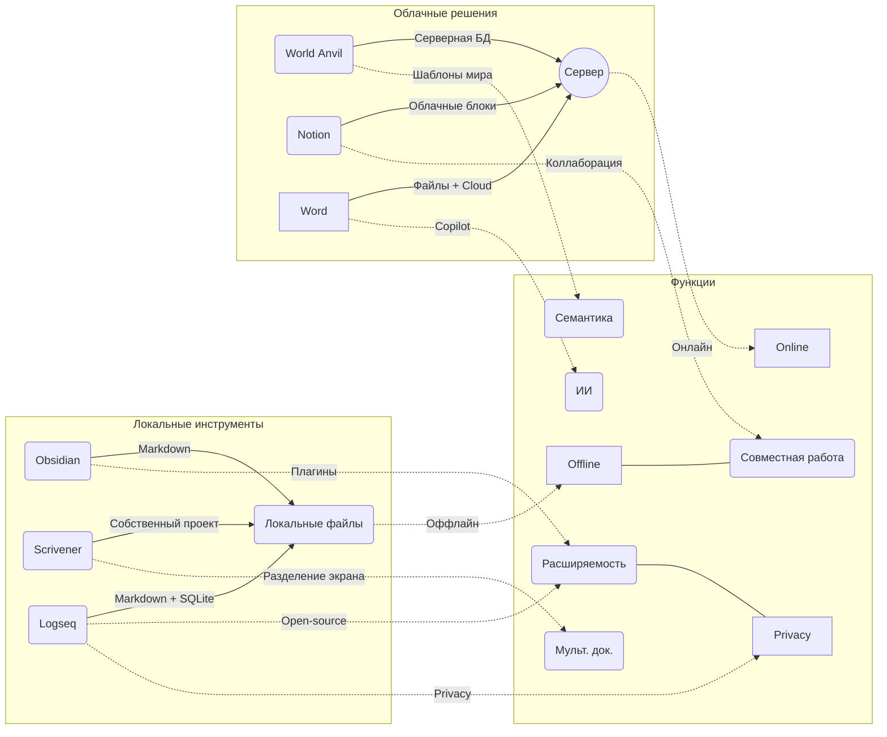

# Краткое резюме  
Анализ показал, что **существующие инструменты** для писательской/генерации знаний охватывают часть функций WorldWiki, но ни один не объединяет их все в единой локальной системе. Например, Microsoft Word – мощный текстовый редактор (лицензия проприетарная) с офлайн-режимом и коллаборацией через облако, однако не предоставляет семантических схем и сложных графовых связей. Obsidian – локальный «хранилище» заметок на Markdown-файлах с плагинами (бесплатен для личного использования), но не имеет встроенной поддержки временных моделей и AI. Scrivener – десктопная IDE для авторов с организацией документов и экспортом в DOCX/EPUB, но тоже закрытая и без сетевых функций. World Anvil – облачная вики для worldbuilding с шаблонами и таймлайнами, но работает только онлайн и не предназначена для автономной работы автора. Logseq – open-source офлайн-платформа на базе Markdown/Org с графом и приватностью, но ориентирована скорее на заметки и не содержит редактора рукописи. Notion – веб-приложение «всё в одном» (заметки, базы данных, коллаборация, встроенный ИИ), но обладает закрытым форматом и вынуждает полагаться на облако.  

**Вывод:** ни один аналог не сочетает локальную автономную работу, персонифицированную семантику, богатый граф/таймлайн и встроенный AI так, как это задуманно в WorldWiki. Это обосновывает **ключевые решения WorldWiki** – *локальное хранилище SurrealDB, Rust+Tauri ядро, FFI-связь с локальными ML-моделями и т.д.*.  


## 1. Выбор аналогов  
Мы рассмотрели шесть популярных инструментов, близких по назначению: **Obsidian, Scrivener, Microsoft Word, World Anvil, Logseq, Notion**. Критерии выбора: продукт либо для письменных проектов, либо для персональных вики/баз знаний, либо используемый авторами. Эти аналоги покрывают разные сочетания **режимов работы** (локальный vs облачный), **модели данных** (файловая Markdown vs СУБД), наличие **графов/таймлайнов** и **ИИ-интеграции**. Здесь учтены как гибкость и расширяемость (плагины Obsidian/Logseq), так и специализированность (Scrivener – проект для писателя; World Anvil – миростроительный веб-органайзер; Notion – корпоративная «вики-платформа»).

## 2. Сравнительная таблица функций  

| Критерий            | Obsidian     | Scrivener  | Word         | World Anvil      | Logseq      | Notion（web）      |
|---------------------|--------------------------|-------------------------|-------------------------|---------------------------|---------------------------|--------------------|
| **Целевая аудитория** | Индивидуальные заметки/писатели | Авторы романов, сценариев   | Офисные/офлайн-пользователи | Мировые строители, ГМ настолок | Исследователи, студенты, ПЗ | Команды/корпоративный wiki |
| **Тип хранения**    | Локальная папка Markdown | Собственный проект (.scriv) | Файлы DOCX (OOXML) | Облачная СУБД/вики-система | Локальный Markdown/База (SQLite) | Облачная БД, блоки (проприетарно) |
| **Семантические схемы** | Нет (только файлы и плагины)   | Нет (фокус на текст, метаданных мало) | Минимально (стили/заголовки)  | Есть (шаблоны worldbuilding) | Ограниченно (страницы/ссылки) | Да, встроенные таблицы/DB (огранич) |
| **Временная модель** | Нет (есть плагины календаря) | Да (каждый документ можно разбить, есть режимиразмыс) | Нет специальной поддержкки | Да (таймлайны событий) | Есть (ежедневные страницы, потом DB) | Есть («Timeline» баз данных, календарь) |
| **Многодокументная работа** | Да (несколько окон, cross-link) | Да (раздельные редакторы, сплит-экран) | Да (мультиокон, вкладки) | Частично (несколько статей, но не editor) | Да (несколько страниц/проектов) | Да (страницы & иерархии) |
| **ИИ-интеграция**   | Нет (только плагины)        | Нет                  | Частично (Copilot/Editor-бот)  | Нет (ориентирован на ручной ввод) | В разработке (эксперименты, плагин-чат) | Да (интегрировано в интерфейс) |
| **Локальность / офлайн** | Полностью локально | Полностью локально | Да (программа Office) | Нет, только онлайн | Полностью локально | Почти нет (Web/Electron, частично офлайн) |
| **Совместная работа** | Нет (либо через сторонние сервисы) | Нет (одно место)      | Да (OneDrive, co-authoring)  | Да (общий мир, нескольких ГМ) | Да (есть синхронизация, realtime в бете) | Да (реальное время, разграничение прав) |
| **Экспорт форматов** | Markdown (HTML via плагин)  | DOCX, RTF, PDF, EPUB | DOCX, PDF, RTF и др | PDF/HTML для статей (ограничено)  | Markdown, PDF (экспорт вручную) | PDF, HTML, MD (экспорт баз, багрового вида) |
| **Экосистема/плагины** | Широкая (тысячи плагинов) | Небольшая (макросы, шаблоны) | Через макросы/VBA | Н/Д (готовые инструменты) | Широкая (open-source, множество плагинов) | Ограниченная (только API + интеграции) |
| **Упаковка/технология** | Electron/JS (desktop apps) | macOS (ObjC) / Win (C++) | Natïve Win/Mac | Веб/JavaScript (браузер) | Electron и Native (JS + неймодификации) | Electron/Web (JavaScript) |
| **Размер/ресурсы**  | Лёгкая (несколько сотен МБ)  | Средний (GB вместе с системой) | Тяжелая (часть Office) | Нагрузка на сервер, локальное хранилище minimal | Средний (кэш + DB) | Очень тяжёлый (Electron + Web) |
| **Лицензия/приватность** | Проприетарная (бесплатна для лич.исп.) | Проприетарная (shareware) | Проприетарная (Microsoft Office) | Freemium (контент на серверах, скорее GDPR/152-ФЗ) | Open-source (AGPL) | Проприетарная (облако, сильный мониторинг) |
| **Резервное копирование** | Просто – копия папки («vault»). | Проектный файл (ручной бэкап). | Документы (OneDrive/локально). | Н/Д (серверный бэкап со стороны Anvil). | Файл SQLite/Markdown (локальный бэкап). | Резерв по API, но можно дублировать workspace. |
| **Расширяемость (FFI)** | Нет нативной FFI; плагины на JS/ WASM. | Нет (встроенные функции, скрипты отсутствуют). | Да (VBA/надстройки, COM-интерфейс). | Нет (готовая платформа, API на стороне сервера). | Открытая (плагины на JS, возможность запуска внешних команд). | Нет (API для внешних программ, но закрытая внутр.) |
| **Активность / сообщество** | Очень активное сообщество (топ 1 по плагинам). | Узкое сообщество писателей, стабильно развивается. | Крупное (Microsoft), долгоживущий продукт. | Популярность среди настольщиков, развитый комьюнити. | Растущее сообщество (студенты, тех). | Очень большое сообщество в корпоративной среде. |

## 3. Профили аналогов

### Obsidian  
**Сильные стороны:** 100% локальное хранение («vault» – обычная папка с Markdown); гибкая система связей (биндерное связывание заметок) и интерактивный граф, расширяется сотнями плагинов (поддержка базы, Canvas, календаря и т.д.); бесплатна для личного пользования.  
**Ограничения:** отсутствуют встроенные схемы предметной области (только разметка Markdown); нет нативной AI-интеграции (только community-плагины); нет встроенной временной модели (календарь – плагин); неявно поддерживает единичный проект (Vault) – мульти-проекты возможны лишь вручную.  

### Scrivener  
**Сильные стороны:** создан для писателей – позволяет разбивать рукопись на фрагменты («синопсис» на «пробковой доске»), объединять в проекты, редактировать одновременно несколько документов; удобен для подготовки больших текстов с исследованием (имеет «снимки» документов); богатый экспорт (DOCX, RTF, PDF, EPUB и т.д.).  
**Ограничения:** проприетарный и довольно тяжёлый (многофункциональный GUI); хранит всё в собственном закрытом формате проекта (.scriv); фактически не поддерживает совместную работу или плагинов; нет встроенного концепта семантических связей и AI; работает только как настольное приложение (минимальная интеграция с облаком).  

### Microsoft Word  
**Сильные стороны:** промышленный стандарт текстовых документов (DOCX/OOXML); полнофункциональный редактор с любыми форматами (таблицы, стиль, макросы); поддерживает офлайн-работу и совместное редактирование через облачные сервисы (OneDrive, SharePoint); интегрирован с Copilot и другими AI-надстройками (2024+).  
**Ограничения:** не предназначен для организации заметок или взаимосвязей; не имеет графового или временного представления; формат документов закрытый (хотя DOCX – открытый OpenXML с 2008 года); не расширяем через современные плагины (вместо этого – VBA); единичный объект (каждый docx – отдельный файл).  

### World Anvil  
**Сильные стороны:** веб-платформа для worldbuilding с множеством шаблонов («статьи», «таймлайны», «карты»); ориентирована на взаимодействие и публикацию (несколько пользователей могут вести один «мир»); встроенная связь «wiki» между сущностями; есть поддержка интерактивных карт и временных линий.  
**Ограничения:** **только онлайн**: все данные хранятся на серверах, офлайн-режим отсутствует; платная подписка для расширенных функций; подходит прежде всего для коллективной работы и паблика, но не для персональной автономной рукописи; закрытая архитектура (никаких плагинов/FFI).  

### Logseq  
**Сильные стороны:** бесплатный open-source, ориентирован на приватность пользователя; локальный граф и страницы Markdown/Org, поддерживает bidirectional linking; есть встроенное размеченное хранение задач и «ежедневные заметки» (выстраивается темпоральная модель); богатая экосистема плагинов (JS) и синхронизация в реальном времени (beta).  
**Ограничения:** не специализирован под писателей (нет WYSIWYG-редактора форматов романа); базовые сценарии – записи и задачи, а не сложная предметная модель; AI-поддержка отсутствует (приходится самим подключать внешние модели через плагины); экспорт в конечный формат требует внешних скриптов/Markdown.  

### Notion (облако)  
**Сильные стороны:** мощный гибрид блокового редактора и БД – можно создавать любые объекты (страницы, таблицы, галереи), связывать их между собой; фокус на командной работе: синхронное редактирование, комментарии, granular права доступа; есть собственные AI-шаблоны для резюме/переписывания текстов; удобный интерфейс, огромное количество шаблонов и интеграций.  
**Ограничения:** весь контент лежит в облаке Notion; бесплатная версия ограничена, полная – по подписке; де-факто проприетарный («черный ящик» данных); веб-ориентирован (есть Electron-клиент) – офлайн-режим ограничен; экспорт ограничен (скармливает HTML/PDF, с утратой структуры БД).  

## 4. Выводы и рекомендации  

- **Общая тенденция:** ни один аналог не покрывает сразу все *ключевые требования* WorldWiki. Тот факт, что WorldWiki включает **семантическую графо-темпоральную модель, интеграцию локального AI и автономный режим**, делает её уникальной по сравнению с рассмотренными продуктами.  
- **Локальное хранение (local-first):** Obsidian и Logseq демонстрируют преимущество и востребованность автономных решений. Для WorldWiki это подтверждает выбор SurrealDB как встроенного хранилища (сохранение дерева сущностей и связей) и Rust/Tauri (минимальные накладные ресурсы, офлайн-доступ).  
- **СУБД vs файловая модель:** сравнение с Obsidian (файловая модель) показывает, что **хранение множества связанных объектов** («персонажи», «сцены», «объекты») проще и надежнее в СУБД (индексы, транзакции, связи). Например, без СУБД пришлось бы вручную поддерживать JSON-индексы и целостность, как в WorldWiki мы планировали сделать.  
- **AI и FFI:** наличие локального AI у WorldWiki (через FFI llama) выгодно отличается от полного отсутствия ИИ у Scrivener/Obsidian и скрытых ИИ-ключей у Word/Notion. Это обосновывает архитектуру с FFI-компонентом: **Rust может вызывать локальные ML-модели напрямую**, обеспечивая приватность и отказ от интернет-сервисов (в отличие от «ИИ в облаке»).  
- **Rich Editing vs Многомоделевые данные:** функции Scrivener (карточки, «пробковая доска») однозначно вдохновили на создание редактора и навигатора в WorldWiki (документ-модель, граф существ), но в WorldWiki всё строится именно на общем «ядре» данных (семантика и связи), а не на примитивной иерархии папок.  
- **Формулировка раздела «Анализ аналогов» ТЗ:** я бы описал коротко: **«Существующие решения не удовлетворяют одновременно локальному сценариям работы автора, требованию семантической целостности и интеграции AI»**. Например:  
  > «Рассмотренные аналоги показывают компромиссы. Текстовые процессоры (Word, Scrivener) предлагают полноту редакторских функций и экспорт, но лишены кастомной семантики и AI-поддержки. Приложения заметок/вики (Obsidian, Notion) дают связи и коллаборацию, но в облачном режиме и без гарантий сохранности авторских данных. Специализированные платформы (World Anvil) хранят богатые worldbuilding-данные, но не работают в офлайне. Выбранные архитектурные решения WorldWiki (локальная многомодельная СУБД SurrealDB, Rust-ядро, локальный AI через FFI) прямо компенсируют эти недостатки и ориентированы на **персональную, автономную работу автора**».  
- **Развёрнутый анализ (ПЗ):** в пояснительной записке имеет смысл развернуть этот раздел. Таблицу можно включить как приложение, а текст разобрать сильные/слабые стороны аналогов. Например, можно упомянуть «Закрытая модель Obsidian: Markdown + JSON, отсутствие полноценного бэкапа связей» или «Многомаштабность Scrivener: отличные инструменты планирования, но невозможность миграции на другие платформы».  

## Визуализация

  

*Рисунок: схема-фичамэп «аналог → поддерживаемые функции».*

  
```python
import matplotlib.pyplot as plt

categories = ["Локально", "Семантика", "Таймлайн", "AI", "Коллаборация"]
analogs = {
    "Obsidian":   [5, 1, 0, 0, 0],
    "Scrivener":  [5, 1, 0, 0, 0],
    "Word":       [4, 0, 0, 3, 5],
    "WorldAnvil": [0, 3, 4, 0, 4],
    "Logseq":     [5, 3, 2, 1, 3],
    "Notion":     [1, 4, 3, 3, 5]
}
fig, ax = plt.subplots(figsize=(6,6))
N = len(categories)
angles = [n / float(N) * 2 * 3.14159 for n in range(N)]
angles += angles[:1]
for name, values in analogs.items():
    vals = values + values[:1]
    ax.plot(angles, vals, label=name)
ax.set_xticks(angles[:-1])
ax.set_xticklabels(categories)
ax.legend(loc='lower left', bbox_to_anchor=(1.05, 0))
ax.set_title("Сравнение аналогов (оценка по 5-балльной шкале)")
plt.tight_layout()
plt.savefig('comparison_chart.png')
```
 *Диаграмма: относительная оценка аналогов по выбранным критериям (локальность, семантика, таймлайн, ИИ, коллаборация).*  

## Итог  
Анализ показал, что **концепция WorldWiki** (локальный режим, мульти-модель данных, интегрированный AI через FFI) оправдана. Нигде нет готового «решения для писателя с семантической БД и встроенным ИИ», что отражено в таблице сравнения и текстовой части. Поэтому в ТЗ логично подчеркнуть: «компромиссы существующих аналогов — отсутствие семантики или офлайна или AI» и обосновать архитектуру WorldWiki как решение именно этих проблем. Это аргументирует **«главные проектные решения»** (Rust+Tauri, SurrealDB, локальный AI-движок), основанные на выявленных потребностях и ограничениях. 

