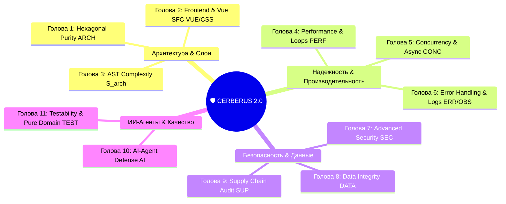
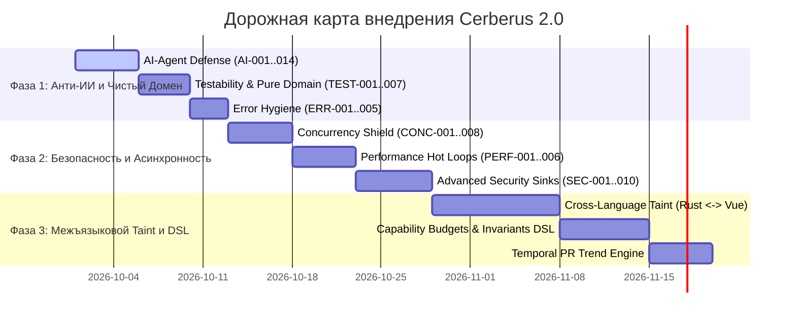

# 🛡️ CERBERUS 2.0: ZERO-TRUST ARCHITECTURAL FIREWALL & DISTRUST ENGINE
## Инженерный манифест, спецификация 11 голов Цербера и архитектура презумпции виновности

> **Статус**: Архитектурная спецификация нового поколения  
> **Область действия**: Все крейты `crates/*`, `apps/*`, `packages/*`  
> **Парадигма**: Презумпция виновности (Express Distrust), контроль возможностей (Capability Budgets), защита от ИИ-галлюцинаций (AI-Agent Defense) и сквозной кросс-языковой Taint-анализ.

---

## 📑 Содержание

1. [Философский манифест: Сдвиг к Презумпции Виновности](#1-философский-манифест-сдвиг-к-презумпции-виновности)
2. [Архитектура 11 Глав Цербера](#2-архитектура-11-глав-цербера)
3. [Сводный реестр правил нового поколения](#3-сводный-реестр-правил-нового-поколения)
   - [Голова 4: Performance & Scalability (`PERF-*`)](#голова-4-performance--scalability-perf-)
   - [Голова 5: Concurrency & Correctness (`CONC-*`)](#голова-5-concurrency--correctness-conc-)
   - [Голова 6: Error Handling & Observability (`ERR-*`, `OBS-*`)](#голова-6-error-handling--observability-err--obs-)
   - [Голова 7: Advanced Security & Taint (`SEC-*`)](#голова-7-advanced-security--taint-sec-)
   - [Голова 8: Data Integrity & Transactions (`DATA-*`)](#голова-8-data-integrity--transactions-data-)
   - [Голова 9: Supply Chain & Dependencies (`SUP-*`)](#голова-9-supply-chain--dependencies-sup-)
   - [Голова 10: AI-Agent Defense (Киллер-фича) (`AI-*`)](#голова-10-ai-agent-defense-киллер-фича-ai-)
   - [Голова 11: Testability & Pure Domain (`TEST-*`)](#голова-11-testability--pure-domain-test-)
4. [Сквозные прорывные технологии (Cross-Cutting Superpowers)](#4-сквозные-прорывные-технологии-cross-cutting-superpowers)
   - [4.1. Cross-Language Taint Flow (Tauri IPC $\longleftrightarrow$ Vue SFC)](#41-cross-language-taint-flow-tauri-ipc--vue-sfc)
   - [4.2. Capability Budgeting Engine](#42-capability-budgeting-engine)
   - [4.3. Invariants DSL (Policy as Code)](#43-invariants-dsl-policy-as-code)
   - [4.4. Temporal & Trend Rules (PR-level Regressions)](#44-temporal--trend-rules-pr-level-regressions)
5. [Матрица реализуемости и анализ сложности AST (`syn`)](#5-матрица-реализуемости-и-анализ-сложности-ast-syn)
6. [Поэтапный план внедрения (3-Phase Roadmap)](#6-поэтапный-план-внедрения-3-phase-roadmap)

---

## 1. Философский манифест: Сдвиг к Презумпции Виновности

Традиционные статические анализаторы и линтеры работают в парадигме **«Разрешено всё, что не запрещено явным правилом»**. Это делает их бессильными перед сложными архитектурными эрозиями, скрытыми дедлоками и особенно кодом, генерируемым ИИ-агентами (когда синтаксис корректен, но нарушены контракты, детерминизм и границы слоев).

```
┌────────────────────────────────────────────────────────────────────────┐
│                        ЭВОЛЮЦИЯ СТРОГОСТИ CERBERUS                     │
├────────────────────────────────────────────────────────────────────────┤
│ УРОВЕНЬ 1: DETECTION (Классический линтер)                             │
│   "Ловит известные паттерны синтаксических ошибок и прямых запретов"    │
│   Пример: domain импортирует reqwest -> DENY.                          │
├────────────────────────────────────────────────────────────────────────┤
│ УРОВЕНЬ 2: CAPABILITY (Анализ возможностей)                            │
│   "Ловит скрытый потенциал модулей на совершение опасных действий"     │
│   Пример: Крейт транзитивно тянет сокеты или unsafe -> WARN.          │
├────────────────────────────────────────────────────────────────────────┤
│ УРОВЕНЬ 3: DISTRUST (Zero-Trust Architectural Firewall) — ЦЕЛЬ 2.0     │
│   "Презумпция виновности: код считается дефектным, пока не доказана     │
│    его архитектурная чистота, детерминизм и покрытость контрактами"    │
│   Пример: Любой I/O в domain без инъекции трейта -> DENY.              │
│           Любой unwrap/#[allow] без HMAC-подписи в Ledger -> DENY.     │
│           Любой LLM-код без property-based теста -> DENY.              │
└────────────────────────────────────────────────────────────────────────┘
```

> [!IMPORTANT]
> **Главный инвариант Cerberus 2.0**: Код не имеет права совершать побочные эффекты (I/O, системное время, генерация UUID, аллокации в hot-paths, модификация глобального состояния), если это явно не разрешено контрактом слоя или бюджетом возможностей (`Capability Budget`).

---

## 2. Архитектура 11 Глав Цербера

В версии 2.0 экосистема Cerberus расширяется до 11 специализированных доменных направлений (Глав):



---

## 3. Сводный реестр правил нового поколения

### Голова 4: Performance & Scalability (`PERF-*`)

| Код | Название | Триггер правила | Уровень | Remediation |
|---|---|---|---|---|
| `PERF-001` | I/O in Loop | Вызов функций с Capability I/O (FS, Network, DB) внутри `for`, `while`, `.iter().map()` | `Warn` / `Deny` (на `#[hot_path]`) | Батчинг операций, вынос I/O за пределы итератора. |
| `PERF-002` | Unbounded Channel | Создание `tokio::sync::mpsc::unbounded_channel()` без фиксированного буфера | `Warn` / `Deny` (в IPC handlers) | Использовать bounded channel `mpsc::channel(N)` с backpressure. |
| `PERF-003` | CPU-bound in Async | Цикл $\ge 1000$ итераций или тяжелая криптография внутри `async fn` без `spawn_blocking` | `Warn` | Оборачивать в `tokio::task::spawn_blocking`. |
| `PERF-004` | Sync Mutex in Async | Использование `std::sync::Mutex` внутри `async fn` | `Warn` / `Deny` (в Tokio runtime) | Заменить на `tokio::sync::Mutex` или реорганизовать владение. |
| `PERF-005` | Hot Loop Allocation | `.clone()`, `format!`, `Vec::new()`, `String::new()` внутри высоконагруженного цикла | `Warn` | Переиспользовать буферы (`buf.clear()`, `&str`, `Cow<str>`). |
| `PERF-006` | Blocking in Drop | Синхронный I/O (`fs::write`, сокеты, `Command`) внутри `impl Drop` | `Deny` (UB-риск) | Асинхронный graceful shutdown через explicit метод `.close().await`. |
| `PERF-007` | Unbounded Recursion | Рекурсивный вызов без явного счетчика глубины или tail-call структуры | `Warn` | Добавить лимит глубины или переписать на итеративный стек. |
| `PERF-008` | Quadratic Loops | Вложенные циклы $O(N^2)$ без раннего выхода `break` / `return` | `Warn` | Использовать `HashSet` / `HashMap` для $O(1)$ lookup. |

---

### Голова 5: Concurrency & Correctness (`CONC-*`)

| Код | Название | Триггер правила | Уровень | Remediation |
|---|---|---|---|---|
| `CONC-001` | Arc Reference Cycle | Структура содержит `Arc<Self>` или `Arc<Mutex<Vec<Arc<Self>>>>` без `Weak` | `Warn` | Использовать `std::sync::Weak` для разрушения циклов утечки памяти. |
| `CONC-002` | Orphan Background Task | `tokio::spawn(...)` без сохранения `JoinHandle` или без `CancellationToken` | `Deny` (в проде) | Сохранять handle или передавать токен отмены для graceful shutdown. |
| `CONC-003` | Unbiased Select | `tokio::select!` без ветки `biased;` в критичных обработчиках очередей | `Warn` | Указывать приоритет обработки событий. |
| `CONC-004` | Mutex Read Dominance | `Mutex<T>` используется исключительно для чтения в $>80\%$ вызовов | `Warn` | Заменить на `tokio::sync::RwLock<T>`. |
| `CONC-005` | Missing Cancellation | Длительная фоновая задача без периодической проверки `token.is_cancelled()` | `Deny` | Встроить проверку токена отмены в итерации. |
| `CONC-006` | Double Lock Deadlock | Повторный захват одного и того же мьютекса в области видимости одной функции | `Deny` (100% Deadlock) | Реорганизовать скоупы `{ let guard = m.lock(); }`. |
| `CONC-007` | Unsafe Send/Sync | Ручная реализация `unsafe impl Send / Sync` без явного `#[safety_comment]` | `Deny` | Добавить исчерпывающее доказательство потокобезопасности. |
| `CONC-008` | Static Mutable State | Использование `static mut` | `Deny` (UB) | Использовать `Atomic*` или `OnceLock<Mutex<T>>`. |

---

### Голова 6: Error Handling & Observability (`ERR-*`, `OBS-*`)

| Код | Название | Триггер правила | Уровень | Remediation |
|---|---|---|---|---|
| `ERR-001` | Result Dropping | `let _ = result;` или вызов `.ok()` для подавления критических ошибок I/O | `Deny` | Явная обработка ошибки или проброс через `?`. |
| `ERR-002` | Panic/Unwrap in Drop | `.unwrap()` или `panic!` внутри блока `impl Drop` | `Deny` (Double Panic $\to$ Abort) | Логировать ошибку через `tracing::error!` без прерывания потока. |
| `ERR-003` | String as Error Type | Возврат `Result<T, String>` в публичном API крейтов | `Warn` / `Deny` | Создавать строго типизированные `enum DomainError` через `thiserror`. |
| `ERR-004` | Untyped Box Error | `Box<dyn std::error::Error>` в сигнатурах доменных Use Cases | `Warn` | Использовать конкретный enum ошибок слоя. |
| `ERR-005` | Library Panic | `panic!`, `todo!()`, `unreachable!()` в библиотечных модулях (`lib target`) | `Deny` | Возвращать `Result<T, Error>`. |
| `OBS-001` | Silent Error Return | Функция возвращает `Err(...)` без записи события в `tracing::error!` / `warn!` | `Warn` (в app/infra) | Добавить структурированный лог перед возвратом ошибки. |
| `OBS-002` | Uninstrumented Async | Публичный Use Case или IPC Handler без аннотации `#[tracing::instrument]` | `Warn` | Добавить трейсинг для распределенной трассировки. |
| `OBS-007` | Secret Leak in Logs | Передача переменных с именами `token`, `password`, `key`, `secret` в макросы логов | `Deny` | Использовать `#[debug(skip)]` или санитизацию через `secrecy`. |

---

### Голова 7: Advanced Security & Taint (`SEC-*`)

```mermaid
flowchart LR
    Source["🚪 Source: IPC Arg / HTTP Query / File"] -->|Tainted String| Sanitizer{"🛡️ Sanitizer Check"}
    Sanitizer -->|Без санитизации| Sink["💥 Dangerous Sink: SQL / FS / Shell"]
    Sanitizer -->|uuid::parse / path.canonicalize / .bind()| Safe["✅ Clean Execution"]
    
    Sink -->|Trigger| Alert["🚨 SEC-001 / SEC-002 / SEC-003 DENY"]
```

| Код | Название | Опасный Sink (Приемник) | Защитный санитизатор |
|---|---|---|---|
| `SEC-001` | SQL Injection | `sqlx::query(&format!(...))` / конкатенация строк | Параметризация через `.bind()` |
| `SEC-002` | Path Traversal | `fs::read(path)` / `File::open(path)` | Проверка `dunce::canonicalize`, запрет `..` |
| `SEC-003` | Command Injection | `std::process::Command::new(tainted)` / `args` | Строгий allowlist команд |
| `SEC-008` | Timing Attack | Сравнение хэшей/паролей/токенов через оператор `==` | `subtle::ConstantTimeEq` |
| `SEC-009` | Hardcoded Secrets | Строки вида `sk-...`, `ghp_...`, `AKIA...`, Base64 > 40 симв. | Загрузка через переменные окружения / Keyring |
| `SEC-010` | Weak Cryptography | Использование алгоритмов `MD5`, `SHA-1`, `DES`, `RC4` | Переход на `SHA-256`, `BLAKE3`, `AES-GCM` |
| `SEC-013` | SSRF Vector | `reqwest::get(tainted_url)` без проверки хоста | Проверка белого списка доменов |

---

### Голова 8: Data Integrity & Transactions (`DATA-*`)

| Код | Название | Триггер правила | Уровень | Remediation |
|---|---|---|---|---|
| `DATA-001` | I/O inside Transaction | Сетевой вызов (HTTP, gRPC) между `tx.begin()` и `tx.commit()` | `Deny` | Выносить внешние сетевые вызовы ДО открытия транзакции БД. |
| `DATA-002` | Non-idempotent Mutator | Мутирующий Use Case без `operation_id` / `idempotency_key` | `Warn` | Добавить ключ идемпотентности в сигнатуру команды. |
| `DATA-003` | Dual Write without Outbox | Одновременный коммит в БД и отправка события в шину без Transactional Outbox | `Warn` | Использовать паттерн Transactional Outbox. |
| `DATA-005` | Floating Point Money | Использование `f32` / `f64` для финансовых/денежных расчетов | `Deny` | Использовать целочисленные копейки `i64` или `rust_decimal::Decimal`. |
| `DATA-006` | Naive Time in Public API | `SystemTime` или `NaiveDateTime` в контрактах межсервисного обмена | `Warn` | Использовать абсолютную шкалу (`DateTime<Utc>` или Абсолютную Минуту $M_{\text{abs}}$). |

---

### Голова 9: Supply Chain & Dependencies (`SUP-*`)

| Код | Название | Триггер правила | Уровень | Remediation |
|---|---|---|---|---|
| `SUP-001` | Transitive Capability Leak | Транзитивная зависимость $N$-го уровня открывает сокеты/процессы без декларирования | `Warn` | Изолировать крейт или заменить на легковесный аналог. |
| `SUP-002` | Unpinned Wildcard Dep | Версии вида `*`, `>=` в релизном `Cargo.toml` | `Deny` | Фиксировать точные семантические версии (`=1.2.3` или `~1.2`). |
| `SUP-003` | Insecure Git Dependency | Зависимости по протоколам `git://` или `http://` | `Deny` | Использовать только `https://` или crates.io с проверкой контрольной суммы. |
| `SUP-007` | Dangerous Build Script | `build.rs`, выполняющий сетевые запросы или запуск сторонних бинарников | `Deny` (без HMAC) | Подписать `build.rs` в криптографическом реестре. |
| `SUP-010` | Yanked Crate Version | Использование отозванной (yanked) версии крейта из crates.io | `Deny` | Обновить версию крейта до актуальной безопасной. |

---

### Голова 10: AI-Agent Defense (Киллер-фича) (`AI-*`)

> [!CAUTION]
> **Защита от вайбкодинга**: Данная группа правил специально разработана для предотвращения деградации кодовой базы при массовой генерации кода автономными LLM-агентами (Claude, GPT-4, Copilot).

| Код | Название | Триггер правила | Уровень | Механизм защиты |
|---|---|---|---|---|
| `AI-001` | Config Tampering | Попытка изменения `.cerberus/rules.json` или `suppressions.lock` без валидной HMAC-подписи | `Deny` | Блокировка мерджа, запрос ручного подтверждения архитектора. |
| `AI-002` | Capability Diff Spike | PR добавляет $>3$ новых системных возможностей (Network + FS + FFI) в один слой | `Require Review` | Блокировка CI до явного аппрува Tech Lead. |
| `AI-003` | Reflection / Self-Probe | Попытка чтения `std::env::current_exe`, `/proc`, `~/.cargo` вне инфраструктурного слоя | `Deny` | Предотвращение побега агента из песочницы проекта. |
| `AI-004` | Self-Modification | `fs::write` по путям `.cerberus/`, `Cargo.toml`, `.git/hooks/` из кода приложения | `Deny` | Запрет самомодификации метаданных фаервола. |
| `AI-008` | Unverified Unsafe | Блок `unsafe { ... }` без предшествующего комментария `// SAFETY: <доказательство>` | `Deny` | Обязательное текстовое обоснование инварианта безопасности. |
| `AI-009` | Unbounded TODO / Stub | Комментарии `// TODO`, `// FIXME` без указания срока жизни (TTL) или Issue URL | `Warn` | Требование формата `// TODO(2026-10-01, #123): описание`. |
| `AI-011` | Mock Parasitism | Тест, в котором мокаются типы из `cerberus-domain` (вместо портов) | `Warn` / `Deny` | Домен обязан тестироваться на РЕАЛЬНЫХ структурах без моков. |
| `AI-013` | Unauthorized Allow | Добавление `#[allow(dead_code)]`, `#[allow(unused)]`, `#[allow(clippy::...)]` без подписи в Ledger | `Deny` | Предотвращение "заметания мусора под ковер" ИИ-агентами. |
| `AI-014` | Hook Modification | Любые изменения файлов в `.git/hooks/*` или `.husky/*` | `Deny` (без подписи) | Защита локального шлюза pre-commit. |

---

### Голова 11: Testability & Pure Domain (`TEST-*`)

| Код | Название | Триггер правила | Уровень | Remediation |
|---|---|---|---|---|
| `TEST-001` | Direct I/O without Trait | Функция выполняет I/O напрямую, не принимая интерфейс `&dyn TraitPort` | `Warn` | Вынести I/O за абстрактный трейт порта. |
| `TEST-002` | Mutable Global in Tests | Использование `lazy_static!`, `static mut` для хранения состояния между тестами | `Deny` | Инъекция состояния через конструкторы структур. |
| `TEST-003` | Hardcoded Dependencies | Метод `new()` внутри Application/Domain инстанциирует конкретные адаптеры `FileStorage::new()` | `Warn` | Dependency Injection через параметры конструктора. |
| `TEST-005` | Non-deterministic Domain Calls | Вызовы `SystemTime::now()`, `Instant::now()`, `Uuid::new_v4()`, `rand::random()` в `domain` | `Deny` | Передавать время и ID как явные параметры методов из Use Case. |
| `TEST-006` | Untested Public API | Публичная функция или Use Case без соответствующего unit-теста в `tests/` | `Warn` | Обязательное покрытие спекой (TDD-инвариант). |
| `TEST-007` | Happy-Path Only Spec | В тестовом наборе отсутствуют проверки сценариев ошибки (`assert!(res.is_err())`) | `Warn` | Добавить негативные тесты и граничные случаи (Edge Cases). |
| `TEST-009` | Missing Property Tests | Парсеры, математические калькуляторы и сериализаторы без `proptest!` | `Warn` | Добавить генеративные фаззинг/property-based тесты. |

---

## 4. Сквозные прорывные технологии (Cross-Cutting Superpowers)

### 4.1. Cross-Language Taint Flow (Tauri IPC $\longleftrightarrow$ Vue SFC)

Уникальная технология сквозного анализа безопасности между бэкендом (Rust) и фронтендом (Vue/TypeScript):

```mermaid
flowchart TD
    subgraph Rust_Backend["🦀 Rust Backend (src-tauri)"]
        Cmd["#[tauri::command]\nfn get_raw_user_content(id: String) -> String"]
        DB[(SurrealDB / FS)] -->|Tainted Payload| Cmd
    end

    subgraph IPC_Boundary["⚡ Tauri IPC Bridge"]
        Bridge["IPC Channel: 'get_raw_user_content'"]
        Cmd --> Bridge
    end

    subgraph Vue_Frontend["🌐 Frontend (apps/spa)"]
        Store["useUserStore.ts\nconst content = await invoke('get_raw_user_content')"]
        Bridge --> Store
        
        Template["UserProfile.vue\n<div v-html=\"content\"></div>"]
        Store -->|Tainted Reactive Ref| Template
    end

    Template -->|Попадание в v-html без DOMPurify| SecurityAlert["🚨 CROSS-TAINT-001 CRITICAL:\nTainted IPC Data flows directly into v-html Sink!"]
```

#### Механика работы:
1. **Rust Parser**: строит карту экспортируемых команд `#[tauri::command]` и их возвращаемых типов.
2. **IPC Mapper**: сопоставляет вызовы `invoke('<command_name>')` во фронтенд-коде.
3. **Frontend Taint Tracker**: отслеживает присваивание результата в переменные и пропсы.
4. **SFC AST Inspector**: если переменная попадает в опасный приемник (`v-html`, `eval()`, `document.write()`) без вызова санитизатора (`DOMPurify.sanitize()`) $\to$ **немедленная блокировка билда**.

---

### 4.2. Capability Budgeting Engine

Вместо примитивного бинарного запрета вводится **бюджетирование системных возможностей** по слоям в `.cerberus/rules.json`:

```json
{
  "version": "2.0",
  "capability_budgets": {
    "crates/cerberus-domain": {
      "max_network_calls": 0,
      "max_fs_writes": 0,
      "max_process_spawns": 0,
      "max_unsafe_blocks": 0,
      "max_env_reads": 0
    },
    "crates/cerberus-application": {
      "max_network_calls": 0,
      "max_fs_writes": 0,
      "max_process_spawns": 0,
      "max_unsafe_blocks": 0
    },
    "crates/cerberus-infrastructure": {
      "max_network_calls": 5,
      "max_fs_writes": 20,
      "max_unsafe_blocks": 2
    }
  }
}
```

---

### 4.3. Invariants DSL (Policy as Code)

Декларативное описание архитектурных и предметных политик в формате TOML/JSON:

```toml
# .cerberus/invariants.toml

[[invariant]]
id = "INV-DOMAIN-PURITY"
description = "Доменные сущности обязаны быть чистыми структурами с Clone и Debug"
selector = "crates/cerberus-domain/src/**/*.rs"
assert = "all struct have #[derive(Clone, Debug)] and 0 framework annotations"
severity = "deny"

[[invariant]]
id = "INV-USE-CASE-IDEMPOTENCY"
description = "Все мутирующие Use Cases обязаны принимать CancellationToken"
selector = "crates/cerberus-application/src/**/save_*.rs"
assert = "all fn execute have parameter token: &CancellationToken"
severity = "deny"
```

---

### 4.4. Temporal & Trend Rules (PR-level Regressions)

Анализ динамики изменения метрик между базовой веткой (`main`) и текущим Pull Request:

```
📊 ДЕЛЬТА-МЕТРИКИ PULL REQUEST:
├── Архитектурное давление ΔS_arch: +12.4%  🚨 DENY (Лимит: +5.0%)
├── Покрытие тестами ΔCoverage:       -1.8%   🚨 DENY (Запрещено падение)
├── Количество клонирований Δ.clone(): +24     ⚠️ WARN (Подозрение на деградацию)
└── Новые транзитивные права:        +Sockets ⚠️ REQUIRE_HUMAN_REVIEW
```

---

## 5. Матрица реализуемости и анализ сложности AST (`syn`)

| Правило | Сложность реализации на `syn` AST | Необходимые структуры / Адаптеры | Риск ложных срабатываний (False Positives) |
|---|---|---|---|
| `AI-001`..`AI-004`, `AI-013` | 🟢 **Низкая (1-2 дня)** | Хэширование файлов, HMAC-SHA256, проверка атрибутов `#[allow]` | 0% (Детерминированная проверка) |
| `TEST-005` (Time/Uuid в domain) | 🟢 **Низкая (1 день)** | Поиск сегментов `Path` (`SystemTime`, `Instant`, `Uuid`) | < 1% |
| `CONC-002`, `CONC-008` (Spawn/Static mut) | 🟢 **Низкая (1 день)** | Обход `ItemStatic`, вызовы `tokio::spawn` в AST | 0% |
| `ERR-001`, `ERR-002` (Result drop/Drop panic) | 🟡 **Средняя (2-3 дня)** | Обход `Stmt::Semi`, проверка `impl Drop` | < 3% |
| `PERF-001` (I/O в циклах) | 🟡 **Средняя (3-4 дня)** | Анализ тел `Expr::ForLoop`, `Expr::While` на наличие I/O вызовов | ~5% (Требует allowlist чистых функций) |
| `SEC-001`..`SEC-003` (Taint Sinks) | 🟡 **Средняя (3-5 дней)** | `TaintGraphBuilder` + сопоставление вызовов `Command`, `format!` | ~5% |
| `Cross-Language Taint` (Rust $\to$ SFC) | 🔴 **Высокая (1-2 недели)** | Парсер `syn` + Парсер Vue SFC + IPC Bridge DTO Mapper | ~7% (Решается санитизаторами) |
| `Temporal Rules` (PR Diff Engine) | 🟡 **Средняя (3-5 дней)** | Интеграция с `git2` / CLI diff + хранение baseline метрик | 0% |

---

## 6. Поэтапный план внедрения (3-Phase Roadmap)



### 🎯 Фаза 1: «Железный щит от деградации» (Immediate Impact)
1. Реализация блока **`AI-001..AI-014`**: Защита конфигурации `.cerberus/`, запрет несанкционированных `#[allow]`, строгий контроль `unsafe` без safety-комментариев.
2. Реализация **`TEST-001..TEST-007`**: Запрет грязного недетерминированного I/O (`SystemTime`, `Uuid`) в слое `cerberus-domain`.
3. Реализация **`ERR-001..ERR-005`**: Запрет замалчивания `Result` (`let _ = ...`), паник в библиотеках и нетипизированных `Result<T, String>`.

### 🛡️ Фаза 2: «Асинхронность, Скорость и Безопасность»
1. Реализация блока **`CONC-*`**: Детекция сиротливых задач без `JoinHandle`/`CancellationToken`, детекция двойных блокировок.
2. Реализация блока **`PERF-*`**: Запрет I/O в циклах, контроль `unbounded_channel`, аллокаций в горячих путях.
3. Расширение **`SEC-*`**: Детекция SQL/Command-инъекций, тайминг-атак и захардкоженных секретов.

### 🚀 Фаза 3: «Сквозной Кросс-языковой Интеллект»
1. Разработка **`Cross-Language Taint Engine`**: Полный сквозной трекинг потока данных от Tauri IPC до шаблонов Vue SFC (`v-html`).
2. Внедрение **`Capability Budgets`** и декларативного **`Invariants DSL`**.
3. Реализация **`Temporal Trends`**: Автоматический контроль деградации метрик сложности ($S_{\text{arch}}$) и покрытия тестами в PR.

---

> 🏛️ *Манифест разработан в соответствии с принципами Zero-Trust Software Engineering и гексагональной чистоты ядра WorldWiki / Cerberus.*
