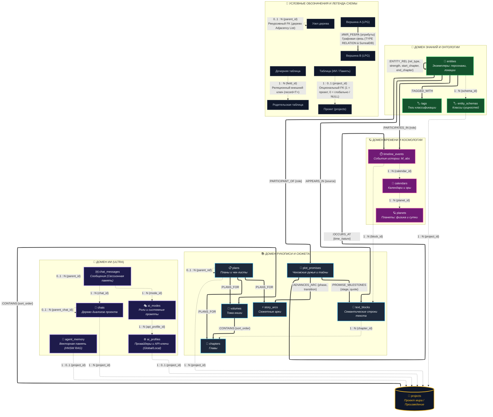

## 2.8. Концептуальная схема базы данных

### 2.8.1. Мультимодельная парадигма концептуального моделирования

Специфика автоматизированной системы «WorldWiki» заключается в одновременном обслуживании четырех гетерогенных информационных потоков:

1. **Иерархической композиции рукописи** (тома, главы, строки текста).
2. **Семантического графа онтологии лора** (персонажи, фракции, локации и динамические отношения между ними).
3. **Астрономической хронологии** (планетарные циклы, календари, координата абсолютной минуты $M_{\text{abs}}$).
4. **Когнитивного диалогового ИИ-пространства** (древовидные ветвящиеся диалоги, сессионный контекст, долгосрочная векторная память).

В связи с этим концептуальная модель базируется на **мультимодельной парадигме**, объединяющей три подхода к организации данных:

- **Размеченный граф свойств (Labeled Property Graph, LPG):** реализует семантические $M:N$ связи лора и сюжетной динамики через ребра первого класса (`TYPE RELATION`), обладающие собственными атрибутами (вес, фаза, цитата, этап жизненного цикла).
- **Реляционные иерархии (кардинальность модели Чена $1:N$):** обеспечивают строгую древовидную соподчиненность для чатов, композиции произведения и астрономических справочников через структурные внешние ссылки прямого доступа (`record<T>`).
- **Векторное индексное пространство (Vector RAG):** организует семантический поиск по долгосрочной памяти агента (`agent_memory`) на базе HNSW-индексации без необходимости создания жестких реляционных связей.

---

### 2.8.2. Архитектурная декомпозиция на предметные домены

Концептуальная модель декомпозирована на корневой узел и **четыре предметных домена**:

1. **Корневой контекст вселенной (`projects`):**
   Изолирует рукописи, онтологию лора, космологию и диалоговые сессии конкретного литературного мира.
2. **Домен рукописи и сюжета (Narrative Domain):**
   - `volumes` — композиционные тома произведения;
   - `chapters` — главы рукописи;
   - `text_blocks` — атомарные семантические строки текста с типизацией («описание», «диалог», «мысль»);
   - `story_arcs` — сквозные драматургические линии (арки персонажей, конфликтов, тем);
   - `plot_promises` — сюжетные обещания («чеховские ружья», тайны, предзнаменования);
   - `plans` — авторские планы и чек-листы с рекурсивной декомпозицией.
3. **Домен знаний и онтологии (Knowledge Graph / Lore Domain):**
   - `entity_schemas` — мета-схемы (классы сущностей: персонаж, локация, артефакт, фракция), задающие структуру полей;
   - `entities` — конкретные экземпляры объектов энциклопедии мира;
   - `tags` — таксономические метки классификации.
4. **Домен времени и космологии (Chronology / Time Domain):**
   - `planets` — небесные тела с астрофизическими параметрами суток и орбит;
   - `calendars` — календарные системы с правилами високосных циклов и эр, привязанные к планете;
   - `timeline_events` — исторические события мира, зафиксированные в координате абсолютной минуты ($M_{\text{abs}} \in \mathbb{Z}$).
5. **Домен когнитивного ИИ (AI & Workspace):**
   - `ai_profiles` — провайдеры языковых моделей и шлюзы доступа (локальные и глобальные);
   - `ai_modes` — ролевые режимы работы ассистента («Критик», «Редактор», «Хранитель лора») с системными промптами;
   - `chats` — иерархическое дерево диалогов проекта;
   - `chat_messages` — атомарные реплики диалога с древовидным ветвлением альтернативных генераций;
   - `agent_memory` — долгосрочная память агента (векторные факты о мире и предпочтения автора).

---

### 2.8.3. Графическая концептуальная схема базы данных

На рисунке 2.1 приведена концептуальная схема базы данных АС «WorldWiki».

_Рисунок 2.1 — Концептуальная графово-документная схема базы данных АС «WorldWiki»_

---

### 2.8.4. Спецификация концептуальных сущностей предметной области

В таблице 2.4 приведен полный реестр концептуальных классов сущностей системы.

Таблица 2.4 — Реестр концептуальных сущностей базы данных

| Домен              | Сущность           | Семантическое назначение                                            | Идентификатор      | Базовые и атрибутивные характеристики                                                                                                                                                                                                                                  |
| ------------------ | ------------------ | ------------------------------------------------------------------- | ------------------ | ---------------------------------------------------------------------------------------------------------------------------------------------------------------------------------------------------------------------------------------------------------------------- |
| **Корень**         | `projects`         | Корневое рабочее пространство вселенной или книги.                  | <u>project_id</u>  | Название, Описание, Жанры, Конфигурационные метаданные, Дата_создания                                                                                                                                                                                                  |
| **Нарратив**       | `volumes`          | Крупный композиционный том произведения.                            | <u>volume_id</u>   | Заголовок, Ссылка на проект (`project_id`)                                                                                                                                                                                                                             |
| **Нарратив**       | `chapters`         | Глава рукописи, содержащая совокупность семантических строк текста. | <u>chapter_id</u>  | Название, Порядковый номер (`sort_order`), Объем слов, Текст (`content`), Ссылка на проект (`project_id`)                                                                                                                                                              |
| **Нарратив**       | `text_blocks`      | Атомарная строка текста рукописи (квант верстки).                   | <u>block_id</u>    | Семантический тег (`block_type`: description, dialogue, thought), Порядковый индекс (`order_index`), Текст строки (`content`), Векторные эмбеддинги, Ссылка на главу (`chapter_id`)                                                                                    |
| **Нарратив**       | `story_arcs`       | Сквозная сюжетная линия (арка персонажа, конфликта, темы).          | <u>arc_id</u>      | Название, Тип арки (`arc_type`: character, event, relationship, theme), Статус (`status`), Цвет в UI                                                                                                                                                                   |
| **Нарратив**       | `plot_promises`    | Нарративный узел (сценарная единица, чеховское ружье, загадка).     | <u>promise_id</u>  | Заголовок, Категория (`kind`: gun, mystery, foreshadowing, question, conflict, scene), Текущий статус (`status`), Заметки, Локация (`location_id`), Событие таймлайна (`timeline_event_id`), Абсолютная минута ($M_{\text{abs}}$), Ссылка на календарь (`calendar_id`) |
| **Нарратив**       | `plans`            | Иерархические пункты авторского плана и чек-листы.                  | <u>plan_id</u>     | Название задачи, Флаг выполнения (`completed`), Порядковый номер (`sort_order`), Тип родителя (`parent_type`), Ссылка на родителя (`parent_ref`), Ссылка на проект (`project_id`)                                                                                      |
| **Онтология**      | `entity_schemas`   | Мета-класс (шаблон типа) сущностей лора.                            | <u>schema_id</u>   | Ключ типа (`type_key`), Наименование (`type_name`), Пиктограмма, Цвет, Декларативная схема полей (`fields_schema`), Ссылка на проект (`project_id`)                                                                                                                    |
| **Онтология**      | `entities`         | Экземпляр объекта базы знаний (герой, замок, орден, артефакт).      | <u>entity_id</u>   | Каноническое имя, Описание, Ссылка на схему (`schema_id`), Динамический JSON-объект характеристик (`attributes`), Векторные эмбеддинги                                                                                                                                 |
| **Онтология**      | `tags`             | Классификационные теги и тематические метки.                        | <u>tag_id</u>      | Наименование тега, Цвет плашки в интерфейсе, Ссылка на проект (`project_id`)                                                                                                                                                                                           |
| **Время**          | `planets`          | Астрофизический базис мира (планета).                               | <u>planet_id</u>   | Наименование, Продолжительность суток в тиках (`ticks_per_day`), Осевой наклон, Орбитальный период, Массив характеристик лун, Ссылка на проект (`project_id`)                                                                                                          |
| **Время**          | `calendars`        | Календарная система и правила счисления эпох.                       | <u>calendar_id</u> | Название, Ссылка на планету (`planet_id`), Структура месяцев, недель и високосных поправок, Флаги (`is_default`, `is_master`), Ссылка на проект (`project_id`)                                                                                                         |
| **Время**          | `timeline_events`  | Историческое событие на шкале вселенной.                            | <u>event_id</u>    | Наименование события, Описание, Координата абсолютной минуты ($M_{\text{abs}}$), Ссылка на календарь (`calendar_id`), Ссылка на блок текста (`block_id`), Ссылка на проект (`project_id`) |
| **Когнитивный ИИ** | `ai_profiles`      | Конфигурация провайдера LLM и параметров доступа.                   | <u>profile_id</u>  | Наименование профиля, Идентификатор провайдера (`provider`: local, openai, anthropic и др.), Base URL, API-ключ, Признак глобальности (`is_global`), Ссылка на проект (`project_id`)                                                                                   |
| **Когнитивный ИИ** | `ai_modes`         | Ролевой профиль ассистента со специализированным поведением.        | <u>mode_id</u>     | Уникальный слаг, Имя роли, Системный ролевой промпт (`role_definition`), Дополнительные инструкции, Ссылка на профиль (`api_profile_id`), Ссылка на проект (`project_id`)                                                                                              |
| **Когнитивный ИИ** | `chats`            | Сессия взаимодействия (узел дерева диалогов).                       | <u>chat_id</u>     | Заголовок ветки, Тематический тег, Массив сессионного контекста (`session_context`), Ссылка на проект (`project_id`), Ссылка на родительский чат (`parent_chat_id`)                                                                                                    |
| **Когнитивный ИИ** | `chat_messages`    | Атомарная реплика в диалоговом пространстве (сессионная память).    | <u>message_id</u>  | Роль (`role`: user, assistant, system), Текст реплики, Логи рассуждений (`reasoning`), Ссылка на родительское сообщение (`parent_id`), Ссылка на режим (`mode_id`)                                                                                                     |
| **Когнитивный ИИ** | `agent_memory`     | Долгосрочная векторная память и авторский контекст соавтора.        | <u>memory_id</u>   | Тип записи (`memory_type`: fact, user_preference, summary), Текстовое содержание, Оценка важности (`importance`), Признак глобальности (`is_global`), Векторные эмбеддинги, Ссылка на проект (`project_id`)                                                            |

---

### 2.8.5. Спецификация связей: графовые ребра и структурные ссылки

#### Таблица 2.5 — Спецификация графовых ребер (`TYPE RELATION`, LPG-модель)

| Ребро отношения        | Исходный класс (IN)    | Целевой класс (OUT)                   | Кардинальность | Атрибуты отношения                                                                           | Семантическое назначение                                                                                                                      |
| ---------------------- | ---------------------- | ------------------------------------- | -------------- | -------------------------------------------------------------------------------------------- | --------------------------------------------------------------------------------------------------------------------------------------------- |
| `:CONTAINS`            | `projects` / `volumes` | `volumes` / `chapters`                | $1:N$          | `sort_order: number`                                                                         | Иерархическая композиция структуры книги (Проект $\rightarrow$ Тома $\rightarrow$ Главы).                                                     |
| `:APPEARS_IN`          | `entities`             | `text_blocks`                         | $M:N$          | `source: string`, `role: string`                                                             | Упоминание персонажа, артефакта или локации в конкретном семантическом блоке текста рукописи (`((Сущность))`).                               |
| `:PARTICIPANT_OF`      | `entities`             | `plot_promises`                       | $M:N$          | `role: string`                                                                               | Прямое авторское закрепление действующих лиц, локаций и артефактов за нарративным узлом.                                                      |
| `:ADVANCES_ARC`        | `plot_promises`        | `story_arcs`                          | $M:N$          | `phase: string`, `transition: string`                                                        | Драматургический сдвиг: продвижение фазы арки (`setup`, `escalation`, `climax`, `resolution`) в данном нарративном узле.                      |
| `:OCCURS_AT`           | `plot_promises`        | `timeline_events`                     | $M:N$          | `time_nature: string`                                                                        | Привязка нарративного узла к событию шкалы времени мира с указанием диегетической природы (`present`, `flashback`, `memory`, `dream`).        |
| `:PROMISE_MILESTONES`  | `plot_promises`        | `text_blocks`                         | $M:N$          | `stage: string`, `quote: string`                                                             | Физический якорь нарративного узла в тексте рукописи: этап жизненного цикла (`plant`, `progression`, `resolution`) и точная цитата (`quote`). |
| `:PLANS_FOR`           | `plans`                | `volumes` / `chapters` / `story_arcs` | $M:N$          | —                                                                                            | Графовая декомпозиция авторских планов и чек-листов по объектам рукописи и сюжета.                                                            |
| `:ENTITY_REL`          | `entities`             | `entities`                            | $M:N$          | `rel_type: string`, `strength: int`, `start_chapter: record`, `end_chapter: record`           | Рекурсивные связи лора (родство, союз, вражда, подчинение) с оценкой силы и временными границами действия.                                    |
| `:TAGGED_WITH`         | `entities`             | `tags`                                | $M:N$          | —                                                                                            | Ассоциация сущностей с таксономическими тегами классификации.                                                                                 |
| `:PARTICIPATES_IN`     | `entities`             | `timeline_events`                     | $M:N$          | `role: string`, `notes: string`                                                              | Участие персонажей и фракций в исторических хронологических событиях мира.                                                                    |

#### Таблица 2.6 — Спецификация структурных ссылок (`Record Links`, реляционная модель)

| Поле-ссылка      | Исходная сущность | Целевая сущность | Кардинальность      | Семантическое назначение                                                            |
| ---------------- | ----------------- | ---------------- | ------------------- | ----------------------------------------------------------------------------------- |
| `chapter_id`     | `text_blocks`     | `chapters`       | $N:1$ (Mandatory)   | Физическая принадлежность семантической строки главе рукописи.                      |
| `block_id`       | `timeline_events` | `text_blocks`    | $N:1$ (Optional)    | Точная привязка исторического события к семантическому блоку текста сцены рукописи. |
| `project_id`     | `plans`           | `projects`       | $N:1$ (Mandatory)   | Принадлежность авторского плана проекту произведения.                               |
| `parent_ref`     | `plans`           | `plans`          | $N:1$ (Optional)    | Рекурсивная иерархия планов: декомпозиция задачи на подзадачи (дерево чек-листов).  |
| `project_id`     | `entity_schemas`  | `projects`       | $N:1$ (Mandatory)   | Закрепление мета-схемы классов онтологии за конкретным миром.                       |
| `schema_id`      | `entities`        | `entity_schemas` | $N:1$ (Mandatory)   | Инвариант онтогенеза: типизация сущности строгой схемой.                            |
| `planet_id`      | `calendars`       | `planets`        | $N:1$ (Mandatory)   | Привязка календаря к астрофизическим суткам и циклу планеты.                        |
| `calendar_id`    | `timeline_events` | `calendars`      | $N:1$ (Mandatory)   | Контекстная календарная система, в которой зафиксировано событие.                   |
| `project_id`     | `chats`           | `projects`       | $N:1$ (Mandatory)   | Принадлежность диалогового дерева проекту произведения.                             |
| `parent_chat_id` | `chats`           | `chats`          | $N:1$ (Optional)    | Иерархическое ветвление тематических диалоговых сессий (дерево чатов).              |
| `chat_id`        | `chat_messages`   | `chats`          | $N:1$ (Mandatory)   | Принадлежность сообщения конкретному диалоговому потоку.                            |
| `parent_id`      | `chat_messages`   | `chat_messages`  | $N:1$ (Optional)    | Древовидная структура сообщений (альтернативные генерации и ветвления ответов).     |
| `mode_id`        | `chat_messages`   | `ai_modes`       | $N:1$ (Optional)    | Ролевой режим, в котором было сгенерировано ответное сообщение.                     |
| `api_profile_id` | `ai_modes`        | `ai_profiles`    | $N:1$ (Mandatory)   | Привязка роли к конкретному провайдеру и модели нейросети.                          |
| `project_id`     | `ai_profiles`     | `projects`       | $N:0..1$ (Optional) | Привязка профиля к проекту либо глобальный статус (при `project_id = null`).        |
| `project_id`     | `agent_memory`    | `projects`       | $N:0..1$ (Optional) | Проектная память мира либо глобальный авторский контекст (при `project_id = null`). |
| `project_id`     | `chats`           | `projects`       | $N:1$ (Mandatory)   | Принадлежность диалогового дерева проекту произведения.                             |
| `parent_chat_id` | `chats`           | `chats`          | $N:1$ (Optional)    | Иерархическое ветвление тематических диалоговых сессий (дерево чатов).              |
| `chat_id`        | `chat_messages`   | `chats`          | $N:1$ (Mandatory)   | Принадлежность сообщения конкретному диалоговому потоку.                            |
| `parent_id`      | `chat_messages`   | `chat_messages`  | $N:1$ (Optional)    | Древовидная структура сообщений (альтернативные генерации и ветвления ответов).     |
| `mode_id`        | `chat_messages`   | `ai_modes`       | $N:1$ (Optional)    | Ролевой режим, в котором было сгенерировано ответное сообщение.                     |
| `profile_id`     | `ai_modes`        | `ai_profiles`    | $N:1$ (Mandatory)   | Привязка роли к конкретному провайдеру и модели нейросети.                          |
| `project_id`     | `ai_profiles`     | `projects`       | $N:0..1$ (Optional) | Привязка профиля к проекту либо глобальный статус (при `project_id = null`).        |
| `project_id`     | `agent_memory`    | `projects`       | $N:0..1$ (Optional) | Проектная память мира либо глобальный авторский контекст (при `project_id = null`). |

---

### 2.8.6. Доменные инварианты и правила целостности

#### 1. Централизованный нарративный хаб (`plot_promises`) и физический текстовый якорь (`text_blocks`)

Система четко разграничивает смысловое драматургическое моделирование и верстку текста рукописи:

- **Нарративный хаб (`plot_promises`):** Писатель оперирует смысловыми сценарными узлами и обещаниями читателю («Чеховские ружья», поворотные сцены, тайны). Именно этот узел выступает единой точкой сборки метаданных: к нему привязаны действующие лица (`:PARTICIPANT_OF`), продвигаемые сюжетные арки (`:ADVANCES_ARC`) и темпоральная координата события (`:OCCURS_AT`).
- **Текстовый якорь (`:MILESTONE` $\rightarrow$ `text_blocks`):** Строки текста главы (`text_blocks`) представляют собой атомарный физический носитель текста с семантическим тегом (`block_type`). Нарративный узел закрепляется в рукописи посредством вех `:MILESTONE` с точной фиксацией цитаты и фазы жизненного цикла («посажено» $\rightarrow$ «развито» $\rightarrow$ «отстреляно»). Несколько сюжетных узлов могут свободно ссылаться на одни и те же строки текста без раздувания схемы.

#### 2. Трехуровневая архитектура когнитивной памяти ИИ

- **Сессионная память (Short-term):** Организована на уровне реляционной истории реплик `chat_messages` внутри конкретного `chat_id` с поддержкой прикрепленного контекста (`chats.session_context`).
- **Проектная память (Long-term Project):** Записи `agent_memory` с установленным `project_id`. Содержит выжимки лора и факты мира, доступные во всех чатах проекта через векторный семантический поиск.
- **Всепроектная глобальная память (Global User):** Записи `agent_memory` с признаком `is_global = true` и `project_id = null`. Хранит персональные стилистические правила и предпочтения автора сквозным образом для всех его произведений.

#### 3. Строгий онтогенез базы знаний

Сущность лора (`entities`) не может существовать вне контекста мета-схемы (`entity_schemas`): обязательная структурная ссылка `schema_id` обеспечивает валидацию динамических атрибутов. Схемы изолированы в рамках вселенной ссылкой `project_id`. Межсущностные отношения описываются рекурсивным графовым ребром `:ENTITY_REL` с поддержкой асимметричности и числового коэффициента силы.

#### 4. Космологическая декомпозиция времени и единый эталон $M_{\text{abs}}$

Хронологическая подсистема исключает использование стандартных типов `Date`/`Timestamp`. Время моделируется трехзвенной цепочкой:
$$\text{Физика планеты (planets)} \longrightarrow \text{Календарная система (calendars)} \longrightarrow \text{События таймлайна (timeline\_events)}$$
Планета определяет квантование суток (`ticks_per_day`), календарь формирует эры и високосные правила, а событие фиксирует абсолютную минуту $M_{\text{abs}} \in \mathbb{Z}$, что обеспечивает корректную сортировку разнородных календарных исчислений.
