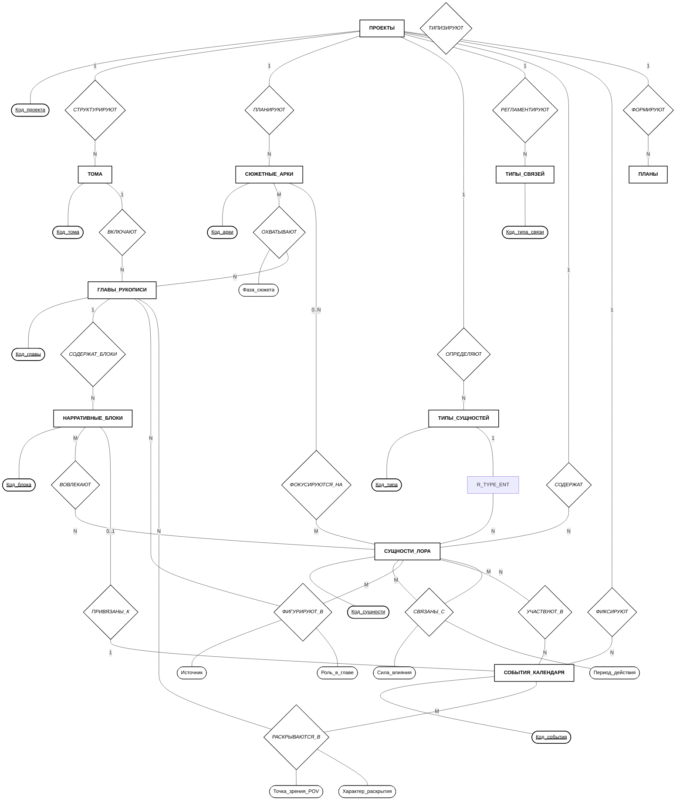
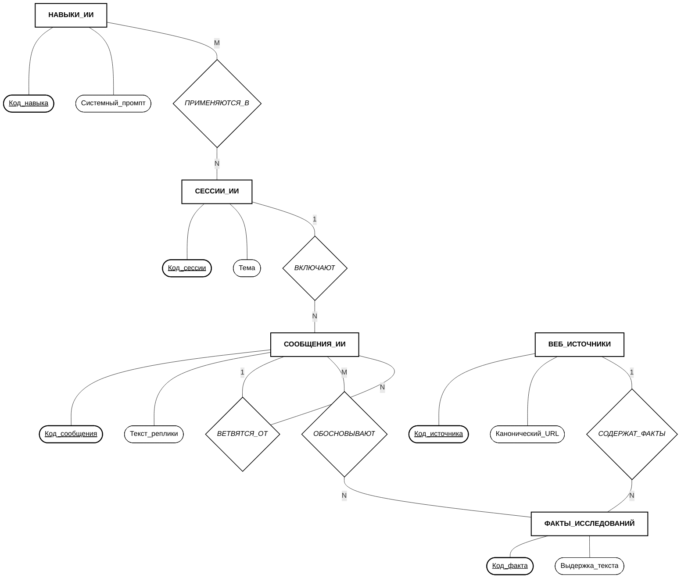
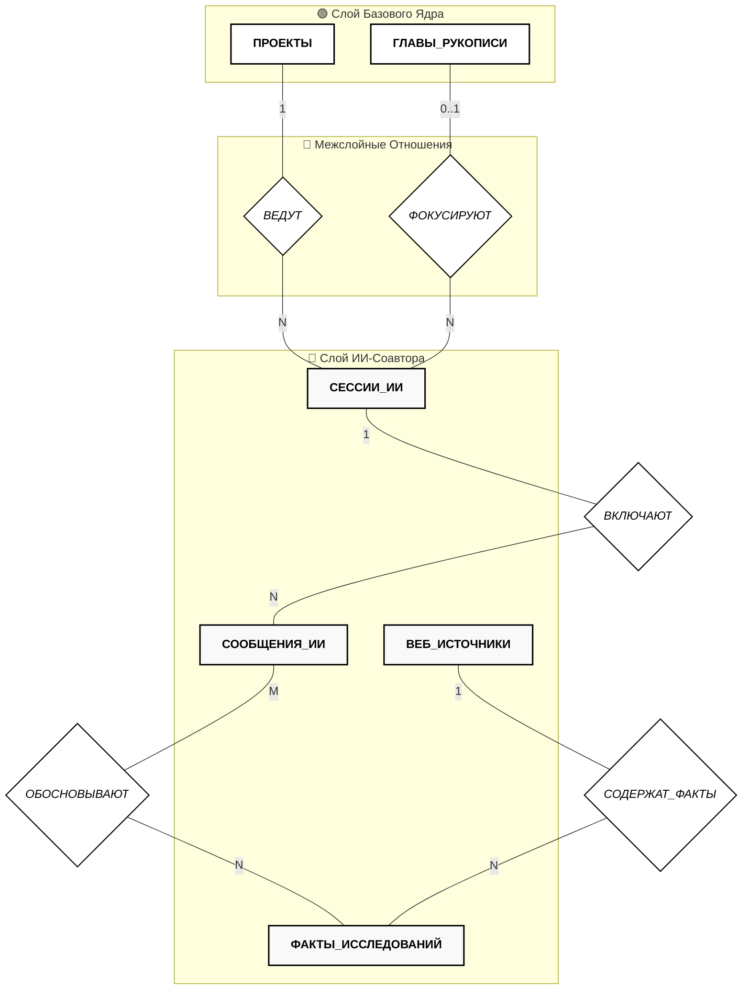

## 2.8. Концептуальная схема базы данных

### 2.8.1. Теоретические основы и методология концептуального моделирования

В соответствии с трехсхемной архитектурой ANSI/SPARC проектирование информационных систем разделяется на три уровня абстракции данных: **концептуальный**, **логический** и **физический**.

**Концептуальная схема базы данных** представляет собой смысловую модель предметной области верхнего уровня, создаваемую на ранних стадиях проектирования. Ее главная цель — формализовать информационные потребности пользователей и зафиксировать фундаментальные бизнес-правила предметной области без привязки к конкретным СУБД, типам колонок, физическим структурам хранения или программным драйверам.

Для построения концептуальной схемы АС «WorldWiki» используется классическая **модель «Сущность-Связь» (Entity-Relationship Model, ERM)** в **нотации Питера Чена (Peter Chen, 1976)**.

#### Базовые конструктивные элементы нотации Чена:

1. **Сущность (Entity):** реальный или абстрактный объект предметной области, информация о котором подлежит хранению. В нотации обозначается **прямоугольником** (именуется существительным во множественном числе).
2. **Атрибут (Attribute):** свойство или качественная характеристика сущности. Обозначается **овалом (эллипсом)**, соединенным ненаправленной линией с соответствующей сущностью.
3. **Ключевой атрибут (Key Attribute / Identifier):** минимальный набор свойств, однозначно идентифицирующий экземпляр сущности. Обозначается **овалом с подчеркнутым наименованием**.
4. **Связь / Отношение (Relationship):** смысловая ассоциация между двумя или более сущностями. Обозначается **ромбом**, внутри которого указывается глагольное наименование связи.
5. **Атрибут связи (Relationship Attribute):** характеристика самого отношения (например, вес связи, тип роли, фаза сюжета, хронологические рамки взаимодействия). Обозначается овалом, соединенным с ромбом связи.
6. **Мощность кардинальности (Cardinality Ratio):** структурные ограничения на количество экземпляров сущностей, участвующих в отношении ($1:1$, $1:N$, $M:N$, $0..N$).

---

### 2.8.2. Особенности концептуального проектирования для графово-документной модели

При проектировании концептуальной схемы для мультимодельной среды (объединяющей графовые связи, темпоральную шкалу и документную агрегацию) в нотацию Чена закладываются следующие концептуальные принципы:

1. **Рекурсивные (унарные) графовые связи сущностей ($M:N$ с атрибутами):**
   В литературном мире сущности лора (персонажи, фракции, территории) вступают в динамические взаимоотношения («враждует с», «является вассалом», «состоит в браке»). В ER-модели такое взаимодействие выражается классической **рекурсивной (унарной) связью «СВЯЗАНЫ_С»**, замкнутой на единое множество _СУЩНОСТИ_ЛОРА_. Отношение несет качественные атрибуты: _Сила_влияния_ и _Период_действия_, а допустимые категории взаимодействия регламентируются сущностью _ТИПЫ_СВЯЗЕЙ_.
2. **Иерархическая структура рукописи и сквозные сюжетные линии:**
   Иерархия текста организуется по схеме $\text{Проект} \rightarrow \text{Тома} \rightarrow \text{Главы}$. Параллельно с ней действуют _СЮЖЕТНЫЕ_АРКИ_ (сторилайны) — сквозные драматургические линии, охватывающие произвольные главы ($M:N$) и фокусирующиеся на ключевых персонажах или фракциях.
3. **Хронологический дуализм времени (Diegetic vs Narrative):**
   Внутримировое время событий лора фиксируется в _СОБЫТИЯХ_КАЛЕНДАРЯ_ через координату _Абсолютная_минута_ ($M_{\text{abs}}$). Порядок же ознакомления читателя с событиями моделируется отношением **«РАСКРЫВАЮТСЯ_В»** ($M:N$) между событиями и главами, что позволяет моделировать нелинейный нарратив (флешбеки, воспоминания, параллельные POV-линии).
4. **Двухуровневая связь фрагментов текста с героями лора:**
   - *Автоматический уровень (упоминание):* Отношение **«ФИГУРИРУЮТ_В»** ($M:N$) фиксирует появление персонажей в тексте на основе семантических маркеров `((Сущность))`.
   - *Детальный сценарный уровень:* Сущность _НАРРАТИВНЫЕ_БЛОКИ_ связывает конкретный абзац (сцену) с участниками, локацией действия и событием хронологии.
5. **Смысловая трассируемость веб-исследований ($M:N$ и $1:N$):**
   Связь между репликами диалога и внешними фактами моделируется отношением **«ОБОСНОВЫВАЮТ»**, связывающим _СООБЩЕНИЯ_ИИ_ с _ФАКТАМИ_ИССЛЕДОВАНИЙ_, извлеченными из _ВЕБ_ИСТОЧНИКОВ_.

---

### 2.8.3. Спецификация концептуальных сущностей и их атрибутов

В таблице 2.4 приведен реестр концептуальных сущностей предметной области АС «WorldWiki» с указанием их семантической роли и ключевых атрибутов.

Таблица 2.4 — Реестр сущностей и атрибутов концептуальной модели

| Сущность (Entity Class) | Семантическое назначение | Идентифицирующий атрибут | Базовые и составные атрибуты |
|---|---|---|---|
| **ПРОЕКТЫ** | Корневые контексты вымышленных вселенных автора. | <u>Код_проекта</u> | Название, Описание, Дата_создания, Конфигурация_календаря |
| **ТОМА** | Крупные композиционные разделы книги/эпопеи. | <u>Код_тома</u> | Название_тома, Порядковый_номер |
| **ГЛАВЫ_РУКОПИСИ** | Структурные единицы художественного текста. | <u>Код_главы</u> | Заглавие, Порядковый_номер (внутри тома), Семантический_текст_AST, Объем_слов, Статус |
| **СЮЖЕТНЫЕ_АРКИ** | Именованные драматургические линии (сторилайны). | <u>Код_арки</u> | Название_арки, Тип_арки (персонаж/событие/тема), Описание, Статус_завершения, Цвет |
| **ТИПЫ_СУЩНОСТЕЙ** | Мета-шаблоны структуры карточек лора. | <u>Код_типа</u> | Наименование, Пиктограмма, Спецификация_полей, Цвет |
| **ТИПЫ_СВЯЗЕЙ** | Регламентирующие схемы взаимоотношений сущностей. | <u>Код_типа_связи</u> | Ключ_связи, Наименование, Пиктограмма, Признак_направленности, Допустимые_типы |
| **СУЩНОСТИ_ЛОРА** | Объекты энциклопедии (персонажи, локации, артефакты). | <u>Код_сущности</u> | Каноническое_имя, Псевдонимы, Состав_динамических_полей, Теги |
| **СОБЫТИЯ_КАЛЕНДАРЯ** | Происшествия на шкале абсолютного времени лора. | <u>Код_события</u> | Название_события, Абсолютная_минута ($M_{\text{abs}}$), Длительность, Описание |
| **НАРРАТИВНЫЕ_БЛОКИ** | Композиционные контейнеры (сцены, конфликты, ружья). | <u>Код_блока</u> | Категория_блока (сцена/конфликт/ружьё/тайна), Идентификатор_абзаца, Цитата, Статус_прогресса |
| **ПЛАНЫ** | Иерархические чек-листы и списки авторских задач. | <u>Код_пункта_плана</u> | Текст_задачи, Флаг_выполнения, Порядковый_номер |
| **СЕССИИ_ИИ** | Тематические ветки взаимодействия с ассистентом. | <u>Код_сессии</u> | Тема_диалога, Имя_модели, Дата_инициализации |
| **СООБЩЕНИЯ_ИИ** | Атомарные реплики в диалоговом пространстве. | <u>Код_сообщения</u> | Роль_отправителя, Текст_реплики, Цитата_контекста, Массив_ссылок |
| **НАВЫКИ_ИИ** | Ролевые инструкции и шаблоны поведения ассистента. | <u>Код_навыка</u> | Название_навыка, Назначение, Системный_промпт, Статус_доступа |
| **ВЕБ_ИСТОЧНИКИ** | Сохраненные сетевые ресурсы внешних знаний. | <u>Код_источника</u> | Канонический_URL, Заголовок, Хеш_содержимого, Срок_актуальности |
| **ФАКТЫ_ИССЛЕДОВАНИЙ** | Атомарные фактологические доказательства. | <u>Код_факта</u> | Выдержка_текста, Подтверждаемый_тезис, Оценка_релевантности |

---

### 2.8.4. Графические диаграммы в нотации Питера Чена

Для обеспечения наглядности и исключения перегруженности схемы концептуальная модель декомпозирована на **три взаимодополняющие проекции**:
1. **Схема 2.1** — Ядро предметной области (рукопись, лор, сторилайны, таймлайн).
2. **Схема 2.2** — ИИ-пространство (диалоги, навыки, веб-исследования).
3. **Схема 2.3** — Архитектурный мост (межслойные связи ядра и ИИ).

#### Проекция 1: Ядро предметной области

На рисунке 2.1 представлена концептуальная диаграмма базового ядра литературной среды.

_Рисунок 2.1 — Концептуальная схема: Ядро предметной области (Base Edition)_

---

#### Проекция 2: ИИ-пространство и исследования

На рисунке 2.2 представлена концептуальная диаграмма изолированного пространства диалогов с ассистентом, базы ролевых навыков и хранилища фактологических веб-исследований.

_Рисунок 2.2 — Концептуальная схема: ИИ-пространство и исследования (Ultra Edition)_

---

#### Проекция 3: Архитектурный мост (Интеграция Ядра и ИИ)

На рисунке 2.3 показано, как аддитивный ИИ-слой интегрируется с базовым ядром через пограничные сущности _ПРОЕКТЫ_ и _ГЛАВЫ_РУКОПИСИ_, не создавая циклических связей с онтологией лора.

_Рисунок 2.3 — Архитектурный мост: Межслойная интеграция Ядра и ИИ_

---

### 2.8.5. Семантическое описание отношений и доменных инвариантов

1. **Контекстно-ограниченная алмазная зависимость «ПРОЕКТЫ $\rightarrow$ ТИПЫ $\rightarrow$ СУЩНОСТИ»:**
   Отношение «ТИПИЗИРУЮТ» является контекстно-ограниченным: схема типа (`entity_schemas`) применяется исключительно к сущностям того же проекта (`entity_schema.project_id = entity.project_id`), что гарантирует строгую изоляцию онтологий вымышленных миров. При этом жизненный цикл `ТИПОВ_СУЩНОСТЕЙ` независим от проекта-создателя — настроенные шаблоны сохраняются после удаления проекта для повторного использования в новых произведениях.
2. **Иерархия композиции «СТРУКТУРИРУЮТ» и «ВКЛЮЧАЮТ» ($1:N$):**
   Отражает строгое вложение $\text{Проект} \rightarrow \text{Тома} \rightarrow \text{Главы}$. Атрибут _Порядковый_номер_ у сущности `ГЛАВЫ_РУКОПИСИ` определяет локальный порядок чтения внутри конкретного тома, а не глобальный сквозной индекс.
3. **Отношения сюжетных арок «ОХВАТЫВАЮТ» ($M:N$) и «ФОКУСИРУЮТСЯ_НА» ($0..N$):**
   Сюжетная арка представляет собой именованную драматургическую линию (арка персонажа, конфликт фракций, романтическая линия). Арка охватывает главы из разных томов книги, фиксируя на ребре атрибут _Фаза_сюжета_ («завязка», «эскалация», «кульминация», «развязка»), и привязывается к ключевым действующим лицам лора.
4. **Рекурсивная (унарная) связь «СВЯЗАНЫ_С» ($M:N$ с атрибутами):**
   Связывает две сущности лора между собой внутри единого множества `СУЩНОСТИ_ЛОРА`. В терминах ER-теории это унарное рекурсивное отношение. В реализации каждое ребро параметризуется атрибутами _Сила_влияния_ (от -100 до +100) и _Период_действия_, а его направленность и допустимость классов участников определяются сущностью `ТИПЫ_СВЯЗЕЙ`. При асимметричных отношениях хранятся два взаимных направленных ребра.
5. **Двухуровневая модель участия в тексте («ФИГУРИРУЮТ_В» и «НАРРАТИВНЫЕ_БЛОКИ»):**
   - *Широкий охват:* Отношение `ФИГУРИРУЮТ_В` связывает сущность лора с главой в целом, фиксируя атрибут _Источник_ (`source: mention` — авто-парсинг маркеров `((Сущность))` при сохранении; `manual` — ручное добавление).
   - *Гранулярный охват:* Сущность `НАРРАТИВНЫЕ_БЛОКИ` привязывается к конкретному абзацу главы (`block_id`), явно фиксируя участников сцены (`ВОВЛЕКАЮТ`), локацию и привязанное событие календаря.
6. **Отношение нелинейного темпорального раскрытия «РАСКРЫВАЮТСЯ_В» ($M:N$ с атрибутами):**
   Разрешает противоречие между внутримировым временем ($M_{\text{abs}}$) и порядком чтения. Одно историческое событие может раскрываться в нескольких главах с различных точек зрения (атрибут _Точка_зрения_ POV) и в разной форме (атрибут _Характер_раскрытия_: прямое действие, воспоминание, слух).
7. **Отношения доказательности ИИ-слоя «СОДЕРЖАТ_ФАКТЫ» ($1:N$) и «ОБОСНОВЫВАЮТ» ($M:N$):**
   Сетевой ресурс `ВЕБ_ИСТОЧНИКИ` декомпозируется на атомарные цитаты `ФАКТЫ_ИССЛЕДОВАНИЙ`, которые связываются с конкретными репликами `СООБЩЕНИЯ_ИИ`, обеспечивая строгую трассируемость фактов и защиту от галлюцинаций LLM.
