## 2.8. Концептуальная схема базы данных

### 2.8.1. Теоретические основы и методология концептуального моделирования

В соответствии с трехсхемной архитектурой ANSI/SPARC проектирование информационных систем разделяется на три уровня абстракции данных: **концептуальный**, **логический** и **физический**.

**Концептуальная схема базы данных** представляет собой смысловую модель предметной области верхнего уровня, создаваемую на ранних стадиях проектирования. Ее главная цель — формализовать информационные потребности пользователей и зафиксировать фундаментальные бизнес-правила предметной области без привязки к конкретным СУБД, типам колонок, структурам хранения или программным драйверам.

Для построения концептуальной схемы АС «WorldWiki» используется классическая **модель «Сущность-Связь» (Entity-Relationship Model, ERM)** в **нотации Питера Чена (Peter Chen, 1976)**.

#### Базовые конструктивные элементы нотации Чена:

1. **Сущность (Entity):** реальный или абстрактный объект предметной области, информация о котором подлежит хранению. В нотации обозначается **прямоугольником**.
2. **Атрибут (Attribute):** свойство или качественная характеристика сущности. Обозначается **овалом (эллипсом)**, соединенным ненаправленной линией с соответствующей сущностью.
3. **Ключевой атрибут (Key Attribute / Identifier):** минимальный набор свойств, однозначно идентифицирующий экземпляр сущности. Обозначается **овалом с подчеркнутым наименованием**.
4. **Связь / Отношение (Relationship):** смысловая ассоциация между двумя или более сущностями. Обозначается **ромбом**, внутри которого указывается глагольное наименование связи.
5. **Атрибут связи (Relationship Attribute):** характеристика самого отношения (например, вес связи, тип альянса, хронологические рамки взаимодействия).
6. **Мощность кардинальности (Cardinality Ratio):** структурные ограничения на количество экземпляров сущностей, участвующих в отношении ($1:1$, $1:N$, $M:N$).

---

### 2.8.2. Особенности концептуального проектирования для графово-документной модели

При проектировании концептуальной схемы для мультимодельной среды (объединяющей графовые связи и документную агрегацию) в нотацию Чена закладываются следующие концептуальные принципы:

1. **Рефлексивные графовые связи сущностей ($M:N$ с атрибутами):**
   В литературном мире сущности лора (персонажи, фракции, территории) вступают в динамические разнородные взаимоотношения («враждует с», «является вассалом», «состоит в браке»). В концептуальной модели такое взаимодействие выражается отношением **«СВЯЗАНЫ_С»**, замкнутым на множество _СУЩНОСТИ_ЛОРА_, несущим собственные атрибуты _Тип_связи_, _Сила_влияния_ и _Период_действия_.

2. **Иерархическая рекурсия сюжета и диалога ($1:N$ самозамыкание):**
   Главы книги и сообщения интеллектуального ассистента имеют концептуальную природу деревьев. В схеме Чена это отражено через унарные отношения **«СОСТОЯТ_ИЗ»** (для вложенных глав и сцен) и **«ВЕТВЯТСЯ_ОТ»** (для альтернативных вариантов генераций и ответов AI).

3. **Смысловая трассируемость веб-исследований ($M:N$ и $1:N$ обоснование):**
   Связь между гипотезами/репликами в диалоге и внешними фактами моделируется отношением **«ОБОСНОВЫВАЮТ»**, связывающим _СООБЩЕНИЯ_ИИ_ с _ФАКТАМИ_ИССЛЕДОВАНИЙ_, которые, в свою очередь, извлечены из _ВЕБ_ИСТОЧНИКОВ_.

---

### 2.8.3. Спецификация концептуальных сущностей и их атрибутов

В таблице 2.4 приведен реестр концептуальных сущностей предметной области АС «WorldWiki» с указанием их семантической роли и ключевых атрибутов.

Таблица 2.4 — Реестр сущностей и атрибутов концептуальной модели

| Сущность (Entity Class) | Семантическое назначение                              | Идентифицирующий атрибут | Базовые и составные атрибуты                                            |
| ----------------------- | ----------------------------------------------------- | ------------------------ | ----------------------------------------------------------------------- |
| **ПРОЕКТЫ**             | Корневые контексты вымышленных вселенных автора.      | <u>Код_проекта</u>       | Название, Описание, Дата_создания, Конфигурация_календаря               |
| **ТИПЫ_СУЩНОСТЕЙ**      | Мета-шаблоны структуры карточек лора.                 | <u>Код_типа</u>          | Наименование, Пиктограмма, Спецификация_полей, Системный_флаг           |
| **СУЩНОСТИ_ЛОРА**       | Объекты энциклопедии (персонажи, локации, артефакты). | <u>Код_сущности</u>      | Каноническое_имя, Псевдонимы, Состав_динамических_полей, Теги           |
| **ГЛАВЫ_РУКОПИСИ**      | Структурные единицы художественного текста.           | <u>Код_главы</u>         | Заглавие, Порядковый_номер, Семантический_текст_AST, Объем_слов, Статус |
| **СОБЫТИЯ_КАЛЕНДАРЯ**   | Происшествия на шкале абсолютного времени лора.       | <u>Код_события</u>       | Название_события, Абсолютная_минута, Длительность, Описание             |
| **СЕССИИ_ИИ**           | Тематические ветки взаимодействия с ассистентом.      | <u>Код_сессии</u>        | Тема_диалога, Имя_модели, Дата_инициализации                            |
| **СООБЩЕНИЯ_ИИ**        | Атомарные реплики в диалоговом пространстве.          | <u>Код_сообщения</u>     | Роль_отправителя, Текст_реплики, Цитата_контекста, Массив_ссылок        |
| **НАВЫКИ_ИИ**           | Ролевые инструкции и шаблоны поведения ассистента.    | <u>Код_навыка</u>        | Название_навыка, Назначение, Системный_промпт, Статус_доступа           |
| **ВЕБ_ИСТОЧНИКИ**       | Сохраненные сетевые ресурсы внешних знаний.           | <u>Код_источника</u>     | Канонический_URL, Заголовок, Хеш_содержимого, Срок_актуальности         |
| **ФАКТЫ_ИССЛЕДОВАНИЙ**  | Атомарные фактологические доказательства.             | <u>Код_факта</u>         | Выдержка_текста, Подтверждаемый_тезис, Оценка_релевантности             |

---

### 2.8.4. Графическая диаграмма в нотации Питера Чена

На рисунке 2.1 представлена концептуальная ER-диаграмма базы данных АС «WorldWiki».

```mermaid
flowchart TD

    classDef entity fill:#ffffff,stroke:#000000,stroke-width:2px,color:#000000,font-weight:bold;
    classDef relationship fill:#ffffff,stroke:#000000,stroke-width:1.5px,color:#000000,font-style:italic;
    classDef attribute fill:#ffffff,stroke:#000000,stroke-width:1px,color:#000000;
    classDef keyAttr fill:#ffffff,stroke:#000000,stroke-width:2px,color:#000000,text-decoration:underline;

    %% ============================================================
    %% 1. СУЩНОСТИ ВО МНОЖЕСТВЕННОМ ЧИСЛЕ (ПРЯМОУГОЛЬНИКИ)
    %% ============================================================
    E_PROJECT["ПРОЕКТЫ"]:::entity
    E_TYPE["ТИПЫ_СУЩНОСТЕЙ"]:::entity
    E_ENTITY["СУЩНОСТИ_ЛОРА"]:::entity
    E_CHAPTER["ГЛАВЫ_РУКОПИСИ"]:::entity
    E_EVENT["СОБЫТИЯ_КАЛЕНДАРЯ"]:::entity
    E_SESSION["СЕССИИ_ИИ"]:::entity
    E_MESSAGE["СООБЩЕНИЯ_ИИ"]:::entity
    E_SKILL["НАВЫКИ_ИИ"]:::entity
    E_PAGE["ВЕБ_ИСТОЧНИКИ"]:::entity
    E_EVIDENCE["ФАКТЫ_ИССЛЕДОВАНИЙ"]:::entity

    %% ============================================================
    %% 2. ОТНОШЕНИЯ / СВЯЗИ (РОМБЫ)
    %% ============================================================
    R_PRJ_TYPE{"ОПРЕДЕЛЯЮТ"}:::relationship
    R_PRJ_ENT{"СОДЕРЖАТ"}:::relationship
    R_PRJ_CHP{"СТРУКТУРИРУЮТ"}:::relationship
    R_PRJ_EVT{"ФИКСИРУЮТ"}:::relationship
    R_PRJ_SES{"ВЕДУТ"}:::relationship

    R_TYPE_ENT{"ТИПИЗИРУЮТ"}:::relationship
    R_ENT_REL{"СВЯЗАНЫ_С"}:::relationship
    R_ENT_EVT{"УЧАСТВУЮТ_В"}:::relationship

    R_CHP_SUB{"СОСТОЯТ_ИЗ"}:::relationship
    R_CHP_SES{"ФОКУСИРУЮТ"}:::relationship

    R_SES_MSG{"ВКЛЮЧАЮТ"}:::relationship
    R_MSG_PAR{"ВЕТВЯТСЯ_ОТ"}:::relationship
    R_SKL_SES{"ПРИМЕНЯЮТСЯ_В"}:::relationship

    R_PAG_EVD{"СОДЕРЖАТ_ФАКТЫ"}:::relationship
    R_MSG_EVD{"ОБОСНОВЫВАЮТ"}:::relationship

    %% ============================================================
    %% 3. КЛЮЧЕВЫЕ И БАЗОВЫЕ АТРИБУТЫ (ОВАЛЫ)
    %% ============================================================
    A_PRJ_ID(["<u>Код_проекта</u>"]):::keyAttr
    A_PRJ_NM(["Название"]):::attribute
    A_PRJ_CAL(["Конфигурация_календаря"]):::attribute

    A_TYP_ID(["<u>Код_типа</u>"]):::keyAttr
    A_TYP_NM(["Наименование"]):::attribute
    A_TYP_DEF(["Спецификация_полей"]):::attribute

    A_ENT_ID(["<u>Код_сущности</u>"]):::keyAttr
    A_ENT_NM(["Каноническое_имя"]):::attribute
    A_ENT_DYN(["Динамические_поля"]):::attribute
    A_ENT_TAG(["Теги"]):::attribute

    A_REL_TYP(["Тип_связи"]):::attribute
    A_REL_STR(["Сила_влияния"]):::attribute
    A_REL_PRD(["Период_действия"]):::attribute

    A_CHP_ID(["<u>Код_главы</u>"]):::keyAttr
    A_CHP_TL(["Заглавие"]):::attribute
    A_CHP_AST(["Текст_AST"]):::attribute
    A_CHP_ORD(["Порядковый_номер"]):::attribute

    A_EVT_ID(["<u>Код_события</u>"]):::keyAttr
    A_EVT_TL(["Название"]):::attribute
    A_EVT_MIN(["Абсолютная_минута"]):::attribute

    A_SES_ID(["<u>Код_сессии</u>"]):::keyAttr
    A_SES_TL(["Тема"]):::attribute
    A_SES_MDL(["Модель"]):::attribute

    A_MSG_ID(["<u>Код_сообщения</u>"]):::keyAttr
    A_MSG_ROL(["Роль"]):::attribute
    A_MSG_TXT(["Текст"]):::attribute
    A_MSG_QUT(["Цитата_контекста"]):::attribute

    A_SKL_ID(["<u>Код_навыка</u>"]):::keyAttr
    A_SKL_NM(["Название"]):::attribute
    A_SKL_PRM(["Системный_промпт"]):::attribute

    A_PAG_ID(["<u>Код_источника</u>"]):::keyAttr
    A_PAG_URL(["Канонический_URL"]):::attribute
    A_PAG_HSH(["Хеш_SHA256"]):::attribute

    A_EVD_ID(["<u>Код_факта</u>"]):::keyAttr
    A_EVD_SNP(["Выдержка_текста"]):::attribute
    A_EVD_SCR(["Релевантность"]):::attribute

    %% ============================================================
    %% 4. ПРИВЯЗКА АТРИБУТОВ К СУЩНОСТЯМ И СВЯЗЯМ
    %% ============================================================
    E_PROJECT --- A_PRJ_ID
    E_PROJECT --- A_PRJ_NM
    E_PROJECT --- A_PRJ_CAL

    E_TYPE --- A_TYP_ID
    E_TYPE --- A_TYP_NM
    E_TYPE --- A_TYP_DEF

    E_ENTITY --- A_ENT_ID
    E_ENTITY --- A_ENT_NM
    E_ENTITY --- A_ENT_DYN
    E_ENTITY --- A_ENT_TAG

    R_ENT_REL --- A_REL_TYP
    R_ENT_REL --- A_REL_STR
    R_ENT_REL --- A_REL_PRD

    E_CHAPTER --- A_CHP_ID
    E_CHAPTER --- A_CHP_TL
    E_CHAPTER --- A_CHP_AST
    E_CHAPTER --- A_CHP_ORD

    E_EVENT --- A_EVT_ID
    E_EVENT --- A_EVT_TL
    E_EVENT --- A_EVT_MIN

    E_SESSION --- A_SES_ID
    E_SESSION --- A_SES_TL
    E_SESSION --- A_SES_MDL

    E_MESSAGE --- A_MSG_ID
    E_MESSAGE --- A_MSG_ROL
    E_MESSAGE --- A_MSG_TXT
    E_MESSAGE --- A_MSG_QUT

    E_SKILL --- A_SKL_ID
    E_SKILL --- A_SKL_NM
    E_SKILL --- A_SKL_PRM

    E_PAGE --- A_PAG_ID
    E_PAGE --- A_PAG_URL
    E_PAGE --- A_PAG_HSH

    E_EVIDENCE --- A_EVD_ID
    E_EVIDENCE --- A_EVD_SNP
    E_EVIDENCE --- A_EVD_SCR

    %% ============================================================
    %% 5. МЕЖСУЩНОСТНЫЕ СВЯЗИ И КАРДИНАЛЬНОСТИ
    %% ============================================================
    E_PROJECT ---|1| R_PRJ_TYPE ---|N| E_TYPE
    E_PROJECT ---|1| R_PRJ_ENT ---|N| E_ENTITY
    E_PROJECT ---|1| R_PRJ_CHP ---|N| E_CHAPTER
    E_PROJECT ---|1| R_PRJ_EVT ---|N| E_EVENT
    E_PROJECT ---|1| R_PRJ_SES ---|N| E_SESSION

    E_TYPE ---|1| R_TYPE_ENT ---|N| E_ENTITY

    E_ENTITY ---|M| R_ENT_REL ---|N| E_ENTITY
    E_ENTITY ---|M| R_ENT_EVT ---|N| E_EVENT

    E_CHAPTER ---|1| R_CHP_SUB ---|N| E_CHAPTER
    E_CHAPTER ---|0..1| R_CHP_SES ---|N| E_SESSION

    E_SESSION ---|1| R_SES_MSG ---|N| E_MESSAGE
    E_MESSAGE ---|1| R_MSG_PAR ---|N| E_MESSAGE

    E_SKILL ---|M| R_SKL_SES ---|N| E_SESSION

    E_PAGE ---|1| R_PAG_EVD ---|N| E_EVIDENCE
    E_MESSAGE ---|M| R_MSG_EVD ---|N| E_EVIDENCE
```

_Рисунок 2.1 — Концептуальная схема базы данных АС «WorldWiki»_

---

### 2.8.5. Семантическое описание отношений и кардинальностей

1. **Отношения владения «ОПРЕДЕЛЯЮТ», «СОДЕРЖАТ», «СТРУКТУРИРУЮТ», «ФИКСИРУЮТ», «ВЕДУТ» ($1:N$):**
   Сущность `ПРОЕКТЫ` является корневым контекстом. Один проект определяет $N$ пользовательских типов, содержит $N$ сущностей энциклопедии, структурирует $N$ глав рукописи, фиксирует $N$ событий хронологии и ведет $N$ сессий общения с ИИ.

2. **Отношение классификации «ТИПИЗИРУЮТ» ($1:N$):**
   Один тип из набора `ТИПЫ_СУЩНОСТЕЙ` (например, «Персонаж») типизирует структуру $N$ конкретных экземпляров из множества `СУЩНОСТИ_ЛОРА`. Метамодель задает схему валидации, не ограничивая динамический набор значений в самой сущности.

3. **Рефлексивное графовое отношение «СВЯЗАНЫ_С» ($M:N$ с атрибутами):**
   Связывает две сущности лора между собой. Отношение является ненаправленным или направленным семантическим ребром графа, несущим качественные свойства: _Тип_связи_ («союзник», «соперник», «создатель»), _Сила_влияния_ (весовой коэффициент) и _Период_действия_.

4. **Отношение участия «УЧАСТВУЮТ_В» ($M:N$):**
   Отражает факт присутствия сущностей лора в исторических или сюжетных инцидентах. В одном событии календаря может участвовать множество персонажей/фракций, и одна сущность может фигурировать во множестве событий.

5. **Рекурсивные отношения «СОСТОЯТ_ИЗ» и «ВЕТВЯТСЯ_ОТ» ($1:N$):**
   - _ГЛАВЫ_РУКОПИСИ:_ отношение «СОСТОЯТ_ИЗ» формирует древовидную иерархию литературного произведения («Книга $\rightarrow$ Том $\rightarrow$ Глава $\rightarrow$ Сцена»).
   - _СООБЩЕНИЯ_ИИ:_ отношение «ВЕТВЯТСЯ_ОТ» обеспечивает возможность древовидного ветвления контекста диалога (_Lineage Traversal_) при редактировании запроса пользователем или повторной генерации ответа.

6. **Отношения доказательности «СОДЕРЖАТ_ФАКТЫ» ($1:N$) и «ОБОСНОВЫВАЮТ» ($M:N$):**
   Один источник из множества `ВЕБ_ИСТОЧНИКИ` в результате интеллектуального анализа декомпозируется на $N$ атомарных фрагментов `ФАКТЫ_ИССЛЕДОВАНИЙ`. Отношение «ОБОСНОВЫВАЮТ» связывает фактологические фрагменты с конкретными репликами `СООБЩЕНИЯ_ИИ`, обеспечивая трассируемость цитат `[1]` к первоисточникам.
