## 2.8. Концептуальная схема базы данных

### 2.8.1. Методология концептуального моделирования и мультимодельная парадигма

В соответствии с трехсхемной архитектурой ANSI/SPARC проектирование информационных систем разделяется на три уровня абстракции данных: **концептуальный**, **логический** и **физический**.

**Концептуальная схема базы данных** представляет собой смысловую модель предметной области верхнего уровня, создаваемую на аналитическом этапе проектирования. Ее главная цель — формализовать информационные потребности пользователей, каталогизировать ключевые классы сущностей и зафиксировать фундаментальные бизнес-правила и ограничения целостности предметной области без привязки к особенностям низкоуровневых СУБД, типам хранения на диске или программным драйверам.

Специфика автоматизированной системы «WorldWiki» заключается в необходимости одновременного обслуживания четырех гетерогенных информационных потоков:

1. **Иерархически-документного нарратива** (структура рукописи: тома, главы, сцены, абзацы).
2. **Семантического графа онтологии и знаний** (персонажи, фракции, локации и динамические отношения между ними).
3. **Астрономической хронологии** (планетарные циклы, календари, расчет координаты абсолютной минуты $M_{\text{abs}}$).
4. **Когнитивного диалогового ИИ-пространства** (древовидные ветвящиеся диалоги, ролевые профили, долгосрочная память агента).

В связи с этим для концептуального описания системы используется расширенная парадигма **размеченного графа свойств (Labeled Property Graph, LPG)** в сочетании с реляционными принципами кардинальности модели Чена. В концептуальной схеме четко разграничиваются два типа связности:

- **Графовые ребра первого класса (`TYPE RELATION`):** семантически насыщенные сущности-отношения, обладающие собственными атрибутами (вес, фаза, роль, этап жизненного цикла) и поддерживающие эффективную навигацию в графе связей.
- **Структурные иерархические ссылки (`Record Links 1:N`):** отношения строгой композиционной или иерархической подчиненности сущностей (внешние ключи прямого доступа).

---

### 2.8.2. Архитектурная декомпозиция на предметные домены

В соответствии с проведенным анализом предметной области концептуальная модель декомпозирована на корневой узел вселенной и **четыре ключевых домена**:

1. **Корневой контекст вселенной (`projects`):**
   Единая точка входа для всей информационной вселенной автора. Проект изолирует рукописи, онтологию лора, космологию и диалоговые сессии конкретного мира.

2. **Домен рукописи и сюжета (Narrative Domain):**
   Обеспечивает сквозную композицию литературного произведения от глобального плана до уровня квантов текста.
   - `volumes` — тома книги, объединяющие крупные композиционные разделы;
   - `chapters` — главы произведения;
   - `text_blocks` — атомарные сцены и кванты семантического текста (абзацы), выступающие **главной точкой сборки** всей системы;
   - `story_arcs` — сквозные драматургические линии (арки персонажей, конфликтов, тем), проходящие через всё произведение;
   - `plot_promises` — сюжетные обещания («чеховские ружья», тайны, предзнаменования);
   - `plans` — чек-листы, планы и авторские задачи с графовой декомпозицией.

3. **Домен знаний и онтологии (Knowledge Graph / Lore Domain):**
   Формализует энциклопедический лор и топологию вымышленного мира.
   - `entity_schemas` — мета-схемы (классы сущностей: персонаж, локация, артефакт, организация), определяющие допустимый набор атрибутов;
   - `entities` — конкретные экземпляры сущностей базы знаний;
   - `tags` — таксономические метки классификации.

4. **Домен времени и космологии (Chronology / Time Domain):**
   Разрешает проблему хронологического дуализма и моделирует многоуровневое время.
   - `planets` — небесные тела с астрофизическими параметрами (продолжительность суток в тиках, осевой наклон, орбитальный период, спутники);
   - `calendars` — календарные системы (эры, месяцы, недели, високосные циклы), привязанные к суткам планеты;
   - `timeline_events` — исторические события мира, позиционированные на линейной шкале абсолютной минуты ($M_{\text{abs}} \in \mathbb{Z}$).

5. **Домен когнитивного ИИ (AI & Workspace / Ultra Edition):**
   Интеллектуальное рабочее пространство соавтора с поддержкой локального и глобального скоупа.
   - `ai_profiles` — провайдеры языковых моделей, параметры шлюзов и API-ключи (с поддержкой глобального использования);
   - `ai_modes` — ролевые режимы работы ассистента («Критик», «Редактор», «Хранитель лора») с системными промптами;
   - `chats` — иерархическое дерево диалогов проекта;
   - `chat_messages` — атомарные сообщения с поддержкой древовидного ветвления альтернативных генераций;
   - `agent_memory` — долгосрочная память агента (факты о мире, стилистические предпочтения автора).

---

### 2.8.3. Графическая концептуальная схема базы данных

На рисунке 2.1 приведена концептуальная схема базы данных АС «WorldWiki», отражающая состав доменов, графовые ребра отношений и структурные ссылки между сущностями.

```mermaid
flowchart TB
%%{init: {"flowchart": {"defaultRenderer": "elk"}} }%%

    %% mermaid-lint-disable no-self-loop

    %% ==========================================
    %% СТИЛИ И КЛАСТЕРЫ
    %% ==========================================
    classDef narrative fill:#1e293b,stroke:#38bdf8,stroke-width:2px,color:#f8fafc;
    classDef lore fill:#14532d,stroke:#4ade80,stroke-width:2px,color:#f8fafc;
    classDef time fill:#701a75,stroke:#f472b6,stroke-width:2px,color:#f8fafc;
    classDef ai fill:#1e1b4b,stroke:#a78bfa,stroke-width:2px,color:#f8fafc;
    classDef root fill:#0f172a,stroke:#fbbf24,stroke-width:3px,color:#fbbf24;

    %% ==========================================
    %% 0. КОРНЕВОЙ КОНТЕКСТ МИРА
    %% ==========================================
    Project[("👑 projects<br/><i>Проект мира / Произведение</i>")]:::root

    %% ==========================================
    %% 1. ДОМЕН РУКОПИСИ И СЮЖЕТА (NARRATIVE)
    %% ==========================================
    subgraph NarrativeDomain ["📚 ДОМЕН РУКОПИСИ И СЮЖЕТА"]
        Volumes["📖 volumes<br/><i>Тома книги</i>"]:::narrative
        Chapters["📄 chapters<br/><i>Главы</i>"]:::narrative
        TextBlocks["📝 text_blocks<br/><i>Сцены / Кванты текста</i>"]:::narrative
        StoryArcs["⚡ story_arcs<br/><i>Сюжетные арки</i>"]:::narrative
        PlotPromises["🎯 plot_promises<br/><i>Чеховские ружья и тайны</i>"]:::narrative
        Plans["📋 plans<br/><i>Планы и чек-листы</i>"]:::narrative
    end

    %% ==========================================
    %% 2. ДОМЕН ЛОРА И ОНТОЛОГИИ (KNOWLEDGE GRAPH)
    %% ==========================================
    subgraph LoreDomain ["🌿 ДОМЕН ЗНАНИЙ И ОНТОЛОГИИ"]
        EntitySchemas["🏷️ entity_schemas<br/><i>Классы сущностей</i>"]:::lore
        Entities["👤 entities<br/><i>Экземпляры: персонажи, локации</i>"]:::lore
        Tags["🏷️ tags<br/><i>Теги классификации</i>"]:::lore
    end

    %% ==========================================
    %% 3. ДОМЕН ВРЕМЕНИ И КОСМОЛОГИИ (CHRONOLOGY)
    %% ==========================================
    subgraph TimeDomain ["🪐 ДОМЕН ВРЕМЕНИ И КОСМОЛОГИИ"]
        Planets["🪐 planets<br/><i>Планеты: физика и сутки</i>"]:::time
        Calendars["📆 calendars<br/><i>Календари и эры</i>"]:::time
        TimelineEvents["⏱️ timeline_events<br/><i>События истории: M_abs</i>"]:::time
    end

    %% ==========================================
    %% 4. ДОМЕН ИИ-ПРОСТРАНСТВА (AI & WORKSPACE)
    %% ==========================================
    subgraph AiDomain ["🧠 ДОМЕН КОГНИТИВНОГО ИИ (ULTRA)"]
        AiProfiles["⚙️ ai_profiles<br/><i>Провайдеры и API-ключи (Global/Local)</i>"]:::ai
        AiModes["🎭 ai_modes<br/><i>Роли и системные промпты</i>"]:::ai
        Chats["💬 ai_chats<br/><i>Дерево диалогов проекта</i>"]:::ai
        ChatMessages["✉️ ai_chat_messages<br/><i>Сообщения</i>"]:::ai
        AgentMemory["🧠 ai_agent_memory<br/><i>Память: факты мира и стиль автора</i>"]:::ai
    end

    %% ==========================================
    %% ГРАФОВЫЕ РЕБРА (TYPE RELATION В СУБД)
    %% ==========================================

    %% ДВА КРЫЛА ПРОЕКТА: РУКОПИСЬ И ОНТОЛОГИЯ
    Project ==>|":CONTAINS {sort_order}"| Volumes
    Volumes ==>|":CONTAINS {sort_order}"| Chapters
    Project ==>|":DEFINES_SCHEMA"| EntitySchemas

    %% ОНТОЛОГИЯ: Схема порождает сущность (без схемы сущности нет)
    EntitySchemas ==>|":INSTANTIATES"| Entities

    %% ТОЧКА СБОРКИ В СЦЕНЕ (text_blocks):
    %% 1. Сущности оживают в тексте
    Entities ==>|":APPEARS_IN {role}"| TextBlocks
    %% 2. Сцена разворачивает арку
    TextBlocks ==>|":ADVANCES_ARC {phase, transition}"| StoryArcs
    %% 3. Сцена происходит в реальном времени мира
    TextBlocks ==>|":OCCURS_AT {time_nature}"| TimelineEvents

    %% ЧЕХОВСКИЕ РУЖЬЯ: Жизненный цикл через ОДНО ребро :MILESTONE
    %% stage: 'plant' (посадка) | 'progression' (развитие) | 'resolution' (выстрел)
    PlotPromises ==>|":MILESTONE {stage, quote}"| TextBlocks

    %% ПЛАНЫ: Декомпозиция томов, глав и арок
    Plans ==>|":PLANS_FOR"| Volumes
    Plans ==>|":PLANS_FOR"| Chapters
    Plans ==>|":PLANS_FOR"| StoryArcs

    %% ЛОР: Взаимодействия сущностей и таксономия
    %% mermaid-lint-disable-next-line no-self-loop
    Entities ==>|":ENTITY_REL {rel_type, bidirectional}"| Entities
    Entities ==>|":TAGGED_WITH"| Tags
    Entities ==>|":PARTICIPATES_IN {role}"| TimelineEvents

    %% ==========================================
    %% СТРУКТУРНЫЕ ССЫЛКИ (RECORD LINKS 1:N)
    %% ==========================================

    %% Рукопись
    TextBlocks -.->|"chapter_id"| Chapters

    %% Космология и физика времени
    Calendars -.->|"planet_id"| Planets
    TimelineEvents -.->|"calendar_id"| Calendars

    %% ИИ-пространство: чаты принадлежат проекту и образуют дерево
    Chats -.->|"project_id"| Project
    %% mermaid-lint-disable-next-line no-self-loop
    Chats -.->|"parent_chat_id"| Chats
    ChatMessages -.->|"chat_id"| Chats
    %% mermaid-lint-disable-next-line no-self-loop
    ChatMessages -.->|"parent_id"| ChatMessages
    ChatMessages -.->|"mode_id"| AiModes

    %% Настройки ИИ и Память (с поддержкой глобальных сущностей)
    AiModes -.->|"profile_id"| AiProfiles
    AiProfiles -.->|"project_id (optional)"| Project
    AgentMemory -.->|"project_id (optional)"| Project
```

_Рисунок 2.1 — Концептуальная графово-документная схема базы данных АС «WorldWiki»_

---

### 2.8.4. Спецификация концептуальных сущностей предметной области

В таблице 2.4 приведен полный реестр концептуальных классов сущностей с указанием доменной принадлежности, семантического назначения и состава атрибутов.

Таблица 2.4 — Реестр концептуальных сущностей базы данных

| Домен              | Сущность           | Семантическое назначение                                       | Идентификатор      | Базовые и атрибутивные характеристики                                                                                                                                      |
| ------------------ | ------------------ | -------------------------------------------------------------- | ------------------ | -------------------------------------------------------------------------------------------------------------------------------------------------------------------------- |
| **Корень**         | `projects`         | Корневое рабочее пространство вселенной или книги.             | <u>project_id</u>  | Название, Описание, Жанры, Конфигурационные метаданные, Дата_создания                                                                                                      |
| **Нарратив**       | `volumes`          | Крупный композиционный том произведения.                       | <u>volume_id</u>   | Заголовок, Ссылка на проект (`project_id`)                                                                                                                                 |
| **Нарратив**       | `chapters`         | Глава рукописи, содержащая совокупность текстовых квантов.     | <u>chapter_id</u>  | Название, Порядковый номер (`sort_order`), Объем слов, Семантический текст, Ссылка на проект (`project_id`)                                                                |
| **Нарратив**       | `text_blocks`      | Атомарный квант текста / сцена (точка сборки сюжета).          | <u>block_id</u>    | Тип блока (`block_type`: описание, диалог, мысль и др.), Порядковый индекс (`order_index`), Текст сцены, Векторные эмбеддинги, Ссылка на главу (`chapter_id`)              |
| **Нарратив**       | `story_arcs`       | Сквозная сюжетная линия (арка персонажа, конфликта, темы).     | <u>arc_id</u>      | Название, Тип арки (`arc_type`: character, event, relationship, theme), Статус (`status`), Цвет в UI                                                                       |
| **Нарратив**       | `plot_promises`    | Сюжетные обещания («чеховские ружья», загадки, тайны).         | <u>promise_id</u>  | Заголовок, Категория (`kind`: gun, mystery, foreshadowing, question, conflict), Текущий статус (`status`: planted, developed, resolved), Заметки                           |
| **Нарратив**       | `plans`            | Иерархические пункты авторского плана и чек-листы.             | <u>plan_id</u>     | Название задачи, Флаг выполнения (`completed`), Порядковый номер (`sort_order`), Тип родителя                                                                              |
| **Онтология**      | `entity_schemas`   | Мета-класс (шаблон типа) сущностей лора.                       | <u>schema_id</u>   | Ключ типа (`type_key`), Наименование (`type_name`), Пиктограмма, Цвет, Декларативная схема полей (`fields_schema`)                                                         |
| **Онтология**      | `entities`         | Экземпляр объекта базы знаний (герой, замок, орден, артефакт). | <u>entity_id</u>   | Каноническое имя, Описание, Ссылка на схему (`schema_id`), Динамический JSON-объект характеристик (`attributes`), Векторные эмбеддинги                                     |
| **Онтология**      | `tags`             | Классификационные теги и тематические метки.                   | <u>tag_id</u>      | Наименование тега, Цвет плашки в интерфейсе                                                                                                                                |
| **Время**          | `planets`          | Астрофизический базис мира (планета).                          | <u>planet_id</u>   | Наименование, Продолжительность суток в тиках (`ticks_per_day`), Осевой наклон, Орбитальный период, Массив характеристик лун                                               |
| **Время**          | `calendars`        | Календарная система и правила счисления эпох.                  | <u>calendar_id</u> | Название, Ссылка на планету (`planet_id`), Структура месяцев, недель и високосных поправок, Флаги (`is_default`, `is_master`)                                              |
| **Время**          | `timeline_events`  | Историческое событие на шкале вселенной.                       | <u>event_id</u>    | Наименование события, Описание, Координата абсолютной минуты ($M_{\text{abs}}$), Ссылка на календарь (`calendar_id`)                                                       |
| **Когнитивный ИИ** | `ai_profiles`      | Конфигурация провайдера LLM и параметров доступа.              | <u>profile_id</u>  | Наименование профиля, Идентификатор провайдера (`provider`: local, openai, anthropic и др.), Base URL, API-ключ, Признак глобальности (`is_global`)                        |
| **Когнитивный ИИ** | `ai_modes`         | Ролевой профиль ассистента со специализированным поведением.   | <u>mode_id</u>     | Уникальный слаг, Имя роли, Системный ролевой промпт (`role_definition`), Дополнительные инструкции, Ссылка на профиль (`profile_id`)                                       |
| **Когнитивный ИИ** | `ai_chats`         | Сессия взаимодействия (узел дерева диалогов).                  | <u>chat_id</u>     | Заголовок ветки, Тематический тег, Ссылка на проект (`project_id`), Ссылка на родительский чат (`parent_chat_id`)                                                          |
| **Когнитивный ИИ** | `ai_chat_messages` | Атомарная реплика в диалоговом пространстве.                   | <u>message_id</u>  | Роль (`role`: user, assistant, system), Текст реплики, Логи рассуждений (`reasoning`), Ссылка на родительское сообщение (`parent_id`), Ссылка на режим (`mode_id`)         |
| **Когнитивный ИИ** | `agent_memory`     | Долгосрочная память и авторский контекст соавтора.             | <u>memory_id</u>   | Тип записи (`memory_type`: fact, user_preference, summary), Текстовое содержание, Оценка важности (`importance`), Признак глобальности (`is_global`), Векторные эмбеддинги |

---

### 2.8.5. Спецификация концептуальных связей и графовых отношений

Концептуальная модель оперирует строгой дифференциацией между **графовыми ребрами (`TYPE RELATION`)**, несущими семантическую нагрузку и атрибуты процесса, и **структурными связями (`Record Links`)**, организующими иерархическую соподчиненность.

#### Таблица 2.5 — Спецификация графовых ребер (`TYPE RELATION`)

| Ребро отношения    | Исходный класс (IN)    | Целевой класс (OUT)                   | Кардинальность | Атрибуты отношения                                         | Семантическое назначение                                                                                             |
| ------------------ | ---------------------- | ------------------------------------- | -------------- | ---------------------------------------------------------- | -------------------------------------------------------------------------------------------------------------------- |
| `:CONTAINS`        | `projects` / `volumes` | `volumes` / `chapters`                | $1:N$          | `sort_order: number`                                       | Иерархическая композиция структуры книги (Проект $\rightarrow$ Тома $\rightarrow$ Главы).                            |
| `:DEFINES_SCHEMA`  | `projects`             | `entity_schemas`                      | $1:N$          | —                                                          | Закрепление схемы классов онтологии за конкретным миром.                                                             |
| `:INSTANTIATES`    | `entity_schemas`       | `entities`                            | $1:N$          | —                                                          | Инвариант онтогенеза: сущность порождается строго на основе валидной схемы.                                          |
| `:APPEARS_IN`      | `entities`             | `text_blocks`                         | $M:N$          | `role: string`                                             | Непосредственное присутствие сущности (персонажа, локации, артефакта) в конкретной сцене.                            |
| `:ADVANCES_ARC`    | `text_blocks`          | `story_arcs`                          | $M:N$          | `phase: string`, `transition: string`                      | Драматургический сдвиг: развитие фазы арки (`setup`, `escalation`, `climax`, `resolution`) в данной сцене.           |
| `:OCCURS_AT`       | `text_blocks`          | `timeline_events`                     | $M:N$          | `time_nature: string`                                      | Привязка сцены к историческому событию с указанием темпоральной природы (`present`, `flashback`, `memory`, `dream`). |
| `:MILESTONE`       | `plot_promises`        | `text_blocks`                         | $M:N$          | `stage: string`, `quote: string`                           | Жизненный цикл «чеховского ружья» в тексте: посадка (`plant`), развитие (`progression`) или развязка (`resolution`). |
| `:PLANS_FOR`       | `plans`                | `volumes` / `chapters` / `story_arcs` | $M:N$          | —                                                          | Графовая декомпозиция авторских планов и чек-листов по объектам рукописи и сюжета.                                   |
| `:ENTITY_REL`      | `entities`             | `entities`                            | $M:N$          | `rel_type: string`, `bidirectional: bool`, `strength: int` | Рекурсивные связи лора (родство, союз, вражда, иерархия) с числовой оценкой силы и направленностью.                  |
| `:TAGGED_WITH`     | `entities`             | `tags`                                | $M:N$          | —                                                          | Ассоциация сущностей с таксономическими тегами классификации.                                                        |
| `:PARTICIPATES_IN` | `entities`             | `timeline_events`                     | $M:N$          | `role: string`, `notes: string`                            | Участие персонажей и фракций в исторических хронологических событиях мира.                                           |

#### Таблица 2.6 — Спецификация структурных связей (`Record Links 1:N`)

| Поле-ссылка      | Исходная сущность | Целевая сущность | Ограничение кардинальности | Семантическое назначение                                                               |
| ---------------- | ----------------- | ---------------- | -------------------------- | -------------------------------------------------------------------------------------- |
| `chapter_id`     | `text_blocks`     | `chapters`       | $N:1$ (Mandatory)          | Физическая принадлежность кванта текста конкретной главе рукописи.                     |
| `planet_id`      | `calendars`       | `planets`        | $N:1$ (Mandatory)          | Привязка календаря к астрофизическим суткам и циклу планеты.                           |
| `calendar_id`    | `timeline_events` | `calendars`      | $N:1$ (Mandatory)          | Контекстная календарная система, в которой зафиксировано историческое событие.         |
| `project_id`     | `chats`           | `projects`       | $N:1$ (Mandatory)          | Принадлежность диалогового дерева проекту произведения.                                |
| `parent_chat_id` | `chats`           | `chats`          | $N:1$ (Optional)           | Иерархическое ветвление тематических диалоговых сессий (дерево чатов).                 |
| `chat_id`        | `chat_messages`   | `chats`          | $N:1$ (Mandatory)          | Принадлежность сообщения конкретному диалоговому потоку.                               |
| `parent_id`      | `chat_messages`   | `chat_messages`  | $N:1$ (Optional)           | Древовидная структура сообщений (альтернативные генерации и ветвления ответов).        |
| `mode_id`        | `chat_messages`   | `ai_modes`       | $N:1$ (Optional)           | Ролевой режим, в котором было сгенерировано ответное сообщение ассистента.             |
| `profile_id`     | `ai_modes`        | `ai_profiles`    | $N:1$ (Mandatory)          | Привязка роли к конкретному провайдеру и модели нейросети.                             |
| `project_id`     | `ai_profiles`     | `projects`       | $N:1$ (Optional)           | Привязка профиля к проекту либо глобальный статус (при `project_id = null`).           |
| `project_id`     | `agent_memory`    | `projects`       | $N:1$ (Optional)           | Локальный контекст мира либо глобальные предпочтения автора (при `project_id = null`). |

---

### 2.8.6. Доменные инварианты, семантика отношений и правила целостности

На основе спроектированной концептуальной схемы формализован комплекс фундаментальных доменных инвариантов системы:

#### 1. Сцена (`text_blocks`) как главная точка конвергенции (сборки) системы

Текстовый квант (`text_blocks`) представляет собой минимальную композиционную единицу повествования, в которой сходятся три фундаментальных измерения литературного мира:

- **Онтологическое измерение (`:APPEARS_IN`):** явное указание персонажей, артефактов и локаций, задействованных в сцене, с фиксацией их локальной роли (`protagonist`, `catalyst`, `background`);
- **Драматургическое измерение (`:ADVANCES_ARC`):** сцена не существует изолированно, а переводит сюжетную арку в новую фазу (`phase`: `setup` $\rightarrow$ `escalation` $\rightarrow$ `climax` $\rightarrow$ `resolution`), гарантируя динамику сюжета;
- **Хронологическое измерение (`:OCCURS_AT`):** сцена синхронизируется с абсолютным временем лора ($M_{\text{abs}}$) через событие таймлайна, явно специфицируя нарративную природу (`time_nature`: действие в настоящем `present`, ретроспектива `flashback`, субъективное воспоминание `memory` или сновидение `dream`).

#### 2. Унифицированный жизненный цикл сюжетных обещаний (`:MILESTONE`)

В отличие от громоздких схем с множеством разрозненных ребер, концептуальная модель фиксирует эволюцию каждого «чеховского ружья» (`plot_promises`) через **единый тип графового ребра `:MILESTONE`**, направленного на сцену (`text_blocks`).
Состояние обещания определяется атрибутом этапа:
$$\text{Этап} \in \{\text{'plant'} \text{ (закладка ружья)}, \text{'progression'} \text{ (развитие / напоминание)}, \text{'resolution'} \text{ (выстрел / раскрытие тайны)}\}$$
Ребро обязательно фиксирует атрибут `quote` (точную текстовую цитату из абзаца), что обеспечивает безупречную фактографическую трассируемость композиционных узлов.

#### 3. Строгий онтогенез базы знаний: изоляция и порождение сущностей

- **Инвариант порождения (`:INSTANTIATES`):** Сущность лора (`entities`) не может существовать вне контекста мета-схемы (`entity_schemas`). Схема задает типизацию динамических атрибутов, предотвращая появление невалидных структур.
- **Инвариант изоляции:** Схемы сущностей привязаны к проекту отношением `:DEFINES_SCHEMA`, что предотвращает коллизии онтологий между независимыми авторскими вселенными.

#### 4. Космологическая декомпозиция времени и единый эталон $M_{\text{abs}}$

Хронологическая подсистема исключает использование стандартных календарных типов данных реального мира (`Date` / `Timestamp`). Время концептуально моделируется трехзвенной цепочкой:
$$\text{Физика планеты (planets)} \longrightarrow \text{Календарная система (calendars)} \longrightarrow \text{События таймлайна (timeline\_events)}$$
Планета определяет квантование суток (`ticks_per_day`), календарь формирует эры, месяцы и високосные правила, а событие фиксирует точное числовое значение абсолютной минуты $M_{\text{abs}} \in \mathbb{Z}$. Это гарантирует корректную хронологическую сортировку событий с произвольными вымышленными календарями.

#### 5. Топология социальных графов (`:ENTITY_REL`)

Отношения между героями и фракциями моделируются рекурсивным графовым ребром `:ENTITY_REL`. Каждое ребро параметризуется типом (`rel_type`), признаком двунаправленности (`bidirectional`) и числовым коэффициентом силы (`strength` $\in [-100; +100]$), позволяя строить графы альянсов, семейных древ и вражды с фильтрацией по томам и главам произведения.

#### 6. Древовидная архитектура и дуализм контекста ИИ-пространства

- **Иерархия диалогов и сообщений:** Чаты организуются в дерево (`parent_chat_id`), а реплики (`chat_messages`) поддерживают ветвление альтернативных генераций от единого родительского сообщения (`parent_id`), предотвращая засорение контекста.
- **Дуализм области видимости (Scope Dualism):** Профили (`ai_profiles`), режимы (`ai_modes`) и память (`agent_memory`) поддерживают гибридную область видимости. При наличии `project_id` они принадлежат конкретному произведению; при `project_id = null` (`is_global = true`) они разделяются между всеми мирами автора, обеспечивая сквозное сохранение персонального писательского стиля и общих настроек провайдеров нейросетей.
