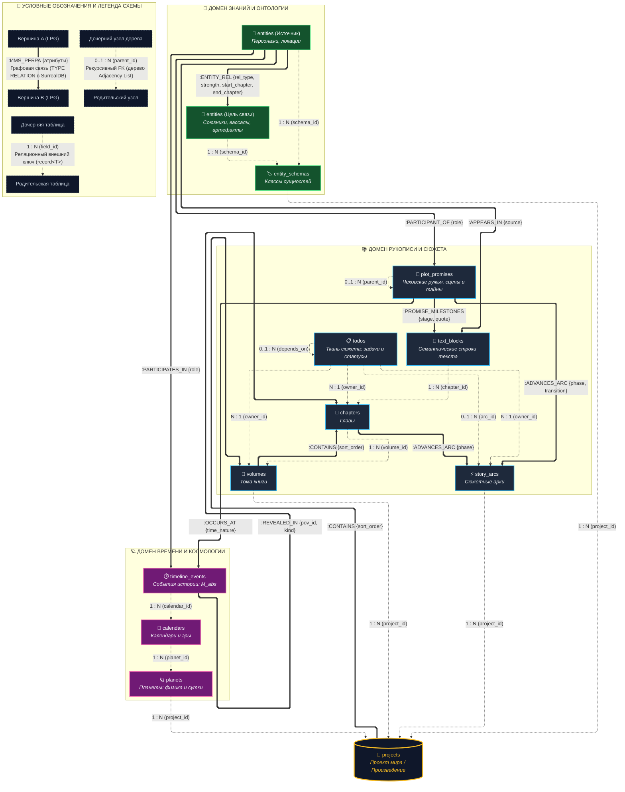

## 2.8. Концептуальная схема базы данных

### 2.8.1. Мультимодельная парадигма концептуального моделирования

Специфика автоматизированной системы «WorldWiki» заключается в одновременном обслуживании трех гетерогенных информационных потоков:

1. **Иерархической композиции рукописи** (тома, главы, строки текста).
2. **Семантического графа онтологии лора** (персонажи, фракции, локации и динамические отношения между ними).
3. **Астрономической хронологии** (планетарные циклы, календари, координата абсолютной минуты $M_{\text{abs}}$).

В связи с этим концептуальная модель базируется на **мультимодельной парадигме**, объединяющей два подхода к организации данных:

- **Размеченный граф свойств (Labeled Property Graph, LPG):** реализует семантические $M:N$ связи лора и сюжетной динамики через ребра первого класса (`TYPE RELATION`), обладающие собственными атрибутами (вес, фаза, цитата, этап жизненного цикла).
- **Реляционные иерархии (кардинальность модели Чена $1:N$):** обеспечивают строгую древовидную соподчиненность для композиции произведения и астрономических справочников через структурные внешние ссылки прямого доступа (`record<T>`).

---

### 2.8.2. Архитектурная декомпозиция на предметные домены

Концептуальная модель декомпозирована на корневой узел и **три предметных домена**:

1. **Корневой контекст вселенной (`projects`):**
   Изолирует рукописи, онтологию лора и космологию конкретного литературного мира.
2. **Домен рукописи и сюжета (Narrative Domain):**
   - `volumes` — композиционные тома произведения;
   - `chapters` — главы рукописи (принадлежат томам, сноски инкапсулированы в AST текста);
   - `text_blocks` — атомарные семантические строки текста с типизацией («описание», «диалог», «мысль»);
   - `story_arcs` — сквозные драматургические линии (арки персонажей, конфликтов, тем);
   - `plot_promises` — нарративные узлы (сценарные единицы, «чеховские ружья», тайны, предзнаменования), поддерживающие древовидную иерархию под-сцен произвольной вложенности (рекурсивный ключ `parent_id`) и темпорально зафиксированные в настоящем или ретроспекциях (`time_nature`);
   - `todos` — нормализованные задачи планировщика (переплетённая ткань повествования) с полиморфной связью `owner_id` (том, глава, арка), сюжетной меткой `arc_id`, причинной связью `depends_on` и статусной моделью (`planned`, `in_progress`, `done`, `blocked`).
3. **Домен знаний и онтологии (Knowledge Graph / Lore Domain):**
   - `entity_schemas` — мета-схемы (классы сущностей: персонаж, локация, артефакт, фракция), задающие структуру полей;
   - `entities` — конкретные экземпляры объектов энциклопедии мира со свободным текстом статьи (`description`) и встроенными тегами (`tags`).
4. **Домен времени и космологии (Chronology / Time Domain):**
   - `planets` — небесные тела с астрофизическими параметрами суток и орбит;
   - `calendars` — календарные системы с правилами високосных циклов и эр, привязанные к планете;
   - `timeline_events` — исторические события мира, зафиксированные в координате абсолютной минуты ($M_{\text{abs}} \in \mathbb{Z}$).

---

### 2.8.3. Графическая концептуальная схема базы данных

На рисунке 2.1 приведена концептуальная схема базы данных АС «WorldWiki».

_Рисунок 2.1 — Концептуальная графово-документная схема базы данных АС «WorldWiki»_

---

### 2.8.4. Ключевые доменные инварианты концептуальной модели

1. **Нарративный хаб (`plot_promises`) и физический якорь (`text_blocks`):** сценарные узлы и «чеховские ружья» поддерживают иерархию под-сцен (`parent_id`) и через вехи `:PROMISE_MILESTONES` привязываются к конкретным строкам рукописи (`text_blocks`).
2. **Строгий онтогенез лора:** любая сущность (`entities`) типизирована мета-схемой (`entity_schemas`) в рамках проекта (`project_id`), а отношения между сущностями моделируются направленным ребром `:ENTITY_REL`.
3. **Космологическая декомпозиция времени:** время моделируется цепочкой $\text{Планета (planets)} \rightarrow \text{Календарь (calendars)} \rightarrow \text{Событие (timeline\_events)}$ с единой координатой абсолютной минуты $M_{\text{abs}} \in \mathbb{Z}$.

Детальная спецификация атрибутов всех таблиц и связей приведена в разделе 3.2 (таблица 3.2), а формальное теоретико-графовое обоснование параллельных путей (Multipath) и контролируемого CQRS-дублирования `chapters.content` / `text_blocks` — в [Приложении В](../Приложение_В_Обоснование_архитектурных_решений_БД.md).
