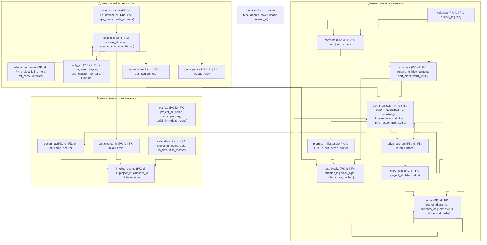

## 3.2. Логическая схема базы данных

### 3.2.1. Концептуальная модель данных
База данных АС «WorldWiki» строится на базе мультимодельного подхода (`SCHEMAFULL`), сочетающего реляционные ссылки (`record<T>`), слабоструктурированные документы (`FLEXIBLE` JSON-атрибуты) и направленные графовые ребра (`TYPE RELATION`). Основные сущности предметной области включают:

1. **Проекты (`projects`):** корневой агрегат, изолирующий данные конкретного литературного произведения или вселенной.
2. **Тома (`volumes`), Сюжетные арки (`story_arcs`), Главы (`chapters`):** иерархическая и драматургическая структура произведения (`Project -> Volume -> Chapter` через графовое ребро `contains` и внешние ключи `project_id`, `volume_id`).
3. **Текстовые блоки (`text_blocks`):** дискретные семантические фрагменты текста главы (описания, диалоги, мысли), выступающие материализованным поисковым индексом и точкой графовой привязки.
4. **Сущности базы знаний (`entities`):** объекты вымышленного мира (персонажи, локации, организации, государства, предметы, события), типизированные через `schema_id -> entity_schemas`.
5. **Схемы сущностей и связей (`entity_schemas`, `relation_schemas`):** мета-описания классов сущностей и допустимых типов отношений, задающие структуру динамических полей и валидационные правила.
6. **Связи сущностей (`entity_rel`):** графовые ребра между объектами базы знаний с фиксацией типа отношений, шкалы доверия (`-100..+100`) и временного диапазона действия в главах (`start_volume`, `start_chapter`, `end_volume`, `end_chapter`).
7. **Планеты и Календари (`planets`, `calendars`):** астрофизические параметры небесных тел и проекционные календарные системы (эпохи, месяцы, недели, гармоники високосных циклов).
8. **События хронологии (`timeline_events`):** исторические и сюжетные события, индексированные скалярной координатой $M_{\text{abs}} \in \mathbb{Z}$ и привязанные к календарям.
9. **Сюжетные обещания и сцены (`plot_promises`):** рекурсивное дерево нарративных узлов («чеховские ружья», тайны, предзнаменования, сцены) с отслеживанием жизненного цикла и якорями в тексте (`promise_milestones`).
10. **Задачи планирования (`todos`):** нормализованные (3NF) чек-листы с полиморфным владельцем (`owner_id`: том, глава или арка), привязкой к арке (`arc_id`) и причинной зависимостью (`depends_on`).

---

### 3.2.2. Правила преобразования концептуальной модели в логическую и ER-диаграмма

Переход от концептуальной схемы (раздел 2.8) к логической модели данных в мультимодельной СУБД SurrealDB выполняется по трем правилам:

1. **Сущности и иерархии `1:N` $\rightarrow$ Таблицы узлов и ссылки `record<T>`:** каждая базовая сущность преобразуется в типизированную таблицу (`SCHEMAFULL`) с первичным ключом `id` (`PK`), а связи «один-ко-многим» реализуются через прямые внешние ссылки `record<Parent>` (`FK`), например `chapters.volume_id -> volumes.id`.
2. **Графовые связи `M:N` с атрибутами $\rightarrow$ Таблицы-рёбра `TYPE RELATION`:** связи «многие-ко-многим» не требуют ручных промежуточных таблиц с составными ключами — они отображаются в нативные таблицы-рёбра (`contains`, `appears_in`, `entity_rel`, `participant_of`, `advances_arc`, `occurs_at`, `promise_milestones`, `participates_in`), в которых роль пары внешних ключей выполняют системные поля `in` (`FK`) и `out` (`FK`), дополненные собственными атрибутами ребра.
3. **Динамические и вложенные структуры $\rightarrow$ Документные поля (`FLEXIBLE`):** пользовательские атрибуты (`entities.attributes`), декларации полей (`entity_schemas.fields_schema`), параметры календарей (`calendars.data`) и спутников (`planets.moons`) агрегируются внутри записей в полях типа `object` / `array`, что исключает антипаттерн EAV и лишние соединения таблиц.

На рисунке 3.1 представлена логическая ER-диаграмма базы данных АС «WorldWiki».

_Рисунок 3.1 — Логическая ER-диаграмма базы данных АС «WorldWiki»_

---

### 3.2.3. Спецификация реляционных и графовых таблиц

В таблице 3.2 представлена логическая структура основных таблиц базы данных (подробная спецификация всех полей приведена в `структура_таблиц_бд.md`).

Таблица 3.2 — Логическая структура базы данных SurrealDB

| Таблица / Граф | Ключевые поля и атрибуты | Связи и внешние ключи | Назначение |
|---|---|---|---|
| `projects` | `id`, `name`, `type`, `genres`, `cover_image`, `created_at` | Корневой узел | Метаданные литературного проекта |
| `volumes` | `id`, `title`, `project_id` | `project_id` $\rightarrow$ `projects.id` | Тома произведения |
| `chapters` | `id`, `title`, `content`, `sort_order`, `word_count`, `volume_id` | `volume_id` $\rightarrow$ `volumes.id` | Главы произведения (мастер-документ AST) |
| `text_blocks` | `id`, `chapter_id`, `block_type`, `order_index`, `content` | `chapter_id` $\rightarrow$ `chapters.id` | Семантические блоки текста главы |
| `story_arcs` | `id`, `project_id`, `title`, `status` | `project_id` $\rightarrow$ `projects.id` | Сквозные сюжетные арки (сторилайны) |
| `plot_promises` | `id`, `parent_id`, `chapter_id`, `block_id`, `kind`, `time_nature`, `title`, `status`, `location_id`, `timeline_event_id` | `parent_id` $\rightarrow$ `plot_promises.id`, `timeline_event_id` $\rightarrow$ `timeline_events.id` | Рекурсивное дерево сцен и сюжетных обещаний |
| `todos` | `id`, `owner_id`, `arc_id`, `depends_on`, `text`, `status`, `is_done`, `sort_order` | `owner_id` $\rightarrow$ `volumes \| chapters \| story_arcs` | Задачи планировщика («Ткань сюжета») |
| `entity_schemas` | `id`, `project_id`, `type_key`, `type_name`, `fields_schema` | `project_id` $\rightarrow$ `projects.id` | Динамические мета-схемы типов сущностей |
| `entities` | `id`, `schema_id`, `name`, `description`, `tags`, `attributes` | `schema_id` $\rightarrow$ `entity_schemas.id` | Экземпляры объектов базы знаний |
| `entity_rel` *(Graph)* | `id`, `in` $\rightarrow$ `entities`, `out` $\rightarrow$ `entities`, `rel_type`, `strength`, `start_chapter`, `end_chapter` | `TYPE RELATION` между `entities` | Графовые ребра взаимоотношений |
| `appears_in` *(Graph)* | `id`, `in` $\rightarrow$ `entities`, `out` $\rightarrow$ `text_blocks`, `source`, `role` | `TYPE RELATION` (`entities` $\rightarrow$ `text_blocks`) | Граф упоминаний `((Сущность))` в тексте |
| `planets` | `id`, `project_id`, `name`, `ticks_per_day`, `axial_tilt_mdeg`, `moons` | `project_id` $\rightarrow$ `projects.id` | Астрофизические параметры планет |
| `calendars` | `id`, `planet_id`, `name`, `data`, `is_default`, `is_master` | `planet_id` $\rightarrow$ `planets.id` | Параметры авторских календарей |
| `timeline_events` | `id`, `project_id`, `title`, `description`, `m_abs`, `calendar_id` | `calendar_id` $\rightarrow$ `calendars.id`, `project_id` $\rightarrow$ `projects.id` | События хронологии мира ($M_{\text{abs}}$) |
| `participates_in` *(Graph)* | `id`, `in` $\rightarrow$ `entities`, `out` $\rightarrow$ `timeline_events`, `role` | `TYPE RELATION` (`entities` $\rightarrow$ `timeline_events`) | Участие сущностей в исторических событиях |
| `revealed_in` *(Graph)* | `id`, `in` $\rightarrow$ `timeline_events`, `out` $\rightarrow$ `chapters`, `pov_id`, `kind`, `block_id` | `TYPE RELATION` (`timeline_events` $\rightarrow$ `chapters`) | Нелинейное раскрытие событий в главах (режим читателя) |
| `participant_of` *(Graph)* | `id`, `in` $\rightarrow$ `entities`, `out` $\rightarrow$ `plot_promises`, `role` | `TYPE RELATION` (`entities` $\rightarrow$ `plot_promises`) | Участие сущностей в сценах и обещаниях |
| `advances_arc` *(Graph)* | `id`, `in` $\rightarrow$ `chapters \| plot_promises`, `out` $\rightarrow$ `story_arcs`, `phase` | `TYPE RELATION` $\rightarrow$ `story_arcs` | Продвижение фазы сюжетной арки |
| `occurs_at` *(Graph)* | `id`, `in` $\rightarrow$ `plot_promises`, `out` $\rightarrow$ `timeline_events`, `time_nature` | `TYPE RELATION` (`plot_promises` $\rightarrow$ `timeline_events`) | Временная фиксация сцены в таймлайне |
| `promise_milestones` *(Graph)* | `id`, `in` $\rightarrow$ `plot_promises`, `out` $\rightarrow$ `text_blocks`, `stage`, `quote` | `TYPE RELATION` (`plot_promises` $\rightarrow$ `text_blocks`) | Якоря жизненного цикла обещаний в тексте |

---

### 3.2.4. Обеспечение целостности данных
Целостность данных обеспечивается следующими механизмами:
1. **Каскадные события (Events):** при удалении записи проекта, сущности или главы срабатывают транзакционные DDL-триггеры (`cascade_project_delete`, `cascade_entity_delete`, `cascade_chapter_delete`), очищающие зависимые узлы и графовые ребра; при удалении календаря события перепривязываются к мастер-календарю (`cascade_calendar_delete`).
2. **Безопасная эволюция схем:** при изменении схемы атрибутов сущностей применяется алгоритм безопасного слияния (Merge) значений по умолчанию, а удаленные поля сохраняются без физической потери пользовательских данных; история версий схем фиксируется в `schema_history`.
3. **Версионирование (Audit Log):** для фиксации истории изменений текста глав, карточек сущностей и связей ведутся специализированные таблицы ревизий `chapter_revisions`, `entity_revisions` и `entity_rel_revisions`.

Полная физическая реализация схемы базы данных на языке SurrealQL (таблицы, индексы, анализаторы и триггеры целостности) приведена в [Приложении А](../Приложение_А_Физическая_схема_БД.md).
