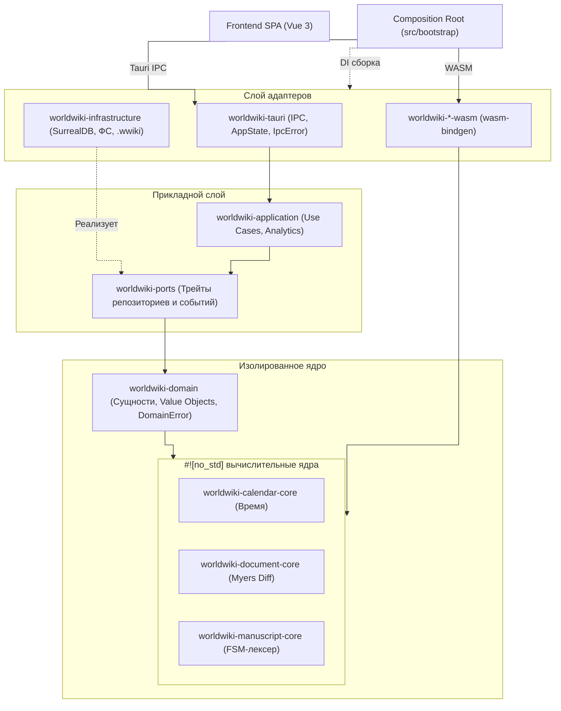
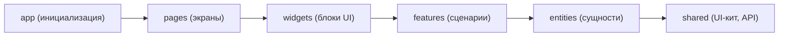
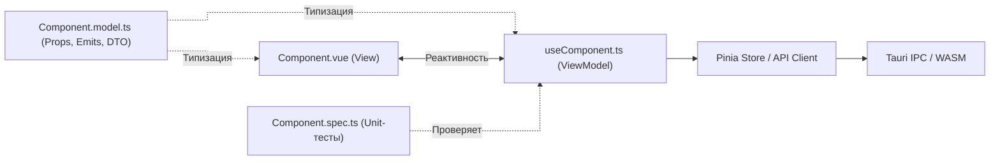

## 3.3. Разработка архитектуры приложения

### 3.3.1. Общая архитектурная концепция
Архитектура программного комплекса «WorldWiki» строится на принципах слабой связанности (Loose Coupling), высокой связности модулей (High Cohesion) и полной изоляции доменной логики от платформо-зависимых интерфейсов.

Общая структура взаимодействия компонентов представлена тремя основными уровнями:
1. **Уровень представления (Frontend):** клиентское одностраничное приложение (SPA) на базе Vue 3, TypeScript и Vite, функционирующее внутри WebView2.
2. **Уровень межпроцессного взаимодействия (Tauri IPC Bridge):** легковесный слой сериализации/десериализации команд и передачи бинарных буферов между JavaScript и Rust.
3. **Уровень прикладного ядра (Backend Core):** нативное ядро на языке Rust, реализующее бизнес-логику, математические модели и работу с базой данных SurrealDB.

---

### 3.3.2. Гексагональная архитектура бэкенда (Ports & Adapters)
Для исключения жесткой привязки к конкретным библиотекам и фреймворкам нативный бэкенд организован в виде workspace из изолированных Cargo-крейтов в соответствии с гексагональным архитектурным паттерном:

**Ключевые архитектурные инварианты бэкенда:**
1. **Изоляция домена:** модули `domain` и `application` не содержат зависимостей от `tauri`, `surrealdb` или сетевых библиотек, что обеспечивает возможность независимого модульного тестирования бизнес-логики без поднятия GUI.
2. **Инверсия зависимостей:** слой инфраструктуры реализует интерфейсы, объявленные в портах (`ports`), а не диктует свои правила прикладным сценариям.
3. **Изоляция IPC:** адаптер Tauri является единственной точкой входа команд от пользовательского интерфейса, преобразуя DTO-структуры в вызовы сценариев `application`.

---

### 3.3.3. Модель семантического документа (AST) как единый источник правды
Для обеспечения взаимной согласованности между визуальным редактором, базой знаний и полнотекстовым поиском разработана абстрактная синтаксическая модель `SemanticDocument`.

Текст рукописи нормализуется в виде типизированного дерева узлов:
- `DocumentNode` — корневой контейнер с метаданными главы;
- `ParagraphNode` — абзац текста со статистическими характеристиками;
- `EntityMentionNode` — специальный узел упоминания объекта лора с привязкой к ID сущности;
- `FootnoteNode` — подстрочная сноска;
- `HeadingNode`, `ImageNode`, `TableNode` — структурные блоки разметки.

Адаптер `ASTAdapter` обеспечивает двунаправленную бесшовную трансляцию между:
- внутренним представлением редактора Tiptap (JSON Schema);
- блочной моделью базы данных `text_blocks`.

---

### 3.3.4. Архитектура фронтенда: FSD и MVVM (Vue 3 / Composition API)
Клиентская часть организована по методологии **Feature-Sliced Design (FSD)** с однонаправленными импортами сверху вниз, а каждый UI-модуль внутри слайсов строится по 4-компонентной схеме паттерна **MVVM**:

1. **Декларативный шаблон (`Component.vue`):** содержит только разметку (`View`) и компактный связующий клей без прямых вызовов Tauri IPC.
2. **Логический хук (`useComponent.ts`):** выступает в роли `ViewModel`, инкапсулируя реактивное состояние (`ref`, `computed`), бизнес-логику и взаимодействие с хранилищем Pinia.
3. **Модель типов (`Component.model.ts`):** содержит строгие TypeScript-интерфейсы `Props`, `Emits` и DTO.
4. **Модульный тест (`Component.spec.ts`):** набор автоматических unit-тестов логики хука.
