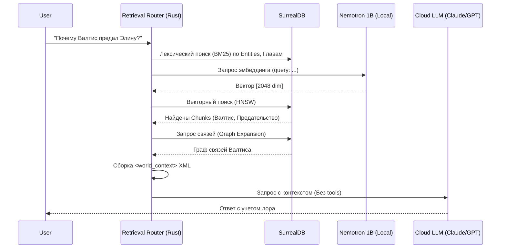

# Архитектура Auto-RAG (Retrieval Middleware)

Данный документ описывает детальную архитектуру переноса логики поиска лора (RAG) с агента LLM (через Tool Calling) на сторону инфраструктуры (Rust Middleware). Это обеспечит более быстрые ответы, экономию токенов и независимость от того, насколько "умная" LLM подключена по API.

---

## 1. Концепция системы

Вместо того чтобы облачная LLM сама принимала решение об использовании инструментов поиска, приложение прозрачно обогащает пользовательский запрос контекстом до отправки. 



---

## 2. Архитектура компонентов (Rust)

Система будет состоять из следующих ключевых сервисов в ядре Tauri:

### 2.1. `EmbedderService`
Управляет локальной моделью Nemotron-3-Embed-1B.
- **Жизненный цикл:** Lazy loading (загружается только при первом RAG-запросе) и Idle Timeout (выгружается из ОЗУ через 30 минут простоя).
- **Скрытый процесс:** Запуск `llama-server` с флагом `CREATE_NO_WINDOW`, чтобы консоль не появлялась у пользователя, либо использование FFI (`llama-cpp-rs`).
- **Префиксы:** Автоматически добавляет префикс `query:` перед поисковыми запросами пользователя, и `passage:` перед текстом лора при сохранении (требование NVIDIA).

### 2.2. `DocumentChunker`
Отвечает за нарезку больших объемов текста при сохранении (Recursive Character Chunking).
- **Размер чанка:** ~512 токенов.
- **Overlap (перекрытие):** ~10-15% (50-70 токенов), чтобы не терять контекст на стыке абзацев.
- **Связь:** Чанки сохраняют ссылку на родительскую `Entity` или `Chapter`.

### 2.3. `ContextBuilder`
Агрегирует результаты поиска из разных источников, отсеивает результаты с низким Score (Thresholding) и форматирует их в XML.

```xml
<world_context>
  <Entity name="Валтис">
    <Chunk>...содержимое...</Chunk>
  </Entity>
  <Relations>
    <Rel from="Валтис" to="Элина" type="enemy">Предательство в главе 17</Rel>
  </Relations>
</world_context>
```

---

## 3. Схема Базы Данных (SurrealDB)

Мы расширяем БД для поддержки 2048-мерных векторов Nemotron и структуры чанков.

```surql
-- 1. Таблица для хранения нарезанных кусков (Chunks) лора
DEFINE TABLE entity_chunks SCHEMAFULL;
DEFINE FIELD entity_id ON entity_chunks TYPE record<entities>;
DEFINE FIELD content ON entity_chunks TYPE string;
DEFINE FIELD chunk_index ON entity_chunks TYPE int;
DEFINE FIELD embedding_nemotron ON entity_chunks TYPE array<float>;

-- 2. Векторный индекс для Nemotron (2048 измерений)
DEFINE INDEX idx_nemotron_chunks ON entity_chunks FIELDS embedding_nemotron HNSW DIMENSION 2048 DISTANCE COSINE;

-- 3. BM25 индексы (остаются и расширяются на главы/арки)
DEFINE INDEX idx_bm25_chapters ON chapters FIELDS title, content BM25;
```

---

## 4. Сценарии Использования (Use Cases)

### Use Case 1: Простой диалог (RAG отсекается)
1. **Пользователь:** "Привет, как дела?"
2. **Router:** Делает лексический и векторный поиск.
3. **Thresholding:** Максимальный score найденных кусков — 0.35 (ниже порога релевантности 0.65).
4. **Результат:** `ContextBuilder` возвращает пустой результат.
5. **LLM:** Получает чистый промпт "Привет, как дела?" и отвечает как обычный чат-бот, не тратя токены на контекст.

### Use Case 2: Глубокий запрос по лору (Auto-RAG)
1. **Пользователь:** "Что случилось с Орденом после смерти короля?"
2. **Router:**
   - *BM25:* Находит `Entity: Орден` по названию.
   - *Vector:* Находит чанки из `Chapter 17` (описание распада Ордена) со score 0.82.
   - *Graph:* Видит сущность "Король" и подтягивает связанные с ним события.
3. **ContextBuilder:** Собирает всё это в компактный XML.
4. **LLM:** Получает контекст и отвечает с идеальным знанием канона. Никаких Tool Calls не совершается.

### Use Case 3: Слабый ПК (Fallback / Cloud-only Mode)
1. **Пользователь:** Отключает "Использовать локальную нейросеть" в UI (чтобы сэкономить 600МБ ОЗУ).
2. **Router:** Пропускает этап `Nemotron`. Выполняет только лексический поиск (BM25) по именам и главам.
3. **LLM:** Если BM25 ничего не нашел, Rust передает в облачную модель инструмент `search_lore` в массиве Tools.
4. **Fallback:** Модель сама понимает, что ей не хватает данных, вызывает `search_lore`, Rust делает FTS поиск по БД и возвращает результат.

---

## 5. UI / UX изменения

1. **Settings Panel:**
   - Чекбокс: *«Локальный семантический поиск (Nemotron)»*
   - Подпись: *«Использует ~600MB ОЗУ. Значительно улучшает понимание лора ИИ без дополнительных затрат токенов API. Работает полностью в фоне.»*
2. **Индикаторы:** При первой загрузке модели (Lazy load) можно отображать небольшую иконку в статус-баре IDE, чтобы пользователь понимал, почему произошла задержка в 1 секунду.

---

## 6. Verification Plan (План проверки)

### Этап 1: Инфраструктура
- Написание тестов на `DocumentChunker`: убедиться, что текст в 2000 токенов корректно режется на 4 чанка с нужным overlap.
- Проверка запуска фонового процесса Nemotron без мерцания консоли на Windows.

### Этап 2: Интеграция БД
- Проверка сохранения Entity: при нажатии "Save", под капотом создаются записи в `entity_chunks`, высчитываются вектора.
- Проверка HNSW 2048 поиска в SurrealDB на тестовых данных.

### Этап 3: E2E Тестирование
- Имитация Use Case 1 и Use Case 2. Проверка того, что в промпт действительно подставляется `<world_context>`, а инструмент `search_lore` отключается.
