# 🏛️ Генеральный План Архитектурной Трансформации: Modular Monolith + AI Workflow Facades

## 🎯 Миссия и Концепция

Трансформация бэкенда WorldWiki в **промышленный Модульный Монолит (Modular Monolith)** на базе **Гексагональной Архитектуры (Ports & Adapters)** и внедрение **двухуровневой модели AI-инструментов (Two-Tier AI Architecture)**.

---

## 🧠 1. Двухуровневая Модель Инструментов (Two-Tier Tool Architecture)

Мы строго разделяем **внешние AI-фасады** и **внутренний Application Core**:
* **AI Tools $\neq$ Use Cases**: Инструмент для LLM — это высокоуровневый **Composite Workflow / Facade**, который решает задачу пользователя за 1 вызов, скрывая сложность.
* **Application Core**: Содержит десятки чистых, строго типизированных `Commands`, `Queries` и транзакционных `Workflows`, которые одинаково доступны для GUI (Vue), AI-агентов и будущего CLI.

```mermaid
flowchart TD
    subgraph Client_Callers ["Внешние Клиенты и Адаптеры"]
        VueUI["Vue 3 GUI (Tauri IPC)"]
        AIAgent["AI Agent (LLM Runtime)"]
        FutureCLI["CLI / Automation (Future)"]
    end

    subgraph AI_Tool_Tier ["🤖 Слой AI-Фасадов (8 High-Level Workflows)"]
        ToolQuery["query_world"]
        ToolInspect["inspect_entity"]
        ToolManage["manage_entity"]
        ToolRead["read_manuscript"]
        ToolEdit["edit_manuscript"]
        ToolTimeline["timeline_manager"]
        ToolAudit["audit_consistency"]
        ToolDelegate["delegate_task (Orchestration)"]
    end

    subgraph Application_Core_Tier ["⚙️ Слой Application Core (CQRS & Workflows)"]
        subgraph Typed_Commands ["Commands (Мутации & Транзакции)"]
            CmdUpdateChapter["UpdateChapterCommand"]
            CmdUpdatePromises["UpdatePlotPromisesCommand"]
            CmdCompletePlans["CompletePlansCommand"]
            CmdCreateEntity["CreateEntityCommand"]
            CmdRelateEntities["RelateEntitiesCommand"]
            CmdAddTimelineEvent["AddTimelineEventCommand"]
        end

        subgraph Typed_Queries ["Queries (Быстрое чтение)"]
            QueryGetChapter["GetChapterQuery"]
            QuerySearchEntities["SearchEntitiesQuery"]
            QueryGetEntityCard["GetEntityFullCardQuery"]
            QueryTimelineSlice["GetTimelineSliceQuery"]
            QueryAuditVolume["AuditVolumeConsistencyQuery"]
        end

        subgraph Composite_Workflows ["Application Workflows (Транзакции)"]
            WfEditManuscript["EditManuscriptAtomicWorkflow (Tx Owned)"]
            WfSearchAll["HybridSemanticSearchWorkflow"]
            WfOrchestration["SubagentOrchestrator"]
        end
    end

    subgraph Domain_Ports_Infra ["🧠 Domain Model + Ports + Infrastructure"]
        DomainCore["Domain Invariants & Entities"]
        PortsLayer["Repositories & AI & Events Ports"]
        SurrealDBEngine["SurrealDB / llama.cpp / OpenXML"]
    end

    VueUI --> Typed_Commands
    VueUI --> Typed_Queries
    FutureCLI --> Typed_Commands

    AIAgent --> AI_Tool_Tier
    
    ToolQuery --> WfSearchAll
    ToolInspect --> QueryGetEntityCard
    ToolManage --> CmdCreateEntity
    ToolManage --> CmdRelateEntities
    ToolRead --> QueryGetChapter
    ToolEdit --> WfEditManuscript
    ToolTimeline --> CmdAddTimelineEvent
    ToolTimeline --> QueryTimelineSlice
    ToolAudit --> QueryAuditVolume
    ToolDelegate --> WfOrchestration

    WfEditManuscript --> CmdUpdateChapter
    WfEditManuscript --> CmdUpdatePromises
    WfEditManuscript --> CmdCompletePlans

    Typed_Commands --> DomainCore
    Typed_Queries --> DomainCore
    Composite_Workflows --> DomainCore

    DomainCore --> PortsLayer
    PortsLayer -.-> SurrealDBEngine
```



---

## 🎯 2. Спецификация 8 AI-Фасадов (Consolidated AI Tool Facades)

### 1. 🔍 `query_world` (Семантический поисковый фасад)
* **Назначение**: Единая точка семантического поиска по миру (скрывает HNSW, BM25, Graph traversal).
* **Внутренний воркфлоу**: `HybridSemanticSearchWorkflow` $\to$ `QueryRouter` $\to$ параллельный опрос `EntitySearch`, `ChapterSearch`, `TimelineSearch`, `ChatHistorySearch`.
* **Параметры**:
  ```json
  { "query": "string", "scope": "all | lore | manuscript | timeline | chat", "top_k": 8 }
  ```

### 2. 🧙‍♂️ `inspect_entity` (Комплексный инспектор лора)
* **Назначение**: За 1 вызов возвращает полный срез знаний о сущности.
* **Внутренний воркфлоу**: `GetEntityCardQuery` $\to$ возвращает сущность, схему, связи и ревизии.
* **Параметры**:
  ```json
  { "entity_id": "string", "include_relations": true, "include_history": false }
  ```

### 3. ✍️ `manage_entity` (Управление сущностями и графом связей)
* **Назначение**: Мутации сущностей и связей через компактный дискриминатор.
* **Внутренний воркфлоу**: `ManageEntityWorkflow` $\to$ `CreateEntityCommand` / `UpdateEntityCommand` / `RelateEntitiesCommand` / `DeleteEntityCommand`.
* **Параметры**:
  ```json
  {
    "action": "create | update | relate | delete",
    "entity_data": { "type_key": "character", "data": { ... } },
    "relation_data": { "from": "entities:1", "to": "entities:2", "rel_type": "ally" }
  }
  ```

### 4. 📖 `read_manuscript` (Чтение рукописи и структуры книги)
* **Назначение**: Чтение текста глав, оглавления и аутлайна томов/арок.
* **Внутренний воркфлоу**: `GetChapterQuery` / `GetVolumeOutlineQuery`.
* **Параметры**:
  ```json
  { "chapter_id": "string", "volume_id": "string", "summary_only": false }
  ```

### 5. 📝 `edit_manuscript` (Атомарная транзакция редактирования главы)
* **Назначение**: Атомарное обновление текста, регистрация Чеховских ружей и закрытие планов в одной транзакции.
* **Внутренний воркфлоу**: `EditManuscriptAtomicWorkflow`:
  $$\text{BEGIN Tx} \longrightarrow \text{Update Chapter Text} \longrightarrow \text{Sync Plot Promises} \longrightarrow \text{Complete Plans} \longrightarrow \text{COMMIT Tx} \longrightarrow \text{Emit Outbox}$$
* **Параметры**:
  ```json
  {
    "chapter_id": "string",
    "content_patch": "string | object",
    "planted_promises": [ { "kind": "gun", "quote": "...", "note": "..." } ],
    "resolved_promise_ids": [ "plot_promises:1" ],
    "completed_plan_ids": [ "plans:1" ]
  }
  ```

### 6. ⏳ `timeline_manager` (Таймлайн и временной континуум)
* **Назначение**: Фасад работы с событиями времени и расчетом $M_{\text{abs}}$.
* **Внутренний воркфлоу**: Делегирует в `TimelineSliceQuery`, `AddTimelineEventCommand`, `DateConversionQuery`.
* **Параметры**:
  ```json
  {
    "action": "get_slice | add_event | convert_date | get_calendar",
    "m_abs_range": [1000, 5000],
    "event_data": { "title": "...", "m_abs": 1200, "chapter_id": "..." }
  }
  ```

### 7. 🛡️ `audit_consistency` (Аудит целостности и лор-валидация)
* **Назначение**: Проверка логических противоречий в лоре или аудит незакрытых ружей и невыполненных планов тома.
* **Внутренний воркфлоу**: `ValidateLoreConsistencyQuery` или `AuditVolumeIntegrityQuery`.
* **Параметры**:
  ```json
  {
    "target": { "type": "statement", "value": "..." } // или { "type": "volume", "id": "volumes:vol_01" }
  }
  ```

### 8. 🤖 `delegate_task` (AI Runtime & Саб-агенты)
* **Назначение**: Изолированная capability оркестрации саб-агентов (не относится к лору мира).
* **Внутренний воркфлоу**: `application/ai/orchestration/SubagentOrchestrator` $\to$ `JobManager`.
* **Параметры**:
  ```json
  {
    "task": "string",
    "agent_role": "researcher | critic | worldbuilder",
    "context_ids": ["chapters:ch_01"]
  }
  ```

---

## 📦 3. Физическая Архитектура Cargo Workspace

```
src-tauri/
├── Cargo.toml                     # Workspace Root (members = ["crates/*", "."])
│
├── crates/
│   ├── worldwiki-domain/          # 🧠 [Чистый Домен]: Сущности, Value Objects, DomainError
│   ├── worldwiki-ports/           # 🔌 [Интерфейсы]: Трейты репозиториев, AI, FS, Events
│   ├── worldwiki-application/     # ⚙️ [Use Cases, Workflows & AI Facades]: CQRS, JobManager
│   ├── worldwiki-infrastructure/  # 🧱 [Адаптеры БД/AI/FS]: SurrealDB, llama.cpp, OpenXML DOCX
│   └── worldwiki-tauri/           # 🚪 [Driving Adapter]: IPC commands, bridge_macro!, State
│
└── src/                           # 🚀 [Composition Root & Bootstrap]
```

---

## 📋 4. Поэтапный План Реализации

### Этап 1: Cargo Workspace и Домен
- [ ] Разбить `src-tauri/` на 5 изолированных крейтов Cargo.
- [ ] Описать чистый домен в `worldwiki-domain` (manuscript, knowledge, calendar, document, plot).

### Этап 2: Порты и Контракты
- [ ] Описать трейты в `worldwiki-ports` (`ChapterRepository`, `EntityRepository`, `LlmInferencePort`, `EventPublisherPort`, `UnitOfWork`).

### Этап 3: Application Core и Workflows
- [ ] Реализовать гранулярные `Commands` и `Queries`.
- [ ] Реализовать составные `Workflows` (`EditManuscriptWorkflow`, `HybridSearchWorkflow`).
- [ ] Собрать 8 AI-фасадов в `application/ai/tools/`.
- [ ] Реализовать `JobManager` с `CancellationToken`.

### Этап 4: Инфраструктура и SurrealDB
- [ ] Реализовать репозитории в `worldwiki-infrastructure/surrealdb/`.
- [ ] Реализовать генераторы OpenXML/EPUB и FFI `llama.cpp`.

### Этап 5: Адаптер Tauri и Composition Root
- [ ] Реализовать `bridge_command!` макрос в `worldwiki-tauri`.
- [ ] Собрать Composition Root в `bootstrap/services.rs`.

### Этап 6: Тестирование и Защита Контрактов
- [ ] Unit-тесты для Use Cases и Workflows.
- [ ] Проверка контрактов `node scripts/codegen.js` + TypeScript typecheck.
