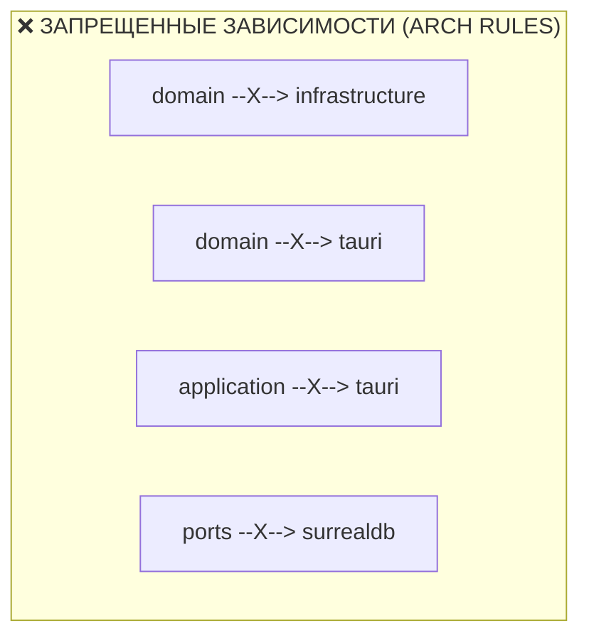

# 🏛️ План перехода бэкенда на Гексагональную Архитектуру (Hexagonal Architecture / Ports & Adapters)

## 🎯 Цель и контекст

Перевод бэкенда WorldWiki (`src-tauri/src`) на строгую **Гексагональную Архитектуру (Ports & Adapters / Onion)** с предметными контекстами (Bounded Contexts).

**Главный принцип**: Внешний фреймворк (Tauri) изолирован как **Driving Adapter**. Внутреннее ядро (Domain, Application, Ports) не зависит от Tauri, SurrealDB или Tokio-специфичных внешних типов. Любые изменения и обновления фреймворка (включая будущий переход на Tauri 3) локализованы строго внутри интеграционного слоя `adapters/tauri/` и `bootstrap/`.

---

## 🏛️ 1. Целевая Архитектура и Структура Директорий

Вместо плоских каталогов на сотни файлов структура организована по предметным контекстам (**Bounded Contexts**):

```
src-tauri/src/
├── main.rs                        # Минимальная точка входа
├── lib.rs                         # Запуск: bootstrap::create_app() -> adapters::tauri::register()
│
├── 🧠 domain/                     # [Ядро Предметной Модели: 0 внешних библиотек]
│   ├── errors.rs                  # DomainError (бизнес-валидация, нарушение инвариантов)
│   ├── manuscript/                # Главы, сцены, тома, арки, статусы готовности
│   ├── knowledge/                 # Сущности лора, схемы, матрица отношений
│   ├── calendar/                  # Абсолютная минута M_abs, астрономия, луны, эпохи
│   └── document/                  # ГОСТ-структура, абстрактная модель документа
│
├── ⚙️ application/                # [Слой Сценариев Использования (Use Cases)]
│   ├── errors.rs                  # ApplicationError (Use-case level, orchestration errors)
│   ├── manuscript/                # Use cases: GetChapter, SaveChapter, ReorderChapters
│   ├── knowledge/                 # Use cases: GetEntity, SaveEntity, ValidateSchema
│   ├── calendar/                  # Use cases: CalculateDate, ConvertEras, GenerateSummary
│   ├── document/                  # Use cases: ExportDocx, ExportEpub, ExportFb2
│   └── ai/                        # Use cases: ChatAgent, VectorRAG, StreamInference
│
├── 🔌 ports/                      # [Интерфейсы и Контракты (Secondary Ports)]
│   ├── repositories.rs            # ChapterRepository, EntityRepository, ProjectRepository
│   ├── ai.rs                      # LlmInferencePort, EmbeddingPort
│   ├── storage.rs                 # FileSystemPort, BackupStoragePort
│   └── events.rs                  # EventPublisherPort + типизированные ApplicationEvent
│
├── 🧱 infrastructure/             # [Реализация Портов (Driven Adapters)]
│   ├── surrealdb/                 # SurrealDB реализации репозиториев (на базе tauri-surreal-kit)
│   ├── ai/                        # llama.cpp FFI + HTTP-провайдеры (OpenAI/Anthropic/Ollama)
│   ├── documents/                 # Компиляторы DOCX (OpenXML), EPUB 3.3, FB2 2.0
│   └── filesystem/                # Работа с диском, путями и архивами .world
│
├── 🚪 adapters/                   # [Входные Адаптеры (Driving Adapters)]
│   └── tauri/                     # ⚠️ ЕДИНСТВЕННОЕ МЕСТО В БЭКЕНДЕ, ГДЕ РАЗРЕШЁН TAURI!
│       ├── mod.rs                 # register(builder, services)
│       ├── commands.rs            # Реестр IPC-команд через bridge_command!
│       ├── bridge_macro.rs        # Механический макрос-мост bridge_command!
│       ├── state.rs               # Tauri State обертка над AppServices
│       ├── error.rs               # IpcError (маппинг ApplicationError -> JSON для фронтенда)
│       └── events.rs              # TauriEventPublisher (реализация EventPublisherPort)
│
└── 🚀 bootstrap/                  # [Composition Root: Сборка Зависимостей]
    ├── app.rs                     # Конфигурация рантайма
    └── services.rs                # Сборка Repositories -> Services -> AppServices
```

---

## 🚫 2. Архитектурные Инварианты (ARCH Rules)

| Код | Правило Инварианта |
|---|---|
| **ARCH-001** | `domain/**` **НЕ ДОЛЖЕН** импортировать `tauri`, `surrealdb`, `reqwest`, `tokio` или другие внешние SDK. |
| **ARCH-002** | `application/**` **НЕ ДОЛЖЕН** импортировать `tauri`. Зависит только от `domain` и `ports`. |
| **ARCH-003** | `ports/**` **НЕ ДОЛЖЕН** зависеть от конкретных реализаций инфраструктуры (только интерфейсы). |
| **ARCH-004** | `infrastructure/**` **ОБЯЗАН** реализовывать трейты из `ports`, а не диктовать доменные правила. |
| **ARCH-005** | `adapters/tauri/**` — **ЕДИНСТВЕННЫЙ** слой, которому разрешено импортировать `tauri::*`. |
| **ARCH-006** | `application/**` **НЕ ДОЛЖЕН** напрямую диспатчить события во фронтенд (только через `EventPublisherPort`). |
| **ARCH-007** | Никакие типы `tauri::*` (`State`, `AppHandle`, `Window`) не могут проникать в сигнатуры `application` или `domain`. |
| **ARCH-008** | Никакие конкретные типы `infrastructure` (например, `Surreal<Db>`) не могут появляться в публичных сигнатурах Use Cases. |



---

## 🧮 3. Детальные Механизмы Реализации

### 3.1. Многоуровневая Иерархия Ошибок (Typed Error Hierarchy)
Исключаем «мусорное ведро» `DomainError::Internal(String)`:

```
InfrastructureError (SurrealDbError, FsError, LlamaError)
         │  (map_err)
         ▼
ApplicationError (NotFound, Conflict, PermissionDenied, ExecutionFailed)
         ▲
         │  (From)
DomainError (InvalidStatusTransition, NegativeTimelineMinute, ConstraintViolation)
         │
         ▼
IpcError (code: "CHAPTER_NOT_FOUND", message: "...", details: Value) -> JSON для фронтенда
```

### 3.2. Типизированные События (`ports/events.rs`)
Вместо небезопасных строк и сырых JSON-блоков:

```rust
pub trait ApplicationEvent: Send + Sync + serde::Serialize {
    fn event_name(&self) -> &'static str;
}

#[derive(serde::Serialize)]
pub struct ChapterSavedEvent {
    pub chapter_id: String,
    pub word_count: usize,
    pub timestamp: i64,
}

impl ApplicationEvent for ChapterSavedEvent {
    fn event_name(&self) -> &'static str { "chapter_saved" }
}

#[async_trait::async_trait]
pub trait EventPublisherPort: Send + Sync {
    async fn publish<E: ApplicationEvent>(&self, event: E) -> Result<(), ApplicationError>;
}
```

### 3.3. Раздельные Сервисные Группы вместо God-Контейнера
```rust
pub struct ManuscriptServices {
    pub repo: Arc<dyn ChapterRepository>,
}

pub struct KnowledgeServices {
    pub repo: Arc<dyn EntityRepository>,
}

pub struct AppServices {
    pub manuscript: ManuscriptServices,
    pub knowledge: KnowledgeServices,
    pub calendar: CalendarServices,
    pub document: DocumentServices,
    pub ai: AiServices,
}
```

### 3.4. Макрос `bridge_command!` (Механический адаптер)
Макрос выполняет только механическую трансляцию без скрытой бизнес-логики:

```rust
#[macro_export]
macro_rules! bridge_command {
    ($cmd_name:ident, $use_case:path, $service_group:ident, $req_type:ty) => {
        #[tauri::command]
        pub async fn $cmd_name(
            state: tauri::State<'_, $crate::adapters::tauri::state::AppState>,
            request: $req_type,
        ) -> Result<impl serde::Serialize, $crate::adapters::tauri::error::IpcError> {
            $use_case(&state.services.$service_group, request)
                .await
                .map_err($crate::adapters::tauri::error::IpcError::from)
        }
    };
}
```

---

## 📋 4. Поэтапный план рефакторинга

### Этап 1: Фундамент (Ports, Domain Bounded Contexts, Errors)
- [ ] Создать `src-tauri/src/domain/errors.rs` и `src-tauri/src/application/errors.rs`.
- [ ] Оформить предметные домены: `domain/manuscript/`, `domain/knowledge/`, `domain/calendar/`, `domain/document/`.
- [ ] Описать порты: `ports/repositories.rs`, `ports/ai.rs`, `ports/storage.rs`, `ports/events.rs`.

### Этап 2: Слой Сценариев (Application Use Cases)
- [ ] Реализовать use cases рукописи (`application/manuscript/` — get, save, reorder).
- [ ] Реализовать use cases лора (`application/knowledge/` — get, save, schemas, relations).
- [ ] Реализовать use cases календаря (`application/calendar/` — calculate, convert).
- [ ] Реализовать use cases документов и экспорта (`application/document/` — export_docx, export_epub, export_fb2).
- [ ] Реализовать use cases AI (`application/ai/` — chat, stream, retrieval).

### Этап 3: Инфраструктурные Адаптеры (Infrastructure)
- [ ] Реализовать SurrealDB репозитории (`infrastructure/surrealdb/`).
- [ ] Вынести генераторы OpenXML/EPUB/FB2 в `infrastructure/documents/`.
- [ ] Вынести `llama.cpp` и HTTP-клиенты в `infrastructure/ai/`.

### Этап 4: Адаптер Tauri и Composition Root
- [ ] Реализовать `adapters/tauri/bridge_macro.rs`, `state.rs`, `error.rs`, `events.rs`.
- [ ] Собрать команды в `adapters/tauri/commands.rs`.
- [ ] Реализовать `bootstrap/services.rs` и `bootstrap/app.rs`.
- [ ] Обновить `src-tauri/src/lib.rs` до минималистичного запуска.

### Этап 5: Верификация и Юнит-тестирование
- [ ] Написать чистые Unit-тесты для Use Cases с использованием Fake/Mock репозиториев (без поднятия Tauri).
- [ ] Запустить `cargo test` и `node scripts/codegen.js`.
- [ ] Запустить `pnpm --filter @worldwiki/spa typecheck`.
