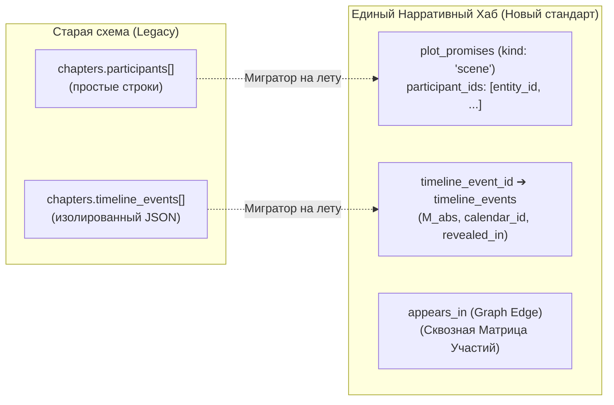

# 📐 СПЕЦИФИКАЦИЯ: УСТОЙЧИВОСТЬ НАРРАТИВНЫХ БЛОКОВ, ТЕРМИНОЛОГИЯ, МАТРИЦА УЧАСТИЙ И МИГРАЦИЯ (v3)

> **Статус**: Готово к согласованию и внедрению  
> **Область действия**: `EditorCoreTiptap`, `PromisesPanel`, `PromiseCardMeta`, `ChapterArcTags`, `story_arcs.store`, `CrossReferenceMatrix`, `SurrealDB Migrations`  
> **Инварианты**: `ARCH-001..ARCH-031`, `Zero-Debt`, `Cerberus Firewall`

---

## 🎯 1. АНАЛИЗ И ИСПРАВЛЕНИЕ КРИТИЧЕСКИХ ДЕФЕКТОВ

### 🐛 Дефект 1: Пропадание арок главы после F5 (`ChapterArcTags`)
- **Причина**: В `useChapterArcTags.ts` проверка связей опиралась на `r.out` (`if (!r.out) return false`), тогда как бэкенд Rust DTO возвращает типизированную структуру `ArcChapterRelation { arc_id: String, chapter_id: String }`. Поле `r.out` в ответе было `undefined`, из-за чего после перезагрузки F5 `boundArcs` становился `[]`.
- **Решение**: Проверять `r.chapter_id || r.out` и нормализовать ID глав с префиксом `chapters:`.

---

### 🐛 Дефект 2: Пустой выпадающий список ⏱️ «Событие таймлайна»
- **Причина**: В `usePromiseCardMeta.ts` вызов `api.getGlobalTimeline(project)` возвращает массив глав `Chapter[]` (у каждой из которых есть массив `timeline_events`), а код пытался прочитать несуществующее свойство `timelineData.events`.
- **Решение**: Агрегировать события из всех глав `timelineData.flatMap(ch => ch.timeline_events)` и таблицы `timeline_events` проекта: `"[Глава 1] Разговор у костра (M_abs: 1200)"`.

---

### 🎨 Дефект 3: Устаревший инпут персонажей с `<datalist>` и галочкой
- **Причина**: Неудобный браузерный `<datalist>` с блокирующей кнопкой `✓` вместо дизайн-системного контейнера тегов.
- **Решение**: Внедрить **`class="tags-input-container interactive-el"`** для участников:
  - Существующие участники отображаются аккуратными интерактивными бейджами с кнопкой быстрого удаления `✕`.
  - Кнопка `[ ＋ Персонаж ]` открывает выпадающий пикер с персонажами проекта + быстрый ввод свободного имени.
  - Добавление по клику или Enter **без отдельной кнопки галочки**.

---

## ⚠️ 2. ПЕРЕХОДНОЕ СОСТОЯНИЕ И ПЛАН МИГРАЦИИ ДАННЫХ

### 🔍 Что осталось в переходном состоянии:
Поля `chapters.timeline_events[]` и `chapters.participants[]` — старые хранилища на объекте главы. 
Новые унифицированные механизмы уже функционируют в **Хабе Сцен и Блоков** (`plot_promises`: `participant_ids`, `timeline_event_id`, `location_id`, `appears_in`). Старые изолированные аккордеоны (`TimelinePanel`, `ParticipantsPanel`) подлежат безопасному выводу из эксплуатации.

### 🛠️ Алгоритм безопасной миграции:
1. **On-the-fly Migration (при открытии главы)**:
   - Если у главы есть старые `chapters.participants` или `chapters.timeline_events`, и для неё ещё нет корневой сцены в `plot_promises`, автоматически создаётся сцена `kind: 'scene'` с переносом участников и дат.
2. **Синхронизация графа `appears_in`**:
   - При сохранении главы (`Ctrl+S`) все участники сцен автоматически получают ребра `appears_in (source = 'scene')`.
3. **Окончательный демонтаж аккордеонов**:
   - Удаление старого `SceneInspectorTab.vue` и освобождение кода от дублирующих вызовов `save_connections` / `save_global_timeline`.

---

## 🏛️ 3. УСТОЙЧИВОСТЬ НАРРАТИВНЫХ БЛОКОВ ПРИ КАРДИНАЛЬНОМ РЕДАКТИРОВАНИИ

1. **Если автор кардинально переписал слова в тексте**:
   - Якорь блока держится за стабильный `block_id` (AST Node ID абзаца).
   - При сохранении главы (`Ctrl+S`) превью-цитата `quote` в карточке блока **автоматически обновляется** на актуальный текст из этого абзаца.
2. **Если автор полностью удалил абзац со сценой**:
   - Блок переходит в статус `⚠️ Текст удален или перемещен` и **не удаляется из БД**.
   - Появляется кнопка `[ 📍 Привязать к выделенному тексту ]`.

---

## 🎭 4. РАЗДЕЛЕНИЕ ТЕРМИНОЛОГИИ В КАРТОЧКЕ (`PromiseCard.vue`)

- **Для Сцен (`kind === 'scene'`)**:
  - Плашка: **`🎬 Сцена:`** Глава 1 · абз. X–Y.
  - Действия: **`🌿 + Добавить момент`** | **`🏁 Завершить сцену`**.
  - Исключены неуместные «🌱 Посажено» и «🎯 Отстреляно».
- **Для Сюжетных ружей (`chekhov_gun`, `foreshadowing`, `clue`, `mystery`, `question`)**:
  - Плашка: **`🌱 Посажено:`** Глава 1 · абз. X.
  - Действия: **`🌿 + Развить`** | **`🎯 Отстрелять / Развязка`**.

---

## 🔍 5. ПОДСВЕТКА ВСЕГО ДИАПАЗОНА СЦЕНЫ (`scrollToParagraph`)

- Метод `scrollToParagraph` в `useEditorCoreTiptap.ts` расширяется для поддержки диапазонов:
- Если блок охватывает несколько абзацев (диалог/сцена), класс пульсирующей подсветки `.promise-highlight-target` вешается на **все абзацы диапазона сцены одновременно**.

---

## 📊 6. СКВОЗНАЯ МАТРИЦА УЧАСТИЙ

- Исправлен DTO-маппинг (`appearances_by_chapter` ↔ `appearances`).
- Исправлен SurrealQL подзапрос `WHERE project_id = $proj` в `chapter_repo.rs` и `crud.rs`.
- Поддержка связи по `entity_id` (когда отображаемый текст «Ника», а ссылка `entities:veronika`).

---

## 📋 7. ПОШАГОВЫЙ ПЛАН ВНЕДРЕНИЯ

1. **`useChapterArcTags.ts` & `story_arcs.store.ts`**: Исправить чтение `chapter_id` из связей арок для сохранения после F5.
2. **`usePromiseCardMeta.ts`**: Исправить извлечение `timeline_events` из массива глав `getGlobalTimeline` и таблицы проекта.
3. **`PromiseCardMeta.vue`**: Переписать селектор персонажей на `tags-input-container interactive-el`.
4. **`PromiseCard.vue`**: Контекстное переключение терминологии для `kind === 'scene'` (Сцена) vs сюжетные ружья.
5. **`useEditorCoreTiptap.ts`**: Подсветка всего диапазона абзацев сцены при `📍 Перейти`.
6. **Миграция & Очистка**: Авто-миграция legacy-полей главы в `plot_promises` при открытии и сохранении.
7. **Валидация**: `pnpm typecheck`, `npx eslint`, `cargo test --lib`, `cargo cerberus check --ci`.
