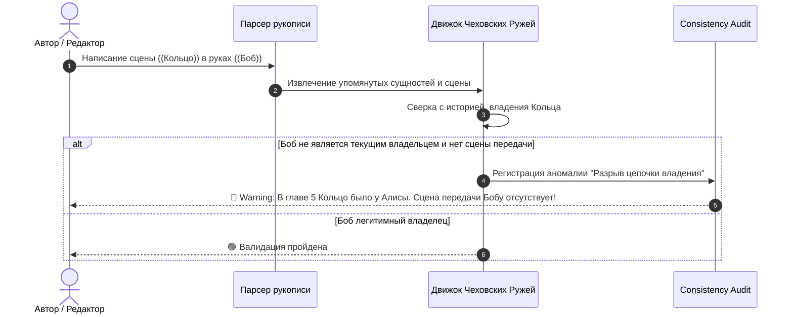

# 🗡️ Спецификация: Трекер Чеховских Ружей и Инвентаря

> **Область действия**: Пересечение сущностей `item` (Предмет/Артефакт), `character` (Персонаж) и сцен рукописи (`chapters` / `plot_promises`).
> **Статус**: Архитектурный стандарт базового ядра WorldWiki.

---

## 📌 1. Концепция и Назначение

«Чеховское ружьё» — классический принцип драматургии: если в первом акте на стене висит ружьё, в последнем оно должно выстрелить. 

В объемных романах и циклах авторы регулярно сталкиваются с двумя критическими проблемами:
1. **Забытый предмет (Forgotten Prop)**: персонаж находит таинственный свиток или кинжал в главе 3, но к главе 30 автор забывает о его существовании, и артефакт растворяется в воздухе.
2. **Парадокс владения / Телепортация (Chain of Custody Violation)**: в главе 5 амулет находился у Алисы, а в главе 12 им внезапно пользуется Боб, хотя сцены передачи, кражи или находки между ними никогда не было.

**Трекер Чеховских Ружей** решает обе проблемы на уровне математической модели данных и инспектора сцен.

---

## 🗄️ 2. Модель Данных и Системные Поля Предмета (`item`)

В схеме `item.json` системно закреплены следующие неудаляемые поля:

```json
{
  "entityType": "item",
  "titleField": "название",
  "fields": [
    {
      "id": "название",
      "type": "text",
      "required": true,
      "path": "название"
    },
    {
      "id": "тип_предмета",
      "type": "select",
      "required": true,
      "options": [
        { "value": "оружие", "label": "⚔️ Оружие" },
        { "value": "артефакт", "label": "🔮 Магический артефакт" },
        { "value": "улика_документ", "label": "📜 Документ / Улика" },
        { "value": "реликвия", "label": "👑 Реликвия / Символ власти" },
        { "value": "транспорт", "label": "🚀 Транспорт / Техника" },
        { "value": "зелье_вещество", "label": "🧪 Зелье / Вещество" }
      ],
      "path": "тип_предмета"
    },
    {
      "id": "статус_категория",
      "type": "select",
      "required": true,
      "options": [
        { "value": "Не указано", "label": "Не указано" },
        { "value": "Цел / Активен", "label": "🟢 Цел / Активен" },
        { "value": "Поврежден", "label": "🟡 Поврежден" },
        { "value": "Уничтожен", "label": "🔴 Уничтожен" },
        { "value": "Утерян", "label": "⚪ Утерян / Местонахождение неизвестно" }
      ],
      "path": "статус_категория"
    },
    {
      "id": "текущий_владелец",
      "type": "select",
      "entityType": "character",
      "path": "текущий_владелец"
    }
  ],
  "dynamicContainers": [
    {
      "id": "история_владения",
      "type": "timeline",
      "title": "Хронология передачи и владения",
      "template": "Базовая хронология",
      "dataPath": "история_владения",
      "fieldOverrides": {
        "название": { "label": "Владелец / Держатель", "type": "select", "entityType": "character" },
        "описание_1": { "label": "Обстоятельства получения / передачи", "type": "textarea" },
        "статус_категория": { "label": "Состояние предмета на этом этапе" }
      }
    }
  ]
}
```

---

## ⚙️ 3. Алгоритмы и Аналитические Правила



### 3.1. Детектор Забытых Предметов (Forgotten Prop Warning)
* **Триггер**: предмет введен в сюжет в главе $N$ (получен персонажем или найден в локации).
* **Условие аномалии**: разность порядковых номеров глав $(\text{CurrentChapter} - N) \ge 10$ при отсутствии упоминаний предмета в последующих сценах.
* **Исключение**: если статус предмета переведен в `Утерян` или `Уничтожен`.
* **Уровень критичности**: `Notice / Warning` (в зависимости от роли: ключевой артефакт или фоновый предмет).

### 3.2. Контроль Цепочки Передачи (Chain of Custody Violation)
* **Инвариант**: уникальный физический предмет не может одновременно принадлежать двум персонажам или использоваться в сцене персонажем $B$, если по таймлайну он зафиксирован за персонажем $A$.
* **Автоматическое связывание**: когда автор создает в тексте сцену с обещанием вида `plot_promises` (где участник $A$ передает предмет участнику $B$), движок предлагает в 1 клик обновить запись в `история_владения`.

### 3.3. Предметный Срез Навигатора (Item Journey Mode)
* В навигаторе путешествий можно выбрать не только персонажа, но и артефакт.
* Экран выстраивает дерево глав:
  ```text
  🗡️ Клинок Зари
  ├── [Эпоха Первых Королей] ⏳ -500 год
  │   └── 📜 Создание в Кузницах Народа Гор
  ├── [Владелец: Король Артур] (Гл. 1 - Гл. 14)
  │   ├── 🌱 Сцена 1: Получение от Владычицы Озера [Гл. 1]
  │   └── ⚡ Сцена 8: Битва у Камелота [Гл. 14]
  └── [Владелец: Мордред] (Гл. 15 - Наст. время) ⚡ Захвачен в бою
      └── ⚡ Сцена 12: Падение Цитадели [Гл. 15]
  ```

---

## 🖥️ 4. Пользовательский Интерфейс (UI/UX)

1. **Индикатор на карточке сцены**: значок артефакта 🗡️ с тултипом текущего держателя.
2. **Вкладка «Инвентарь» в карточке персонажа**: список всех предметов, находящихся у героя в выбранной главе.
3. **Фильтр «Ружья на стене»**: панель в разделе аналитики, группирующая все активные артефакты проекта по статусам:
   * 🟢 *Активно используются в текущей арке*;
   * 🟡 *В спящем режиме (ждут своего часа)*;
   * 🔴 *Забыты (требуют внимания автора)*.
