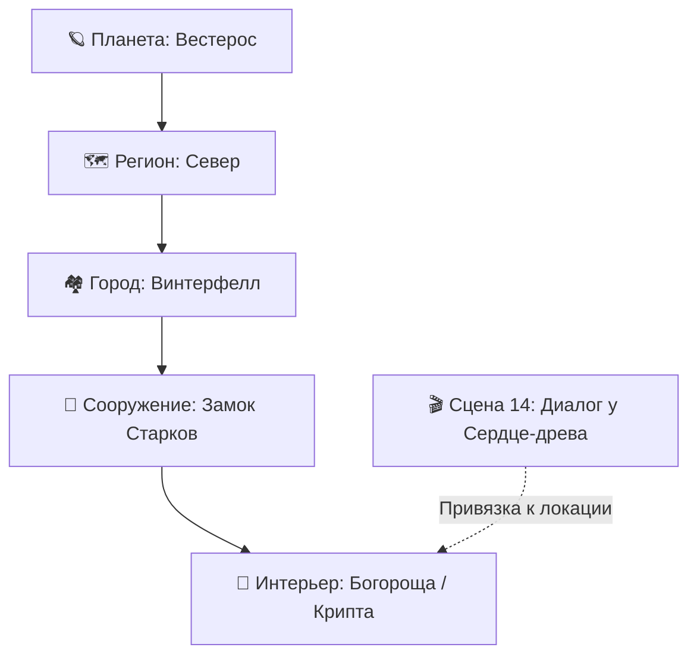

# 🗺️ Спецификация: Пространственно-Сюжетный Атлас

> **Область действия**: Пересечение сущностей `location` (Локация), `character` (Персонаж), `state` (Государство) и сцен рукописи.
> **Статус**: Архитектурный стандарт базового ядра WorldWiki.

---

## 📌 1. Концепция и Назначение

В литературном произведении география — это не статичная карта, а динамическая арена. Герои перемещаются между городами, захватывают крепости, скрываются в лесах. 

**Пространственно-Сюжетный Атлас** решает три задачи автора:
1. **Географическая иерархия сцен (Breadcrumbs)**: мгновенное понимание, где разворачивается действие (в какой комнате, какого замка, какого города, какой провинции).
2. **Аудит реализма перемещений (Travel Velocity & Teleportation Prevention)**: исключение ситуаций, когда герой в главе 1 находится на Севере, а в главе 2 (через 2 часа по лору) уже сидит в таверне на Юге.
3. **Тепловая карта плотности событий (Hotspots & Chokepoints)**: визуализация того, какие регионы мира перегружены сценами, а какие упомянуты вскользь и простаивают.

---

## 🗄️ 2. Модель Данных и Системные Поля Локации (`location`)

В схеме `location.json` системно закреплены следующие неудаляемые поля:

```json
{
  "entityType": "location",
  "titleField": "название",
  "fields": [
    {
      "id": "название",
      "type": "text",
      "required": true,
      "path": "название"
    },
    {
      "id": "тип_локации",
      "type": "select",
      "required": true,
      "options": [
        { "value": "интерьер", "label": "🚪 Помещение / Интерьер (кабинет, зал, каюта)" },
        { "value": "здание", "label": "🏰 Здание / Сооружение (замок, трактир, бункер)" },
        { "value": "микро_точка", "label": "📍 Точка на местности (мост, поляна, площадь)" },
        { "value": "поселение", "label": "🏘️ Поселение / Город (деревня, мегаполис, станция)" },
        { "value": "природная_зона", "label": "🌲 Природная зона (лес, перевал, болото, пещера)" },
        { "value": "гео_регион", "label": "🗺️ Географический регион (остров, долина, архипелаг)" },
        { "value": "макро_объект", "label": "🪐 Планета / Астрономический объект / Сектор" }
      ],
      "path": "тип_локации"
    },
    {
      "id": "родительская_локация",
      "type": "select",
      "entityType": "location",
      "label": "Входит в локацию (Родитель)",
      "path": "родительская_локация"
    },
    {
      "id": "принадлежность_государству",
      "type": "select",
      "entityType": "state",
      "label": "Государство / Держава (Юрисдикция)",
      "path": "принадлежность_государству"
    },
    {
      "id": "контролирующая_фракция",
      "type": "select",
      "entityType": "organization",
      "label": "Фактический контроль (Фракция / Гарнизон)",
      "path": "контролирующая_фракция"
    },
    {
      "id": "статус_категория",
      "type": "select",
      "required": true,
      "options": [
        { "value": "Существует", "label": "🟢 Существует / Доступна" },
        { "value": "Разрушена / Руины", "label": "🔴 Разрушена / В руинах" },
        { "value": "Заброшена", "label": "🟡 Заброшена" },
        { "value": "Скрыта / Затоплена", "label": "⚪ Скрыта / Затоплена / Недоступна" }
      ],
      "path": "статус_категория"
    }
  ]
}
```

---

## ⚙️ 3. Алгоритмы и Аналитические Правила



### 3.1. Иерархический Географический Навигатор (Breadcrumb Engine)
* При выборе любой микро-локации в сцене система автоматически вычисляет полный путь:
  $$\text{Крипта} \subset \text{Замок Старков} \subset \text{Винтерфелл} \subset \text{Север} \subset \text{Семь Королевств}$$
* В навигаторе глав автор может фильтровать события на любом уровне зума:
  * *«Показать все сцены в Винтерфелле»* (выдаст и крипту, и тронный зал, и тренировочный двор).
  * *«Показать все сцены на Севере»* (выдаст все города и замки этого региона).

### 3.2. Аудит Скорости Перемещений (Travel Velocity Audit)
* **Входные данные**: 
  * Сцена $A$ в момент времени $M_{\text{abs\_A}}$ в локации $\text{Loc}_A$.
  * Сцена $B$ в момент времени $M_{\text{abs\_B}}$ с участием того же персонажа в локации $\text{Loc}_B$.
* **Алгоритм**:
  1. Вычисляется степень удаленности (расстояние в графе локаций между общим предком $\text{Loc}_A$ и $\text{Loc}_B$).
  2. Разница во времени $\Delta M = M_{\text{abs\_B}} - M_{\text{abs\_A}}$.
  3. Если $\text{Loc}_A$ и $\text{Loc}_B$ принадлежат разным континентам/регионам, а $\Delta M < \text{Порог реалистичного пути}$ (например, менее 3 суток при отсутствии магии) $\to$ генерируется **Warning: Пространственный телепорт персонажа**.

### 3.3. Тепловая Карта Плотности Сюжета (Narrative Hotspots)
* Анализ распределения сцен по географическим кластерам.
* Выявление «мертвых зон лора» — локаций, подробно описанных в энциклопедии, но не имеющих ни одного появления в тексте книги.

---

## 🖥️ 4. Пользовательский Интерфейс (UI/UX)

1. **Хроника Локации (Location Chronicle View)**:
   * Отдельный таб в карточке локации: вертикальный таймлайн всех сцен, происходивших в этом месте, с аватарами участников и статусом разрушений.
2. **Индикатор юрисдикции в рукописи**:
   * При клике на абзац со сценой в шапке инспектора отображается бейдж: `[📍 Крипта Винтерфелла | 🛡️ Дом Старков]`.
