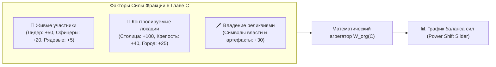

# ⚖️ Спецификация: Фракционные Весы и Баланс Сил

> **Область действия**: Пересечение сущностей `organization` (Организация/Фракция), `state` (Государство), `character` (Персонаж) и `location` (Локация).
> **Статус**: Архитектурный стандарт базового ядра WorldWiki.

---

## 📌 1. Концепция и Назначение

Политические интриги, восстания и войны в литературе строятся на постоянном изменении **баланса сил**. Когда погибает влиятельный генерал, когда тайный агент переходит на другую сторону или когда гильдия купцов захватывает контроль над столичным банком — вся расстановка сил в мире меняется.

**Фракционные Весы** предоставляют автору:
1. **Динамический график влияния (Power Shift Slider)**: возможность двигать ползунок по главам и наблюдать математический расчет политического веса фракций во времени.
2. **Детектор теневой лояльности и шпионажа**: визуализацию двойных агентов, скрытого подчинения и расколов внутри организаций.
3. **Контроль над ключевыми ресурсами и столицами**: прозрачную карту того, какие города и крепости кем фактически удерживаются на каждом этапе сюжета.

---

## 🗄️ 2. Модель Данных и Системные Поля

### Организация (`organization.json`):
* `статус_категория`: `Не указано`, `Действует`, `Неактивна`, `Распущена / Уничтожена`, `Подпольная`.
* `лидер_глава`: `select: character` (привязка к персонажу).
* `штаб_квартира`: `select: location` (привязка к локации).
* `состав_участники`: контейнер `timeline` с фиксацией вступления и выхода персонажей по главам книги (`manuscript_point`).

### Государство (`state.json`):
* `статус_категория`: `Не указано`, `Суверенное`, `Зависимое / Колония`, `Исчезнувшее / Пало`, `Оспариваемое`, `Автономное`.
* `столица`: `select: location`.
* `правитель`: `select: character`.

---

## ⚙️ 3. Алгоритм Расчета Баланса Сил (Power Metric)

В любой выбранной главе $C$ совокупный **Политический Вес Фракции ($W_{\text{org}}$)** рассчитывается как взвешенная сумма факторов:

$$W_{\text{org}}(C) = \sum \text{Actors}(C) + \sum \text{Territories}(C) + \sum \text{Artifacts}(C)$$

### 3.1. Динамика по главам (Timeline Power Slider)
* Автор выбирает главу на шкале времени (например, *«Глава 10»* $\to$ *«Глава 25»*).
* Если в Главе 12 погиб Лидер фракции (`статус_категория == "Мёртв"`), его персональный вес аннулируется.
* Если в Главе 15 Фракция потеряла контроль над Столицей в пользу Бунтовщиков, бонус за локацию мгновенно переходит оппонентам.
* На графике отображается резкий перегиб кривой влияния (Climax Point).

### 3.2. Детектор Теневой Лояльности и Шпионажа
* Взаимосвязь через `двунаправленные_связи` у персонажа:
  * Официальное членство: персонаж $X$ состоит в `Орден Паладинов`.
  * Скрытая связь: персонаж $X$ имеет направленное ребро `entity_rel` к лидеру `Культ Теней` с типом «Тайный союзник / Осведомитель».
* Система подсвечивает конфликт интересов пунктирным ребром на графе фракций (Infiltration Risk).

---

## 🖥️ 4. Пользовательский Интерфейс (UI/UX)

1. **Экран «Политические Весы» (Faction Dashboard)**:
   * Круговая или столбчатая диаграмма распределения сил в выбранной главе.
   * Ползунок времени внизу экрана для плавной анимации перераспределения влияния по главам.
2. **Карточка фракции**:
   * Список активных членов на текущую главу;
   * Список утраченных территорий и погибших лидеров;
   * Союзные и враждебные фракции с индикатором силы связи.
