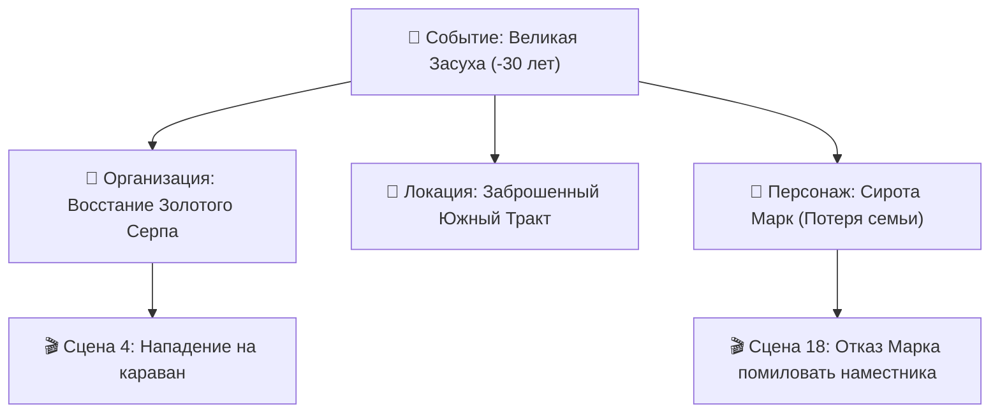

# 📜 Спецификация: Причинно-Следственный Граф и Лоро-Эхо

> **Область действия**: Пересечение сущностей `event` (Событие), `character` (Персонаж), `state` (Государство) и `organization` (Организация).
> **Статус**: Архитектурный стандарт базового ядра WorldWiki.

---

## 📌 1. Концепция и Назначение

Любая глубокая вымышленная вселенная стоит на фундаменте своей истории. Прошлые катаклизмы, революции, войны и династические браки определяют, почему герои ненавидят друг друга, почему разрушены древние крепости и почему в мире действуют строгие религиозные запреты.

**Причинно-Следственный Граф** связывает прошлое с настоящим:
1. **Каузальные цепочки (Causality Chains)**: показ того, как одно событие прошлого повлекло череду последствий вплоть до конкретных сцен в романе.
2. **Травмы и мотивация персонажей (Lore Footprint & Trauma)**: объяснение психологических мотивов героя через пережитые им исторические потрясения.
3. **Лоро-Эхо и Семантическая инъекция в AI**: автоматическое обогащение контекста нейросети историческим бэкграундом при написании диалогов между представителями враждующих родов.

---

## 🗄️ 2. Модель Данных и Системные Поля События (`event`)

В схеме `event.json` системно закреплены следующие неудаляемые поля:

```json
{
  "entityType": "event",
  "titleField": "название",
  "fields": [
    {
      "id": "название",
      "type": "text",
      "required": true,
      "path": "название"
    },
    {
      "id": "дата_события",
      "type": "calendar_datetime",
      "required": true,
      "path": "дата_события"
    },
    {
      "id": "длительность",
      "type": "number",
      "label": "Длительность (в абсолютных минутах / часах)",
      "path": "длительность"
    },
    {
      "id": "место_действия",
      "type": "select",
      "entityType": "location",
      "path": "место_действия"
    },
    {
      "id": "участники",
      "type": "multiselect",
      "entityType": "character",
      "path": "участники"
    },
    {
      "id": "затронутые_фракции",
      "type": "multiselect",
      "entityType": "organization",
      "path": "затронутые_фракции"
    },
    {
      "id": "масштаб_важность",
      "type": "select",
      "options": [
        { "value": "локальное", "label": "🟢 Локальное событие" },
        { "value": "региональное", "label": "🟡 Региональный масштаб" },
        { "value": "мировое", "label": "🟠 Мировой масштаб" },
        { "value": "эпохальное", "label": "🔴 Эпохальный сдвиг (Новая эра)" }
      ],
      "path": "масштаб_важность"
    }
  ]
}
```

---

## ⚙️ 3. Алгоритмы Каузального Анализа



### 3.1. Дерево Последствий (Event Footprint)
* Клик по историческому событию разворачивает радиальный граф:
  * Какие персонажи участвовали или пострадали;
  * Какие локации изменили статус (например, перешли в статус `Разрушена / Руины`);
  * Какие государства пали или образовались.

### 3.2. Лоро-Эхо в Диалогах (AI Lore Injection)
* При написании сцены между персонажами $A$ и $B$ ассистент анализирует пересечение их истории:
  * *«Дед персонажа А казнил отца персонажа Б во время События "Ночь Длинных Кинжалов"»*.
* AI-генерация текста и диалогов автоматически учитывает скрытую напряженность и фамильную вражду без необходимости автору каждый раз писать об этом длинные системные промпты.

---

## 🖥️ 4. Пользовательский Интерфейс (UI/UX)

1. **Таймлайн Истории Мира (Chronology Master View)**:
   * Глобальная лента исторических событий с фильтрацией по масштабу (`Эпохальные`, `Мировые`, `Локальные`).
2. **Инспектор мотивации в карточке персонажа**:
   * Блок «Ключевые события жизни»: список всех исторических точек, сформировавших личность героя.
