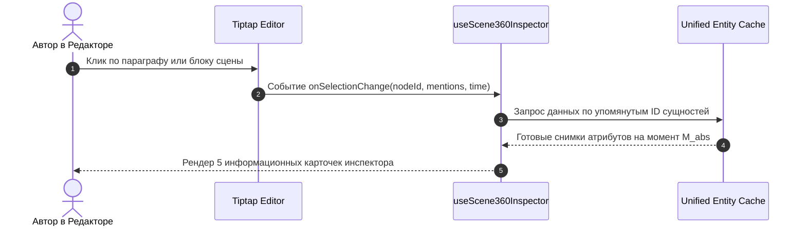

# 🔍 Спецификация: Инспектор Сцены «360°» (Scene Multiverse Lens)

> **Область действия**: Основной редактор рукописи (Tiptap / Word-Vibe), интеграция со всеми 6 сущностями.
> **Статус**: Архитектурный стандарт базового ядра WorldWiki.

---

## 📌 1. Концепция и Назначение

Главная боль автора при написании сложных многофигурных сцен — необходимость постоянно держать в голове десятки разрозненных фактов:
* *«Сколько лет Сонечке в этой главе?»*
* *«Жив ли ещё старый кузнец?»*
* *«Кто сейчас правит этим городом?»*
* *«У кого в этой главе находится фамильный перстень?»*

**Инспектор Сцены «360°»** — это контекстная боковая панель прямо в редакторе рукописи, которая при установке курсора на абзац или блок сцены мгновенно собирает проекцию **всех 6 системных сущностей в этой точке пространства и времени**.

---

## 🗄️ 2. Анатомия Панели «360°»

```
┌─────────────────────────────────────────────────────────────┐
│ 🎬 ИНСПЕКТОР СЦЕНЫ: Глава 5, Сцена 2 (Минута M_abs: 104250) │
├─────────────────────────────────────────────────────────────┤
│ 👤 ПЕРСОНАЖИ В СЦЕНЕ (2):                                   │
│  ├─ 🟢 Сонечка (19 лет) | Роль: Главный герой | Арка: Грех  │
│  └─ 🟢 Макс (24 года) | Роль: Второстепенный | Арка: Погоня │
│  ⚡ Отношения: «Напряженное недоверие» (Сила: -35)          │
├─────────────────────────────────────────────────────────────┤
│ 📍 ЛОКАЦИЯ:                                                 │
│  ├─ 🚪 Трактир «У Серого Волка» (Здание / Таверна)          │
│  └─ 🗺️ Иерархия: Нижний Город ⊂ Столица ⊂ Империя Валория │
├─────────────────────────────────────────────────────────────┤
│ 🏢 ЧЬЯ ВЛАСТЬ И ЮРИСДИКЦИЯ:                                 │
│  ├─ 🗺️ Государство: Империя Валория (Суверенное)            │
│  └─ 🛡️ Контроль района: Гильдия Воров (Подпольная)          │
├─────────────────────────────────────────────────────────────┤
│ 🗡️ ПРЕДМЕТЫ В СЦЕНЕ:                                        │
│  └─ 🔮 Амулет Затмения (В руках у: Сонечка | Статус: Цел)  │
├─────────────────────────────────────────────────────────────┤
│ 📜 ЛОРНЫЙ КОНТЕКСТ & ОБЕЩАНИЯ:                              │
│  ├─ ⚠️ Напоминание: Макс поклялся отомстить за Пожар в Гл. 2 │
│  └─ 🎯 Цель сцены: Передать зашифрованное письмо            │
└─────────────────────────────────────────────────────────────┘
```

---

## ⚙️ 3. Архитектура Сбора Данных (Reactivity Pipeline)



### 3.1. Динамический расчет на лету:
1. **Возраст персонажа**: $Age = \lfloor (M_{\text{abs\_scene}} - \text{birth\_m\_abs}) / \text{MinutesInYear} \rfloor$.
2. **Актуальное отношение**: срез из `relationshipStates` для конкретной главы.
3. **Держатель артефакта**: последняя активная запись в `история_владения` на момент текущей главы.
4. **Владелец локации**: срез `контролирующая_фракция` для текущей локации.

---

## 🖥️ 4. Интерактивные Действия (Quick Actions)

Прямо из панели Инспектора «360°» автор может выполнять мгновенные манипуляции:
* 🗡️ **«Передать предмет»**: в 1 клик сменить держателя артефакта с одного присутствующего персонажа на другого.
* 💔 **«Изменить отношения»**: подвинуть ползунок дружбы/вражды прямо во время написания кульминационного диалога.
* 💀 **«Изменить статус»**: пометить персонажа как погибшего прямо в боевой сцене (с фиксацией $M_{\text{abs\_death}}$).
