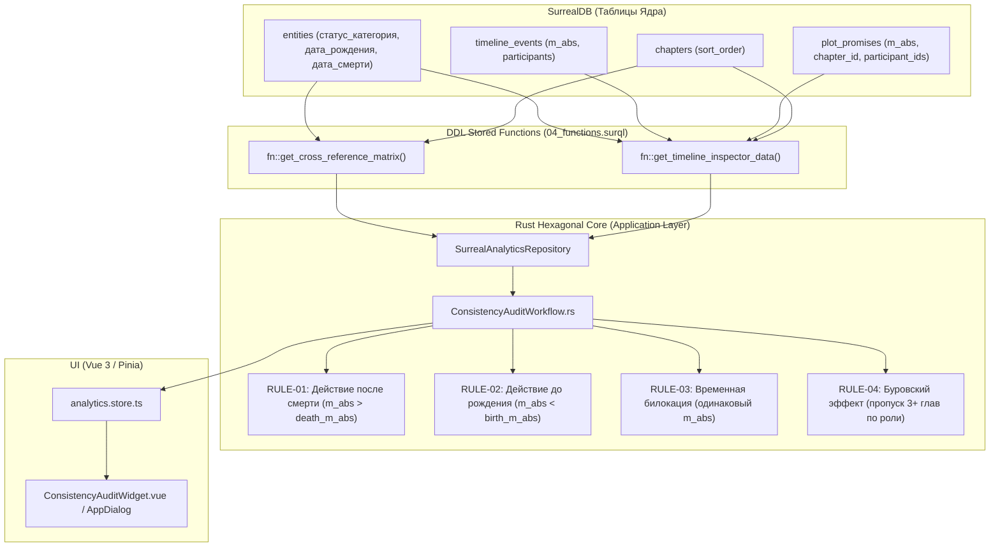
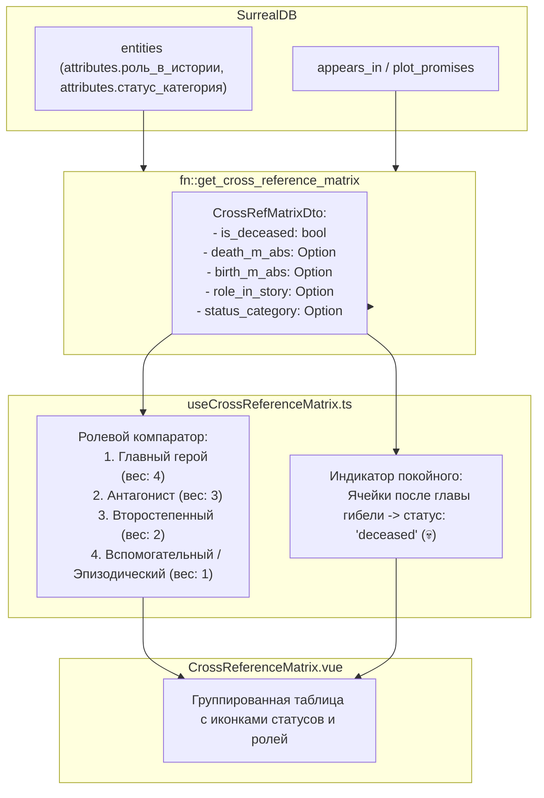
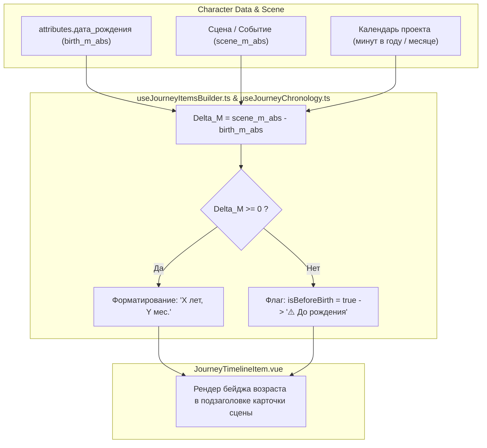

# 📋 Архитектурный План Реализации: Этап 1 (Ревизия Модулей под Системный Контракт)

> **Цель этапа**: Перевести 3 ключевых аналитических подсистемы (`ConsistencyAudit`, `CrossReferenceMatrix`, `CharacterJourney`) на зафиксированный системный контракт 6 сущностей (`статус_категория`, `дата_рождения`, `дата_смерти`, `роль_в_истории`), исключив баги и хрупкость нетипизированных полей.

---

## 🗺️ 1. Диаграммы Потоков Данных (DFD)

### 1.1. DFD: Аудит Непротиворечивости (Consistency Audit Pipeline)



---

### 1.2. DFD: Матрица Пересечений и Ролевая Сортировка (Cross-Reference Matrix)



---

### 1.3. DFD: Расчет Динамического Возраста (Character Journey Age Calculator)



---

## 🛠️ 2. Пошаговый План Изменений по Слоям

### Слой 1: База Данных и DDL (`logic/schema/no_ai/04_functions.surql`)
1. **Обновление `fn::get_cross_reference_matrix`**:
   * Извлекать `(attributes.статус_категория = 'Мёртв' OR attributes.is_deceased = true) AS is_deceased`.
   * Извлекать `attributes.дата_смерти.m_abs AS death_m_abs`.
   * Извлекать `attributes.дата_рождения.m_abs AS birth_m_abs`.
   * Извлекать `attributes.роль_в_истории AS role_in_story`.
   * Извлекать `attributes.статус_категория AS status_category`.
2. **Синхронизация с копией в `apps/spa/src/logic/schema/no_ai/04_functions.surql`**.

---

### Слой 2: Rust Hexagonal Core (`src-tauri/crates/`)
1. **Доменные DTO (`worldwiki-domain/src/analytics/cross_ref.rs`)**:
   * Добавить поля в `EntityRowDto`:
     ```rust
     pub role_in_story: Option<String>,
     pub status_category: Option<String>,
     pub birth_m_abs: Option<i64>,
     ```
2. **Инфраструктурный репозиторий (`worldwiki-infrastructure/src/surrealdb/repos/analytics_repo.rs`)**:
   * Обновить `RawEntityRow` и маппинг в `EntityRowDto`.
3. **Use Case: Аудит Непротиворечивости (`worldwiki-application/src/analytics/consistency_audit.rs`)**:
   * Добавить `RULE-02` (Действие до рождения: `ev.m_abs < birth_m_abs`).
   * Обновить `RULE-04` (Буровский эффект): проверять пропуск глав с учетом `role_in_story` (только для главных и антагонистов).
4. **Unit-тесты (`consistency_audit.rs`)**:
   * Написать изолированные тесты на все сценарии (жизнь после смерти, действие до рождения, пропуск глав).

---

### Слой 3: Frontend Стейт и Логика (`apps/spa/src/ts/`)
1. **Аналитический стор (`stores/analytics.store.ts`)**:
   * Расширить интерфейс `MatrixEntity`:
     ```typescript
     export interface MatrixEntity {
       id: string;
       name: string;
       entity_type: string;
       is_deceased?: boolean;
       death_m_abs?: number;
       birth_m_abs?: number;
       role_in_story?: string;
       status_category?: string;
       appearances_by_chapter?: MatrixAppearance[];
     }
     ```
2. **Хук матрицы (`features/analytics/CrossReferenceMatrix/useCrossReferenceMatrix.ts`)**:
   * Внедрить весовой компаратор ролей: `Главный (4) > Антагонист (3) > Второстепенный (2) > Эпизодический (1)`.
   * При равенстве ролей — сортировать по `totalAppearances DESC`.
   * Серая штриховка ячеек для покойников во всех главах после момента гибели.
3. **Хук навигатора пути (`features/entities/CharacterJourney/hooks/useJourneyItemsBuilder.ts`)**:
   * Извлекать `birth_m_abs` из `data.attributes.дата_рождения`.
   * Если у сцены/события есть `m_abs`, вычислять возраст через функцию `calculateDiegeticAge(birth_m_abs, scene_m_abs, calendarData)`.
   * Добавить `ageLabel` и `isBeforeBirth` в `JourneyTimelineItem`.

---

### Слой 4: UI и Стили (`packages/resources/`)
1. **Стили матрицы (`CrossReferenceMatrix.css`)**:
   * Добавить CSS-классы для бейджей ролей (`role-badge--main`, `role-badge--antagonist`).
   * Стилизация ячеек погибших персонажей (`matrix-cell--deceased`).
2. **Шаблон элемента пути (`JourneyTimelineItem.vue` / стили)**:
   * Отображение чипса возраста рядом с датой сцены.

---

## 🧪 3. Чеклист Контроля Качества и Тестирования

- [ ] 🦀 **Rust Core Tests**: `cargo test --lib analytics` и `cargo test --lib consistency_audit` проходят без ошибок.
- [ ] ⚡ **Frontend Vitest**: `pnpm test` (все тесты `schemas_contract.spec.ts`, `useCrossReferenceMatrix.spec.ts`, `useJourneyItemsBuilder.spec.ts` зелёные).
- [ ] 🔍 **TypeScript Strict**: `pnpm typecheck` — 0 ошибок во всех 4 пакетах монорепозитория.
- [ ] 🛡️ **Cerberus Architectural Firewall**: `cargo cerberus check --ci` — 0 новых `[DENY]` нарушений.
- [ ] 🎨 **Design Tokens Audit**: В новых CSS-стилях отсутствуют захардкоженные Hex-цвета (только токены дизайн-системы).
