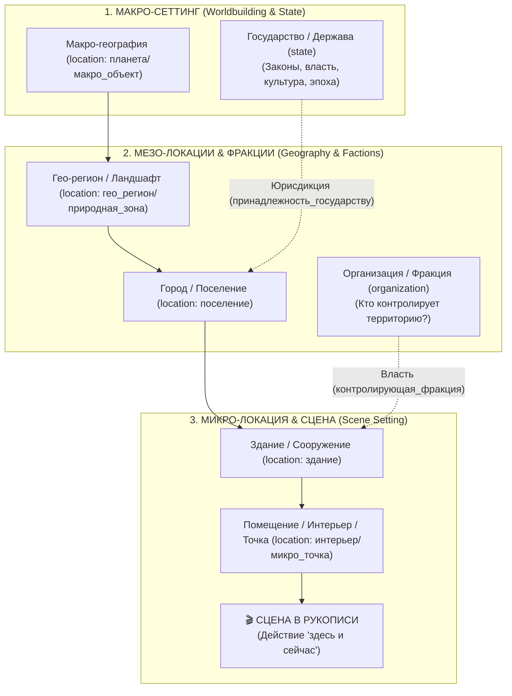

# 🏛️ Спецификация: Системные Поля Сущностей и Движок Литературного Анализа

## 📌 1. Введение и Архитектурный Принцип

В системе **WorldWiki** сущности делятся на два уровня свойств:
1. **Гибкие (Пользовательские) поля**: автор может создавать, переименовывать, скрывать и удалять любые характеристики (например, *«Цвет глаз»*, *«Любимый чай»*, *«Девиз рода»*).
2. **Системные (Защищенные / Hardcoded) поля**: набор фундаментальных атрибутов, на которых базируются математические модели, графовые выборки, парсеры рукописи, семантический RAG и **Движок Аудита Непротиворечивости (Consistency Audit Engine)**.

> 🛑 **Правило Неприкосновенности (Immutability Invariant)**:
> Системные поля имеют флаги `isSystem: true` и `preventDelete: true`. В визуальном редакторе схем (**Schema Editor**) автор **не может удалить** эти поля или изменить их системный `path` / `value`, так как это приведет к отказу аналитических модулей ядра.

---

## 🎭 2. Нарративная Архитектура: Разграничение Географии и Политики

В нарративном анализе и сценарном мастерстве действует строгая **Иерархия Сеттинга (Hierarchy of Setting / Принцип матрешки)**:



### Принцип разделения ответственности:
* **Государство (`state`) и Организация (`organization`) — это СОЦИАЛЬНО-ПОЛИТИЧЕСКИЕ СУБЪЕКТЫ (Люди и Власть)**.
  * Они обладают законами, флагами, правителями, армиями, могут менять границы, распадаться или уходить в изгнание.
* **Локация (`location`) — это ФИЗИЧЕСКОЕ ПРОСТРАНСТВО (География и Декорация)**.
  * Персонаж не может физически стоять внутри абстрактного государства — он находится в конкретной комнате, на мосту или в переулке.
  * Город Рим или остров Британия физически остаются на месте независимо от смены империй и королей.
* **Связка через граф**:
  * Локация отвечает на вопрос: **«ГДЕ физически находятся герои?»**
  * Поля `принадлежность_государству` и `контролирующая_фракция` отвечают на вопрос: **«ЧЬЯ это власть в этой точке в текущей главе?»**

---

## 📋 3. Реестр 6 Базовых Сущностей и Системные Поля

### 3.1. 👤 Персонаж (`character`)

Центральный актор повествования. Участвует в сценах, сюжетных обещаниях, формирует граф отношений и проживает сюжетные арки.

| Идентификатор / Path | Тип контрола | Допустимые значения (Options / Struct) | Назначение и влияние на аналитику |
|---|---|---|---|
| **`название`** (`titleField`) | `text` (required) | Строка (*«Владимир Коршунов»*) | Единый ключ идентификатора. Парсинг сущностей в тексте через триггер `((Владимир Коршунов))`. Заголовок карточки и узла графа. |
| **`псевдонимы`** (`aliases`) | `tags` | Массив строк (*«Волк»*, *«Капитан»*) | **Автоматическая привязка к главам (`fn::sync_chapter_mentions`)**: если в тексте написано `((Волк))`, движок автоматически связывает сцену с этим персонажем. |
| **`статус_категория`** | `select` (required) | `Не указано`, `Жив`, `Мёртв`, `Пропал без вести` | **Флаг жизни/смерти**: при `Мёртв` включает статус `is_deceased` в матрице пересечений и активирует проверку действий после смерти в аудите. |
| **`роль_в_истории`** | `select` | `Главный герой`, `Второстепенный`, `Антагонист`, `Эпизодический` | **Детекция Буровского эффекта**: если `Главный герой` не появляется 3+ глав подряд — выдается Warning. Приоритизация в AI-контексте. |
| **`дата_рождения`** | `calendar_datetime` | Структура даты мира $\to M_{\text{abs}}$ | Динамический расчет возраста в любой сцене книги. Детекция анахронизмов «Действие персонажа до его рождения». |
| **`дата_смерти`** | `calendar_datetime` | Структура даты мира $\to M_{\text{abs}}$ | **Железный инвариант времени**: если $M_{\text{abs\_scene}} > \text{death\_m\_abs}$, система регистрирует критическое логическое противоречие. |
| **`двунаправленные_связи`** | `dynamic` (шаблон) | Список связей: `целевая_сущность`, `тип_отношения`, `relationshipStates` | **Граф связей (`fn::get_graph_time_slice`)**: расчет графа отношений на любую главу/минуту с учетом силы связи ($-100 \dots +100$). |

---

### 3.2. 📍 Локация / Место (`location`)

Пространственная основа мира. Организуется в топологическое дерево физической вложенности.

| Идентификатор / Path | Тип контрола | Допустимые значения | Назначение и влияние на аналитику |
|---|---|---|---|
| **`название`** (`titleField`) | `text` (required) | Строка (*«Трактир "Пьяный Дракон"»*) | Триггер `((Локация))` в тексте и фильтр в Навигаторе Сцен. |
| **`тип_локации`** | `select` (required) | `интерьер`, `здание`, `микро_точка`, `поселение`, `природная_зона`, `гео_регион`, `макро_объект` | **Шкала масштаба сцены** (от комнаты до галактического сектора). Используется для группировки и расчета времени путешествий. |
| **`родительская_локация`** | `select: location` | Связь на `entities:loc_*` | **Иерархический географический граф (Breadcrumbs)**: понимание физической вложенности (Комната $\subset$ Замок $\subset$ Город $\subset$ Долина). |
| **`принадлежность_государству`** | `select: state` | Связь на `entities:state_*` | Политическая юрисдикция территории. |
| **`контролирующая_фракция`** | `select: organization` | Связь на `entities:org_*` | Фактический владелец/гарнизон (с возможностью динамической смены по главам). |
| **`статус_категория`** | `select` | `Существует`, `Разрушена / Руины`, `Заброшена`, `Скрыта / Затоплена` | **Защита от аномалий**: персонажи не могут вести диалог в уничтоженной локации. |

#### Канонические опции `тип_локации`:
* `интерьер` — 🚪 Помещение / Интерьер (кабинет, тронный зал, каюта, тюремная камера).
* `здание` — 🏰 Здание / Сооружение (замок, трактир, бункер, звездолет, маяк).
* `микро_точка` — 📍 Точка на местности (мост, перекресток дорог, городская площадь, поляна у костра).
* `поселение` — 🏘️ Поселение / Город (деревня, мегаполис, военный лагерь, орбитальная станция).
* `природная_зона` — 🌲 Природный ландшафт (дремучий лес, горный перевал, гиблое болото, пещера, озеро).
* `гео_регион` — 🗺️ Географический регион (остров, долина, архипелаг, пустыня, плато).
* `макро_объект` — 🪐 Планета / Астрономический объект / Звездная система.

---

### 3.3. 🏢 Организация / Фракция (`organization`)

Социальные структуры: гильдии, ордена, тайные общества, корпорации, воинские подразделения.

| Идентификатор / Path | Тип контрола | Допустимые значения | Назначение и влияние на аналитику |
|---|---|---|---|
| **`название`** (`titleField`) | `text` (required) | Строка (*«Орден Серой Стражи»*) | Ключ идентификации и меншенов `((Организация))`. |
| **`официальное_название`** | `text` / `tags` | Синонимы, аббревиатуры | Распознавание упоминаний в рукописи. |
| **`статус_категория`** | `select` | `Не указано`, `Действует`, `Неактивна`, `Распущена / Уничтожена`, `Подпольная` | Состояние фракции. Проверка активности членов после роспуска. |
| **`лидер_глава`** | `select: character` | Связь на персонажа | Автоматическое построение ребра подчинения в графе фракций. |
| **`штаб_квартира`** | `select: location` | Связь на локацию | Географическая привязка центра влияния. |
| **`дата_основания` / `ликвидации`** | `calendar_datetime` | Мировой календарь $\to M_{\text{abs}}$ | Хронологические рамки существования. |
| **`состав_участники`** | `timeline` (шаблон) | Хронология членства персонажей | Отслеживание вступления/выхода героев из фракции по главам книги. |

---

### 3.4. 🗺️ Государство / Держава (`state`)

Макро-политические образования.

| Идентификатор / Path | Тип контрола | Допустимые значения | Назначение и влияние на аналитику |
|---|---|---|---|
| **`название`** (`titleField`) | `text` (required) | Строка (*«Валирийская Империя»*) | Идентификатор геополитического субъекта. |
| **`статус_категория`** | `select` | `Не указано`, `Суверенное`, `Зависимое / Колония`, `Исчезнувшее / Пало`, `Оспариваемое`, `Автономное` | Геополитический статус для анализа таймлайна эпох. |
| **`столица`** | `select: location` | Связь на локацию | Главный административный центр. |
| **`правитель`** | `select: character` | Связь на персонажа | Династический анализ и престолонаследие. |
| **`дата_основания` / `падения`** | `calendar_datetime` | Даты по календарю | Эпохальные маркеры истории мира. |

---

### 3.5. 🗡️ Предмет / Артефакт (`item` / `artifact`)

Материальные объекты, реликвии, ключевые улики и Чеховские ружья.

| Идентификатор / Path | Тип контрола | Допустимые значения | Назначение и влияние на аналитику |
|---|---|---|---|
| **`название`** (`titleField`) | `text` (required) | Строка (*«Кольцо Всевластья»*) | Меншены `((Предмет))` в тексте сцен. |
| **`тип_предмета`** | `select` | `Оружие`, `Магический артефакт`, `Документ / Улика`, `Реликвия`, `Транспорт / Техника`, `Зелье / Вещество` | Категоризация инвентаря мира. |
| **`статус_категория`** | `select` | `Не указано`, `Цел / Активен`, `Поврежден`, `Уничтожен`, `Утерян` | **Защита от логических дыр**: уничтоженный предмет не может быть использован в последующих главах. |
| **`текущий_владелец`** | `select: character/org` | Связь на персонажа/организацию | Быстрая справка о текущем держателе. |
| **`история_владения`** | `timeline` (шаблон) | Хронология передачи по главам: Начало (Глава), Конец (Глава), Владелец, Обстоятельства | **Анализ Чеховских ружей и исключение билокации предмета**: проверка, что предмет не находится в руках двух разных героев одновременно в одной главе. |

---

### 3.6. 📜 Историческое Событие (`event`)

Ключевые события прошлого и настоящего, формирующие канву лора (Войны, Советы, Катаклизмы).

| Идентификатор / Path | Тип контрола | Допустимые значения | Назначение и влияние на аналитику |
|---|---|---|---|
| **`название`** (`titleField`) | `text` (required) | Строка (*«Битва на Красных Полях»*) | Идентификатор события. |
| **`дата_события`** | `calendar_datetime` | $M_{\text{abs}}$ начала | Привязка к временной шкале Timeline Inspector. |
| **`длительность`** | `number` / `datetime` | $M_{\text{abs}}$ окончания | Временной охват события. |
| **`место_действия`** | `select: location` | Связь на локацию | Географическая привязка. |
| **`участники`** | `multiselect: character/org` | Список сущностей | Автоматическая генерация ребер `participates_in` в базе данных. |
| **`масштаб_важность`** | `select` | `Локальное`, `Региональное`, `Мировое`, `Эпохальное` | Фильтрация на глобальном таймлайне проекта. |

---

## 🚀 4. Комбинаторные Фичи Литературного Анализа (Стыки 6 Сущностей)

Вся сила сюжетного и логического анализа WorldWiki строится на комбинации этих 6 базовых сущностей без необходимости перегружать систему лишними надстройками:

```
                      ┌────────────────────────────────┐
                      │    6 БАЗОВЫХ СУЩНОСТЕЙ         │
                      │  👤 Персонаж    📍 Локация     │
                      │  🏢 Организация 🗺️ Государство  │
                      │  🗡️ Предмет     📜 Событие     │
                      └───────────────┬────────────────┘
                                      │
       ┌──────────────────┬───────────┴──────────┬──────────────────┐
       ▼                  ▼                      ▼                  ▼
┌──────────────┐   ┌──────────────┐       ┌──────────────┐   ┌──────────────┐
│ 1. ЧЕХОВСКИЕ │   │ 2. СЮЖЕТНЫЙ  │       │ 3. БАЛАНС    │   │ 4. ИНСПЕКТОР │
│    РУЖЬЯ     │   │    АТЛАС     │       │    СИЛ       │   │    «360°»    │
│  (Предметы × │   │  (Локации ×  │       │(Организации ×│   │(Все 6 в одной│
│ Персонажи ×  │   │ Персонажи ×  │       │Государства × │   │    точке     │
│    Сцены)    │   │    Сцены)    │       │ Персонажи)   │   │  рукописи)   │
└──────────────┘   └──────────────┘       └──────────────┘   └──────────────┘
```

---

### 4.1. 🗡️ Трекер Чеховских Ружей и Инвентаря (Предметы $\times$ Персонажи $\times$ Сцены)
* **Детектор Забытых Предметов (Forgotten Props)**:
  * Если герой подобрал артефакт/улику/оружие в Главе 3, но за следующие 15 глав предмет ни разу не упоминался в сценах — система выводит предупреждение: *«Артефакт "Ключ от склепа" получен Владимиром в Гл. 3 и висит без действия уже 12 глав»*.
* **Контроль Цепочки Передачи (Chain of Custody & Anti-Teleportation)**:
  * Исключение логических дыр: если в Главе 5 кинжал был у Сонечки, а в Главе 8 им внезапно орудует Макс, но сцены передачи, кражи или находки между ними не было — система фиксирует нарушение связности.
* **Предмет как фокус навигатора**:
  * Возможность в один клик построить таймлайн: «Показать все сцены книги, в которых участвовал этот артефакт, и в чьих руках он находился».

---

### 4.2. 🗺️ Пространственно-Сюжетный Атлас (Локации $\times$ Персонажи $\times$ Сцены)
* **Географический Навигатор Сцен**:
  * Клик по локации (например, *«Замок Драконий Камень»*) открывает хронологию места: какие главы там происходили, кто с кем встречался, какие переговоры велись и какие артефакты там сейчас хранятся.
* **Анализ Узловых Точек (Chokepoints & Hotspots)**:
  * Тепловая карта плотности сюжета: система подсвечивает места максимальной концентрации событий. Автор видит: *«В Столице происходит 85% книги, а Южные Земли упомянуты, но в них нет ни одной сцены»*.
* **Аудит Скорости Перемещений (Travel Velocity)**:
  * Проверка реализма перемещений: если герой в Главе 1 в Заполярье, а в Главе 2 (через 2 часа по лору) в Тропиках — движок сверяет расстояние по дереву локаций и сигнализирует об аномалии.

---

### 4.3. ⚖️ Фракционные Весы и Баланс Сил (Организации $\times$ Государства $\times$ Персонажи)
* **Динамический График Влияния (Power Shift Slider)**:
  * Каждая фракция обладает совокупным весом (количество живых членов, их ранг, контролируемые локации и столицы).
  * Перемещая ползунок глав (от 1 до 50), автор наблюдает график изменения политических сил: *«После гибели эрцгерцога в Гл. 12 влияние Имперской Гвардии упало с 70% до 30%, а контроль над Столицей перешел к Бунтовщикам»*.
* **Детектор Теневой Лояльности и Шпионажа**:
  * Наложение связей: персонаж официально принадлежит к Организации А, но в графе отношений имеет скрытую связь подчинения с лидером Организации Б.

---

### 4.4. 📜 Причинно-Следственный Граф (События $\times$ Государства $\times$ Персонажи)
* **Историческое Эхо (Lore Footprint & Trauma Tracking)**:
  * Привязка древних лорных событий к мотивации героев и состоянию мира.
  * Событие *«Великий Пожар 50 лет назад»* $\to$ разрушило Локацию А $\to$ лишило власти Организацию Б $\to$ породило личную клятву мести у Персонажа В.
* **Семантическая инъекция в AI**:
  * При написании диалога нейросеть точно знает предысторию вражды между персонажами на основе общего участия их предков в историческом событии.

---

### 4.5. 🔍 Инспектор Сцены «360°» (Scene 360° Lens в Редакторе)
Прямо в основном редакторе рукописи при клике на абзац/сцену боковая панель формирует мгновенную проекцию всех 6 сущностей:
* 👤 **Кто здесь**: Персонажи (их возраст на текущую минуту, статус `Жив/Мёртв`, текущая фаза арки).
* 📍 **Где**: Локация (и её текущее состояние).
* 🏢 **Чьи интересы**: Какие Организации и Державы стоят за участниками.
* 🗡️ **Что в руках**: Какие Артефакты присутствуют у героев в этой сцене.
* 📜 **С чем связано**: На какое прошлое Событие или Сюжетное Обещание опирается диалог.

---

## 🛡️ 5. Архитектурный Чеклист для Внедрения в Код

- [ ] **Обновление JSON-шаблонов в `apps/spa/public/struct/editor/`**:
  - `character.json`: поле статуса $\to$ `статус_категория` со значениями `["Не указано", "Жив", "Мёртв", "Пропал без вести"]`.
  - `organization.json` и `state.json`: унификация `статус_категория`.
  - Создание эталонных `location.json` (с шкалой `тип_локации`, `родительская_локация`, `принадлежность_государству`, `контролирующая_фракция`) и `item.json` (с `история_владения`).
- [ ] **Защита в Schema Editor (`useSchemaEditorMain.ts` / `SchemaFieldEditor.vue`)**:
  - Запрет удаления и смены ID у системных полей (`isSystem: true` / `preventDelete: true`).
- [ ] **SurrealDB Functions (`04_functions.surql`)**:
  - Обновление селекторов с учетом `статус_категория == 'Мёртв'` и связей 6 сущностей.
- [ ] **Consistency Audit Engine (`ConsistencyAuditWorkflow.rs`)**:
  - Проверка условий гибели, перемещений между локациями и владения артефактами.
